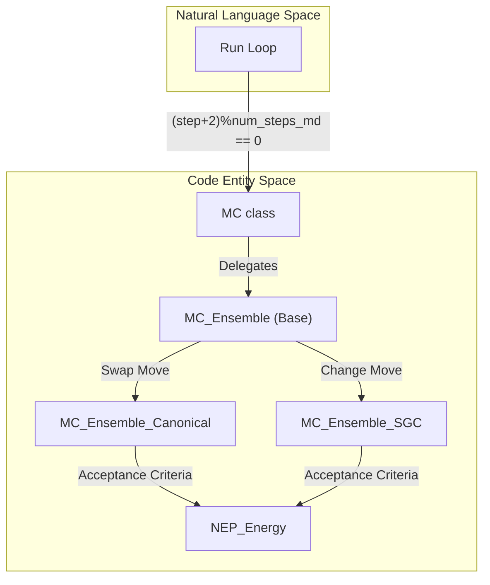
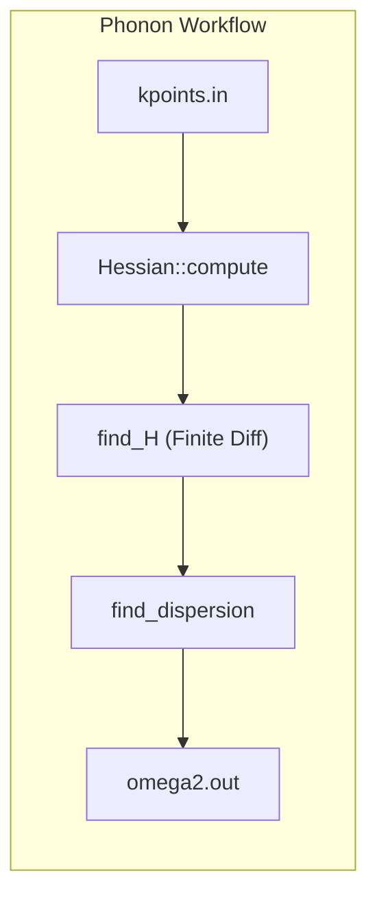
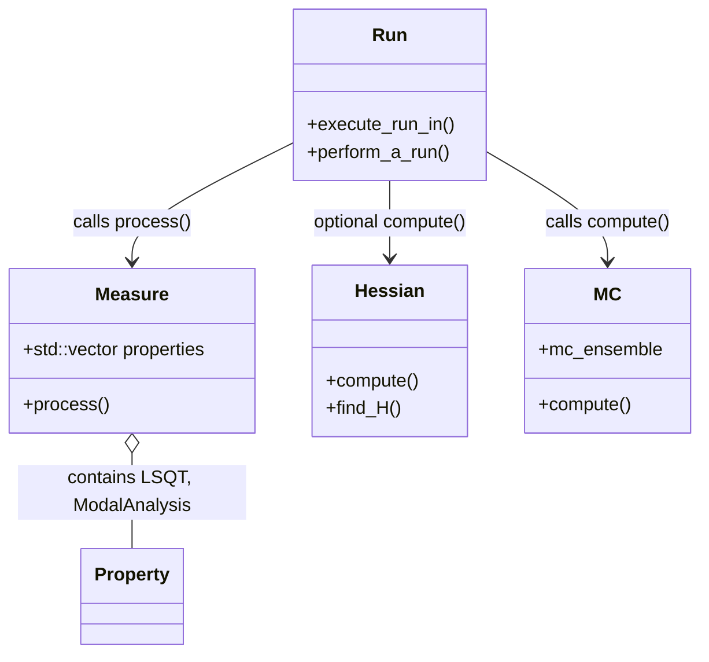

# Advanced Simulation Methods

Relevant source files

The following files were used as context for generating this wiki page:

- [src/force/force.cu](src/force/force.cu)
- [src/force/force.cuh](src/force/force.cuh)
- [src/main_gpumd/run.cu](src/main_gpumd/run.cu)
- [src/mc/mc.cu](src/mc/mc.cu)
- [src/mc/mc.cuh](src/mc/mc.cuh)
- [src/mc/mc_ensemble.cu](src/mc/mc_ensemble.cu)
- [src/mc/mc_ensemble.cuh](src/mc/mc_ensemble.cuh)
- [src/mc/mc_ensemble_canonical.cu](src/mc/mc_ensemble_canonical.cu)
- [src/mc/mc_ensemble_canonical.cuh](src/mc/mc_ensemble_canonical.cuh)
- [src/mc/mc_ensemble_sgc.cu](src/mc/mc_ensemble_sgc.cu)
- [src/mc/mc_ensemble_sgc.cuh](src/mc/mc_ensemble_sgc.cuh)
- [src/mc/nep_energy.cu](src/mc/nep_energy.cu)
- [src/mc/nep_energy.cuh](src/mc/nep_energy.cuh)
- [src/measure/dump_observer.cu](src/measure/dump_observer.cu)
- [src/measure/dump_observer.cuh](src/measure/dump_observer.cuh)
- [src/measure/lsqt.cu](src/measure/lsqt.cu)
- [src/measure/lsqt.cuh](src/measure/lsqt.cuh)
- [src/measure/measure.cu](src/measure/measure.cu)
- [src/measure/measure.cuh](src/measure/measure.cuh)
- [src/phonon/hessian.cu](src/phonon/hessian.cu)
- [src/phonon/hessian.cuh](src/phonon/hessian.cuh)
- [src/utilities/gpu_vector.cuh](src/utilities/gpu_vector.cuh)

This page documents the advanced simulation techniques implemented in GPUMD beyond standard molecular dynamics. These methods extend GPUMD's capabilities to include quantum effects, hybrid Monte Carlo/molecular dynamics approaches, shock physics, phonon analysis, and quantum transport.

## Monte Carlo Molecular Dynamics (MCMD)

GPUMD implements hybrid Monte Carlo/Molecular Dynamics methods that combine traditional MD for local movements with MC for non-local changes, particularly useful for simulating alloys and phase transitions. The MC module currently only supports Neuroevolution Potentials (NEP).

For details, see [Monte Carlo Molecular Dynamics](#6.1).

### Implementation Overview

Sources: [src/mc/mc.cu:36-45](), [src/mc/mc_ensemble_canonical.cu:208-232](), [src/mc/mc_ensemble_sgc.cu:139-160](), [src/mc/nep_energy.cu:42-74]()

### Supported Ensembles
*   **Canonical Ensemble**: A pair of particles of different species is randomly selected for a possible swap. Accepted based on the Metropolis criterion [src/mc/mc_ensemble_canonical.cu:208-388]().
*   **Semi-Grand Canonical (SGC)**: A single particle is selected for species change, allowing control of composition through chemical potentials [src/mc/mc_ensemble_sgc.cu:15-27]().
*   **Variance-Constrained SGC (VCSGC)**: Uses constraints on concentration variance, improving stability for phase-separated systems [src/mc/mc_ensemble_sgc.cu:24-27]().

## Shock and Non-Equilibrium Simulations

GPUMD provides tools for simulating shock compression and other non-equilibrium processes using specialized ensembles and wall boundary conditions.

For details, see [Shock and Non-Equilibrium Simulations](#6.2).

### Shock Techniques
*   **MSST (Multi-Scale Shock Technique)**: Adjusts the simulation box to follow a shock wave profile.
*   **NPHug (Hugoniostat)**: Constrains the system to the Hugoniot state.
*   **Wall Ensembles**: Includes harmonic, piston, and mirror walls for generating shock waves or confining systems [src/main_gpumd/run.cu:20-43]().
*   **Output**: The `dump_shock_nemd` command allows for spatial-temporal analysis of shock fronts [src/main_gpumd/run.cu:43]().

Sources: [src/main_gpumd/run.cu:43](), [src/measure/dump_shock_nemd.cuh:1-15]()

## Phonon Calculations

GPUMD can perform lattice dynamics and modal analysis to study vibrational properties and thermal transport.

For details, see [Phonon Calculations](#6.3).

### Hessian and Dispersion
The `Hessian` class calculates force constants using finite displacement [src/phonon/hessian.cu:16-20](). It reads symmetry points from `kpoints.in` to generate phonon dispersion curves [src/phonon/hessian.cu:110-154]().

### Modal Analysis
*   **GKMA (Green-Kubo Modal Analysis)**: Decomposes thermal conductivity into modal contributions.
*   **HNEMA (Homogeneous Non-Equilibrium Modal Analysis)**: Provides a modal decomposition of the HNEMD heat flux.

Sources: [src/phonon/hessian.cu:65-81](), [src/phonon/hessian.cuh:28-38]()

## Linear-Scaling Quantum Transport (LSQT)

The LSQT module enables the calculation of electronic transport properties for large-scale systems using the Kernel Polynomial Method (KPM).

For details, see [Linear-Scaling Quantum Transport](#6.4).

### Key Components
*   **Chebyshev Expansion**: Uses Chebyshev polynomials to expand the density of states and conductivity [src/measure/lsqt.cu:53-72]().
*   **Hamiltonian Application**: Efficiently applies the Hamiltonian to state vectors on the GPU [src/measure/lsqt.cu:185-218]().
*   **Kubo-Greenwood**: Calculates the frequency-dependent conductivity and DC limit [src/measure/lsqt.cu:27-36]().

Sources: [src/measure/lsqt.cu:27-36](), [src/measure/lsqt.cuh:17-30]()

## Implementation Architecture

Advanced simulation methods are integrated into the `Measure` and `Integrate` frameworks.

Sources: [src/main_gpumd/run.cu:211-216](), [src/measure/measure.cuh:28-63](), [src/mc/mc.cuh:29-45]()

### Performance Considerations
*   **GPU Acceleration**: All heavy computations (Hessian finite differences, MC energy evaluations, LSQT Hamiltonian applications) are performed on the GPU [src/mc/mc_ensemble_canonical.cu:74-111](), [src/measure/lsqt.cu:185-218]().
*   **Memory Management**: Uses the `GPU_Vector` template to minimize Host-Device data transfers during advanced measurements [src/measure/measure.cuh:18]().

Sources: [src/mc/mc_ensemble_canonical.cu:74-111](), [src/measure/lsqt.cu:185-218](), [src/measure/measure.cuh:18]()

---