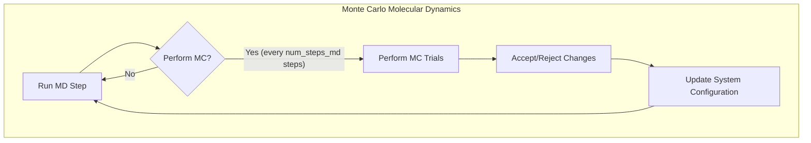
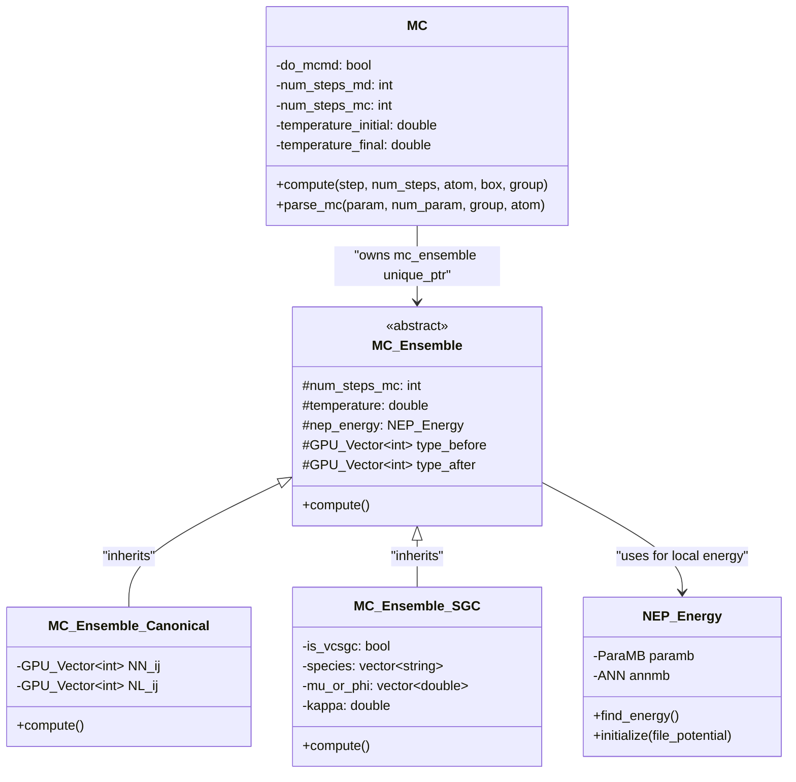
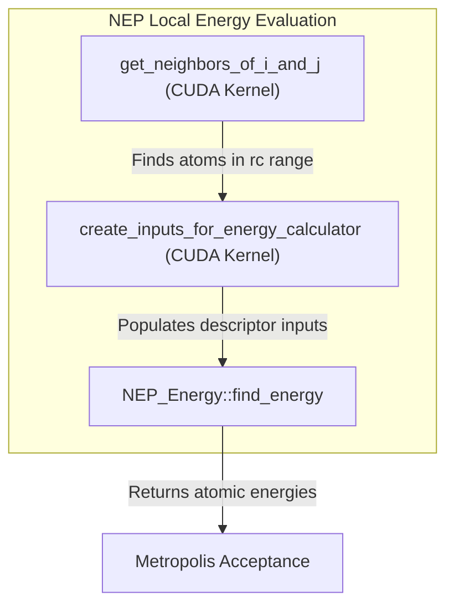

# Monte Carlo Molecular Dynamics

Relevant source files

The following files were used as context for generating this wiki page:

- [doc/gpumd/input_parameters/electron_stop.rst](doc/gpumd/input_parameters/electron_stop.rst)
- [doc/gpumd/input_parameters/mc.rst](doc/gpumd/input_parameters/mc.rst)
- [doc/gpumd/output_files/lsqt_dos_out.rst](doc/gpumd/output_files/lsqt_dos_out.rst)
- [doc/gpumd/output_files/lsqt_sigma_out.rst](doc/gpumd/output_files/lsqt_sigma_out.rst)
- [doc/gpumd/output_files/lsqt_velocity_out.rst](doc/gpumd/output_files/lsqt_velocity_out.rst)
- [src/mc/mc.cu](src/mc/mc.cu)
- [src/mc/mc.cuh](src/mc/mc.cuh)
- [src/mc/mc_ensemble.cu](src/mc/mc_ensemble.cu)
- [src/mc/mc_ensemble.cuh](src/mc/mc_ensemble.cuh)
- [src/mc/mc_ensemble_canonical.cu](src/mc/mc_ensemble_canonical.cu)
- [src/mc/mc_ensemble_canonical.cuh](src/mc/mc_ensemble_canonical.cuh)
- [src/mc/mc_ensemble_sgc.cu](src/mc/mc_ensemble_sgc.cu)
- [src/mc/mc_ensemble_sgc.cuh](src/mc/mc_ensemble_sgc.cuh)
- [src/mc/nep_energy.cu](src/mc/nep_energy.cu)
- [src/mc/nep_energy.cuh](src/mc/nep_energy.cuh)

This page documents the Monte Carlo Molecular Dynamics (MCMD) implementation in GPUMD. MCMD is a hybrid method that combines conventional molecular dynamics (MD) simulations with periodic Monte Carlo (MC) trials to enable efficient equilibration and sampling of complex systems, particularly for studying structural phase transitions, alloy thermodynamics, and composition-dependent properties.

## Overview

GPUMD implements MCMD as a specialized simulation approach where conventional molecular dynamics steps are periodically interrupted by Monte Carlo trials. During MC trials, the system's configuration is modified by either swapping atom types (in canonical ensemble) or changing atom identities (in semi-grand canonical ensembles), followed by acceptance or rejection based on the Metropolis criterion.

Sources: [src/mc/mc.cu:36-45](), [src/mc/mc.cuh:38-40]()

## Architecture and Components

The MCMD implementation consists of several key classes with specific responsibilities:

Sources: [src/mc/mc.cuh:26-56](), [src/mc/mc_ensemble.cuh:27-71](), [src/mc/mc_ensemble_canonical.cuh:19-37](), [src/mc/mc_ensemble_sgc.cuh:19-56](), [src/mc/nep_energy.cuh:21-97]()

### Main Classes

1.  **`MC`**: The driver class that manages the Monte Carlo simulation, parses input parameters from `run.in`, and coordinates the overall simulation flow during the MD loop [src/mc/mc.cu:36-45]().
2.  **`MC_Ensemble`**: Abstract base class defining the interface and shared GPU buffers (e.g., `type_before`, `type_after`, `pe_before`, `pe_after`) for different MC ensemble implementations [src/mc/mc_ensemble.cuh:27-71]().
3.  **`MC_Ensemble_Canonical`**: Implementation of the canonical ensemble, which maintains a fixed number of atoms of each type through swap moves [src/mc/mc_ensemble_canonical.cu:208-388]().
4.  **`MC_Ensemble_SGC`**: Implementation of semi-grand canonical (SGC) and variance-constrained SGC (VCSGC) ensembles, which allow composition changes based on chemical potentials or concentration constraints [src/mc/mc_ensemble_sgc.cu:320-508]().
5.  **`NEP_Energy`**: A specialized energy calculator using Neuroevolution Potentials (NEP) to evaluate the energy of different atom configurations locally without a full neighbor list rebuild [src/mc/nep_energy.cu:42-511]().

Sources: [src/mc/mc.cu:28-333](), [src/mc/mc_ensemble.cu:67-129](), [src/mc/mc_ensemble_canonical.cu:24-388](), [src/mc/mc_ensemble_sgc.cu:139-508](), [src/mc/nep_energy.cu:42-511]()

## Supported Ensembles

### Canonical Ensemble
In the canonical ensemble, the system's composition remains fixed. Atom types are swapped to reach equilibrium configurations.

*   **Move type**: Swap types of two atoms `i` and `j` [src/mc/mc_ensemble_canonical.cu:177-206]().
*   **Acceptance**: Based on $\Delta E = E_{after} - E_{before}$ [src/mc/mc_ensemble_canonical.cu:362-372]().

Sources: [src/mc/mc_ensemble_canonical.cu:208-388](), [doc/gpumd/input_parameters/mc.rst:16-24]()

### Semi-Grand Canonical Ensemble (SGC)
Allows atom types to change identity while maintaining a fixed total number of atoms $N$.

*   **Move type**: Randomly change the type of one atom `i` to another allowed species [src/mc/mc_ensemble_sgc.cu:349-362]().
*   **Acceptance**: Includes the chemical potential difference $\Delta \mu$ [src/mc/mc_ensemble_sgc.cu:477-488]().

Sources: [src/mc/mc_ensemble_sgc.cu:320-508](), [doc/gpumd/input_parameters/mc.rst:25-39]()

### Variance-Constrained Semi-Grand Canonical Ensemble (VCSGC)
An extension of SGC that constrains the average and variance of species concentrations using parameters $\phi$ and $\kappa$ [doc/gpumd/input_parameters/mc.rst:42-61]().

Sources: [src/mc/mc_ensemble_sgc.cu:320-508](), [src/mc/mc.cu:286-299]()

## Energy Calculation with NEP

MCMD requires frequent energy evaluations of local perturbations. GPUMD utilizes the `NEP_Energy` class to compute these efficiently on the GPU.

The process avoids a global neighbor list update by:
1.  Identifying all neighbors of the modified atoms (e.g., atoms `i` and `j` in a swap) using `get_neighbors_of_i_and_j` [src/mc/mc_ensemble_canonical.cu:74-111]().
2.  Preparing descriptor inputs for only those neighbors [src/mc/mc_ensemble_canonical.cu:113-174]().
3.  Calling `NEP_Energy::find_energy` to get atomic energies for the affected subset [src/mc/nep_energy.cu:81-94]().

Sources: [src/mc/nep_energy.cu:297-511](), [src/mc/mc_ensemble_canonical.cu:248-352](), [src/mc/mc_ensemble_sgc.cu:364-472]()

## Usage and Configuration

MCMD is configured via the `mc` keyword in `run.in`. It is exclusively compatible with `NEP` models [doc/gpumd/input_parameters/mc.rst:11-12]().

### Parameters Reference

| Parameter | Ensemble | Description |
| :--- | :--- | :--- |
| `md_steps` | All | MD steps between MC trial blocks [doc/gpumd/input_parameters/mc.rst:23]() |
| `mc_trials` | All | Number of MC trials per block [doc/gpumd/input_parameters/mc.rst:23]() |
| `T_i`, `T_f` | All | Initial and final temperatures for linear annealing [doc/gpumd/input_parameters/mc.rst:23]() |
| `mu_i` | SGC | Chemical potential of species $i$ (eV) [doc/gpumd/input_parameters/mc.rst:36]() |
| `phi_i` | VCSGC | Concentration constraint parameter [doc/gpumd/input_parameters/mc.rst:51]() |
| `kappa` | VCSGC | Variance constraint parameter [doc/gpumd/input_parameters/mc.rst:53]() |
| `group` | All | Optional: restrict MC moves to a specific group [doc/gpumd/input_parameters/mc.rst:66-67]() |

Sources: [doc/gpumd/input_parameters/mc.rst:1-111](), [src/mc/mc.cu:206-333]()

## Implementation Details

### Mass and Velocity Handling
When an atom's type changes, its mass must be updated. To maintain consistent dynamics, GPUMD scales the velocities to keep the momentum or kinetic energy consistent (though MD usually re-equilibrates this quickly). The `exchange` kernel handles the swap of types, masses, and velocities on the GPU [src/mc/mc_ensemble_canonical.cu:177-206]().

### Box Size Constraints
MCMD cannot be used with "small boxes" where the box dimensions are less than twice the potential cutoff ($L \le 2r_c$), as this would violate the Minimum Image Convention (MIC) during the local neighbor searches used in MC trials [src/mc/mc_ensemble.cu:112-129](), [src/mc/mc_ensemble_canonical.cu:217-220]().

### Output
Simulation progress is logged to `mcmd.out`.
*   **Header**: Echoes the `mc` command parameters [src/mc/mc_ensemble.cu:69-74]().
*   **Data**: Logs MD step, acceptance ratio, and (for SGC) species concentrations [src/mc/mc_ensemble.cu:75](), [src/mc/mc_ensemble_sgc.cu:503-507]().

Sources: [src/mc/mc_ensemble.cu:69-76](), [src/mc/mc_ensemble_canonical.cu:387](), [src/mc/mc_ensemble_sgc.cu:503-507]()

---