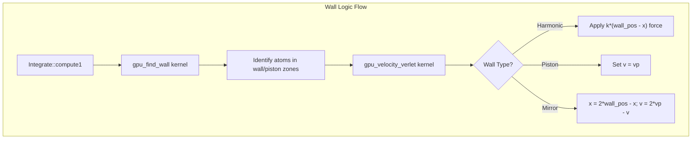

# Shock and Non-Equilibrium Simulations

<details>
<summary>Relevant source files</summary>

The following files were used as context for generating this wiki page:

- [doc/gpumd/input_parameters/ensemble_msst.rst](doc/gpumd/input_parameters/ensemble_msst.rst)
- [doc/gpumd/input_parameters/ensemble_mttk.rst](doc/gpumd/input_parameters/ensemble_mttk.rst)
- [doc/gpumd/input_parameters/ensemble_nphug.rst](doc/gpumd/input_parameters/ensemble_nphug.rst)
- [src/integrate/ensemble_msst.cu](src/integrate/ensemble_msst.cu)
- [src/integrate/ensemble_msst.cuh](src/integrate/ensemble_msst.cuh)
- [src/integrate/ensemble_mttk.cu](src/integrate/ensemble_mttk.cu)
- [src/integrate/ensemble_mttk.cuh](src/integrate/ensemble_mttk.cuh)
- [src/integrate/ensemble_nphug.cu](src/integrate/ensemble_nphug.cu)
- [src/integrate/ensemble_nphug.cuh](src/integrate/ensemble_nphug.cuh)
- [src/integrate/ensemble_wall_harmonic.cu](src/integrate/ensemble_wall_harmonic.cu)
- [src/integrate/ensemble_wall_harmonic.cuh](src/integrate/ensemble_wall_harmonic.cuh)
- [src/integrate/ensemble_wall_mirror.cu](src/integrate/ensemble_wall_mirror.cu)
- [src/integrate/ensemble_wall_mirror.cuh](src/integrate/ensemble_wall_mirror.cuh)
- [src/integrate/ensemble_wall_piston.cu](src/integrate/ensemble_wall_piston.cu)
- [src/integrate/ensemble_wall_piston.cuh](src/integrate/ensemble_wall_piston.cuh)
- [src/measure/dump_shock_nemd.cu](src/measure/dump_shock_nemd.cu)

</details>


GPUMD provides several specialized integration techniques and measurement tools for simulating shock waves and non-equilibrium states. These include multi-scale techniques that evolve the simulation cell based on shock conditions, Hugoniostat methods for reaching specific points on a Hugoniot curve, and wall-based ensembles for Non-Equilibrium Molecular Dynamics (NEMD).

## Shock Integration Techniques

GPUMD implements two primary Lagrangian shock techniques: MSST and NPHug. These methods adjust the simulation box or thermostatting to maintain shock conditions without requiring large-scale NEMD setups.

### Multi-Scale Shock Technique (MSST)

The `Ensemble_MSST` class implements the multi-scale shock technique [ensemble_msst.cuh:22-78](). MSST constrains the simulation to the Hugoniot and Rayleigh line by evolving the simulation cell length in the shock direction based on the difference between the current pressure and the shock pressure [ensemble_msst.cu:167-183]().

**Data Flow for MSST:**
1.  **Initialization**: The system calculates initial energy ($E_0$), volume ($V_0$), and pressure ($P_0$) if not provided [ensemble_msst.cu:198-205]().
2.  **Cell Evolution**: The variable `omega` represents the strain rate, which is updated based on the Hugoniot constraint [ensemble_msst.cu:211-216]().
3.  **Velocity Scaling**: Particle velocities are scaled to account for the work done by the shock [ensemble_msst.cu:70-87]().

### Hugoniostat (NPHug)

The `Ensemble_NPHug` class inherits from `Ensemble_MTTK` [ensemble_nphug.cuh:19-20](). It utilizes the Martyna-Tuckerman-Tobias-Klein (MTTK) framework to reach a specific point on the shock Hugoniot curve by dynamically adjusting the thermostat temperature [ensemble_nphug.cu:151-153]().

**Key Parameters:**
*   `p0`, `v0`, `e0`: Initial reference states [ensemble_nphug.cuh:26-29]().
*   `t_period` and `p_period`: Coupling constants for the thermostat and barostat [ensemble_nphug.cu:52-64]().

### Entity Mapping: Shock Integrators

| Code Entity | Role | File |
| :--- | :--- | :--- |
| `Ensemble_MSST` | Implements MSST Lagrangian dynamics | [src/integrate/ensemble_msst.cu]() |
| `Ensemble_NPHug` | Hugoniostat using MTTK framework | [src/integrate/ensemble_nphug.cu]() |
| `gpu_msst_v` | CUDA kernel for MSST velocity updates | [ensemble_msst.cu:57-88]() |
| `gpu_remap` | Dilation kernel for box scaling | [ensemble_msst.cu:90-98]() |

Sources: [src/integrate/ensemble_msst.cuh:22-78](), [src/integrate/ensemble_msst.cu:167-216](), [src/integrate/ensemble_nphug.cuh:19-37](), [src/integrate/ensemble_nphug.cu:36-170]()

---

## Wall Ensembles for NEMD

For explicit shock simulations where a piston or wall drives a wave through a material, GPUMD provides specialized wall ensembles. These ensembles typically divide the system into a "fixed" region (wall) and a "mobile" region.

### Harmonic Wall (`Ensemble_wall_harmonic`)
Applies a harmonic force to atoms that cross a defined boundary [ensemble_wall_harmonic.cu:59-60](). The left wall position moves over time based on the piston velocity `vp` [ensemble_wall_harmonic.cu:170]().

### Piston Wall (`Ensemble_wall_piston`)
Maintains a rigid piston by setting the velocity of atoms within a certain thickness to the piston velocity `vp` [ensemble_wall_piston.cu:71-74](). It also fixes a "right wall" by zeroing out velocities [ensemble_wall_piston.cu:67-70]().

### Mirror Wall (`Ensemble_wall_mirror`)
Implements a reflecting boundary condition where atoms hitting the wall have their positions and velocities mirrored relative to the moving wall [ensemble_wall_mirror.cu:80-83]().


Sources: [src/integrate/ensemble_wall_harmonic.cu:32-90](), [src/integrate/ensemble_wall_piston.cu:37-90](), [src/integrate/ensemble_wall_mirror.cu:31-85]()

---

## Shock NEMD Output (`dump_shock_nemd`)

The `Dump_Shock_NEMD` class provides spatial binning of thermodynamic properties specifically for shock waves [dump_shock_nemd.cu:144-148](). It calculates profiles of temperature, pressure components ($P_{xx}, P_{yy}, P_{zz}$), and density across the simulation box [dump_shock_nemd.cu:217-225]().

### Calculation Process
1.  **COM Velocity Removal**: The code first calculates the Center-of-Mass (COM) velocity for each spatial bin using `gpu_com` [dump_shock_nemd.cu:37-63]().
2.  **Thermal Property Calculation**: The `gpu_thermo` kernel calculates temperature and pressure by subtracting the local bin COM velocity from each atom's velocity [dump_shock_nemd.cu:76-110]().
3.  **Normalization**: The `gpu_calc2` kernel converts accumulated values into physical units (e.g., GPa for pressure, K for temperature) based on bin volume [dump_shock_nemd.cu:112-132]().

### Output Files
The command generates several histogram files:
*   `temperature_hist.txt`: Local temperature per bin.
*   `pxx_hist.txt`, `pyy_hist.txt`, `pzz_hist.txt`: Stress components per bin.
*   `density_hist.txt`: Mass density per bin.
*   `vp_hist.txt`: Local particle velocity (COM velocity) per bin.

### Data Association Diagram

```mermaid
classDiagram
    class Dump_Shock_NEMD {
        +int bins
        +double avg_window
        +GPU_Vector gpu_temp
        +GPU_Vector gpu_com_vx
        +preprocess()
        +process()
    }
    class CUDA_Kernels {
        +gpu_com()
        +gpu_thermo()
        +gpu_calc2()
    }
    Dump_Shock_NEMD --> CUDA_Kernels : launches
    CUDA_Kernels --> "temperature_hist.txt" : writes
    CUDA_Kernels --> "pxx_hist.txt" : writes
    CUDA_Kernels --> "density_hist.txt" : writes
```
Sources: [src/measure/dump_shock_nemd.cu:183-198](), [src/measure/dump_shock_nemd.cu:235-258](), [src/measure/dump_shock_nemd.cuh:19-58]()

---