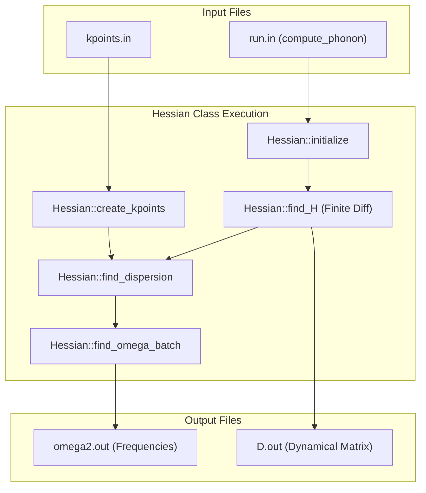
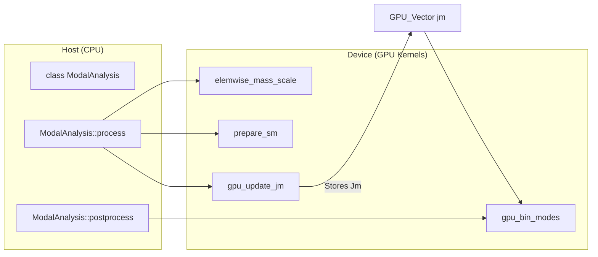

# Phonon Calculations

Relevant source files

The following files were used as context for generating this wiki page:

- [doc/GPUMD-Manual.pdf](doc/GPUMD-Manual.pdf)
- [doc/gpumd/input_files/eigenvector_in.rst](doc/gpumd/input_files/eigenvector_in.rst)
- [doc/gpumd/input_files/index.rst](doc/gpumd/input_files/index.rst)
- [doc/gpumd/input_files/kpoints_in.rst](doc/gpumd/input_files/kpoints_in.rst)
- [doc/gpumd/input_parameters/compute_chunk.rst](doc/gpumd/input_parameters/compute_chunk.rst)
- [doc/gpumd/input_parameters/compute_phonon.rst](doc/gpumd/input_parameters/compute_phonon.rst)
- [doc/gpumd/input_parameters/compute_rdf.rst](doc/gpumd/input_parameters/compute_rdf.rst)
- [doc/gpumd/output_files/D_out.rst](doc/gpumd/output_files/D_out.rst)
- [doc/gpumd/output_files/omega2_out.rst](doc/gpumd/output_files/omega2_out.rst)
- [doc/gpumd/output_files/rdf_out.rst](doc/gpumd/output_files/rdf_out.rst)
- [src/measure/compute.cu](src/measure/compute.cu)
- [src/measure/compute.cuh](src/measure/compute.cuh)
- [src/measure/compute_chunk.cu](src/measure/compute_chunk.cu)
- [src/measure/compute_chunk.cuh](src/measure/compute_chunk.cuh)
- [src/measure/compute_heat.cu](src/measure/compute_heat.cu)
- [src/measure/compute_heat.cuh](src/measure/compute_heat.cuh)
- [src/measure/hac.cu](src/measure/hac.cu)
- [src/measure/hnemd_kappa.cu](src/measure/hnemd_kappa.cu)
- [src/measure/hnemd_kappa.cuh](src/measure/hnemd_kappa.cuh)
- [src/measure/hnemdec_kappa.cu](src/measure/hnemdec_kappa.cu)
- [src/measure/hnemdec_kappa.cuh](src/measure/hnemdec_kappa.cuh)
- [src/measure/modal_analysis.cu](src/measure/modal_analysis.cu)
- [src/measure/modal_analysis.cuh](src/measure/modal_analysis.cuh)
- [src/phonon/hessian.cu](src/phonon/hessian.cu)
- [src/phonon/hessian.cuh](src/phonon/hessian.cuh)

GPUMD provides a suite of tools for phonon-related calculations, ranging from static properties like phonon dispersion curves to dynamic modal analysis for thermal transport. These calculations are primarily handled by the `Hessian` class for dispersion and the `ModalAnalysis` framework for Green-Kubo Modal Analysis (GKMA) and Homogeneous Nonequilibrium Modal Analysis (HNEMA).

## Hessian Matrix and Phonon Dispersion

The `Hessian` class computes the force constant matrix using the finite-displacement method [src/phonon/hessian.cu:17-20](). This implementation is used to generate phonon dispersion relations and eigenvectors.

### Implementation Details
The computation follows a standard finite-difference approach:
$$H_{ij}^{ab} = \frac{F_i^a(-) - F_i^a(+)}{u_j^b(+) - u_j^b(-)}$$
where $F_i^a$ is the force on atom $i$ in direction $a$, and $u_j^b$ is the displacement of atom $j$ in direction $b$ [src/phonon/hessian.cu:18-19]().

1.  **Cutoff Logic**: For many-body potentials, the cutoff distance for force constants is automatically set to twice the potential cutoff (`rc`) to capture the full range of interactions [src/phonon/hessian.cu:85-90]().
2.  **Replication**: The system must be replicated sufficiently so that the box size in any direction is at least twice the force constant cutoff distance [doc/gpumd/input_parameters/compute_phonon.rst:50-52](). The code checks for the `replicate` keyword in `run.in` and suggests minimum sizes [src/phonon/hessian.cu:205-241]().
3.  **Symmetry and K-points**: The `kpoints.in` file defines the high-symmetry paths in the Brillouin zone [doc/gpumd/input_files/kpoints_in.rst:8-22]().

### Data Flow for Dispersion
The following diagram illustrates the workflow from input files to the final `omega2.out` file.

**Phonon Dispersion Pipeline**

**Sources:** [src/phonon/hessian.cu:65-81](), [doc/gpumd/input_parameters/compute_phonon.rst:1-34]()

## Modal Analysis for Thermal Transport

GPUMD implements two advanced modal analysis methods for decomposing thermal conductivity into contributions from individual phonon modes: **GKMA** (Green-Kubo Modal Analysis) and **HNEMA** (Homogeneous Nonequilibrium Modal Analysis) [src/measure/modal_analysis.cu:16-30]().

### Modal Heat Current
Both methods rely on projecting the atomic velocities and forces onto the phonon eigenvectors $\epsilon_{n, \nu}$ to obtain the modal heat current $J_{\nu}(t)$.

*   **GKMA**: Uses the equilibrium heat current autocorrelation function (HAC) for each mode [src/measure/modal_analysis.cu:20-23]().
*   **HNEMA**: Uses a driven system where a small external force is applied, allowing for faster convergence of the spectral decomposition [src/measure/modal_analysis.cu:17-18]().

### Code Structure and GPU Acceleration
The `ModalAnalysis` class handles the heavy lifting of projecting MD trajectories onto the basis set.

| Component | Description | Code Reference |
| :--- | :--- | :--- |
| `elemwise_mass_scale` | Scales atomic velocities by $\sqrt{m_i}$ for projection. | [src/measure/modal_analysis.cu:132-155]() |
| `prepare_sm` | Prepares the virial-velocity terms scaled by $1/\sqrt{m_i}$. | [src/measure/modal_analysis.cu:173-209]() |
| `gpu_update_jm` | Accumulates the modal heat current $J_m$ on the GPU. | [src/measure/modal_analysis.cu:212-225]() |
| `gpu_bin_modes` | Bins modal contributions by frequency for output. | [src/measure/modal_analysis.cu:115-130]() |

**GKMA/HNEMA Code Entity Map**

**Sources:** [src/measure/modal_analysis.cu:32-230](), [src/measure/modal_analysis.cuh:1-50]()

## Input and Output Files

### kpoints.in
This file specifies the coordinates of high-symmetry points in the Brillouin zone. Coordinates are provided in units of the reciprocal lattice vectors [doc/gpumd/input_files/kpoints_in.rst:13-22]().
*   **Format**: `kx ky kz name`
*   **Path Breaks**: A blank line indicates the start of a new path [doc/gpumd/input_files/kpoints_in.rst:52]().

### omega2.out
Contains the squared phonon frequencies $\omega^2$ for each k-point along the path specified in `kpoints.in` [doc/gpumd/output_files/omega2_out.rst:1-10]().
*   **Unit**: $(\text{THz})^2$ (default GPUMD units).

### heatmode.out & kappamode.out
These files are generated during GKMA/HNEMA simulations. They provide the spectral decomposition of the heat current and the resulting thermal conductivity as a function of frequency [src/measure/modal_analysis.cu:600-650]().

**Sources:** [doc/gpumd/input_files/kpoints_in.rst:1-52](), [src/phonon/hessian.cu:110-153](), [src/measure/modal_analysis.cu:700-750]()

---