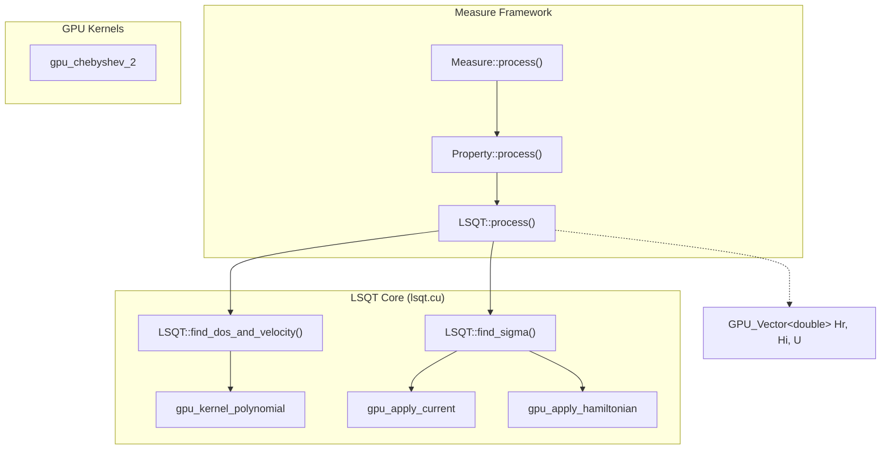
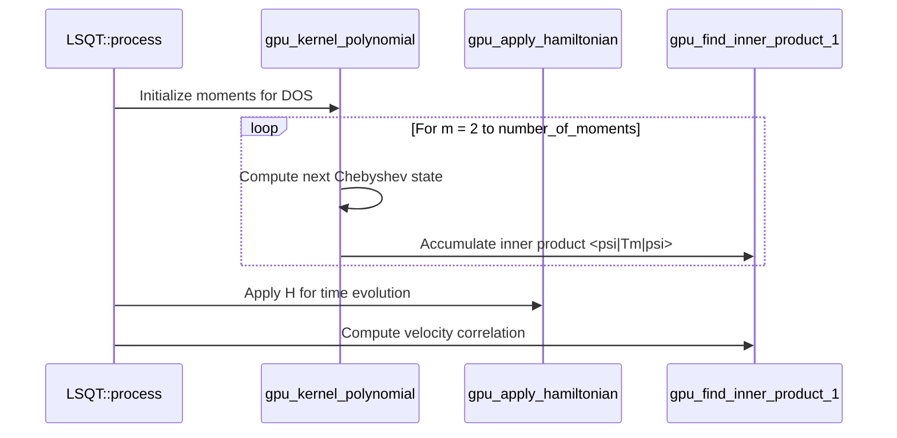

# Linear-Scaling Quantum Transport

Relevant source files

The following files were used as context for generating this wiki page:

- [doc/gpumd/input_parameters/electron_stop.rst](doc/gpumd/input_parameters/electron_stop.rst)
- [doc/gpumd/input_parameters/mc.rst](doc/gpumd/input_parameters/mc.rst)
- [doc/gpumd/output_files/lsqt_dos_out.rst](doc/gpumd/output_files/lsqt_dos_out.rst)
- [doc/gpumd/output_files/lsqt_sigma_out.rst](doc/gpumd/output_files/lsqt_sigma_out.rst)
- [doc/gpumd/output_files/lsqt_velocity_out.rst](doc/gpumd/output_files/lsqt_velocity_out.rst)
- [src/force/force.cu](src/force/force.cu)
- [src/force/force.cuh](src/force/force.cuh)
- [src/main_gpumd/run.cu](src/main_gpumd/run.cu)
- [src/measure/dump_observer.cu](src/measure/dump_observer.cu)
- [src/measure/dump_observer.cuh](src/measure/dump_observer.cuh)
- [src/measure/lsqt.cu](src/measure/lsqt.cu)
- [src/measure/lsqt.cuh](src/measure/lsqt.cuh)
- [src/measure/measure.cu](src/measure/measure.cu)
- [src/measure/measure.cuh](src/measure/measure.cuh)
- [src/utilities/gpu_vector.cuh](src/utilities/gpu_vector.cuh)

The Linear-Scaling Quantum Transport (LSQT) module in GPUMD provides an efficient framework for calculating electronic transport properties, such as the Density of States (DOS) and Kubo-Greenwood conductivity, using the Kernel Polynomial Method (KPM). The implementation leverages GPU acceleration to scale linearly with the number of atoms, making it suitable for large-scale systems.

### Overview and Theory
The LSQT module implements methods similar to the [GPUQT](https://github.com/brucefan1983/gpuqt) code [src/measure/lsqt.cu:28-29](). It uses a unit system where length is in Angstroms, charge in $e$, energy in eV, and time in $\hbar/\text{eV}$ [src/measure/lsqt.cu:31-36](). 

The core of the method involves:
1.  **Chebyshev Expansion**: Expanding the time-evolution operator or the Dirac delta function (for DOS) using Chebyshev polynomials [src/measure/lsqt.cu:53-140]().
2.  **Hamiltonian Application**: Efficiently applying the Tight-Binding (TB) Hamiltonian to electronic states on the GPU [src/measure/lsqt.cu:185-218]().
3.  **Kubo-Greenwood Conductivity**: Calculating the longitudinal conductivity $\sigma(\omega)$ by evaluating the time-dependent velocity-velocity correlation function [src/measure/lsqt.cu:221-252]().

### Data Structures and Configuration
The LSQT module is encapsulated in the `LSQT` class, which inherits from the `Property` base class [src/measure/lsqt.cuh:29-30]().

#### Key Class Members
| Member | Description |
| :--- | :--- |
| `number_of_orbitals` | Total orbitals in the system ($N_{atoms} \times N_{orbitals\_per\_atom}$) [src/measure/lsqt.cuh:86](). |
| `transport_direction` | Direction for conductivity calculation (0 for x, 1 for y, 2 for z) [src/measure/lsqt.cuh:87](). |
| `number_of_moments` | Number of Chebyshev moments used in KPM expansion [src/measure/lsqt.cuh:88](). |
| `Hr`, `Hi` | Real and Imaginary parts of the Hamiltonian hopping terms [src/measure/lsqt.cuh:103-104](). |
| `slr`, `sli` | Real/Imaginary parts of the "left" state vector in inner products [src/measure/lsqt.cuh:107-108](). |
| `srr`, `sri` | Real/Imaginary parts of the "right" state vector in inner products [src/measure/lsqt.cuh:109-110](). |

**Sources:** [src/measure/lsqt.cuh:29-116]()

### Implementation Workflow

The LSQT process is integrated into the GPUMD measurement framework. It is initialized via `LSQT::parse` and executed during the simulation's measurement steps.

#### System Architecture: LSQT Code Entities
This diagram illustrates the relationship between the `Measure` driver and the `LSQT` property implementation.

**Sources:** [src/measure/measure.cu:91-120](), [src/measure/lsqt.cu:142-252](), [src/measure/lsqt.cuh:77-105]()

### Hamiltonian and State Evolution
The Hamiltonian is applied using a sparse matrix-vector multiplication approach optimized for the GPU. The `gpu_apply_hamiltonian` kernel computes $H|\psi\rangle$ by iterating over neighbors defined in the neighbor list `NL` [src/measure/lsqt.cu:185-218]().

#### State Propagation and Chebyshev Expansion
The propagation of electronic states for time-dependent properties uses the recursive relation of Chebyshev polynomials:

1.  **Initial Steps**: `gpu_chebyshev_01` handles the first two terms ($T_0$ and $T_1$) of the expansion [src/measure/lsqt.cu:53-72]().
2.  **Recursion**: `gpu_chebyshev_2` implements the $T_m = 2\bar{H}T_{m-1} - T_{m-2}$ recursion, where $\bar{H}$ is the scaled Hamiltonian [src/measure/lsqt.cu:75-139]().

**Sources:** [src/measure/lsqt.cu:75-182](), [src/measure/lsqt.cu:255-265]()

### Tight-Binding Models
GPUMD includes built-in support for specific Tight-Binding models, primarily for carbon-based systems:
*   **Graphene TB**: Enabled via the `USE_GRAPHENE_TB` macro, using 1 orbital per atom [src/measure/lsqt.cuh:22-24]().
*   **Generic $sp^3$ Model**: If `USE_GRAPHENE_TB` is not defined, a 4-orbital per atom model is used with parameters for $s, p_x, p_y, p_z$ orbitals, including hopping parameters like `v_sss`, `v_sps`, `v_pps`, and `v_ppp` [src/measure/lsqt.cuh:32-42]().

### Output Files
The LSQT module generates several output files detailing the electronic properties:
*   `dos.out`: Electronic density of states.
*   `velocity.out`: Square of the velocity matrix elements.
*   `sigma.out`: Optical/AC conductivity as a function of energy and frequency.

**Sources:** [src/measure/lsqt.cu:77-78](), [doc/gpumd/output_files/lsqt_dos_out.rst:1-5](), [doc/gpumd/output_files/lsqt_velocity_out.rst:1-5](), [doc/gpumd/output_files/lsqt_sigma_out.rst:1-5]()

---