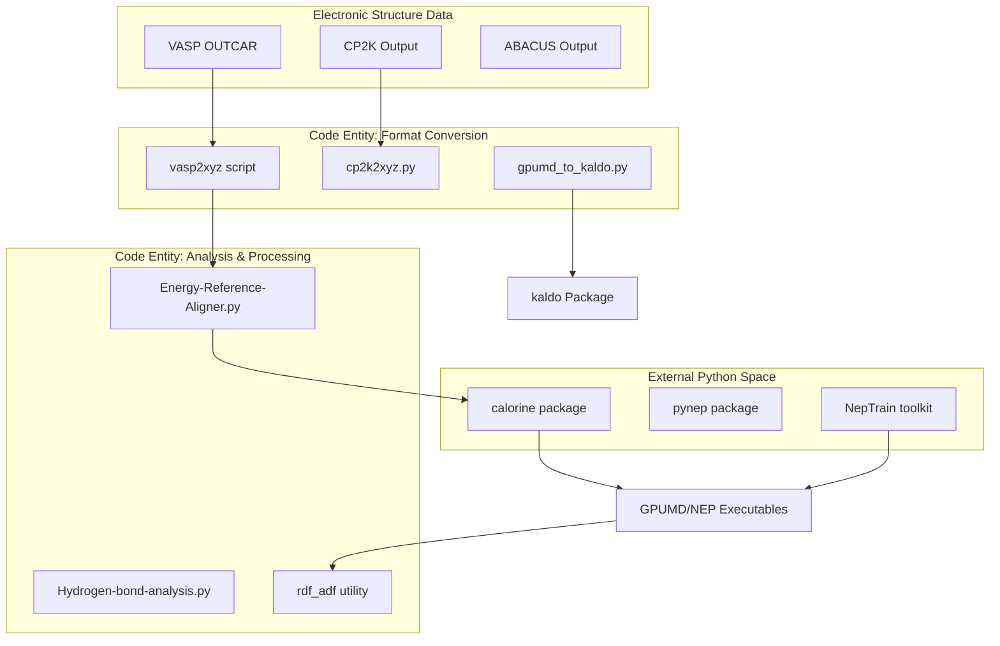
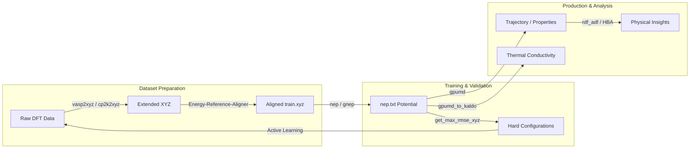

# Auxiliary Tools

Relevant source files

The following files were used as context for generating this wiki page:

- [tools/Analysis_and_Processing/README.md](tools/Analysis_and_Processing/README.md)
- [tools/Analysis_and_Processing/energy-reference-aligner/Energy-Reference-Aligner.py](tools/Analysis_and_Processing/energy-reference-aligner/Energy-Reference-Aligner.py)
- [tools/Analysis_and_Processing/energy-reference-aligner/README.md](tools/Analysis_and_Processing/energy-reference-aligner/README.md)
- [tools/Analysis_and_Processing/hydrogen_bond_analysis/Hydrogen-bond-analysis.py](tools/Analysis_and_Processing/hydrogen_bond_analysis/Hydrogen-bond-analysis.py)
- [tools/Analysis_and_Processing/hydrogen_bond_analysis/README.md](tools/Analysis_and_Processing/hydrogen_bond_analysis/README.md)
- [tools/Format_Conversion/README.md](tools/Format_Conversion/README.md)
- [tools/Format_Conversion/gpumd_to_kaldo/README.md](tools/Format_Conversion/gpumd_to_kaldo/README.md)
- [tools/Format_Conversion/gpumd_to_kaldo/example_silicon/run.sh](tools/Format_Conversion/gpumd_to_kaldo/example_silicon/run.sh)
- [tools/Format_Conversion/gpumd_to_kaldo/gpumd_to_kaldo.py](tools/Format_Conversion/gpumd_to_kaldo/gpumd_to_kaldo.py)
- [tools/Format_Conversion/gpumd_to_kaldo/test_gpumd_to_kaldo.py](tools/Format_Conversion/gpumd_to_kaldo/test_gpumd_to_kaldo.py)
- [tools/Format_Conversion/siesta2xyz/siesta2xyz.py](tools/Format_Conversion/siesta2xyz/siesta2xyz.py)
- [tools/Format_Conversion/vasp2xyz/outcar2xyz/NEPdataset-multiple_frames/NEP-dataset.xyz](tools/Format_Conversion/vasp2xyz/outcar2xyz/NEPdataset-multiple_frames/NEP-dataset.xyz)
- [tools/Format_Conversion/vasp2xyz/outcar2xyz/NEPdataset/NEP-dataset.xyz](tools/Format_Conversion/vasp2xyz/outcar2xyz/NEPdataset/NEP-dataset.xyz)
- [tools/Format_Conversion/vasp2xyz/outcar2xyz/OUTCARs/Cu_single-point/OUTCAR](tools/Format_Conversion/vasp2xyz/outcar2xyz/OUTCARs/Cu_single-point/OUTCAR)
- [tools/Format_Conversion/vasp2xyz/outcar2xyz/OUTCARs/WH-AIMD/OUTCAR](tools/Format_Conversion/vasp2xyz/outcar2xyz/OUTCARs/WH-AIMD/OUTCAR)
- [tools/Format_Conversion/vasp2xyz/outcar2xyz/OUTCARs/Water_BEC/OUTCAR](tools/Format_Conversion/vasp2xyz/outcar2xyz/OUTCARs/Water_BEC/OUTCAR)
- [tools/Format_Conversion/vasp2xyz/outcar2xyz/OUTCARs/diamond_relax/OUTCAR](tools/Format_Conversion/vasp2xyz/outcar2xyz/OUTCARs/diamond_relax/OUTCAR)
- [tools/Format_Conversion/vasp2xyz/outcar2xyz/non_converged_files.txt](tools/Format_Conversion/vasp2xyz/outcar2xyz/non_converged_files.txt)
- [tools/Format_Conversion/vasp2xyz/outcar2xyz/singleFrame-outcars2nep-exyz.sh](tools/Format_Conversion/vasp2xyz/outcar2xyz/singleFrame-outcars2nep-exyz.sh)
- [tools/Miscellaneous/for_coding/for_perioidc_table/a.out](tools/Miscellaneous/for_coding/for_perioidc_table/a.out)
- [tools/Miscellaneous/for_coding/for_perioidc_table/dftd3para.h](tools/Miscellaneous/for_coding/for_perioidc_table/dftd3para.h)
- [tools/Miscellaneous/for_coding/for_perioidc_table/nep.cpp](tools/Miscellaneous/for_coding/for_perioidc_table/nep.cpp)
- [tools/Miscellaneous/for_coding/for_perioidc_table/nep.h](tools/Miscellaneous/for_coding/for_perioidc_table/nep.h)
- [tools/Miscellaneous/for_coding/for_perioidc_table/nep_data_toolkit.cpp](tools/Miscellaneous/for_coding/for_perioidc_table/nep_data_toolkit.cpp)
- [tools/readme.md](tools/readme.md)

This document provides a technical overview of the auxiliary scripts and utilities provided with GPUMD. These tools facilitate data preparation, format conversion, and post-simulation analysis, bridging GPUMD with other electronic structure packages and Python-based analysis workflows.

For detailed technical specifications, refer to the child pages:
- [Format Conversion Tools](#7.1) — Detailed documentation of scripts in `tools/Format_Conversion`.
- [Analysis and Processing Tools](#7.2) — Detailed documentation of scripts in `tools/Analysis_and_Processing`.

## Overview of Tool Categories

The auxiliary tools are organized into three primary categories to support the simulation lifecycle:

| Category | Role | Key File Locations |
| :--- | :--- | :--- |
| **Format Conversion** | Translates outputs from DFT codes (VASP, CP2K, etc.) to the extended XYZ format required for NEP training and GPUMD simulations. | `tools/Format_Conversion/` |
| **Analysis & Processing** | Manipulates trajectories, aligns energy baselines, and computes structural properties like RDF/ADF. | `tools/Analysis_and_Processing/` |
| **Miscellaneous** | Development utilities, VIM syntax highlighting, and legacy documentation. | `tools/Miscellaneous/` |

Sources: [tools/readme.md:5-13]()

## Format Conversion Tools

These utilities are essential for preparing the `train.xyz` dataset used by the `nep` and `gnep` executables. They extract coordinates, forces, virial stresses, and (optionally) Born Effective Charges from various source formats.

### Key Converters
*   **vasp2xyz**: Extracts data from VASP `OUTCAR` files. It supports single-frame and multi-frame extractions, including BEC for `NEP-Charge` training [tools/Format_Conversion/vasp2xyz/outcar2xyz/singleFrame-outcars2nep-exyz.sh:29-34]().
*   **cp2k2xyz**: Bi-directional conversion between CP2K and XYZ [tools/Format_Conversion/README.md:5]().
*   **gpumd_to_kaldo**: Exports 2nd and 3rd order force constants calculated via NEP into a format compatible with the `kaldo` thermal transport package [tools/Format_Conversion/gpumd_to_kaldo/gpumd_to_kaldo.py:1-11]().

For details, see [Format Conversion Tools](#7.1).

Sources: [tools/Format_Conversion/README.md:1-16](), [tools/Format_Conversion/gpumd_to_kaldo/gpumd_to_kaldo.py:1-11]()

## Analysis and Processing Tools

These tools process `model.xyz` or trajectory files for structural characterization or dataset refinement.

### Energy Alignment and Normalization
A critical step in NEP training is ensuring energy consistency across different datasets.
*   **Energy-Reference-Aligner**: A unified tool supporting `REF_GROUP_ALIGNMENT` (aligning to a high-accuracy reference), `ZERO_BASELINE_ALIGNMENT` (standardizing to vacuum), and `DFT_TO_NEP_ALIGNMENT` (fine-tuning DFT data to an existing NEP model) [tools/Analysis_and_Processing/energy-reference-aligner/Energy-Reference-Aligner.py:8-34]().
*   **shift_energy_to_zero**: A simpler utility to shift average atomic species energies to zero [tools/Analysis_and_Processing/README.md:15]().

### Structural Analysis
*   **rdf_adf**: Computes Radial Distribution Functions and Angular Distribution Functions, often leveraging `OVITO` for processing [tools/Analysis_and_Processing/README.md:13]().
*   **hydrogen_bond_analysis**: Specifically designed for analyzing H-bond networks in molecular trajectories [tools/Analysis_and_Processing/README.md:9]().

For details, see [Analysis and Processing Tools](#7.2).

Sources: [tools/Analysis_and_Processing/README.md:4-16](), [tools/Analysis_and_Processing/energy-reference-aligner/Energy-Reference-Aligner.py:8-63]()

## External Ecosystem

GPUMD is supported by a robust ecosystem of Python packages that provide high-level APIs for simulation management and active learning.

### Python Interfaces and Toolkits
*   **calorine**: A primary Python package for running GPUMD simulations and sampling NEP models [tools/readme.md:21]().
*   **gpyumd**: Facilitates input generation and output parsing for GPUMD v3.3.1 [tools/readme.md:23]().
*   **pynep**: A dedicated Python interface for the NEP machine learning potential [tools/readme.md:26]().

### Active Learning and Training
*   **NEP_Active** & **nep_maker**: Packages for training set construction using active learning strategies like MTP and ACE [tools/readme.md:30-31]().
*   **NepTrain**: An automated toolkit integrating GPUMD, VASP, and NEP for streamlined active learning workflows [tools/readme.md:28]().

### Data-Code Entity Mapping

The following diagram bridges the natural language tool categories to the specific code implementations and related packages.

Sources: [tools/readme.md:15-31](), [tools/Format_Conversion/README.md:1-16](), [tools/Analysis_and_Processing/README.md:4-16]()

## Integration Workflow

The auxiliary tools serve as the "glue" in the NEP development and MD analysis cycle.

Sources: [tools/readme.md:1-13](), [tools/Analysis_and_Processing/energy-reference-aligner/Energy-Reference-Aligner.py:8-34](), [tools/Format_Conversion/gpumd_to_kaldo/gpumd_to_kaldo.py:1-11]()

---