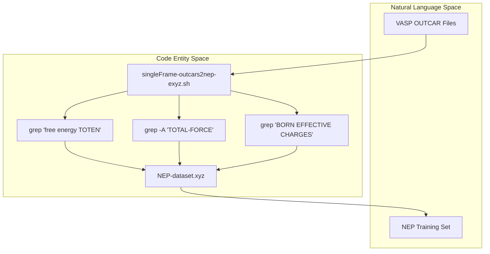
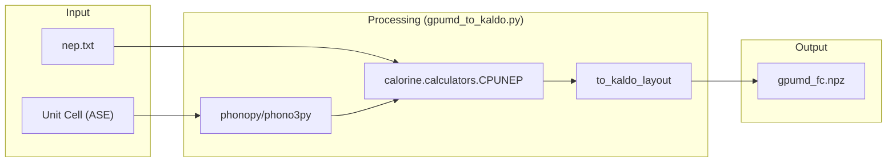

# Format Conversion Tools

Relevant source files

The following files were used as context for generating this wiki page:

- [tools/Analysis_and_Processing/README.md](tools/Analysis_and_Processing/README.md)
- [tools/Analysis_and_Processing/energy-reference-aligner/Energy-Reference-Aligner.py](tools/Analysis_and_Processing/energy-reference-aligner/Energy-Reference-Aligner.py)
- [tools/Analysis_and_Processing/energy-reference-aligner/README.md](tools/Analysis_and_Processing/energy-reference-aligner/README.md)
- [tools/Analysis_and_Processing/hydrogen_bond_analysis/Hydrogen-bond-analysis.py](tools/Analysis_and_Processing/hydrogen_bond_analysis/Hydrogen-bond-analysis.py)
- [tools/Analysis_and_Processing/hydrogen_bond_analysis/README.md](tools/Analysis_and_Processing/hydrogen_bond_analysis/README.md)
- [tools/Format_Conversion/README.md](tools/Format_Conversion/README.md)
- [tools/Format_Conversion/gpumd_to_kaldo/README.md](tools/Format_Conversion/gpumd_to_kaldo/README.md)
- [tools/Format_Conversion/gpumd_to_kaldo/example_silicon/run.sh](tools/Format_Conversion/gpumd_to_kaldo/example_silicon/run.sh)
- [tools/Format_Conversion/gpumd_to_kaldo/gpumd_to_kaldo.py](tools/Format_Conversion/gpumd_to_kaldo/gpumd_to_kaldo.py)
- [tools/Format_Conversion/gpumd_to_kaldo/test_gpumd_to_kaldo.py](tools/Format_Conversion/gpumd_to_kaldo/test_gpumd_to_kaldo.py)
- [tools/Format_Conversion/siesta2xyz/siesta2xyz.py](tools/Format_Conversion/siesta2xyz/siesta2xyz.py)
- [tools/Format_Conversion/vasp2xyz/outcar2xyz/NEPdataset-multiple_frames/NEP-dataset.xyz](tools/Format_Conversion/vasp2xyz/outcar2xyz/NEPdataset-multiple_frames/NEP-dataset.xyz)
- [tools/Format_Conversion/vasp2xyz/outcar2xyz/NEPdataset/NEP-dataset.xyz](tools/Format_Conversion/vasp2xyz/outcar2xyz/NEPdataset/NEP-dataset.xyz)
- [tools/Format_Conversion/vasp2xyz/outcar2xyz/OUTCARs/Cu_single-point/OUTCAR](tools/Format_Conversion/vasp2xyz/outcar2xyz/OUTCARs/Cu_single-point/OUTCAR)
- [tools/Format_Conversion/vasp2xyz/outcar2xyz/OUTCARs/WH-AIMD/OUTCAR](tools/Format_Conversion/vasp2xyz/outcar2xyz/OUTCARs/WH-AIMD/OUTCAR)
- [tools/Format_Conversion/vasp2xyz/outcar2xyz/OUTCARs/Water_BEC/OUTCAR](tools/Format_Conversion/vasp2xyz/outcar2xyz/OUTCARs/Water_BEC/OUTCAR)
- [tools/Format_Conversion/vasp2xyz/outcar2xyz/OUTCARs/diamond_relax/OUTCAR](tools/Format_Conversion/vasp2xyz/outcar2xyz/OUTCARs/diamond_relax/OUTCAR)
- [tools/Format_Conversion/vasp2xyz/outcar2xyz/non_converged_files.txt](tools/Format_Conversion/vasp2xyz/outcar2xyz/non_converged_files.txt)
- [tools/Format_Conversion/vasp2xyz/outcar2xyz/singleFrame-outcars2nep-exyz.sh](tools/Format_Conversion/vasp2xyz/outcar2xyz/singleFrame-outcars2nep-exyz.sh)
- [tools/readme.md](tools/readme.md)

The `tools/Format_Conversion` directory provides a comprehensive suite of utilities designed to bridge the gap between various Ab-initio Molecular Dynamics (AIMD) packages, external machine learning potential formats, and the **Extended XYZ (exyz)** format required for training Neuroevolution Potentials (NEP) in GPUMD [tools/readme.md:1-13]().

These tools are essential for preparing the `train.xyz` and `test.xyz` files, which contain atomic coordinates, cell dimensions, energies, forces, and optionally virials or Born effective charges [tools/Format_Conversion/README.md:1-16]().

## Overview of Converters

The following table summarizes the primary conversion scripts available:

| Source Format | Script/Directory | Target Format | Key Extracted Data |
| :--- | :--- | :--- | :--- |
| **VASP** | `vasp2xyz` | Extended XYZ | Energy, Forces, Virials, BEC |
| **ABACUS** | `abacus2xyz` | Extended XYZ | Training data for NEP |
| **CP2K** | `cp2k2xyz` | Extended XYZ | Bi-directional conversion |
| **CASTEP** | `castep2exyz` | Extended XYZ | Output to training data |
| **DeePMD-kit** | `dp2xyz` | Extended XYZ | DP data to GPUMD |
| **GPUMD** | `gpumd_to_kaldo` | `.npz` (Kaldo) | 2nd/3rd order Force Constants |
| **MTP / Runner**| `mtp2xyz` / `runner2xyz`| Extended XYZ | ML potential cross-compatibility |

**Sources:** [tools/readme.md:9-13](), [tools/Format_Conversion/README.md:1-16]()

---

## VASP to Extended XYZ (`vasp2xyz`)

The VASP conversion utilities, particularly `outcar2xyz`, are designed to parse `OUTCAR` files to generate datasets for NEP training.

### Data Extraction Logic
The script `singleFrame-outcars2nep-exyz.sh` automates the extraction from multiple directories [tools/Format_Conversion/vasp2xyz/outcar2xyz/singleFrame-outcars2nep-exyz.sh:1-7]():
1.  **Lattice**: Extracted from the "VOLUME and BASIS-vectors are now" section [tools/Format_Conversion/vasp2xyz/outcar2xyz/singleFrame-outcars2nep-exyz.sh:26-26]().
2.  **Energy**: Extracted from "free energy TOTEN" [tools/Format_Conversion/vasp2xyz/outcar2xyz/singleFrame-outcars2nep-exyz.sh:27-27]().
3.  **Forces**: Extracted from the "TOTAL-FORCE (eV/Angst)" block [tools/Format_Conversion/vasp2xyz/outcar2xyz/singleFrame-outcars2nep-exyz.sh:51-51]().
4.  **Virials**: If `ISIF != 0`, the stress tensor is converted to the GPUMD virial format [tools/Format_Conversion/vasp2xyz/outcar2xyz/singleFrame-outcars2nep-exyz.sh:36-43]().
5.  **Born Effective Charges (BEC)**: If `LEPSILON = .TRUE.` in the `INCAR`, the script parses the "BORN EFFECTIVE CHARGES" section [tools/Format_Conversion/vasp2xyz/outcar2xyz/singleFrame-outcars2nep-exyz.sh:29-34]().

### Workflow Diagram: VASP to NEP Dataset

**Sources:** [tools/Format_Conversion/vasp2xyz/outcar2xyz/singleFrame-outcars2nep-exyz.sh:21-65](), [tools/Format_Conversion/vasp2xyz/outcar2xyz/OUTCARs/Water_BEC/OUTCAR:29-29]()

---

## GPUMD to Kaldo (`gpumd_to_kaldo`)

This tool exports second- and third-order interatomic force constants (IFCs) from a NEP potential (`nep.txt`) into a format readable by the `kaldo` thermal transport package [tools/Format_Conversion/gpumd_to_kaldo/README.md:3-9]().

### Implementation Details
The tool uses `calorine` to evaluate NEP forces on the CPU without requiring a GPU [tools/Format_Conversion/gpumd_to_kaldo/gpumd_to_kaldo.py:5-6]().

*   **`relaxed_lattice_constant`**: Uses `scipy.optimize.minimize_scalar` (Brent's method) to find the equilibrium lattice constant for a given NEP potential before calculating IFCs [tools/Format_Conversion/gpumd_to_kaldo/gpumd_to_kaldo.py:68-93]().
*   **`compute_fc2`**: Uses `phonopy` to generate finite displacements and extract 2nd-order constants [tools/Format_Conversion/gpumd_to_kaldo/gpumd_to_kaldo.py:129-158]().
*   **`compute_fc3`**: Uses `phono3py` for 3rd-order constants [tools/Format_Conversion/gpumd_to_kaldo/gpumd_to_kaldo.py:161-202]().
*   **`to_kaldo_layout`**: Remaps the IFCs into the canonical C-grid replica order used by Kaldo [tools/Format_Conversion/gpumd_to_kaldo/gpumd_to_kaldo.py:209-210]().

### Data Flow: IFC Export

**Sources:** [tools/Format_Conversion/gpumd_to_kaldo/gpumd_to_kaldo.py:1-23](), [tools/Format_Conversion/gpumd_to_kaldo/README.md:40-60]()

---

## Energy Reference Aligner

Located in `tools/Analysis_and_Processing`, the `Energy-Reference-Aligner.py` script is a critical post-processing tool for merging datasets from different sources (e.g., different DFT functionals or codes) [tools/Analysis_and_Processing/energy-reference-aligner/Energy-Reference-Aligner.py:5-12]().

### Alignment Modes
The script implements three modes via the `ALIGNMENT_MODE` setting [tools/Analysis_and_Processing/energy-reference-aligner/Energy-Reference-Aligner.py:82-90]():

1.  **`REF_GROUP_ALIGNMENT`**: Aligns "shift groups" to the average energy baseline of a "reference group" based on `config_type` [tools/Analysis_and_Processing/energy-reference-aligner/Energy-Reference-Aligner.py:8-16]().
2.  **`ZERO_BASELINE_ALIGNMENT`**: Shifts all energies so that free atoms have zero energy (vacuum reference) [tools/Analysis_and_Processing/energy-reference-aligner/Energy-Reference-Aligner.py:18-24]().
3.  **`DFT_TO_NEP_ALIGNMENT`**: Aligns DFT energies to match energies predicted by an existing NEP model (`nep.txt`), useful for fine-tuning [tools/Analysis_and_Processing/energy-reference-aligner/Energy-Reference-Aligner.py:26-33]().

### Optimization Algorithm
The tool uses a **Natural Evolution Strategy (NES)** to optimize atomic energy baselines by minimizing the Mean Squared Error (MSE) between the shifted energies and the target reference [tools/Analysis_and_Processing/energy-reference-aligner/Energy-Reference-Aligner.py:41-43]().

**Sources:** [tools/Analysis_and_Processing/energy-reference-aligner/README.md:1-47](), [tools/Analysis_and_Processing/energy-reference-aligner/Energy-Reference-Aligner.py:79-105]()

---

## Miscellaneous Converters

*   **`dp2xyz`**: Converts DeePMD-kit training data to Extended XYZ, allowing models trained for DP to be used or fine-tuned in GPUMD [tools/Format_Conversion/README.md:6-6]().
*   **`cp2k2xyz`**: Handles the specific formatting of CP2K output files, which often require careful parsing of the cell and stress information [tools/Format_Conversion/README.md:5-5]().
*   **`exyz2pdb` / `xyz2gro`**: Provides compatibility with visualization and MD analysis tools like VMD or GROMACS [tools/Format_Conversion/README.md:7-16]().

**Sources:** [tools/readme.md:11-13](), [tools/Format_Conversion/README.md:1-16]()

---