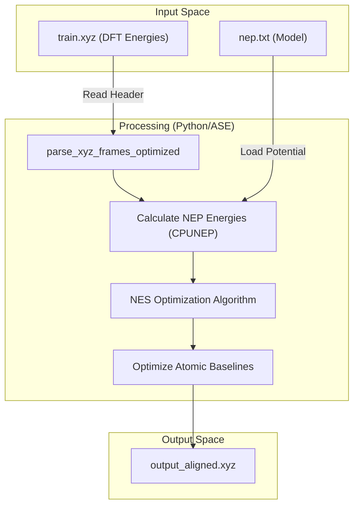
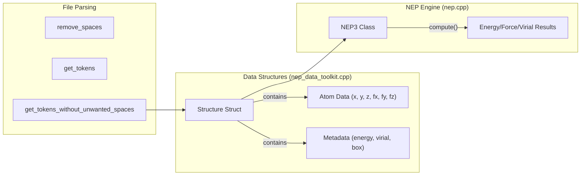

# Analysis and Processing Tools

Relevant source files

The following files were used as context for generating this wiki page:

- [tools/Analysis_and_Processing/README.md](tools/Analysis_and_Processing/README.md)
- [tools/Analysis_and_Processing/energy-reference-aligner/Energy-Reference-Aligner.py](tools/Analysis_and_Processing/energy-reference-aligner/Energy-Reference-Aligner.py)
- [tools/Analysis_and_Processing/energy-reference-aligner/README.md](tools/Analysis_and_Processing/energy-reference-aligner/README.md)
- [tools/Analysis_and_Processing/hydrogen_bond_analysis/Hydrogen-bond-analysis.py](tools/Analysis_and_Processing/hydrogen_bond_analysis/Hydrogen-bond-analysis.py)
- [tools/Analysis_and_Processing/hydrogen_bond_analysis/README.md](tools/Analysis_and_Processing/hydrogen_bond_analysis/README.md)
- [tools/Format_Conversion/README.md](tools/Format_Conversion/README.md)
- [tools/Format_Conversion/siesta2xyz/siesta2xyz.py](tools/Format_Conversion/siesta2xyz/siesta2xyz.py)
- [tools/Miscellaneous/for_coding/for_perioidc_table/a.out](tools/Miscellaneous/for_coding/for_perioidc_table/a.out)
- [tools/Miscellaneous/for_coding/for_perioidc_table/dftd3para.h](tools/Miscellaneous/for_coding/for_perioidc_table/dftd3para.h)
- [tools/Miscellaneous/for_coding/for_perioidc_table/nep.cpp](tools/Miscellaneous/for_coding/for_perioidc_table/nep.cpp)
- [tools/Miscellaneous/for_coding/for_perioidc_table/nep.h](tools/Miscellaneous/for_coding/for_perioidc_table/nep.h)
- [tools/Miscellaneous/for_coding/for_perioidc_table/nep_data_toolkit.cpp](tools/Miscellaneous/for_coding/for_perioidc_table/nep_data_toolkit.cpp)
- [tools/readme.md](tools/readme.md)

The `tools/Analysis_and_Processing` directory contains a collection of auxiliary scripts and utilities designed to process simulation trajectories, prepare training data for NEP models, and perform structural analysis. These tools complement the main GPUMD and NEP executables by providing post-simulation analysis and pre-simulation data conditioning.

## Overview of Tools

The following table summarizes the primary tools available in this directory:

| Tool | Creator | Description |
| :--- | :--- | :--- |
| `add_groups` | Yuwen Zhang | Generates grouping methods for `model.xyz` to enable group-based computations. |
| `energy-reference-aligner` | Zherui Chen | Aligns atomic energy baselines across different XYZ trajectory files. |
| `hydrogen_bond_analysis` | Zherui Chen | Analyzes conventional and unconventional hydrogen bonds in XYZ trajectories. |
| `pca_sampling` | Penghua Ying | Performs farthest-point sampling based on Principal Component Analysis. |
| `rdf_adf` | Ke Xu | Calculates Radial Distribution Function (RDF) and Angular Distribution Function (ADF). |
| `select_xyz_frames` | Zherui Chen | Selects specific frames from extended XYZ files based on user criteria. |
| `split_xyz` | Yong Wang | Splitting large XYZ files for training/test set preparation. |

**Sources:** [tools/Analysis_and_Processing/README.md:4-16]()

---

## Energy Reference Aligner

The `Energy-Reference-Aligner.py` script is a sophisticated tool for standardizing the `energy=` field in extended XYZ files. It is particularly critical when combining datasets from different DFT codes or when fine-tuning existing NEP models.

### Alignment Modes
The script supports three primary logic flows defined by the `ALIGNMENT_MODE` setting [tools/Analysis_and_Processing/energy-reference-aligner/Energy-Reference-Aligner.py:82-90]():

1.  **REF_GROUP_ALIGNMENT**: Aligns "shift groups" to the average energy baseline of a "reference group". This is used when a high-accuracy dataset serves as the gold standard [tools/Analysis_and_Processing/energy-reference-aligner/Energy-Reference-Aligner.py:8-16]().
2.  **ZERO_BASELINE_ALIGNMENT**: Shifts all energies so that free atoms (vacuum reference) have zero energy [tools/Analysis_and_Processing/energy-reference-aligner/Energy-Reference-Aligner.py:18-24]().
3.  **DFT_TO_NEP_ALIGNMENT**: Aligns original DFT energies to energies calculated by a pre-existing NEP model (e.g., `nep.txt`). This is recommended for fine-tuning tasks [tools/Analysis_and_Processing/energy-reference-aligner/Energy-Reference-Aligner.py:26-33]().

### Technical Implementation
The tool utilizes a **Natural Evolution Strategy (NES)** algorithm to optimize atomic energy baselines by minimizing the Mean Squared Error (MSE) between shifted energies and target references [tools/Analysis_and_Processing/energy-reference-aligner/Energy-Reference-Aligner.py:41-43]().

### Data Flow: DFT to NEP Alignment

**Sources:** [tools/Analysis_and_Processing/energy-reference-aligner/Energy-Reference-Aligner.py:111-120](), [tools/Analysis_and_Processing/energy-reference-aligner/Energy-Reference-Aligner.py:71-72]()

---

## Hydrogen Bond Analysis

The `Hydrogen-bond-analysis.py` script identifies hydrogen bonds (H-bonds) based on geometric criteria. It supports both conventional and unconventional bonds, including pi-H bonds and dihydrogen bonds [tools/Analysis_and_Processing/hydrogen_bond_analysis/Hydrogen-bond-analysis.py:6-21]().

### Detection Criteria
Bonds are identified using the following parameters:
*   **Distance (D...A)**: Donor to Acceptor distance must be below a specified threshold (typically < 3.5 Å) [tools/Analysis_and_Processing/hydrogen_bond_analysis/Hydrogen-bond-analysis.py:14]().
*   **Angle (H-D-A)**: The angle must be sharp (typically < 30°) [tools/Analysis_and_Processing/hydrogen_bond_analysis/Hydrogen-bond-analysis.py:15]().
*   **Bond Length (H-D)**: The Hydrogen-Donor distance must be within a cutoff (typically < 1.2 Å) [tools/Analysis_and_Processing/hydrogen_bond_analysis/Hydrogen-bond-analysis.py:16]().

### Key Functions
*   `auto_detect_pi_centers`: Identifies six-membered carbon rings and triple bonds to detect pi-H interactions [tools/Analysis_and_Processing/hydrogen_bond_analysis/Hydrogen-bond-analysis.py:125-167]().
*   `process_un`: The core processing function that iterates through species and coordinates to find unconventional bonds [tools/Analysis_and_Processing/hydrogen_bond_analysis/Hydrogen-bond-analysis.py:174-182]().

**Sources:** [tools/Analysis_and_Processing/hydrogen_bond_analysis/README.md:7-19](), [tools/Analysis_and_Processing/hydrogen_bond_analysis/Hydrogen-bond-analysis.py:125-182]()

---

## NEP Data Toolkit (C++ Utilities)

Located in `tools/Miscellaneous/for_coding/for_perioidc_table/`, this utility provides a high-performance C++ implementation for handling NEP data structures.

### Structure Definition
The `Structure` struct represents a single atomic configuration with all associated metadata required for NEP training [tools/Miscellaneous/for_coding/for_perioidc_table/nep_data_toolkit.cpp:157-178]():

| Field | Type | Description |
| :--- | :--- | :--- |
| `num_atom` | `int` | Number of atoms in the frame. |
| `energy` | `double` | Total potential energy. |
| `box` | `double[9]` | Lattice vectors. |
| `x, y, z` | `vector<double>` | Atomic positions. |
| `fx, fy, fz` | `vector<double>` | Forces on atoms. |
| `virial` | `double[9]` | Virial stress components. |

### System Logic Mapping

**Sources:** [tools/Miscellaneous/for_coding/for_perioidc_table/nep_data_toolkit.cpp:56-178](), [tools/Miscellaneous/for_coding/for_perioidc_table/nep.h:23-115]()

---

## Other Processing Utilities

### RDF and ADF Calculation
The `rdf_adf` tool leverages the `OVITO` Python API to calculate Radial Distribution Functions and Angular Distribution Functions from trajectories. This is useful for verifying the structural accuracy of a trained NEP model against DFT references.
**Sources:** [tools/Analysis_and_Processing/README.md:13]()

### PCA Sampling
The `pca_sampling` tool uses the `calorine` package to perform farthest-point sampling in the descriptor space. This is a critical step in active learning workflows to select the most diverse structures for labeling, thereby improving the robustness of NEP models.
**Sources:** [tools/Analysis_and_Processing/README.md:11]()

### Add Groups
The `add_groups` utility is used to modify `model.xyz` files by assigning atoms to specific groups. This is necessary for GPUMD features like group-based temperature control (`ensemble`) or group-based heat current decomposition.
**Sources:** [tools/Analysis_and_Processing/README.md:6]()

---