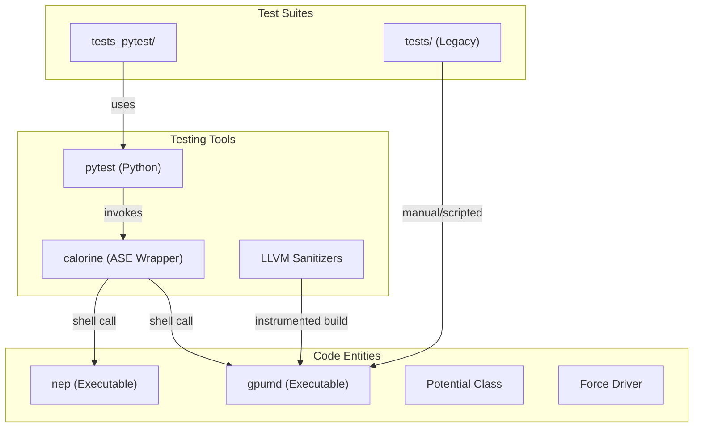
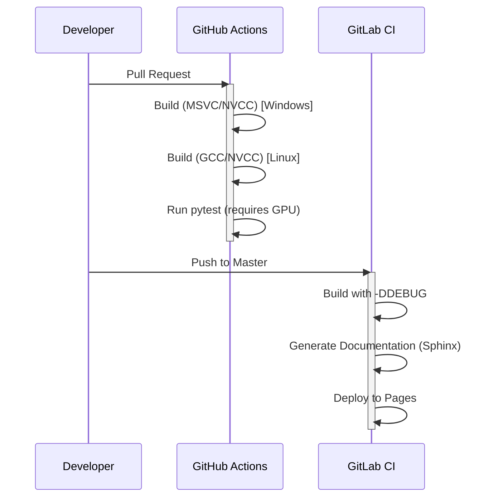

# Testing Infrastructure

<details>
<summary>Relevant source files</summary>

The following files were used as context for generating this wiki page:

- [.github/workflows/cuda-build.yml](.github/workflows/cuda-build.yml)
- [.github/workflows/cuda_build_windows.yml](.github/workflows/cuda_build_windows.yml)
- [.github/workflows/integration-test.yml](.github/workflows/integration-test.yml)
- [.gitlab-ci.yml](.gitlab-ci.yml)
- [doc/_static/custom.css](doc/_static/custom.css)
- [doc/_static/logo-2x1.png](doc/_static/logo-2x1.png)
- [doc/_static/logo-icon.svg](doc/_static/logo-icon.svg)
- [doc/_static/logo.ico](doc/_static/logo.ico)
- [doc/_static/logo.png](doc/_static/logo.png)
- [doc/_static/logo.svg](doc/_static/logo.svg)
- [doc/_templates/breadcrumbs.html](doc/_templates/breadcrumbs.html)
- [doc/_templates/page.html](doc/_templates/page.html)
- [tests/gpumd/carbon/thermo1.out](tests/gpumd/carbon/thermo1.out)
- [tests/gpumd/graphene_dos/dos1.out](tests/gpumd/graphene_dos/dos1.out)
- [tests/gpumd/graphene_dos/mvac1.out](tests/gpumd/graphene_dos/mvac1.out)
- [tests/gpumd/graphene_dos/thermo1.out](tests/gpumd/graphene_dos/thermo1.out)
- [tests/gpumd/graphene_kappa_emd/hac1.out](tests/gpumd/graphene_kappa_emd/hac1.out)
- [tests/gpumd/graphene_kappa_emd/thermo1.out](tests/gpumd/graphene_kappa_emd/thermo1.out)
- [tests/gpumd/graphene_kappa_hnemd/kappa1.out](tests/gpumd/graphene_kappa_hnemd/kappa1.out)
- [tests/gpumd/graphene_kappa_hnemd/shc1.out](tests/gpumd/graphene_kappa_hnemd/shc1.out)
- [tests/gpumd/graphene_kappa_hnemd/thermo1.out](tests/gpumd/graphene_kappa_hnemd/thermo1.out)
- [tests/gpumd/graphene_kappa_nemd/compute1.out](tests/gpumd/graphene_kappa_nemd/compute1.out)
- [tests/gpumd/graphene_kappa_nemd/shc1.out](tests/gpumd/graphene_kappa_nemd/shc1.out)
- [tests/gpumd/graphene_kappa_nemd/thermo1.out](tests/gpumd/graphene_kappa_nemd/thermo1.out)
- [tests_pytest/conftest.py](tests_pytest/conftest.py)
- [tests_pytest/fixtures/golden/bec_bulk_perovskite_qnep_mode1_ewald.npz](tests_pytest/fixtures/golden/bec_bulk_perovskite_qnep_mode1_ewald.npz)
- [tests_pytest/fixtures/golden/bec_bulk_perovskite_qnep_mode1_pppm.npz](tests_pytest/fixtures/golden/bec_bulk_perovskite_qnep_mode1_pppm.npz)
- [tests_pytest/fixtures/golden/bulk_bazro3.npz](tests_pytest/fixtures/golden/bulk_bazro3.npz)
- [tests_pytest/fixtures/training/generate_train_xyz.py](tests_pytest/fixtures/training/generate_train_xyz.py)
- [tests_pytest/fixtures/training/train.xyz](tests_pytest/fixtures/training/train.xyz)
- [tests_pytest/io_helpers.py](tests_pytest/io_helpers.py)
- [tests_pytest/pytest.ini](tests_pytest/pytest.ini)
- [tests_pytest/run_sanitizer_checks.sh](tests_pytest/run_sanitizer_checks.sh)
- [tests_pytest/test_force_energy_consistency.py](tests_pytest/test_force_energy_consistency.py)
- [tests_pytest/test_invariances.py](tests_pytest/test_invariances.py)
- [tests_pytest/test_io_basic_setup.py](tests_pytest/test_io_basic_setup.py)
- [tests_pytest/test_kspace_consistency.py](tests_pytest/test_kspace_consistency.py)
- [tests_pytest/test_md_conservation.py](tests_pytest/test_md_conservation.py)
- [tests_pytest/test_nep_model_consistency.py](tests_pytest/test_nep_model_consistency.py)
- [tests_pytest/test_parsing.py](tests_pytest/test_parsing.py)
- [tests_pytest/test_regression.py](tests_pytest/test_regression.py)
- [tests_pytest/test_tnep_invariances.py](tests_pytest/test_tnep_invariances.py)

</details>


The GPUMD repository maintains a multi-layered testing infrastructure to ensure numerical correctness, prevent regressions in physical property calculations, and validate the consistency of Neuroevolution Potentials (NEP). The infrastructure ranges from low-level unit-like checks for parsers to large-scale integration tests and continuous integration (CI) workflows.

## Infrastructure Overview

The testing environment is split into two primary components: a modern automated suite and a legacy collection of physical validation cases.

| Component | Directory | Purpose |
| :--- | :--- | :--- |
| **Pytest Suite** | `tests_pytest/` | Automated regression, consistency, and invariance tests using Python/ASE. |
| **Legacy Tests** | `tests/` | Reference outputs for complex MD simulations (e.g., thermal conductivity). |
| **CI/CD** | `.github/workflows/`, `.gitlab-ci.yml` | Automated building and testing on Linux and Windows. |
| **Sanitizers** | `tests_pytest/run_sanitizer_checks.sh` | Memory and thread safety validation via LLVM sanitizers. |

### System Mapping
The following diagram illustrates how the testing infrastructure interacts with the core binaries.


**Sources:** [.github/workflows/integration-test.yml:23-29](), [tests_pytest/conftest.py:24-44](), [tests_pytest/run_sanitizer_checks.sh:1-10]()

---

## Pytest Test Suite
The `tests_pytest/` directory contains the primary automated testing framework. It utilizes the `pytest` runner and the `calorine` Python package to interface with the `gpumd` and `nep` binaries. 

Key features include:
*   **Regression Testing**: Comparing current energy, force, and virial outputs against "golden" reference files stored in `.npz` format [tests_pytest/test_regression.py:35-55]().
*   **Consistency Checks**: Validating that analytical forces match numerical gradients (finite-difference) and that different k-space methods (Ewald vs PPPM) agree within tolerance [tests_pytest/test_force_energy_consistency.py:60]().
*   **Invariance Testing**: Ensuring that total energy and forces are invariant under translation, rotation, and atom permutation [tests_pytest/test_invariances.py:70-82]().
*   **Fixture Architecture**: Centralized management of executables and tolerances in `conftest.py` [tests_pytest/conftest.py:43-60]().

For details, see [Pytest Test Suite](#8.1).

**Sources:** [tests_pytest/conftest.py:1-80](), [tests_pytest/test_regression.py:1-25]()

---

## Legacy Test Cases
The `tests/` directory houses a collection of simulation setups and their corresponding reference outputs. These are used to validate the physical accuracy of GPUMD for specific materials and properties.

Typical contents include:
*   **Graphene Thermal Conductivity**: Reference outputs for EMD (`hac.out`), NEMD (`compute.out`), and HNEMD (`kappa.out`) [tests/gpumd/graphene_kappa_emd/hac1.out:1-10](), [tests/gpumd/graphene_kappa_hnemd/kappa1.out:1]().
*   **Spectral Properties**: Reference data for Density of States (DOS) and Spectral Heat Current (SHC) [tests/gpumd/graphene_dos/dos1.out:1-10](), [tests/gpumd/graphene_kappa_nemd/shc1.out:1-9]().
*   **Thermodynamic Data**: Standardized `thermo.out` files containing Temperature, Kinetic Energy, Potential Energy, and Stress tensors [tests/gpumd/carbon/thermo1.out:1-6]().

For details, see [Legacy Test Cases](#8.2).

**Sources:** [tests/gpumd/carbon/thermo1.out:1-15](), [tests/gpumd/graphene_kappa_nemd/shc1.out:1-10]()

---

## CI/CD and Build Validation
GPUMD employs GitHub Actions and GitLab CI to ensure the codebase remains buildable and passes basic integration tests across different environments.

### Workflow Integration


*   **Windows CI**: Uses `choco install cuda` and MSVC to verify builds on Windows runners [.github/workflows/cuda_build_windows.yml:22-31]().
*   **Linux CI**: Uses Docker containers with CUDA toolkits (e.g., `nvidia/cuda:12.2.0-devel-ubuntu22.04`) to run integration tests [.github/workflows/integration-test.yml:8-26]().
*   **Debug Builds**: CI pipelines frequently build with `-DDEBUG` to enable internal assertions and safety checks [src/Makefile:22-23](), [.gitlab-ci.yml:22]().

**Sources:** [.github/workflows/cuda_build_windows.yml:1-32](), [.github/workflows/integration-test.yml:1-29](), [.gitlab-ci.yml:11-27]()

---

## Running and Extending Tests

### How to Run
To run the automated suite, ensure `pytest` and `calorine` are installed, and the binaries are built in `src/`:
```bash
cd tests_pytest
pytest
```
To update the golden reference files after an intentional change:
```bash
pytest --update-golden
```

### Extending the Suite
1.  **New Potentials**: Add a test in `test_regression.py` using a new model file in `fixtures/models/` [tests_pytest/test_regression.py:35-45]().
2.  **Parser Changes**: Add cases to `test_parsing.py` to ensure I/O round-trips remain stable [tests_pytest/test_parsing.py:87-95]().
3.  **Sanitizers**: Run `run_sanitizer_checks.sh` to check for memory leaks or undefined behavior in new features [tests_pytest/run_sanitizer_checks.sh:1-10]().

**Sources:** [tests_pytest/conftest.py:96-102](), [tests_pytest/test_parsing.py:1-8]()

---