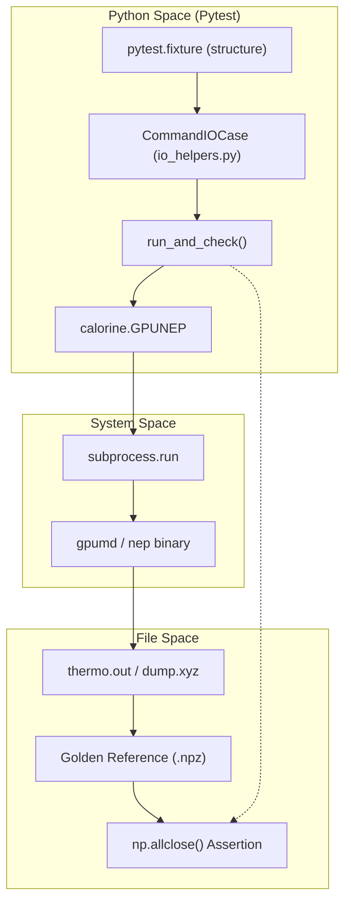
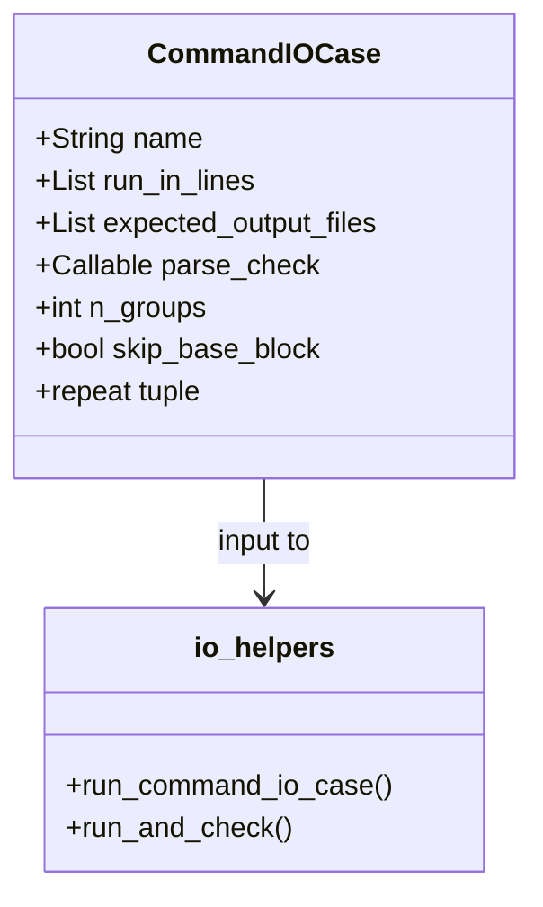

# Pytest Test Suite

Relevant source files

The following files were used as context for generating this wiki page:

- [tests_pytest/conftest.py](tests_pytest/conftest.py)
- [tests_pytest/fixtures/golden/bec_bulk_perovskite_qnep_mode1_ewald.npz](tests_pytest/fixtures/golden/bec_bulk_perovskite_qnep_mode1_ewald.npz)
- [tests_pytest/fixtures/golden/bec_bulk_perovskite_qnep_mode1_pppm.npz](tests_pytest/fixtures/golden/bec_bulk_perovskite_qnep_mode1_pppm.npz)
- [tests_pytest/fixtures/golden/bulk_bazro3.npz](tests_pytest/fixtures/golden/bulk_bazro3.npz)
- [tests_pytest/fixtures/golden/tnep_dipole_water.npz](tests_pytest/fixtures/golden/tnep_dipole_water.npz)
- [tests_pytest/fixtures/golden/tnep_polarizability_bazro3.npz](tests_pytest/fixtures/golden/tnep_polarizability_bazro3.npz)
- [tests_pytest/fixtures/models/nep_water.txt](tests_pytest/fixtures/models/nep_water.txt)
- [tests_pytest/fixtures/models/tnep-BaZrO3-susceptibility.txt](tests_pytest/fixtures/models/tnep-BaZrO3-susceptibility.txt)
- [tests_pytest/fixtures/models/tnep-water-polarization.txt](tests_pytest/fixtures/models/tnep-water-polarization.txt)
- [tests_pytest/fixtures/training/generate_train_xyz.py](tests_pytest/fixtures/training/generate_train_xyz.py)
- [tests_pytest/fixtures/training/train.xyz](tests_pytest/fixtures/training/train.xyz)
- [tests_pytest/io_helpers.py](tests_pytest/io_helpers.py)
- [tests_pytest/pytest.ini](tests_pytest/pytest.ini)
- [tests_pytest/run_sanitizer_checks.sh](tests_pytest/run_sanitizer_checks.sh)
- [tests_pytest/test_force_energy_consistency.py](tests_pytest/test_force_energy_consistency.py)
- [tests_pytest/test_invariances.py](tests_pytest/test_invariances.py)
- [tests_pytest/test_io_basic_setup.py](tests_pytest/test_io_basic_setup.py)
- [tests_pytest/test_io_compute_commands.py](tests_pytest/test_io_compute_commands.py)
- [tests_pytest/test_io_tnep_commands.py](tests_pytest/test_io_tnep_commands.py)
- [tests_pytest/test_kspace_consistency.py](tests_pytest/test_kspace_consistency.py)
- [tests_pytest/test_md_conservation.py](tests_pytest/test_md_conservation.py)
- [tests_pytest/test_nep_model_consistency.py](tests_pytest/test_nep_model_consistency.py)
- [tests_pytest/test_parsing.py](tests_pytest/test_parsing.py)
- [tests_pytest/test_regression.py](tests_pytest/test_regression.py)
- [tests_pytest/test_tnep_invariances.py](tests_pytest/test_tnep_invariances.py)

The `tests_pytest/` directory contains an automated testing suite designed to validate the numerical correctness, physical consistency, and input/output integrity of the `gpumd` and `nep` executables. Unlike legacy tests that rely on comparing text output, this suite leverages the `pytest` framework and the `calorine` Python interface to perform rigorous checks on energy, forces, virials, and specialized properties like Born effective charges [tests_pytest/conftest.py:1-8]().

## Fixture Architecture and Configuration

The suite is built around a centralized configuration file, `conftest.py`, which manages executable discovery, shared tolerances, and system fixtures.

### Executable Discovery
The suite automatically locates the `gpumd` and `nep` binaries. It defaults to searching in `src/` (where a standard `make` command places them) and falls back to the repository root [tests_pytest/conftest.py:24-44]().

### Numerical Tolerances
Because GPUMD uses FP32 accumulation and non-associative reduction on GPUs, results are not bit-for-bit identical across different kernel launches. The suite defines specific tolerances (`TOLERANCES`) to absorb this noise while still catching regressions [tests_pytest/conftest.py:46-60]().

| Quantity | Relative Tolerance (`rtol`) | Absolute Tolerance (`atol`) |
| :--- | :--- | :--- |
| Energy | $10^{-5}$ | $10^{-8}$ eV |
| Force | $10^{-4}$ | $10^{-6}$ eV/Å |
| Virial | $10^{-4}$ | $10^{-6}$ eV/ų |
| BEC | $10^{-4}$ | $10^{-5}$ |

### Data Flow and Entity Mapping
The following diagram illustrates how the Pytest fixtures and helpers bridge the gap between the Python testing environment and the C++/CUDA executables.

**Pytest to GPUMD Execution Flow**

Sources: [tests_pytest/conftest.py:118-145](), [tests_pytest/io_helpers.py:59-102](), [tests_pytest/test_regression.py:35-45]()

## Test Categories

### 1. Regression Tests
These tests compare current GPUMD outputs against "Golden Reference" files stored in `fixtures/golden/` as `.npz` arrays [tests_pytest/conftest.py:21](). 
*   **Bulk Systems:** Validates energy, forces, and stress for realistic systems like BaZrO3 [tests_pytest/test_regression.py:35-45]().
*   **BEC Regression:** Checks Born effective charges using both Ewald and PPPM k-space methods [tests_pytest/test_regression.py:47-55]().
*   **Golden Updates:** The suite provides a `--update-golden` CLI flag to regenerate these references when intentional changes occur [tests_pytest/conftest.py:96-102]().

### 2. Physical Invariances
Validates that the potential energy surface is invariant under basic geometric transformations [tests_pytest/test_invariances.py:1-6]():
*   **Translation:** Shifting the structure coordinates [tests_pytest/test_invariances.py:31-44]().
*   **Rotation:** Rotating the cell and positions (using Rodrigues' rotation formula) and checking force vector rotation [tests_pytest/test_invariances.py:47-69]().
*   **Permutation:** Swapping atoms of the same species [tests_pytest/test_invariances.py:72-97]().
*   **Lattice Shift:** Shifting by a lattice vector and wrapping coordinates [tests_pytest/test_invariances.py:100-117]().

### 3. MD Conservation
Performs short NVE (Velocity-Verlet) simulations to ensure:
*   **Energy Drift:** Accumulated global energy drift scales as $O(\Delta t^2)$ and stays below `ENERGY_DRIFT_COEFFICIENT` [tests_pytest/test_md_conservation.py:1-14]().
*   **Momentum Conservation:** Linear and angular momentum remain near zero (absolute bound of $10^{-3}$ Dalton·Å/fs) [tests_pytest/test_md_conservation.py:33-73]().

### 4. Force-Energy Consistency
Validates that analytic forces calculated by the GPU kernels match the negative gradient of the energy calculated via central finite difference [tests_pytest/conftest.py:85-93]().

### 5. K-space Consistency
Specifically for qNEP models, this test ensures that the PPPM (Particle-Particle Particle-Mesh) approximation agrees with the Ewald summation method within a defined tolerance across different system sizes [tests_pytest/test_kspace_consistency.py:1-11]().

## Input/Output and Parsing

### Command IO Smoke Tests (Tier 1)
These tests use the `CommandIOCase` dataclass to verify that `run.in` keywords (e.g., `ensemble`, `fix`, `compute_rdf`, `minimize`) execute without error and produce the expected output files [tests_pytest/io_helpers.py:25-57]().

**Command Validation Logic**

Sources: [tests_pytest/io_helpers.py:25-57](), [tests_pytest/test_io_basic_setup.py:37-77]()

### Parser Robustness
*   **Round-trip Parsing:** Ensures that `thermo.out`, `dpdt.out`, and `nep.txt` files can be read back into Python accurately [tests_pytest/test_parsing.py:88-126]().
*   **Hypothesis Testing:** Uses the `hypothesis` library to feed arbitrary text into the `read_model` parser to ensure it raises documented `ValueError` or `OSError` exceptions rather than crashing [tests_pytest/test_parsing.py:128-145]().
*   **Hyperparameter Consistency:** The `test_nep_model_consistency.py` module ensures that `nep` training resumes correctly by checking that `nep.in` parameters match those stored in `nep.txt` and `nep.restart` [tests_pytest/test_nep_model_consistency.py:1-19]().

## Sanitizer Checks
The suite includes `run_sanitizer_checks.sh` to run the tests under LLVM sanitizers (AddressSanitizer, UndefinedBehaviorSanitizer). This helps detect memory leaks, out-of-bounds access, and undefined behavior in the C++/CUDA source code [tests_pytest/conftest.py:107-109]().

Sources:
- `tests_pytest/conftest.py`
- `tests_pytest/io_helpers.py`
- `tests_pytest/test_regression.py`
- `tests_pytest/test_invariances.py`
- `tests_pytest/test_md_conservation.py`
- `tests_pytest/test_parsing.py`
- `tests_pytest/test_kspace_consistency.py`
- `tests_pytest/test_nep_model_consistency.py`
- `tests_pytest/test_io_basic_setup.py`

---