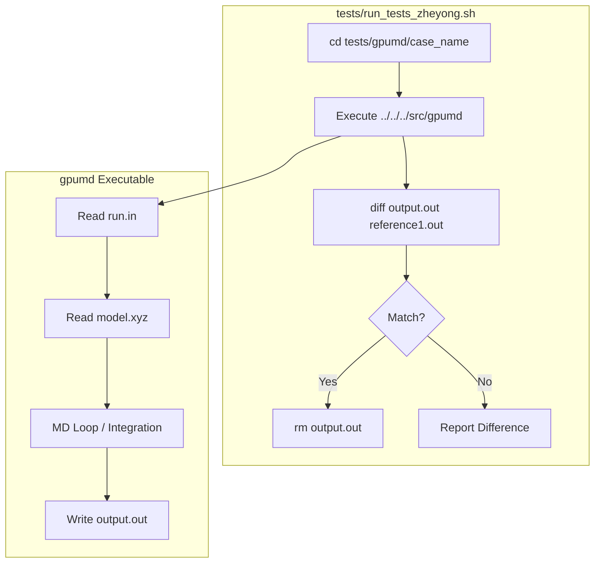

# Legacy Test Cases

Relevant source files

The following files were used as context for generating this wiki page:

- [potentials/tersoff/Graphene_Lindsay_2010_modified.txt](potentials/tersoff/Graphene_Lindsay_2010_modified.txt)
- [tests/gpumd/carbon/thermo1.out](tests/gpumd/carbon/thermo1.out)
- [tests/gpumd/graphene_dos/create_xyz.m](tests/gpumd/graphene_dos/create_xyz.m)
- [tests/gpumd/graphene_dos/dos1.out](tests/gpumd/graphene_dos/dos1.out)
- [tests/gpumd/graphene_dos/model.xyz](tests/gpumd/graphene_dos/model.xyz)
- [tests/gpumd/graphene_dos/mvac1.out](tests/gpumd/graphene_dos/mvac1.out)
- [tests/gpumd/graphene_dos/run.in](tests/gpumd/graphene_dos/run.in)
- [tests/gpumd/graphene_dos/thermo1.out](tests/gpumd/graphene_dos/thermo1.out)
- [tests/gpumd/graphene_kappa_emd/create_xyz.m](tests/gpumd/graphene_kappa_emd/create_xyz.m)
- [tests/gpumd/graphene_kappa_emd/hac1.out](tests/gpumd/graphene_kappa_emd/hac1.out)
- [tests/gpumd/graphene_kappa_emd/model.xyz](tests/gpumd/graphene_kappa_emd/model.xyz)
- [tests/gpumd/graphene_kappa_emd/run.in](tests/gpumd/graphene_kappa_emd/run.in)
- [tests/gpumd/graphene_kappa_emd/thermo1.out](tests/gpumd/graphene_kappa_emd/thermo1.out)
- [tests/gpumd/graphene_kappa_hnemd/create_xyz.m](tests/gpumd/graphene_kappa_hnemd/create_xyz.m)
- [tests/gpumd/graphene_kappa_hnemd/kappa1.out](tests/gpumd/graphene_kappa_hnemd/kappa1.out)
- [tests/gpumd/graphene_kappa_hnemd/model.xyz](tests/gpumd/graphene_kappa_hnemd/model.xyz)
- [tests/gpumd/graphene_kappa_hnemd/run.in](tests/gpumd/graphene_kappa_hnemd/run.in)
- [tests/gpumd/graphene_kappa_hnemd/shc1.out](tests/gpumd/graphene_kappa_hnemd/shc1.out)
- [tests/gpumd/graphene_kappa_hnemd/thermo1.out](tests/gpumd/graphene_kappa_hnemd/thermo1.out)
- [tests/gpumd/graphene_kappa_nemd/compute1.out](tests/gpumd/graphene_kappa_nemd/compute1.out)
- [tests/gpumd/graphene_kappa_nemd/create_xyz.m](tests/gpumd/graphene_kappa_nemd/create_xyz.m)
- [tests/gpumd/graphene_kappa_nemd/model.xyz](tests/gpumd/graphene_kappa_nemd/model.xyz)
- [tests/gpumd/graphene_kappa_nemd/run.in](tests/gpumd/graphene_kappa_nemd/run.in)
- [tests/gpumd/graphene_kappa_nemd/shc1.out](tests/gpumd/graphene_kappa_nemd/shc1.out)
- [tests/gpumd/graphene_kappa_nemd/thermo1.out](tests/gpumd/graphene_kappa_nemd/thermo1.out)
- [tests/gpumd/silicon_dispersion/model.xyz](tests/gpumd/silicon_dispersion/model.xyz)
- [tests/gpumd/silicon_liquid/adf1.out](tests/gpumd/silicon_liquid/adf1.out)
- [tests/gpumd/silicon_liquid/msd1.out](tests/gpumd/silicon_liquid/msd1.out)
- [tests/gpumd/silicon_liquid/neighbor1.out](tests/gpumd/silicon_liquid/neighbor1.out)
- [tests/gpumd/silicon_liquid/rdf1.out](tests/gpumd/silicon_liquid/rdf1.out)
- [tests/gpumd/silicon_liquid/restart1.xyz](tests/gpumd/silicon_liquid/restart1.xyz)
- [tests/gpumd/silicon_liquid/run.in](tests/gpumd/silicon_liquid/run.in)
- [tests/gpumd/silicon_liquid/sdc1.out](tests/gpumd/silicon_liquid/sdc1.out)
- [tests/gpumd/silicon_liquid/viscosity1.out](tests/gpumd/silicon_liquid/viscosity1.out)
- [tests/run_tests.bat](tests/run_tests.bat)
- [tests/run_tests_zheyong.sh](tests/run_tests_zheyong.sh)

The `tests/` directory contains a suite of legacy regression tests designed to validate the physical accuracy and numerical stability of GPUMD across various simulation modes. These tests rely on comparing current simulation outputs against established "golden" reference files using shell or batch scripts.

## Test Infrastructure and Execution

The legacy testing system is built around directory-based test cases where each folder contains the necessary input files (`run.in`, `model.xyz`, and potential files) and reference output files (suffixed with `1.out` or `1.xyz`).

### Test Runners
Two primary scripts facilitate the execution of these tests:
*   **Linux/Unix**: `tests/run_tests_zheyong.sh` [tests/run_tests_zheyong.sh:1-62]()
*   **Windows**: `tests/run_tests.bat` [tests/run_tests.bat:1-44]()

The runners follow a standardized data flow:
1.  Navigate into a specific test directory (e.g., `gpumd/graphene_dos`).
2.  Execute the `gpumd` binary.
3.  Use `diff` (Linux) or `fc` (Windows) to compare the newly generated output with the reference file.
4.  Clean up generated files if the comparison passes.

### Logic Flow Diagram
The following diagram illustrates how the test runner interacts with the GPUMD executable and the file system.

**Test Execution and Validation Flow**

**Sources:** [tests/run_tests_zheyong.sh:1-62](), [tests/run_tests.bat:1-44]()

---

## Thermal Conductivity Test Cases

A significant portion of the legacy suite focuses on thermal transport in graphene using three distinct methods: EMD, NEMD, and HNEMD.

### Graphene EMD (Equilibrium Molecular Dynamics)
Located in `tests/gpumd/graphene_kappa_emd/`, this test calculates thermal conductivity via the Green-Kubo method.
*   **Input**: Uses `run.in` with the `potential` keyword pointing to Tersoff graphene parameters [tests/gpumd/graphene_kappa_emd/run.in:1-1]().
*   **Validation**: Compares `hac.out` (Heat Autocorrelation Function) against `hac1.out` [tests/run_tests_zheyong.sh:14-14]().
*   **Reference Data**: `hac1.out` contains 11 columns including time correlation and integrated thermal conductivity components [tests/gpumd/graphene_kappa_emd/hac1.out:1-30]().

### Graphene NEMD (Non-Equilibrium Molecular Dynamics)
Located in `tests/gpumd/graphene_kappa_nemd/`, this test uses a temperature gradient.
*   **Validation**: Compares `shc.out` (Spectral Heat Current) and `compute.out` against references [tests/run_tests_zheyong.sh:22-23]().
*   **Data Structure**: `shc1.out` provides correlation time, in-out heat currents, and frequency-domain spectral heat current [tests/gpumd/graphene_kappa_nemd/shc1.out:1-10]().

### Graphene HNEMD (Homogeneous NEMD)
Located in `tests/gpumd/graphene_kappa_hnemd/`, this test validates the HNEMD algorithm which applies a driving force to atoms to simulate a heat flux.
*   **Validation**: Compares `kappa.out` (Thermal Conductivity) and `shc.out` [tests/run_tests_zheyong.sh:31-32]().

**Sources:** [tests/gpumd/graphene_kappa_emd/run.in:1-10](), [tests/gpumd/graphene_kappa_emd/hac1.out:1-30](), [tests/gpumd/graphene_kappa_nemd/shc1.out:1-20](), [tests/run_tests_zheyong.sh:10-34]()

---

## Silicon and Carbon Property Tests

These tests validate the implementation of NEP (Neuroevolution Potentials) and structural analysis tools.

### Silicon Liquid Properties
The `tests/gpumd/silicon_liquid/` case performs a comprehensive check of transport and structural properties using NEP4.
*   **Integration**: Uses `npt_scr` for equilibration followed by `nve` for production [tests/gpumd/silicon_liquid/run.in:6-10]().
*   **Measurements**: Validates several compute commands:
    *   `compute_sdc` and `compute_msd` for diffusion [tests/gpumd/silicon_liquid/run.in:11-12]().
    *   `compute_viscosity` [tests/gpumd/silicon_liquid/run.in:13-13]().
    *   `compute_rdf` and `compute_adf` for Radial and Angular Distribution Functions [tests/gpumd/silicon_liquid/run.in:14-15]().
*   **Reference Data**: Includes `rdf1.out` providing the Si-Si pair distribution [tests/gpumd/silicon_liquid/rdf1.out:1-101]().

### Silicon Phonon Dispersion
Located in `tests/gpumd/silicon_dispersion/`, this test calculates the dynamical matrix and phonon frequencies.
*   **Validation**: The script checks `omega2.out` (squared frequencies) against `omega21.out` [tests/run_tests_zheyong.sh:39-39]().

**Sources:** [tests/gpumd/silicon_liquid/run.in:1-16](), [tests/gpumd/silicon_liquid/rdf1.out:1-101](), [tests/run_tests_zheyong.sh:36-41](), [tests/run_tests_zheyong.sh:51-62]()

---

## Summary of Reference Files

The following table maps the physical properties tested to their corresponding reference files in the `tests/` directory.

| Test Case | Property | Reference File |
| :--- | :--- | :--- |
| `graphene_dos` | Density of States | `dos1.out`, `mvac1.out` |
| `graphene_kappa_emd` | Thermal Conductivity (GK) | `hac1.out` |
| `graphene_kappa_nemd` | Spectral Heat Current | `shc1.out`, `compute1.out` |
| `graphene_kappa_hnemd` | HNEMD Conductivity | `kappa1.out`, `shc1.out` |
| `silicon_dispersion` | Phonon Frequencies | `omega21.out` |
| `silicon_liquid` | Transport & Structure | `sdc1.out`, `msd1.out`, `rdf1.out`, `adf1.out` |
| `carbon` | Thermodynamics & Neighbors | `thermo1.out`, `neighbor1.out` |

**Sources:** [tests/run_tests_zheyong.sh:1-62](), [tests/gpumd/carbon/thermo1.out:1-15]()

---