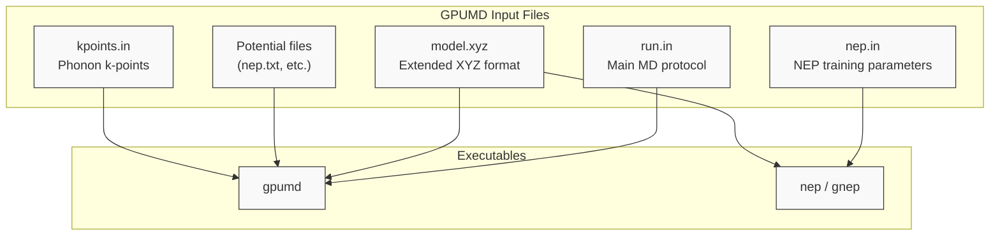
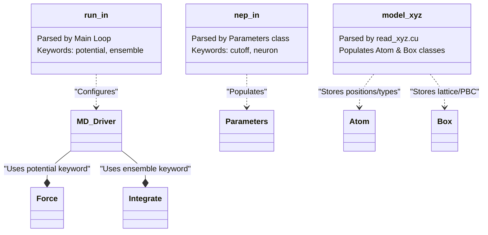

# Input File Reference

<details>
<summary>Relevant source files</summary>

The following files were used as context for generating this wiki page:

- [doc/bibliography.rst](doc/bibliography.rst)
- [doc/glossary.rst](doc/glossary.rst)
- [doc/gpumd/input_files/eigenvector_in.rst](doc/gpumd/input_files/eigenvector_in.rst)
- [doc/gpumd/input_files/index.rst](doc/gpumd/input_files/index.rst)
- [doc/gpumd/input_files/model_xyz.rst](doc/gpumd/input_files/model_xyz.rst)
- [doc/gpumd/input_files/run_in.rst](doc/gpumd/input_files/run_in.rst)
- [doc/gpumd/input_parameters/add_efield.rst](doc/gpumd/input_parameters/add_efield.rst)
- [doc/gpumd/input_parameters/add_force.rst](doc/gpumd/input_parameters/add_force.rst)
- [doc/gpumd/input_parameters/dump_observer.rst](doc/gpumd/input_parameters/dump_observer.rst)
- [doc/gpumd/input_parameters/ensemble.rst](doc/gpumd/input_parameters/ensemble.rst)
- [doc/gpumd/input_parameters/index.rst](doc/gpumd/input_parameters/index.rst)
- [doc/gpumd/input_parameters/replicate.rst](doc/gpumd/input_parameters/replicate.rst)
- [doc/gpumd/input_parameters/velocity.rst](doc/gpumd/input_parameters/velocity.rst)
- [doc/gpumd/output_files/D_out.rst](doc/gpumd/output_files/D_out.rst)
- [doc/gpumd/output_files/dump_xyz.rst](doc/gpumd/output_files/dump_xyz.rst)
- [doc/gpumd/output_files/index.rst](doc/gpumd/output_files/index.rst)
- [doc/gpumd/output_files/observer_xyz.rst](doc/gpumd/output_files/observer_xyz.rst)
- [doc/nep/input_files/nep_in.rst](doc/nep/input_files/nep_in.rst)
- [doc/nep/input_parameters/atomic_v.rst](doc/nep/input_parameters/atomic_v.rst)
- [doc/nep/input_parameters/basis_size.rst](doc/nep/input_parameters/basis_size.rst)
- [doc/nep/input_parameters/index.rst](doc/nep/input_parameters/index.rst)
- [doc/nep/input_parameters/l_max.rst](doc/nep/input_parameters/l_max.rst)
- [doc/nep/input_parameters/lambda_1.rst](doc/nep/input_parameters/lambda_1.rst)
- [doc/nep/input_parameters/lambda_2.rst](doc/nep/input_parameters/lambda_2.rst)
- [doc/nep/input_parameters/lambda_q.rst](doc/nep/input_parameters/lambda_q.rst)
- [doc/nep/input_parameters/lambda_z.rst](doc/nep/input_parameters/lambda_z.rst)
- [doc/nep/input_parameters/n_max.rst](doc/nep/input_parameters/n_max.rst)
- [doc/nep/input_parameters/output_interval.rst](doc/nep/input_parameters/output_interval.rst)
- [doc/nep/input_parameters/prediction.rst](doc/nep/input_parameters/prediction.rst)
- [doc/nep/input_parameters/use_typewise_cutoff_zbl.rst](doc/nep/input_parameters/use_typewise_cutoff_zbl.rst)
- [doc/nep/input_parameters/version.rst](doc/nep/input_parameters/version.rst)
- [doc/nep/output_files/loss_out.rst](doc/nep/output_files/loss_out.rst)
- [doc/nep/output_files/nep_restart.rst](doc/nep/output_files/nep_restart.rst)
- [doc/potentials/nep.rst](doc/potentials/nep.rst)
- [doc/theory/ensembles.rst](doc/theory/ensembles.rst)
- [src/main_gpumd/replicate.cu](src/main_gpumd/replicate.cu)
- [src/main_gpumd/replicate.cuh](src/main_gpumd/replicate.cuh)
- [src/model/read_xyz.cu](src/model/read_xyz.cu)
- [src/model/read_xyz.cuh](src/model/read_xyz.cuh)

</details>


This document serves as a comprehensive reference guide for the input files used in the GPUMD (GPU-accelerated Molecular Dynamics) software package. GPUMD requires several input files to configure and execute both molecular dynamics simulations and neural network potential training. This page explains the structure, format, and purpose of each input file type.

## Input File Overview

GPUMD uses several types of input files to configure simulations and training sessions:



Sources: `doc/gpumd/input_files/run_in.rst` [1-10](), `doc/nep/input_files/nep_in.rst` [1-10](), `src/model/read_xyz.cu` [16-25]()

## Detailed Reference Pages

This is a high-level overview. For comprehensive keyword and parameter details, please see the following child pages:

*   **[GPUMD run.in Reference](#9.1)**: Detailed reference for all `run.in` keywords including `potential`, `ensemble`, `time_step`, `run`, `minimize`, and `compute_*` commands.
*   **[NEP nep.in Reference](#9.2)**: Detailed reference for `nep.in` parameters such as `type`, `cutoff`, `n_max`, `basis_size`, `neuron`, and regularization weights (`lambda_1`, `lambda_2`).

## Main Input Files

### The `run.in` File
The `run.in` file defines the MD simulation protocol. It contains sequential commands consisting of a keyword followed by parameters. 

**Key Categories:**
*   **Setup:** `potential`, `velocity`, `time_step`, `ensemble`.
*   **Actions:** `minimize`, `run`.
*   **Analysis:** `compute_rdf`, `compute_msd`, `compute_hac`, etc.
*   **Output:** `dump_thermo`, `dump_xyz`, `dump_restart`.

Sources: `doc/gpumd/input_parameters/index.rst` [10-92](), `doc/gpumd/input_files/run_in.rst` [1-20]()

### The `nep.in` File
The `nep.in` file specifies hyperparameters for training Neuroevolution Potential (NEP) models. Unlike `run.in`, keywords in `nep.in` can generally appear in any order, except for `type_weight` which must follow `type`.

**Mandatory Keywords:**
*   `type`: Number of atom types and the list of chemical species [doc/nep/input_files/nep_in.rst:39-40]().

**Example Snippet:**
```
type        2 Te Pb
version     4
cutoff      8 4
n_max       6 6
basis_size  6 6
l_max       4 1
neuron      30
```
Sources: `doc/nep/input_files/nep_in.rst` [12-81](), `doc/nep/input_parameters/index.rst` [10-45]()

### Model Configuration (`model.xyz`)
GPUMD uses an extended XYZ format. The file is read by `read_xyz.cu`.

| Line | Content |
| :--- | :--- |
| 1 | Number of atoms ($N \ge 2$) [src/model/read_xyz.cu:141-153]() |
| 2 | Lattice parameters, PBC (T/F), and property definitions [src/model/read_xyz.cu:155-230]() |
| 3 to N+2 | Atomic data: Species, positions ($x, y, z$), and optional properties (velocity, mass, charge) |

GPUMD includes a built-in `MASS_TABLE` for standard chemical elements to simplify model preparation [src/model/read_xyz.cu:36-139]().

Sources: `src/model/read_xyz.cu` [141-230](), `doc/gpumd/input_files/model_xyz.rst` [1-15]()

## Code Entity Mapping

The following diagram maps input file concepts to the specific code classes and files responsible for parsing and managing them.



Sources: `src/model/read_xyz.cu` [20-24](), `doc/nep/input_files/nep_in.rst` [85-91](), `doc/gpumd/input_parameters/ensemble.rst` [5-9]()

## Summary Table of Key Parameters

| File | Key Parameter | Role |
| :--- | :--- | :--- |
| `run.in` | `ensemble` | Sets the integrator (e.g., `nvt_ber`, `npt_scr`, `nve`) [doc/gpumd/input_parameters/ensemble.rst:5-18]() |
| `run.in` | `time_step` | Integration step in fs [doc/gpumd/input_parameters/index.rst:22]() |
| `nep.in` | `cutoff` | Sets radial and angular cutoffs for descriptors [doc/nep/input_files/nep_in.rst:51-52]() |
| `nep.in` | `lambda_1` | Weight of $L_1$ regularization in the loss function [doc/nep/input_parameters/lambda_1.rst:8-14]() |
| `kpoints.in` | `k-points` | Specifies points in Brillouin zone for phonon calculations [doc/gpumd/output_files/index.rst:108-111]() |

Sources: `doc/gpumd/input_parameters/ensemble.rst` [5-18](), `doc/nep/input_files/nep_in.rst` [51-52](), `doc/nep/input_parameters/lambda_1.rst` [8-14]()

---