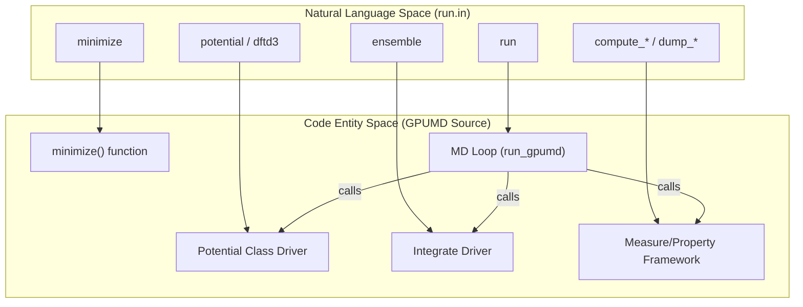
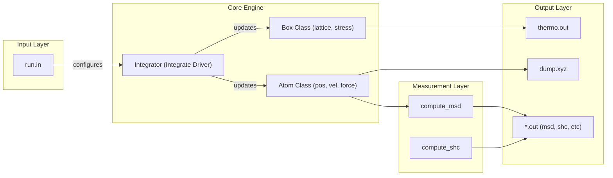

# GPUMD run.in Reference

Relevant source files

The following files were used as context for generating this wiki page:

- [doc/bibliography.rst](doc/bibliography.rst)
- [doc/glossary.rst](doc/glossary.rst)
- [doc/gpumd/input_files/run_in.rst](doc/gpumd/input_files/run_in.rst)
- [doc/gpumd/input_parameters/active.rst](doc/gpumd/input_parameters/active.rst)
- [doc/gpumd/input_parameters/change_box.rst](doc/gpumd/input_parameters/change_box.rst)
- [doc/gpumd/input_parameters/compute.rst](doc/gpumd/input_parameters/compute.rst)
- [doc/gpumd/input_parameters/compute_angular_rdf.rst](doc/gpumd/input_parameters/compute_angular_rdf.rst)
- [doc/gpumd/input_parameters/compute_cohesive.rst](doc/gpumd/input_parameters/compute_cohesive.rst)
- [doc/gpumd/input_parameters/compute_dos.rst](doc/gpumd/input_parameters/compute_dos.rst)
- [doc/gpumd/input_parameters/compute_elastic.rst](doc/gpumd/input_parameters/compute_elastic.rst)
- [doc/gpumd/input_parameters/compute_gkma.rst](doc/gpumd/input_parameters/compute_gkma.rst)
- [doc/gpumd/input_parameters/compute_hac.rst](doc/gpumd/input_parameters/compute_hac.rst)
- [doc/gpumd/input_parameters/compute_hnema.rst](doc/gpumd/input_parameters/compute_hnema.rst)
- [doc/gpumd/input_parameters/compute_hnemd.rst](doc/gpumd/input_parameters/compute_hnemd.rst)
- [doc/gpumd/input_parameters/compute_msd.rst](doc/gpumd/input_parameters/compute_msd.rst)
- [doc/gpumd/input_parameters/compute_shc.rst](doc/gpumd/input_parameters/compute_shc.rst)
- [doc/gpumd/input_parameters/deform.rst](doc/gpumd/input_parameters/deform.rst)
- [doc/gpumd/input_parameters/dump_observer.rst](doc/gpumd/input_parameters/dump_observer.rst)
- [doc/gpumd/input_parameters/electron_stop.rst](doc/gpumd/input_parameters/electron_stop.rst)
- [doc/gpumd/input_parameters/ensemble.rst](doc/gpumd/input_parameters/ensemble.rst)
- [doc/gpumd/input_parameters/fix.rst](doc/gpumd/input_parameters/fix.rst)
- [doc/gpumd/input_parameters/index.rst](doc/gpumd/input_parameters/index.rst)
- [doc/gpumd/input_parameters/mc.rst](doc/gpumd/input_parameters/mc.rst)
- [doc/gpumd/input_parameters/move.rst](doc/gpumd/input_parameters/move.rst)
- [doc/gpumd/output_files/active_out.rst](doc/gpumd/output_files/active_out.rst)
- [doc/gpumd/output_files/active_xyz.rst](doc/gpumd/output_files/active_xyz.rst)
- [doc/gpumd/output_files/angular_rdf_out.rst](doc/gpumd/output_files/angular_rdf_out.rst)
- [doc/gpumd/output_files/dos_out.rst](doc/gpumd/output_files/dos_out.rst)
- [doc/gpumd/output_files/dump_xyz.rst](doc/gpumd/output_files/dump_xyz.rst)
- [doc/gpumd/output_files/index.rst](doc/gpumd/output_files/index.rst)
- [doc/gpumd/output_files/lsqt_dos_out.rst](doc/gpumd/output_files/lsqt_dos_out.rst)
- [doc/gpumd/output_files/lsqt_sigma_out.rst](doc/gpumd/output_files/lsqt_sigma_out.rst)
- [doc/gpumd/output_files/lsqt_velocity_out.rst](doc/gpumd/output_files/lsqt_velocity_out.rst)
- [doc/gpumd/output_files/msd_out.rst](doc/gpumd/output_files/msd_out.rst)
- [doc/gpumd/output_files/observer_out.rst](doc/gpumd/output_files/observer_out.rst)
- [doc/gpumd/output_files/observer_xyz.rst](doc/gpumd/output_files/observer_xyz.rst)
- [doc/gpumd/output_files/shc_out.rst](doc/gpumd/output_files/shc_out.rst)
- [doc/theory/ensembles.rst](doc/theory/ensembles.rst)
- [src/main_gpumd/cohesive.cuh](src/main_gpumd/cohesive.cuh)

The `run.in` file is the central simulation protocol for GPUMD. It defines the sequence of operations, potential models, integration methods, and measurement parameters. The GPUMD executable parses this file line-by-line, executing some commands immediately and storing others to be propagated through subsequent simulation runs [doc/gpumd/input_files/run_in.rst:9-14]().

## 1. Execution Model and File Structure

GPUMD follows a sequential execution model where keywords are processed in the order they appear. Lines starting with `#` and blank lines are ignored [doc/gpumd/input_files/run_in.rst:12-13]().

### Keyword Classification
Keywords are categorized by their behavior regarding immediate execution and propagation:
*   **Immediate Execution (Exec.)**: The command is performed as soon as the parser encounters it (e.g., `potential`, `minimize`, `velocity`) [doc/gpumd/input_files/run_in.rst:52-67]().
*   **Propagation (Prop.)**: The settings persist across multiple `run` commands until explicitly changed (e.g., `time_step`) [doc/gpumd/input_files/run_in.rst:80-83]().

### Code Mapping: Input Parsing to Simulation Flow
The following diagram maps the logical `run.in` keywords to the internal simulation flow and the data structures involved in the GPUMD execution loop.

**Simulation Flow and Entity Mapping**

**Sources:** [doc/gpumd/input_files/run_in.rst:40-189](), [doc/gpumd/input_parameters/index.rst:8-91]()

---

## 2. Setup and Initialization Keywords

### potential
Defines the interatomic potential model. For NEP models, multiple potentials can be loaded to enable "observe" or "average" modes via `dump_observer` [doc/gpumd/input_files/run_in.rst:22-23]().

### velocity
Sets initial atomic velocities, typically corresponding to a specific temperature [doc/gpumd/input_files/run_in.rst:52-55]().

### time_step
Specifies the integration time step $\Delta t$ in femtoseconds. This is a propagated keyword [doc/gpumd/input_files/run_in.rst:80-83]().

### deform
Used for tensile tests by deforming the simulation box at a specified rate [doc/gpumd/input_parameters/deform.rst:5-8]().
*   **4-parameter form**: `deform <A_per_step> <deform_x> <deform_y> <deform_z>` [doc/gpumd/input_parameters/deform.rst:15-17]().
*   **6-parameter form**: `deform <Ax> <Ay> <Az> <def_x> <def_y> <def_z>` [doc/gpumd/input_parameters/deform.rst:27-29]().
*   **Constraint**: Must be used with an NPT ensemble to control pressure in non-deformed directions [doc/gpumd/input_parameters/deform.rst:66-67]().

**Sources:** [doc/gpumd/input_files/run_in.rst:52-83](), [doc/gpumd/input_parameters/deform.rst:1-72]()

---

## 3. Integration and Ensembles

The `ensemble` keyword selects the integrator. GPUMD supports a wide range of thermodynamic ensembles and specialized integrators for transport properties [doc/gpumd/input_parameters/ensemble.rst:5-17]().

### Standard Ensembles
*   **NVE**: Constant number of atoms, volume, and energy.
*   **NVT**: Constant temperature using Berendsen, NHC, or BDP (Stochastic Velocity Rescaling) [doc/glossary.rst:20-21](), [doc/glossary.rst:92-93]().
*   **NPT**: Constant pressure using Berendsen or SCR (Stochastic Cell Rescaling) [doc/glossary.rst:116-117]().

### Integration Parameters
*   **Temperature Coupling (`T_coup`)**: $\tau_T/\Delta t$. Recommended value $\approx 100$ [doc/gpumd/input_parameters/ensemble.rst:27-28]().
*   **Pressure Coupling (`p_coup`)**: $\tau_p/\Delta t$. Recommended value $\approx 1000$ [doc/gpumd/input_parameters/ensemble.rst:32-33]().

**Sources:** [doc/gpumd/input_parameters/ensemble.rst:1-40](), [doc/glossary.rst:83-117]()

---

## 4. Actions and Measurement Keywords

### run
Executes the simulation for a specified number of steps using the current integrator and measurement settings [doc/gpumd/input_files/run_in.rst:99-102]().

### minimize
Performs energy minimization (structural relaxation) using algorithms like FIRE or Steepest Descent [doc/gpumd/input_files/run_in.rst:95-98]().

### compute_* Commands
These keywords initiate the calculation of physical properties during the MD run.

| Keyword | Property | Output File |
| :--- | :--- | :--- |
| `compute_hac` | Thermal conductivity (EMD/Green-Kubo) | `hac.out` |
| `compute_hnemd` | Thermal conductivity (Non-equilibrium) | `kappa.out` |
| `compute_msd` | Mean-square displacement / Diffusion | `msd.out` |
| `compute_shc` | Spectral heat current | `shc.out` |
| `compute_angular_rdf` | Angular-dependent RDF | `angular_rdf.out` |

**Sources:** [doc/gpumd/output_files/index.rst:7-151](), [doc/gpumd/input_parameters/compute_shc.rst:5-10](), [doc/gpumd/input_parameters/compute_angular_rdf.rst:5-10]()

---

## 5. Monte Carlo and Active Learning

### mc
Enables Monte Carlo trial steps, typically interleaved with MD steps. This keyword is exclusively available for NEP models [doc/gpumd/input_parameters/mc.rst:5-11]().
*   **Canonical**: `mc canonical <md_steps> <mc_trials> <Ti> <Tf>` [doc/gpumd/input_parameters/mc.rst:16-21]().
*   **Semi-Grand Canonical (SGC)**: Used for multicomponent systems with chemical potential $\mu$ [doc/gpumd/input_parameters/mc.rst:25-30]().
*   **Variance-Constrained SGC (VCSGC)**: Constrains species concentration variance using parameter $\kappa$ [doc/gpumd/input_parameters/mc.rst:40-45]().

### active
Initiates on-the-fly active learning. It saves structures that exceed a force uncertainty threshold to `active.xyz` for further training [doc/gpumd/input_files/run_in.rst:166-169]().

**Sources:** [doc/gpumd/input_parameters/mc.rst:1-111](), [doc/gpumd/output_files/index.rst:36-43]()

---

## 6. Output and Dumping

### dump_xyz
Writes per-atom data (positions, velocities, forces) in extended XYZ format [doc/gpumd/input_files/run_in.rst:186-189]().

### dump_observer
A specialized NEP output command for multi-potential simulations [doc/gpumd/input_parameters/dump_observer.rst:5-8]().
*   **observe mode**: Propagates MD with the first potential while evaluating others at specified intervals [doc/gpumd/input_parameters/dump_observer.rst:10-15]().
*   **average mode**: Evaluates all potentials and uses the averaged force/energy to propagate MD [doc/gpumd/input_parameters/dump_observer.rst:17-18]().

**Sources:** [doc/gpumd/input_parameters/dump_observer.rst:1-67](), [doc/gpumd/output_files/index.rst:24-35]()

---

## 7. Data Flow Architecture

The diagram below illustrates how keywords in `run.in` drive the internal state of the `Atom` and `Box` classes and how that data flows into output files.

**Data Flow from run.in to Output**

**Sources:** [doc/gpumd/input_files/run_in.rst:20-35](), [doc/gpumd/output_files/index.rst:7-151](), [doc/gpumd/input_parameters/compute_msd.rst:5-10]()

---