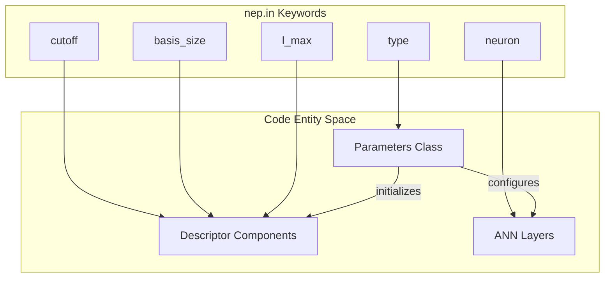
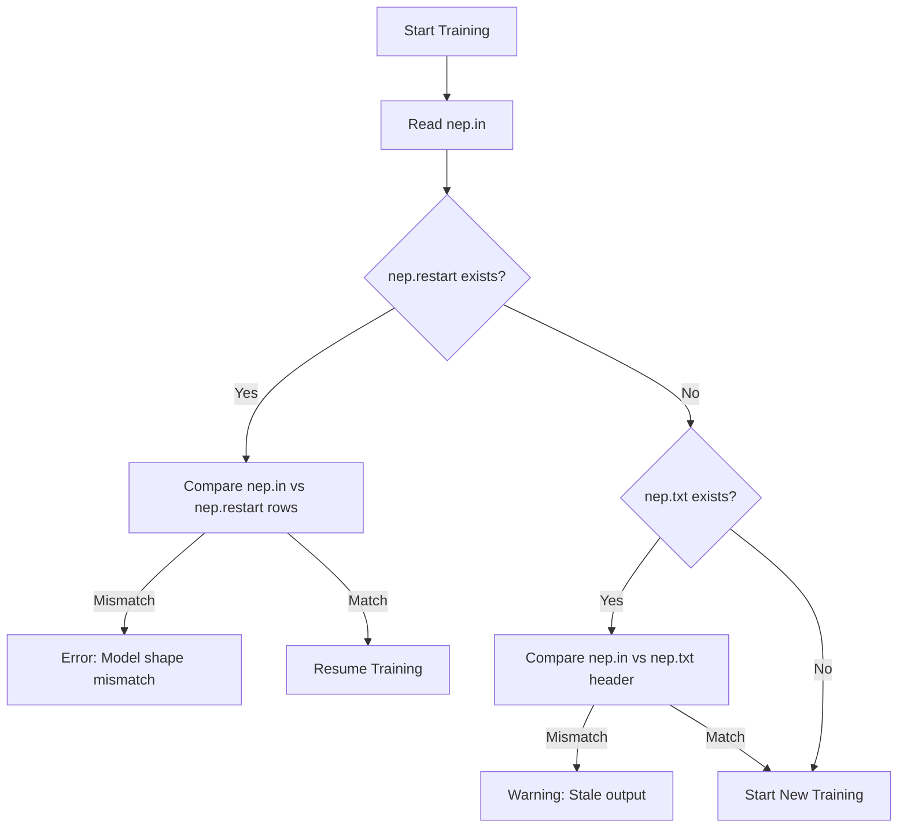

# NEP nep.in Reference

Relevant source files

The following files were used as context for generating this wiki page:

- [doc/nep/input_files/nep_in.rst](doc/nep/input_files/nep_in.rst)
- [doc/nep/input_parameters/atomic_v.rst](doc/nep/input_parameters/atomic_v.rst)
- [doc/nep/input_parameters/basis_size.rst](doc/nep/input_parameters/basis_size.rst)
- [doc/nep/input_parameters/cutoff.rst](doc/nep/input_parameters/cutoff.rst)
- [doc/nep/input_parameters/fine_tune.rst](doc/nep/input_parameters/fine_tune.rst)
- [doc/nep/input_parameters/import_q_scaler.rst](doc/nep/input_parameters/import_q_scaler.rst)
- [doc/nep/input_parameters/index.rst](doc/nep/input_parameters/index.rst)
- [doc/nep/input_parameters/l_max.rst](doc/nep/input_parameters/l_max.rst)
- [doc/nep/input_parameters/lambda_1.rst](doc/nep/input_parameters/lambda_1.rst)
- [doc/nep/input_parameters/lambda_2.rst](doc/nep/input_parameters/lambda_2.rst)
- [doc/nep/input_parameters/lambda_q.rst](doc/nep/input_parameters/lambda_q.rst)
- [doc/nep/input_parameters/lambda_z.rst](doc/nep/input_parameters/lambda_z.rst)
- [doc/nep/input_parameters/n_max.rst](doc/nep/input_parameters/n_max.rst)
- [doc/nep/input_parameters/neuron.rst](doc/nep/input_parameters/neuron.rst)
- [doc/nep/input_parameters/output_interval.rst](doc/nep/input_parameters/output_interval.rst)
- [doc/nep/input_parameters/prediction.rst](doc/nep/input_parameters/prediction.rst)
- [doc/nep/input_parameters/type.rst](doc/nep/input_parameters/type.rst)
- [doc/nep/input_parameters/use_typewise_cutoff_zbl.rst](doc/nep/input_parameters/use_typewise_cutoff_zbl.rst)
- [doc/nep/input_parameters/version.rst](doc/nep/input_parameters/version.rst)
- [doc/nep/input_parameters/zbl.rst](doc/nep/input_parameters/zbl.rst)
- [doc/nep/output_files/energy_out.rst](doc/nep/output_files/energy_out.rst)
- [doc/nep/output_files/force_out.rst](doc/nep/output_files/force_out.rst)
- [doc/nep/output_files/loss_out.rst](doc/nep/output_files/loss_out.rst)
- [doc/nep/output_files/nep_restart.rst](doc/nep/output_files/nep_restart.rst)
- [doc/potentials/nep.rst](doc/potentials/nep.rst)
- [potentials/nep/nep89_20250409/nep.in](potentials/nep/nep89_20250409/nep.in)
- [potentials/nep/nep89_20250409/nep89_20250409.restart](potentials/nep/nep89_20250409/nep89_20250409.restart)
- [potentials/nep/nep89_20250409/nep89_20250409.txt](potentials/nep/nep89_20250409/nep89_20250409.txt)

The `nep.in` file is the primary configuration file for training Neuroevolution Potentials (NEP) using the `nep` or `gnep` executables [doc/nep/input_files/nep_in.rst:5-11](). It defines the hyperparameters for the descriptor, the neural network architecture, and the optimization process [doc/nep/input_files/nep_in.rst:18-26]().

## System Architecture: Input to Model
The `nep.in` file is parsed by the `Parameters` class, which initializes the model dimensions and training weights. These parameters are then used to construct the descriptors and the neural network layers.

### Data Flow and Code Entity Mapping
The following diagram maps the high-level keywords in `nep.in` to the underlying code entities and data structures.

**NEP Configuration to Code Mapping**

**Sources:** [doc/nep/input_files/nep_in.rst:30-81](), [doc/potentials/nep.rst:13-29]()

## Keyword Reference

### Model Definition & Versioning
*   **version**: Selects the NEP version. Currently, NEP4 is the standard supported version, while NEP1-3 are deprecated [doc/nep/input_parameters/version.rst:1-13](), [doc/potentials/nep.rst:8-9]().
*   **type**: (Mandatory) Specifies the number of atom types and the list of chemical species [doc/nep/input_files/nep_in.rst:39-40]().
*   **prediction**: Toggles between training mode and inference/prediction mode [doc/nep/input_files/nep_in.rst:47-48]().

### Descriptor Hyperparameters
The descriptor consists of radial and angular components [doc/potentials/nep.rst:31-34]().

| Keyword | Description | Constraints / Defaults |
| :--- | :--- | :--- |
| **cutoff** | Radial ($r_c^R$) and angular ($r_c^A$) cutoffs [doc/nep/input_parameters/cutoff.rst:8-11](). | $3 \text{ Å} \leq r_c^A \leq r_c^R \leq 10 \text{ Å}$. Default: 8 4 [doc/nep/input_parameters/cutoff.rst:14-16](). |
| **n_max** | Max order of radial ($n_{max}^R$) and angular ($n_{max}^A$) basis [doc/nep/input_files/nep_in.rst:53-54](). | Default: 6 6 [doc/nep/input_files/nep_in.rst:117](). |
| **basis_size** | Number of basis functions ($N_{bas}^R, N_{bas}^A$) for descriptors [doc/nep/input_parameters/basis_size.rst:8-13](). | $0 \leq N_{bas} \leq 8$. Default: 6 6 [doc/nep/input_parameters/basis_size.rst:14-16](). |
| **l_max** | Expansion order for angular terms (3-body to 5-body) [doc/nep/input_parameters/l_max.rst:5-13](). | Default: 4 1 (3-body $l_{max}=4$, 4-body active) [doc/nep/input_parameters/l_max.rst:17-20](). |

### Neural Network Architecture
*   **neuron**: Sets the number of neurons ($N_{neu}$) in the single hidden layer [doc/nep/input_files/nep_in.rst:59-60](). The site energy is calculated as a function of the descriptor vector through this layer using a $\tanh$ activation function [doc/potentials/nep.rst:22-28](). Default is 30 [doc/nep/input_files/nep_in.rst:120]().

### Loss Function Weights
The loss function $L(\boldsymbol{z})$ is a weighted sum of energy, force, virial, and regularization terms [doc/potentials/nep.rst:140-155]().

*   **lambda_e**: Weight for energy loss [doc/nep/input_files/nep_in.rst:65-66]().
*   **lambda_f**: Weight for force loss [doc/nep/input_files/nep_in.rst:67-68]().
*   **lambda_v**: Weight for virial loss [doc/nep/input_files/nep_in.rst:69-70]().
*   **lambda_1 / lambda_2**: Weights for $\mathcal{L}_1$ and $\mathcal{L}_2$ regularization [doc/nep/input_parameters/lambda_1.rst:8-14](), [doc/nep/input_parameters/lambda_2.rst:8-14]().

### Optimization Control
*   **batch**: Mini-batch size for training [doc/nep/input_files/nep_in.rst:75-76]().
*   **population**: Population size for the Separable Natural Evolution Strategy (SNES) [doc/nep/input_files/nep_in.rst:77-78]().
*   **generation**: Total number of generations for training [doc/nep/input_files/nep_in.rst:79-80]().

### ZBL Correction
*   **zbl**: Sets the outer cutoff for the universal Ziegler-Biersack-Littmark (ZBL) potential to handle short-range repulsions [doc/nep/input_files/nep_in.rst:49-50]().
*   **use_typewise_cutoff_zbl**: Enables species-specific ZBL cutoffs based on covalent radii [doc/nep/input_parameters/use_typewise_cutoff_zbl.rst:5-15]().

## Training Lifecycle and Consistency
When starting a training run, the `nep` executable checks for existing `nep.txt` and `nep.restart` files in the directory [doc/nep/input_files/nep_in.rst:82-85]().

**Consistency Check Workflow**

**Sources:** [doc/nep/input_files/nep_in.rst:89-108](), [doc/nep/output_files/nep_restart.rst:8-20]()

## Advanced Training Features
*   **fine_tune**: Specifies a foundation model to be used for transfer learning. The model shape in `nep.in` must match the foundation model [doc/nep/input_files/nep_in.rst:108]().
*   **import_q_scaler**: Imports descriptor scaling factors from a previous run to ensure consistency in active learning or fine-tuning [doc/nep/input_files/nep_in.rst:108]().
*   **atomic_v**: Determines whether to fit global or atomic tensors for dipole/polarizability models [doc/nep/input_parameters/atomic_v.rst:8-20]().

**Sources:** [doc/nep/input_files/nep_in.rst:1-129](), [doc/potentials/nep.rst:1-156](), [doc/nep/input_parameters/l_max.rst:1-26](), [doc/nep/input_parameters/basis_size.rst:1-18](), [doc/nep/input_parameters/cutoff.rst:1-28]()

---