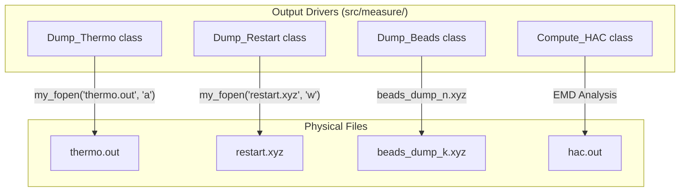
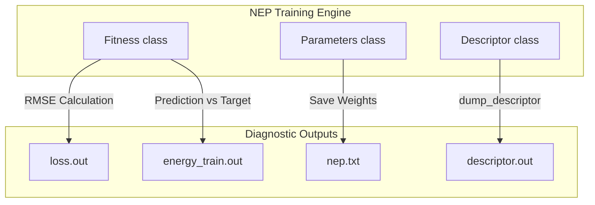

# Output File Reference

Relevant source files

The following files were used as context for generating this wiki page:

- [doc/bibliography.rst](doc/bibliography.rst)
- [doc/glossary.rst](doc/glossary.rst)
- [doc/gpumd/input_files/run_in.rst](doc/gpumd/input_files/run_in.rst)
- [doc/gpumd/input_parameters/dump_dipole.rst](doc/gpumd/input_parameters/dump_dipole.rst)
- [doc/gpumd/input_parameters/dump_observer.rst](doc/gpumd/input_parameters/dump_observer.rst)
- [doc/gpumd/input_parameters/dump_polarizability.rst](doc/gpumd/input_parameters/dump_polarizability.rst)
- [doc/gpumd/input_parameters/ensemble.rst](doc/gpumd/input_parameters/ensemble.rst)
- [doc/gpumd/input_parameters/ensemble_heat.rst](doc/gpumd/input_parameters/ensemble_heat.rst)
- [doc/gpumd/input_parameters/ensemble_pimd.rst](doc/gpumd/input_parameters/ensemble_pimd.rst)
- [doc/gpumd/input_parameters/ensemble_ttm.rst](doc/gpumd/input_parameters/ensemble_ttm.rst)
- [doc/gpumd/input_parameters/index.rst](doc/gpumd/input_parameters/index.rst)
- [doc/gpumd/output_files/compute_out.rst](doc/gpumd/output_files/compute_out.rst)
- [doc/gpumd/output_files/dipole_out.rst](doc/gpumd/output_files/dipole_out.rst)
- [doc/gpumd/output_files/dump_xyz.rst](doc/gpumd/output_files/dump_xyz.rst)
- [doc/gpumd/output_files/index.rst](doc/gpumd/output_files/index.rst)
- [doc/gpumd/output_files/observer_xyz.rst](doc/gpumd/output_files/observer_xyz.rst)
- [doc/gpumd/output_files/polarizability_out.rst](doc/gpumd/output_files/polarizability_out.rst)
- [doc/gpumd/output_files/ttm_electron_temperature_out.rst](doc/gpumd/output_files/ttm_electron_temperature_out.rst)
- [doc/nep/input_parameters/index.rst](doc/nep/input_parameters/index.rst)
- [doc/nep/input_parameters/lambda_q.rst](doc/nep/input_parameters/lambda_q.rst)
- [doc/nep/input_parameters/lambda_z.rst](doc/nep/input_parameters/lambda_z.rst)
- [doc/nep/input_parameters/output_descriptor.rst](doc/nep/input_parameters/output_descriptor.rst)
- [doc/nep/input_parameters/output_interval.rst](doc/nep/input_parameters/output_interval.rst)
- [doc/nep/input_parameters/prediction.rst](doc/nep/input_parameters/prediction.rst)
- [doc/nep/output_files/descriptor_out.rst](doc/nep/output_files/descriptor_out.rst)
- [doc/nep/output_files/dipole_out.rst](doc/nep/output_files/dipole_out.rst)
- [doc/nep/output_files/index.rst](doc/nep/output_files/index.rst)
- [doc/nep/output_files/loss_out.rst](doc/nep/output_files/loss_out.rst)
- [doc/nep/output_files/nep_restart.rst](doc/nep/output_files/nep_restart.rst)
- [doc/nep/output_files/polarizability_out.rst](doc/nep/output_files/polarizability_out.rst)
- [doc/theory/ensembles.rst](doc/theory/ensembles.rst)
- [src/measure/dump_beads.cu](src/measure/dump_beads.cu)
- [src/measure/dump_beads.cuh](src/measure/dump_beads.cuh)
- [src/measure/dump_restart.cu](src/measure/dump_restart.cu)
- [src/measure/dump_restart.cuh](src/measure/dump_restart.cuh)
- [src/measure/dump_thermo.cu](src/measure/dump_thermo.cu)
- [src/measure/dump_thermo.cuh](src/measure/dump_thermo.cuh)

This page provides a high-level overview of the output files generated by the GPUMD package, including the main molecular dynamics engine (`gpumd`) and the neuroevolution potential training tools (`nep` and `gnep`). Detailed formatting and field descriptions are provided in the child pages.

## GPUMD Simulation Outputs

The `gpumd` executable generates a variety of files depending on the keywords used in the `run.in` file. These outputs range from global thermodynamic data to per-atom trajectories and specialized transport property correlations.

### Core Thermodynamic and Trajectory Files
*   **`thermo.out`**: Contains global quantities like temperature, kinetic energy, potential energy, pressure tensor components, and box dimensions [src/measure/dump_thermo.cu:60-70](). It is generated via the `dump_thermo` keyword [src/measure/dump_thermo.cu:30-34]().
*   **`dump.xyz`**: The primary trajectory file in extended XYZ format, containing per-atom data such as positions, velocities, and forces [doc/gpumd/output_files/index.rst:24-27]().
*   **`restart.xyz`**: A specialized XYZ file containing all information (positions, velocities, masses, groups) needed to restart a simulation [src/measure/dump_restart.cu:85-114]().

### Transport and Spectral Properties
GPUMD is heavily optimized for thermal transport analysis. Key output files include:
*   **`hac.out`**: Heat current auto-correlation data for Green-Kubo (EMD) calculations [doc/gpumd/output_files/index.rst:60-63]().
*   **`kappa.out`**: Thermal conductivity results from HNEMD simulations [doc/gpumd/output_files/index.rst:64-67]().
*   **`shc.out`**: Spectral heat current data for frequency-domain analysis [doc/gpumd/output_files/index.rst:68-71]().
*   **`dos.out` / `mvac.out`**: Phonon density of states and mass-weighted velocity auto-correlation [doc/gpumd/output_files/index.rst:80-83]().

For a complete list of all 30+ specialized GPUMD output files, see **[GPUMD Output Files](#10.1)**.

---

## NEP Training Outputs

The `nep` and `gnep` executables generate files related to the machine-learning potential training process, including loss evolution, model parameters, and accuracy benchmarks.

### Training Progress and Model Files
*   **`loss.out`**: Records the loss function components, regularization terms, and RMSE (Root Mean Square Error) for energy, force, and virials at each generation [doc/nep/output_files/index.rst:22-23]().
*   **`nep.txt`**: The final trained model file containing the neural network weights and descriptor parameters [doc/nep/output_files/index.rst:24-25]().
*   **`nep.restart`**: Binary or text file used to resume an interrupted training session [doc/nep/output_files/index.rst:26-27]().

### Validation and Prediction Files
*   **`energy_train.out` / `force_train.out`**: Comparison between target DFT values and NEP-predicted values for the training set [doc/nep/output_files/index.rst:28-35]().
*   **`descriptor.out`**: The raw descriptor values for the training set, useful for dimensionality reduction or visualization [doc/nep/output_files/index.rst:60-61]().
*   **`dipole.out` / `polarizability.out`**: Outputs specific to Tensorial NEP models (TNEP) for IR and Raman spectra [doc/nep/output_files/index.rst:44-51]().

For detailed column descriptions of training outputs, see **[NEP Output Files](#10.2)**.

---

## Code Entity to System Mapping

The following diagrams illustrate how internal C++ classes and CUDA kernels relate to the generation of specific output files.

### Output Generation Architecture
This diagram shows the relationship between the `Measure` framework and the resulting files.

Sources: [src/measure/dump_thermo.cu:59-60](), [src/measure/dump_restart.cu:85-86](), [src/measure/dump_beads.cu:89-91]()

### NEP Output Lifecycle
This diagram maps the training components to their respective diagnostic files.

Sources: [doc/nep/output_files/index.rst:22-61](), [doc/nep/input_parameters/index.rst:39-41]()

---

## Summary Table of Key Outputs

| File Category | Key Files | Generating Keyword |
| :--- | :--- | :--- |
| **MD Thermo** | `thermo.out` | `dump_thermo` |
| **Trajectories** | `dump.xyz`, `restart.xyz` | `dump_xyz`, `dump_restart` |
| **Thermal** | `kappa.out`, `hac.out`, `shc.out` | `compute_hnemd`, `compute_hac`, `compute_shc` |
| **Quantum** | `beads_dump_*.xyz` | `dump_beads` (PIMD only) |
| **NEP Training** | `loss.out`, `nep.txt` | `nep` executable |
| **NEP Accuracy** | `force_train.out`, `energy_train.out` | `nep` executable |

Sources: [doc/gpumd/output_files/index.rst:7-151](), [doc/nep/output_files/index.rst:15-61]()

---