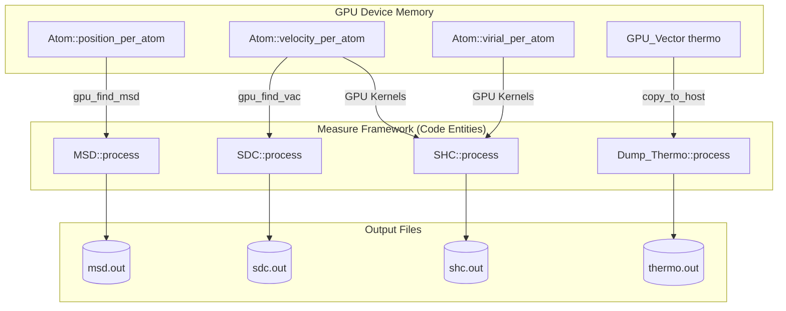
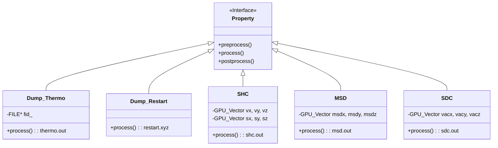

# GPUMD Output Files

Relevant source files

The following files were used as context for generating this wiki page:

- [Dockerfile](Dockerfile)
- [doc/conf.py](doc/conf.py)
- [doc/gpumd/input_parameters/compute_viscosity.rst](doc/gpumd/input_parameters/compute_viscosity.rst)
- [doc/gpumd/input_parameters/ensemble_heat.rst](doc/gpumd/input_parameters/ensemble_heat.rst)
- [doc/gpumd/input_parameters/ensemble_pimd.rst](doc/gpumd/input_parameters/ensemble_pimd.rst)
- [doc/gpumd/input_parameters/ensemble_ttm.rst](doc/gpumd/input_parameters/ensemble_ttm.rst)
- [doc/gpumd/output_files/compute_out.rst](doc/gpumd/output_files/compute_out.rst)
- [doc/gpumd/output_files/heatmode_out.rst](doc/gpumd/output_files/heatmode_out.rst)
- [doc/gpumd/output_files/kappamode_out.rst](doc/gpumd/output_files/kappamode_out.rst)
- [doc/gpumd/output_files/ttm_electron_temperature_out.rst](doc/gpumd/output_files/ttm_electron_temperature_out.rst)
- [doc/gpumd/output_files/viscosity_out.rst](doc/gpumd/output_files/viscosity_out.rst)
- [doc/index.rst](doc/index.rst)
- [doc/installation.rst](doc/installation.rst)
- [doc/nep/input_parameters/type_weight.rst](doc/nep/input_parameters/type_weight.rst)
- [doc/publications.bib](doc/publications.bib)
- [doc/publications.rst](doc/publications.rst)
- [src/measure/dos.cu](src/measure/dos.cu)
- [src/measure/dos.cuh](src/measure/dos.cuh)
- [src/measure/dump_beads.cu](src/measure/dump_beads.cu)
- [src/measure/dump_beads.cuh](src/measure/dump_beads.cuh)
- [src/measure/dump_restart.cu](src/measure/dump_restart.cu)
- [src/measure/dump_restart.cuh](src/measure/dump_restart.cuh)
- [src/measure/dump_thermo.cu](src/measure/dump_thermo.cu)
- [src/measure/dump_thermo.cuh](src/measure/dump_thermo.cuh)
- [src/measure/msd.cu](src/measure/msd.cu)
- [src/measure/msd.cuh](src/measure/msd.cuh)
- [src/measure/parse_utilities.cu](src/measure/parse_utilities.cu)
- [src/measure/parse_utilities.cuh](src/measure/parse_utilities.cuh)
- [src/measure/sdc.cu](src/measure/sdc.cu)
- [src/measure/sdc.cuh](src/measure/sdc.cuh)
- [src/measure/shc.cu](src/measure/shc.cu)
- [src/measure/shc.cuh](src/measure/shc.cuh)

This page provides a technical reference for the output files generated by the GPUMD (Graphics Processing Units Molecular Dynamics) code. GPUMD produces a variety of plain-text and binary (NetCDF) files containing thermodynamic data, atomic trajectories, and transport properties calculated via the `Measure` framework.

## Overview of the Output System

The output system is managed by the `Property` base class and its various derived classes in the `src/measure/` directory. Each output command in the `run.in` file instantiates a specific class that handles three stages of the simulation lifecycle:
1.  **Preprocess**: Initializes file handles and allocates GPU/CPU memory buffers.
2.  **Process**: Samples data from the GPU at specified intervals during the MD loop.
3.  **Postprocess**: Performs final averaging, Fourier transforms (if applicable), and closes file handles.

### Data Flow for Measurements

The following diagram illustrates how data moves from the GPU simulation core to the output files.

**Diagram: Measurement Data Flow**

Sources: `[src/measure/dump_thermo.cu:73-132]()`, `[src/measure/shc.cu:162-210]()`, `[src/measure/msd.cu:89-149]()`, `[src/measure/sdc.cu:157-224]()`

---

## Standard Thermodynamic and Trajectory Files

### thermo.out
This file contains global thermodynamic properties. It is managed by the `Dump_Thermo` class `[src/measure/dump_thermo.cuh:30-34]()`.
*   **Format**: Plain text with a header identifying columns.
*   **Columns**: Temperature (T), Kinetic Energy (KE), Potential Energy (PE), Stress components ($s_{xx}, s_{yy}, s_{zz}, s_{yz}, s_{xz}, s_{xy}$), and Lattice vectors ($a, b, c$).
*   **Implementation**: Stress components are converted using `PRESSURE_UNIT_CONVERSION` before writing `[src/measure/dump_thermo.cu:112-117]()`.

### dump.xyz and restart.xyz
These files store atomic configurations. `restart.xyz` is a single-frame file used to resume simulations, managed by `Dump_Restart` `[src/measure/dump_restart.cu:31-35]()`.
*   **Data Layout**: Standard Extended XYZ format.
*   **Velocities**: Velocities are converted from GPUMD internal units to $\text{\AA/fs}$ using `1.0 / TIME_UNIT_CONVERSION` `[src/measure/dump_restart.cu:126-128]()`.
*   **Groups**: If grouping is defined, group IDs are appended to each atom line `[src/measure/dump_restart.cu:130-132]()`.

### NetCDF Outputs
GPUMD supports binary NetCDF output for large trajectories to reduce disk usage and improve I/O performance. This requires the `USE_NETCDF` flag during compilation `[doc/installation.rst:163-178]()`.

---

## Transport and Spectral Properties

GPUMD specializes in thermal transport calculations, resulting in several specific spectral and correlation outputs.

### shc.out (Spectral Heat Current)
Generated by the `SHC` class `[src/measure/shc.cuh:21-80]()`. It implements the homogeneous non-equilibrium molecular dynamics (HNEMD) method for spectral decomposition.
*   **Key Function**: `gpu_find_k` calculates the correlation between virial components and velocities `[src/measure/shc.cu:81-130]()`.
*   **Memory**: Uses `Nc` (correlation points) to store buffers of `vx`, `vy`, `vz` and `sx`, `sy`, `sz` `[src/measure/shc.cu:61-66]()`.

### msd.out and sdc.out
These files contain Mean-Square Displacement and Self-Diffusion Coefficients.
*   **MSD**: Calculated via `gpu_find_msd` kernel which computes $(x(t) - x(0))^2$ `[src/measure/msd.cu:89-101]()`.
*   **SDC**: Calculated via the Velocity Auto-Correlation (VAC) function using the `gpu_find_vac` kernel `[src/measure/sdc.cu:71-128]()`.

### dose.out (Density of States)
Managed by the `DOS` class `[src/measure/dos.cuh:27-80]()`.
*   **Method**: Computes the Mass-weighted Velocity AutoCorrelation (MVAC) function `[src/measure/dos.cu:16-25]()`.
*   **Processing**: The `DOS::process` function samples velocities and the `postprocess` stage performs a Fourier transform to obtain the phonon DOS `[src/measure/dos.cu:220-238]()`.

---

## Specialized Simulation Outputs

### beads_dump_k.xyz
For Path Integral Molecular Dynamics (PIMD), GPUMD outputs individual files for each bead.
*   **Class**: `Dump_Beads` `[src/measure/dump_beads.cuh:30-34]()`.
*   **Logic**: Iterates through `atom.number_of_beads` and writes separate files `beads_dump_0.xyz`, `beads_dump_1.xyz`, etc. `[src/measure/dump_beads.cu:88-91]()`.
*   **Options**: Can optionally include velocities and forces per bead `[src/measure/dump_beads.cu:54-70]()`.

---

## Implementation Summary

The following diagram maps the logical output files to their corresponding C++/CUDA implementation classes.

**Diagram: Output File to Class Mapping**

Sources: `[src/measure/dump_thermo.cuh:30-34]()`, `[src/measure/dump_restart.cuh:31-35]()`, `[src/measure/shc.cuh:21-80]()`, `[src/measure/msd.cuh:23-83]()`, `[src/measure/sdc.cuh:23-73]()`

### Units in Output Files
Unless otherwise specified in the file header, GPUMD uses the following units for outputs:
*   **Time**: Femtoseconds (fs) for `thermo.out` and trajectory files `[src/measure/dump_thermo.cu:63]()`.
*   **Energy**: eV.
*   **Force**: eV/$\text{\AA}$.
*   **Pressure/Stress**: GPa `[src/measure/dump_thermo.cu:112-117]()`.
*   **Distance**: $\text{\AA}$.
*   **Frequency**: THz `[src/measure/dos.cu:187]()`.

Sources: `[src/measure/dump_thermo.cu:1-143]()`, `[src/measure/msd.cu:1-240]()`, `[src/measure/sdc.cu:1-240]()`, `[src/measure/shc.cu:1-220]()`, `[src/measure/dump_restart.cu:1-152]()`, `[src/measure/dump_beads.cu:1-214]()`, `[doc/installation.rst:134-180]()`.

---