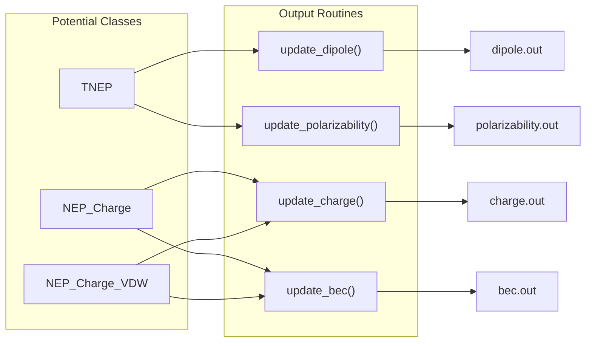

# NEP Output Files

<details>
<summary>Relevant source files</summary>

The following files were used as context for generating this wiki page:

- [doc/gpumd/input_parameters/dump_dipole.rst](doc/gpumd/input_parameters/dump_dipole.rst)
- [doc/gpumd/input_parameters/dump_polarizability.rst](doc/gpumd/input_parameters/dump_polarizability.rst)
- [doc/gpumd/output_files/dipole_out.rst](doc/gpumd/output_files/dipole_out.rst)
- [doc/gpumd/output_files/polarizability_out.rst](doc/gpumd/output_files/polarizability_out.rst)
- [doc/nep/input_files/train_test_xyz.rst](doc/nep/input_files/train_test_xyz.rst)
- [doc/nep/input_parameters/charge_mode.rst](doc/nep/input_parameters/charge_mode.rst)
- [doc/nep/input_parameters/index.rst](doc/nep/input_parameters/index.rst)
- [doc/nep/input_parameters/lambda_q.rst](doc/nep/input_parameters/lambda_q.rst)
- [doc/nep/input_parameters/lambda_z.rst](doc/nep/input_parameters/lambda_z.rst)
- [doc/nep/input_parameters/output_descriptor.rst](doc/nep/input_parameters/output_descriptor.rst)
- [doc/nep/input_parameters/output_interval.rst](doc/nep/input_parameters/output_interval.rst)
- [doc/nep/input_parameters/prediction.rst](doc/nep/input_parameters/prediction.rst)
- [doc/nep/output_files/bec_out.rst](doc/nep/output_files/bec_out.rst)
- [doc/nep/output_files/charge_out.rst](doc/nep/output_files/charge_out.rst)
- [doc/nep/output_files/descriptor_out.rst](doc/nep/output_files/descriptor_out.rst)
- [doc/nep/output_files/dipole_out.rst](doc/nep/output_files/dipole_out.rst)
- [doc/nep/output_files/index.rst](doc/nep/output_files/index.rst)
- [doc/nep/output_files/loss_out.rst](doc/nep/output_files/loss_out.rst)
- [doc/nep/output_files/nep_restart.rst](doc/nep/output_files/nep_restart.rst)
- [doc/nep/output_files/polarizability_out.rst](doc/nep/output_files/polarizability_out.rst)
- [doc/nep/output_files/stress_out.rst](doc/nep/output_files/stress_out.rst)
- [doc/nep/output_files/virial_out.rst](doc/nep/output_files/virial_out.rst)
- [src/main_nep/dataset.cu](src/main_nep/dataset.cu)
- [src/main_nep/dataset.cuh](src/main_nep/dataset.cuh)
- [src/main_nep/fitness.cu](src/main_nep/fitness.cu)
- [src/main_nep/fitness.cuh](src/main_nep/fitness.cuh)
- [src/main_nep/parameters.cu](src/main_nep/parameters.cu)
- [src/main_nep/parameters.cuh](src/main_nep/parameters.cuh)
- [src/main_nep/snes.cu](src/main_nep/snes.cu)
- [src/main_nep/snes.cuh](src/main_nep/snes.cuh)
- [src/main_nep/structure.cu](src/main_nep/structure.cu)
- [src/main_nep/structure.cuh](src/main_nep/structure.cuh)

</details>


This page provides a technical reference for the output files generated by the `nep` and `gnep` executables during the training and prediction phases of Neuroevolution Potentials (NEP). These files facilitate model monitoring, checkpointing, and evaluation of model accuracy against training/test datasets.

## Architecture and Data Flow

The generation of output files is managed primarily by the `Fitness` class [src/main_nep/fitness.cu:40-145](), which coordinates the evaluation of potential parameters against the training and test sets. During training, the `SNES` optimizer [src/main_nep/snes.cu:44-93]() or GNEP optimizer drives the evolution of parameters, and at intervals defined by the `output_interval` keyword in `nep.in` [src/main_nep/parameters.cu:112](), the `Fitness::report_error` method is invoked to update the output files.

### System to Code Entity Mapping

The following diagram maps the logical output categories to the specific C++ classes and functions responsible for writing them.

**NEP Output Generation Map**
```mermaid
graph TD
    subgraph "Logic Layer"
        [Parameters] --> |"output_interval"| [Fitness]
        [SNES] --> |"generation loop"| [Fitness]
    end

    subgraph "Code Entity Space"
        [Fitness] --> |"report_error()"| F1["loss.out"]
        [Fitness] --> |"update_energy_force_virial()"| F2["energy_train.out"]
        [Fitness] --> |"update_energy_force_virial()"| F3["force_train.out"]
        [Fitness] --> |"update_energy_force_virial()"| F4["virial_train.out"]
        [Fitness] --> |"update_charge()"| F5["charge.out"]
        [Fitness] --> |"update_bec()"| F6["bec.out"]
        [Fitness] --> |"write_nep_txt()"| F7["nep.txt"]
        [SNES] --> |"output_mu_and_sigma()"| F8["nep.restart"]
    end

    style F1 stroke-dasharray: 5 5
    style F7 stroke-dasharray: 5 5
```
**Sources:** [src/main_nep/fitness.cuh:26-71](), [src/main_nep/fitness.cu:200-330](), [src/main_nep/snes.cu:92-93]()

## Core Training Outputs

### loss.out
This file tracks the evolution of the loss function components over generations. It is opened in append mode during `Fitness` construction [src/main_nep/fitness.cu:143]().
*   **Columns**: Generation number, Total Loss, L1 Regularization, L2 Regularization, and RMSEs for Energy, Force, and Virial (if applicable).
*   **Implementation**: Written in `Fitness::report_error` [src/main_nep/fitness.cu:200-266]().

### nep.txt
The primary model file containing hyperparameters and the trained weights. It is written at intervals defined by `output_interval` [src/main_nep/parameters.cu:112]().
*   **Contents**: Version, number of types, element symbols, cutoffs, basis sizes, and the neural network weights (mu) [src/main_nep/fitness.cu:653-705]().
*   **Data Structure**: The header is managed by the `NepTxtHeader` struct [src/main_nep/parameters.cuh:22-54]().

### nep.restart
Used for resuming training. It stores the mean (`mu`) and step size (`sigma`) for every variable in the optimization space [src/main_nep/snes.cu:106-142]().
*   **Implementation**: Written by `SNES::output_mu_and_sigma` [src/main_nep/snes.cuh:80]().

## Dataset Accuracy Outputs

These files compare the predicted values from the current "elite" (best performing) individual in the population against the reference values provided in `train.xyz` and `test.xyz`.

| File | Physical Property | Method |
| :--- | :--- | :--- |
| `energy_train.out` | Total Energy (eV) | `Fitness::update_energy_force_virial` |
| `force_train.out` | Atomic Forces (eV/Å) | `Fitness::update_energy_force_virial` |
| `virial_train.out` | System Virial (eV) | `Fitness::update_energy_force_virial` |
| `stress_train.out` | System Stress (eV/ų) | `Fitness::update_energy_force_virial` |
| `descriptor.out` | Structural Descriptors | Enabled via `output_descriptor` |

**Sources:** [src/main_nep/fitness.cu:395-447](), [src/main_nep/parameters.cuh:109]()

## Specialized Model Outputs

When specialized models like `NEP_Charge` or `TNEP` are enabled via `nep.in` [src/main_nep/parameters.cu:119-121](), additional files are generated.

### Tensorial and Charge Outputs
*   **dipole.out**: Predicted vs. reference dipole vectors. Generated when `train_mode` is 1 [src/main_nep/fitness.cu:517-548]().
*   **polarizability.out**: Predicted vs. reference polarizability tensors. Generated when `train_mode` is 2 [src/main_nep/fitness.cu:550-584]().
*   **bec.out**: Predicted vs. reference Born Effective Charge tensors [src/main_nep/fitness.cu:483-515]().
*   **charge.out**: Predicted atomic charges. Used in `charge_mode` or `charge_vdw` [src/main_nep/fitness.cu:449-481]().

**Data Flow for Specialized Outputs**

**Sources:** [src/main_nep/fitness.cu:128-140](), [src/main_nep/fitness.cuh:66-69]()

## Implementation Details

### The `Fitness::output` Helper
Most comparison files (train/test accuracy) are generated using the `Fitness::output` helper function [src/main_nep/fitness.cu:340-366](). This function takes the predicted values (calculated on the GPU and copied to `Dataset::energy_cpu`, `force_cpu`, etc.) and the reference values (stored in `Dataset::energy_ref_cpu`, etc.) and writes them in two-column (or multi-column for tensors) format to the specified file handle.

### Atomic Virial
If `atomic_v` is set to 1 in `nep.in` [src/main_nep/parameters.cu:106](), the training process can output atomic-level virials to `virial_train.out` using `Fitness::output_atomic` [src/main_nep/fitness.cu:368-393]().

**Sources:** [src/main_nep/dataset.cuh:58-85](), [src/main_nep/fitness.cu:332-393]()

---