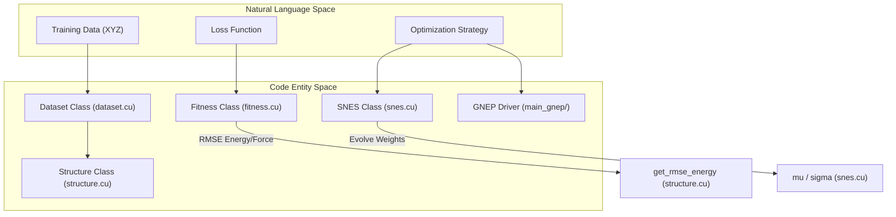
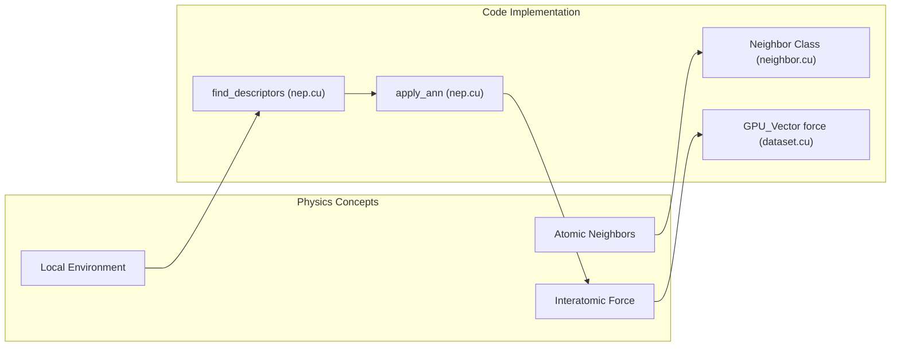

# Glossary

Relevant source files

The following files were used as context for generating this wiki page:

- [Dockerfile](Dockerfile)
- [README.md](README.md)
- [developers/readme.md](developers/readme.md)
- [doc/conf.py](doc/conf.py)
- [doc/gpumd/input_parameters/potential.rst](doc/gpumd/input_parameters/potential.rst)
- [doc/gpumd/output_files/heatmode_out.rst](doc/gpumd/output_files/heatmode_out.rst)
- [doc/gpumd/output_files/kappamode_out.rst](doc/gpumd/output_files/kappamode_out.rst)
- [doc/index.rst](doc/index.rst)
- [doc/installation.rst](doc/installation.rst)
- [doc/potentials/index.rst](doc/potentials/index.rst)
- [doc/potentials/nep_ilp.rst](doc/potentials/nep_ilp.rst)
- [doc/potentials/sw_ilp.rst](doc/potentials/sw_ilp.rst)
- [doc/potentials/tersoff_ilp.rst](doc/potentials/tersoff_ilp.rst)
- [doc/publications.bib](doc/publications.bib)
- [doc/publications.rst](doc/publications.rst)
- [src/force/ilp_nep.cu](src/force/ilp_nep.cu)
- [src/force/ilp_nep.cuh](src/force/ilp_nep.cuh)
- [src/force/neighbor.cu](src/force/neighbor.cu)
- [src/force/neighbor.cuh](src/force/neighbor.cuh)
- [src/force/nep.cu](src/force/nep.cu)
- [src/force/nep.cuh](src/force/nep.cuh)
- [src/force/nep_charge.cu](src/force/nep_charge.cu)
- [src/force/nep_charge.cuh](src/force/nep_charge.cuh)
- [src/force/nep_charge_small_box.cuh](src/force/nep_charge_small_box.cuh)
- [src/force/nep_multigpu.cu](src/force/nep_multigpu.cu)
- [src/force/nep_multigpu.cuh](src/force/nep_multigpu.cuh)
- [src/force/nep_small_box.cuh](src/force/nep_small_box.cuh)
- [src/force/pppm.cu](src/force/pppm.cu)
- [src/force/pppm.cuh](src/force/pppm.cuh)
- [src/integrate/ensemble.cu](src/integrate/ensemble.cu)
- [src/integrate/ensemble.cuh](src/integrate/ensemble.cuh)
- [src/integrate/ensemble_bdp.cu](src/integrate/ensemble_bdp.cu)
- [src/integrate/ensemble_bdp.cuh](src/integrate/ensemble_bdp.cuh)
- [src/integrate/ensemble_ber.cu](src/integrate/ensemble_ber.cu)
- [src/integrate/ensemble_ber.cuh](src/integrate/ensemble_ber.cuh)
- [src/integrate/ensemble_nhc.cu](src/integrate/ensemble_nhc.cu)
- [src/integrate/ensemble_nhc.cuh](src/integrate/ensemble_nhc.cuh)
- [src/integrate/ensemble_npt_scr.cu](src/integrate/ensemble_npt_scr.cu)
- [src/integrate/ensemble_npt_scr.cuh](src/integrate/ensemble_npt_scr.cuh)
- [src/integrate/ensemble_nve.cu](src/integrate/ensemble_nve.cu)
- [src/integrate/ensemble_nve.cuh](src/integrate/ensemble_nve.cuh)
- [src/integrate/integrate.cu](src/integrate/integrate.cu)
- [src/integrate/integrate.cuh](src/integrate/integrate.cuh)
- [src/main_nep/dataset.cu](src/main_nep/dataset.cu)
- [src/main_nep/dataset.cuh](src/main_nep/dataset.cuh)
- [src/main_nep/fitness.cu](src/main_nep/fitness.cu)
- [src/main_nep/fitness.cuh](src/main_nep/fitness.cuh)
- [src/main_nep/nep.cu](src/main_nep/nep.cu)
- [src/main_nep/nep.cuh](src/main_nep/nep.cuh)
- [src/main_nep/nep_charge.cu](src/main_nep/nep_charge.cu)
- [src/main_nep/nep_charge.cuh](src/main_nep/nep_charge.cuh)
- [src/main_nep/parameters.cu](src/main_nep/parameters.cu)
- [src/main_nep/parameters.cuh](src/main_nep/parameters.cuh)
- [src/main_nep/potential.cuh](src/main_nep/potential.cuh)
- [src/main_nep/snes.cu](src/main_nep/snes.cu)
- [src/main_nep/snes.cuh](src/main_nep/snes.cuh)
- [src/main_nep/structure.cu](src/main_nep/structure.cu)
- [src/main_nep/structure.cuh](src/main_nep/structure.cuh)
- [src/main_nep/tnep.cu](src/main_nep/tnep.cu)
- [src/main_nep/tnep.cuh](src/main_nep/tnep.cuh)
- [src/makefile](src/makefile)
- [src/makefile.hip](src/makefile.hip)
- [src/measure/extrapolation.cu](src/measure/extrapolation.cu)
- [src/measure/extrapolation.cuh](src/measure/extrapolation.cuh)
- [src/model/group.cu](src/model/group.cu)
- [src/utilities/gpu_macro.cuh](src/utilities/gpu_macro.cuh)
- [src/utilities/nep_utilities.cuh](src/utilities/nep_utilities.cuh)
- [src/utilities/read_file.cu](src/utilities/read_file.cu)
- [src/utilities/read_file.cuh](src/utilities/read_file.cuh)

This page provides definitions for codebase-specific terms, abbreviations, and domain concepts essential for navigating the GPUMD repository. It serves as a bridge between physical simulation theory and the specific C++/CUDA implementation details found in the source code.

## Core Domain Terms

### NEP (Neuroevolution Potential)
A machine-learned interatomic potential (MLP) that uses radial and angular descriptors to represent local atomic environments, which are then processed by an Artificial Neural Network (ANN) to predict site energies, forces, and virials.
*   **Implementation**: Defined in the `NEP` class [src/force/nep.cu:100-143]().
*   **Descriptors**: Includes radial components (Chebyshev basis) and angular components (spherical harmonics) [src/main_nep/nep.cu:34-154]().
*   **Versions**: Supports `nep3`, `nep4`, and `nep5` [src/force/nep.cu:113-124]().

### GNEP (Gradient-based NEP)
A training method for NEP models that utilizes analytical gradients of the loss function with respect to the ANN weights, typically optimized via the Adam optimizer. This is distinct from the evolutionary strategy used in the standard `nep` executable.
*   **Executable**: Generated via `make gnep` [src/makefile:102-106]().
*   **Input**: Uses `gnep.in` for training hyperparameters [doc/installation.rst:115-133]().

### SNES (Separable Natural Evolution Strategy)
The primary optimization algorithm used in the `nep` training executable to fit ANN parameters without requiring analytical gradients of the loss function.
*   **Class**: `SNES` [src/main_nep/snes.cu:44-93]().
*   **Logic**: Manages a population of solutions, evolving `mu` (mean) and `sigma` (step size) vectors [src/main_nep/snes.cu:104-146]().

### ILP (Interlayer Potential)
A specialized potential for layered materials (e.g., graphene, TMDs) that accounts for anisotropic long-range Van der Waals interactions between layers.
*   **Hybrid Model**: Often combined with NEP as `ILP_NEP` [src/force/ilp_nep.cu:58-120]().
*   **Normal Vectors**: Requires calculation of local normals to determine layer orientation.

---

## Technical and Code Entities

### GPU_Vector
A custom template class used throughout the codebase to manage memory that resides on the GPU device, providing methods for host-to-device and device-to-host synchronization.
*   **Usage**: Heavily used in the `Dataset` class for storing atomic positions, forces, and types [src/main_nep/dataset.cu:158-186]().

### Descriptor
A vector of values representing the local environment of an atom. In NEP, this consists of radial and angular components calculated before being fed into the ANN layers.
*   **Radial Calculation**: `find_descriptors_radial` kernel [src/main_nep/nep.cu:34-88]().
*   **Angular Calculation**: `find_descriptors_angular` kernel [src/main_nep/nep.cu:90-154]().

### Virial
A tensor used to calculate the pressure and stress of the system. In GPUMD, virials are accumulated alongside forces during the potential evaluation.
*   **Storage**: Handled in the `Dataset` and `Structure` classes [src/main_nep/dataset.cu:179-183]().

---

## Architecture Diagrams

### From Physics to NEP Training Code
This diagram maps the conceptual training process to the specific C++/CUDA classes and files responsible for execution.

**Sources**: [src/main_nep/fitness.cu:40-145](), [src/main_nep/dataset.cu:27-108](), [src/main_nep/snes.cu:44-93](), [src/main_nep/structure.cu:1-100]() (inferred from usage).

### Force Calculation Pipeline
Mapping the physical concept of "Interatomic Force" to the GPU-accelerated execution flow.

**Sources**: [src/force/nep.cu:100-143](), [src/main_nep/nep.cu:34-88](), [src/main_nep/dataset.cu:180-183](), [src/force/neighbor.cu:1-50]() (inferred).

---

## Glossary Table

| Term | Definition | Code Pointer |
| :--- | :--- | :--- |
| **ANN** | Artificial Neural Network used in NEP to map descriptors to energy. | [src/main_nep/nep.cuh]() |
| **ZBL** | Ziegler-Biersack-Littmark potential for short-range repulsion. | [src/force/nep.cu:115-131]() |
| **BEC** | Born Effective Charge, used in tensorial NEP models. | [src/main_nep/fitness.cu:189-190]() |
| **TNEP** | Tensorial NEP for predicting dipole and polarizability. | [src/main_nep/tnep.cu:1-50]() |
| **L_max** | Maximum angular momentum for angular descriptors. | [src/main_nep/parameters.cu:91]() |
| **n_max** | Maximum order of basis functions (radial/angular). | [src/main_nep/parameters.cu:89-90]() |
| **rc** | Cutoff radius for interatomic interactions. | [src/main_nep/parameters.cu:129-133]() |
| **Epoch** | One full pass through the training dataset in GNEP. | [doc/installation.rst:132]() |
| **Batch** | Subset of structures used for one weight update. | [src/main_nep/fitness.cu:47-54]() |

**Sources**:
*   `NEP` and `ANN`: [src/force/nep.cu:100-143](), [src/main_nep/nep.cuh]()
*   `ZBL`: [src/force/nep.cu:115-131]()
*   `BEC` and `TNEP`: [src/main_nep/fitness.cu:189-190](), [src/main_nep/tnep.cu:1-50]()
*   Parameters (`L_max`, `n_max`, `rc`): [src/main_nep/parameters.cu:89-133]()
*   `Epoch` and `Batch`: [doc/installation.rst:132](), [src/main_nep/fitness.cu:47-54]()