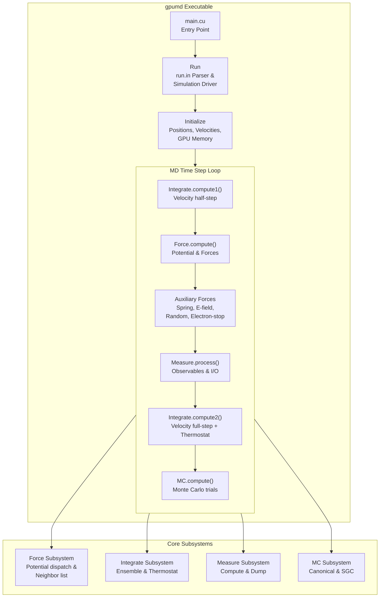
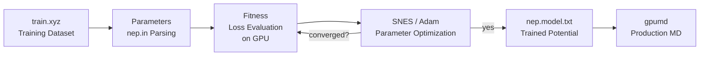

**GPUMD** (Graphics Processing Units Molecular Dynamics) is a highly efficient, general-purpose molecular dynamics package fully implemented on GPUs using CUDA C++. It combines production-ready MD simulation capabilities with a built-in machine-learned potential framework called **Neuroevolution Potential (NEP)**, enabling users to train, validate, and deploy ML potentials within a single cohesive toolchain. The package is distributed under the GNU General Public License v3 and currently stands at **version 5.7**.


Sources: [README.md](/README.md#L1-L161), [main.cu](/src/main_gpumd/main.cu#L60-L79)

## What GPUMD Does

GPUMD serves two primary roles in computational materials science, delivered through two distinct executables built from the same source tree:

| Executable | Purpose | Entry Point | Key Capability |
|---|---|---|---|
| `gpumd` | Run MD simulations | `src/main_gpumd/` | Dynamics, minimization, phonon, heat transport, measurement |
| `nep` | Train & predict NEP models | `src/main_nep/` | Neuroevolution potential training, dataset prediction, TNEP/qNEP support |

A third executable, `gnep`, is optionally buildable and provides an alternative training scheme (GNEP) using gradient-based optimization.

The `gpumd` executable reads a `run.in` file containing a sequence of keyword-driven commands — each command specifying a potential, ensemble, measurement, or other operation — and executes them in order. Multiple "runs" can be chained in a single `run.in`, enabling complex multi-stage workflows (e.g., equilibrate → measure → deform) without scripting.

Sources: [CMakeLists.txt](/CMakeLists.txt#L1-L69), [main.cu](/src/main_gpumd/main.cu#L42-L58), [run.cu](/src/main_gpumd/run.cu#L175-L209)

## Architecture at a Glance

The `gpumd` executable follows a classic MD loop architecture, fully resident on the GPU. The main simulation loop in `Run::perform_a_run()` orchestrates four subsystems in each timestep: **Integration** (half-step velocity update), **Force** (potential evaluation), **Measurement** (observables), and **Integration** (second half-step). A fifth subsystem, **Monte Carlo**, interleaves trial moves for hybrid MC/MD simulations.



Sources: [run.cu](/src/main_gpumd/run.cu#L211-L348), [force.cuh](/src/force/force.cuh#L34-L87), [integrate.cuh](/src/integrate/integrate.cuh#L28-L120), [measure.cuh](/src/measure/measure.cuh#L28-L69)

## Source Code Organization

The source tree under `src/` is organized by functional responsibility, with each module compiled as `.cu` CUDA source files:

| Directory | Responsibility | Key Classes | Count |
|---|---|---|---|
| `main_gpumd/` | Simulation driver, run.in parser, velocity/deposition | `Run`, `Velocity`, `Deposition` | 10 files |
| `force/` | All interatomic potentials & neighbor list | `Force`, `Potential` (abstract), `NEP`, `Tersoff1988`, ... | 30 files |
| `integrate/` | Ensemble thermostats & barostats | `Ensemble` (abstract), `Ensemble_NVE`, `Ensemble_NHC`, ... | 34 files |
| `measure/` | Observables, I/O, heat transport | `Measure`, `HAC`, `HNEMD_Kappa`, `DOS`, ... | 46 files |
| `model/` | Atom data, simulation box, groups | `Atom`, `Box`, `Group` | 8 files |
| `minimize/` | Energy minimization (SD, FIRE) | `Minimizer_SD`, `Minimizer_FIRE` | 8 files |
| `mc/` | Monte Carlo sampling | `MC`, `MC_Ensemble_Canonical` | 9 files |
| `phonon/` | Hessian & phonon computation | `Hessian` | 2 files |
| `utilities/` | GPU vectors, error handling, I/O | `GPU_Vector`, `read_file` | 12 files |
| `main_nep/` | NEP training & prediction | `SNES`, `Fitness`, `Parameters` | 18 files |
| `main_gnep/` | GNEP gradient-based training | `GNEP`, `Adam` | 15 files |

Sources: [get_repo_structure src](/src), [atom.cuh](/src/model/atom.cuh#L27-L57)

## Supported Interatomic Potentials

GPUMD supports a rich set of potentials through a polymorphic `Potential` base class. The `Force` class dispatches computation to one or more `Potential` instances, enabling hybrid combinations. Potentials are selected at runtime by reading the first keyword in the potential file:

| Category | Potentials | Hybrid Combinations |
|---|---|---|
| **Machine-Learned** | NEP3, NEP4, NEP5 (+ ZBL variants), qNEP (dynamic charge), TNEP (dipole/polarizability) | NEP+ILP, NEP+ZBL, NEP+D3 |
| **Empirical Many-Body** | Tersoff (1988, 1989, mini), EAM (Zhou 2004, Dai 2006, alloy), ADP | Tersoff+ILP, SW+ILP |
| **Pairwise** | Lennard-Jones (LJ) | — |
| **Special Purpose** | FCP (force constant potential), Deep Potential (DP), NNAP | — |

> [!TIP]
> The `Force` class holds a `std::vector<std::unique_ptr<Potential>>`, meaning multiple potentials can be active simultaneously in a single simulation — for example, a NEP model for intralayer interactions combined with an ILP model for interlayer Van der Waals forces.

Sources: [force.cu](/src/force/force.cu#L58-L200), [potential.cuh](/src/force/potential.cuh#L30-L114)

## Ensemble & Integration Methods

The integration subsystem uses a two-step split-operator pattern (`compute1` / `compute2`) enabling Velocity Verlet with interleaved thermostat/barostat operations. Available ensembles span equilibrium, non-equilibrium, and advanced sampling regimes:

| Ensemble Type | Class | Use Case |
|---|---|---|
| NVE | `Ensemble_NVE` | Microcanonical dynamics |
| NVT (Langevin) | `Ensemble_Lan` | Stochastic thermostat |
| NVT (NHC) | `Ensemble_NHC` | Nosé-Hoover chain thermostat |
| NVT (BER) | `Ensemble_Ber` | Berendsen thermostat |
| NVT (QTB) | `Ensemble_QTB` | Quantum thermal bath |
| NPT (MTTK) | `Ensemble_MTTK` | Martyna-Tuckerman-Tobias-Klein |
| NPT (SCR) | `Ensemble_NPT_SCR` | Stochastic cell rescaling |
| NPT (BAO) | `Ensemble_BAO` | BAOAB integrator |
| Heat (NEMD) | `Ensemble_Heat_Hybrid` | Non-equilibrium heat transport |
| HNEMD | Multiple | Homogeneous NEMD for thermal conductivity |
| MSST | `Ensemble_MSST` | Multi-scale shock simulation |
| NPHug | `Ensemble_NPHug` | Shock Hugoniot |
| PIMD | `Ensemble_PIMD` | Path-integral molecular dynamics |
| TTM | `Ensemble_TTM` | Two-temperature model |
| Thermodynamic Integration | `Ensemble_TI` variants | Free energy calculations |

Sources: [ensemble.cuh](/src/integrate/ensemble.cuh#L27-L158), [integrate.cuh](/src/integrate/integrate.cuh#L28-L120)

## Measurement & Analysis Capabilities

The `Measure` subsystem aggregates a collection of `Property` objects that compute and output observables during simulation. This is where GPUMD's strength in heat transport becomes evident:

| Capability | Class | Description |
|---|---|---|
| **Heat Transport** | `HAC`, `HNEMD_Kappa`, `HNEMDEC_Kappa`, `SHC` | EMD (HAC), HNEMD, spectral heat current |
| **Structural** | `RDF`, `ADF`, `Angular_RDF`, `OrientOrder` | Radial/angular distribution, order parameters |
| **Dynamical** | `MSD`, `SDC`, `DOS`, `Viscosity` | Mean-square displacement, density of states |
| **I/O** | `Dump_Thermo`, `Dump_XYZ`, `Dump_Restart`, `Dump_NetCDF` | Trajectory and restart output |
| **Electronic** | `LSQT`, `Iron_Conductivity` | Linear-scaling quantum transport |
| **Special** | `Plumed`, `Extrapolation`, `Modal_Analysis` | Enhanced sampling, model monitoring, modal analysis |

Sources: [measure.cuh](/src/measure/measure.cuh#L28-L69), [run.cu](/src/main_gpumd/run.cu#L29-L62)

## NEP Training Pipeline

The `nep` executable implements a complete training workflow: it reads a `train.xyz` dataset in extended XYZ format, optimizes NEP model parameters using the SNES (separable natural evolution strategy) optimizer, and writes the resulting potential file. The pipeline supports prediction mode (evaluating a trained model on a dataset) and training for TNEP (tensorial models for dipole/polarizability) and qNEP (dynamic charge models).



Sources: [main.cu (nep)](/src/main_nep/main.cu#L42-L84)

## GPU & Platform Requirements

| Requirement | Minimum | Notes |
|---|---|---|
| NVIDIA GPU | Compute capability ≥ 3.5 | Kepler generation and above |
| CUDA Toolkit | ≥ CUDA 9.0 | C++17 and CUDA 17 standards |
| OS | Linux (GCC) / Windows (MSVC) | Full support on both |
| Libraries | cuBLAS, cuSOLVER, cuFFT | Auto-linked via CMake |

Multi-GPU parallelism is supported for NEP-based simulations via domain decomposition along the thickest box dimension (overridable with `x`/`y`/`z` specifier). Good efficiency requires ≥10⁵ atoms per GPU.

Sources: [CMakeLists.txt](/CMakeLists.txt#L1-L30), [README.md](/README.md#L19-L23)

## Ecosystem & Extensions

GPUMD connects to a broader ecosystem of tools and interfaces:

- **Python Interfaces**: `calorine` (NEP construction & MD analysis), `gpyumd` (GPUMD I/O), `pyNEP` (NEP Python interface)
- **Format Converters**: 13+ converters for VASP, CP2K, CASTEP, ABACUS, ORCA, LAMMPS (MTP/Runner), GROMACS, DeepMD, and more
- **LAMMPS Integration**: Standalone [NEP_CPU](https://github.com/brucefan1983/NEP_CPU) provides a C++ NEP engine with LAMMPS pair style
- **MDI Interface**: `gpumd-mdi` enables coupling with other codes (e.g., VASP) via the MolSSI Driver Interface
- **PySAGES Integration**: GPU-native enhanced sampling on NEP potentials
- **Colab Tutorial**: End-to-end NEP workflow runnable on Google Colab

Sources: [tools/readme.md](/tools/readme.md#L1-L33), [README.md](/README.md#L30-L38)

## Project Directory Map

```
GPUMD/
├── src/                  ← CUDA C++ source code (all .cu/.cuh files)
│   ├── main_gpumd/      ← gpumd executable: simulation driver
│   ├── main_nep/        ← nep executable: NEP training
│   ├── main_gnep/       ← gnep executable: gradient-based NEP (optional)
│   ├── main_mdi/        ← MDI interface executable
│   ├── force/           ← Potential models & neighbor list
│   ├── integrate/       ← Ensemble thermostats & barostats
│   ├── measure/         ← Observables, I/O, heat transport
│   ├── model/           ← Atom, Box, Group data structures
│   ├── minimize/        ← Energy minimizers (SD, FIRE)
│   ├── mc/              ← Monte Carlo sampling
│   ├── phonon/          ← Hessian & phonon computation
│   └── utilities/       ← GPU vectors, error handling, I/O
├── examples/            ← Minimal working examples
├── potentials/          ← Pre-packaged potential parameter files
├── tools/               ← Format converters, analysis scripts, utilities
├── tests/               ← Bash/Batch integration tests
├── tests_pytest/        ← Python pytest regression & conservation tests
├── doc/                 ← Sphinx-based documentation & manual
├── developers/          ← Developer class topology diagrams
├── CMakeLists.txt       ← CMake build system
├── Dockerfile           ← Containerized build
└── LICENCE              ← GPL v3
```

Sources: [README.md](/README.md#L1-L161)

## Where to Go Next

For a hands-on introduction, start with [Quick Start](2-quick-start) to compile and run your first simulation. To understand the input file syntax that drives all GPUMD workflows, proceed to [Input File Format](3-input-file-format). For a deeper understanding of how the subsystems connect, see [Architecture Overview](4-architecture-overview). If you're interested in machine-learned potentials, jump to [NEP Model Architecture](8-nep-model-architecture) or [NEP Training Pipeline](9-nep-training-pipeline).