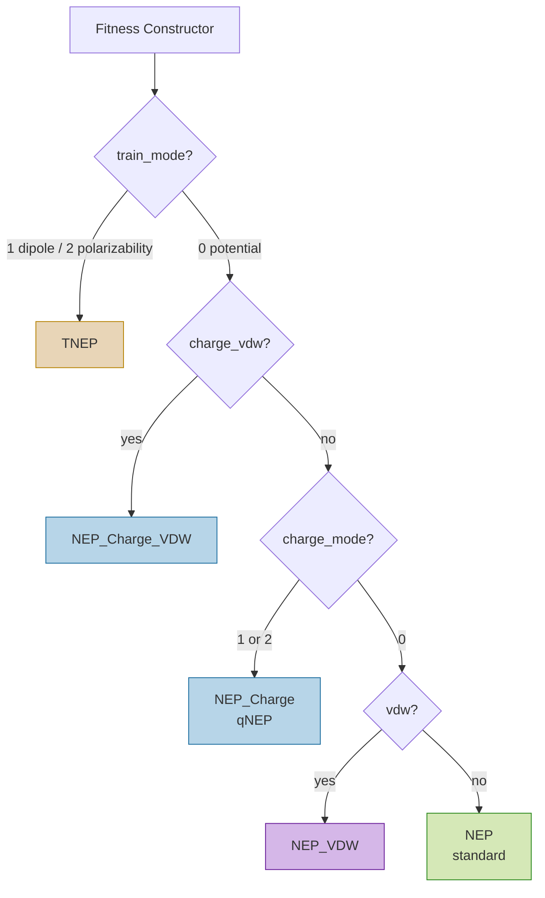
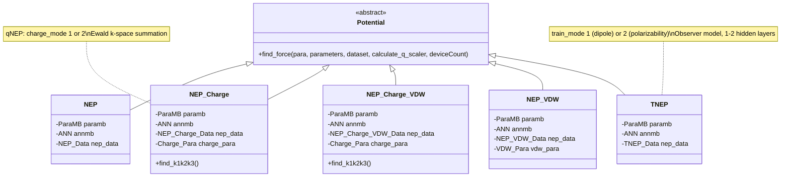

The NEP framework extends beyond scalar potential energy surfaces into two powerful variant architectures: **qNEP** (charge-augmented NEP) introduces self-consistent atomic charges with electrostatic long-range interactions, and **TNEP** (tensorial NEP) predicts rank-1 and rank-2 tensorial properties—dipoles and polarizabilities—using the same descriptor infrastructure. Both variants inherit the core NEP descriptor computation and SNES optimization pipeline but diverge in their output heads, loss functions, and physical semantics, enabling NEP to serve not merely as an interatomic potential but as a unified framework for multi-property machine-learning potentials.

## Variant Taxonomy and Dispatch Architecture

The model variant is determined at construction time by the `Fitness` class, which inspects three independent configuration flags—`train_mode`, `charge_mode`, and `vdw`/`charge_vdw`—to instantiate the correct `Potential` subclass. The dispatch logic follows a strict priority chain:



All variants inherit from the abstract `Potential` base class, which declares a pure virtual `find_force` interface. This polymorphic design ensures the SNES optimizer interacts uniformly with any variant through `potential->find_force(...)`, while variant-specific computation kernels handle the distinct physics internally.

| Variant Class | Source File | `train_mode` | `charge_mode` | `vdw` | `charge_vdw` | Output Properties |
|---|---|---|---|---|---|---|
| `NEP` | nep.cu | 0 | 0 | 0 | 0 | Energy, Force, Virial |
| `NEP_VDW` | nep_vdw.cu | 0 | 0 | 1 | 0 | + Environment-dependent vdW |
| `NEP_Charge` | nep_charge.cu | 0 | 1 or 2 | 0 | 0 | + Electrostatics (qNEP) |
| `NEP_Charge_VDW` | nep_charge_vdw.cu | 0 | 1 or 2 | 0 | 1 | + Electrostatics + vdW |
| `TNEP` | tnep.cu | 1 or 2 | — | — | — | Dipole / Polarizability |

Sources: [fitness.cu](src/main_nep/fitness.cu#L130-L141), [potential.cuh](src/main_nep/potential.cuh#L27-L33)

## qNEP: Charge-Augmented NEP

### Physical Model

The qNEP model augments the standard NEP potential with **environment-dependent atomic charges** computed from the same descriptor vector via a separate ANN head. The total energy includes an electrostatic contribution evaluated using Ewald summation, split into real-space and reciprocal-space components. The atomic charge $q_i$ is predicted from the local descriptor $\mathbf{q}_i$ through a per-element single-hidden-layer ANN, identical in architecture to the energy-predicting ANN but with independent weights.

Two charge modes control which electrostatic contributions are included:

| `charge_mode` | Real-space | Reciprocal-space | Reference |
|---|---|---|---|
| 0 | — | — | Standard NEP (no charges) |
| 1 | ✓ | ✓ | Song et al. (2024b) — full Ewald |
| 2 | — | ✓ | Cheng (2025) — reciprocal only |

Mode 2 omits the real-space contribution, which is physically justified when the short-range NEP potential already implicitly captures the real-space electrostatic effects through its parametric flexibility. This reduces computational cost while maintaining accuracy for systems where the charge–dipole and charge–charge interactions at short range are absorbed into the short-range NEP parameters.

> [!TIP]
> When training a qNEP model, target charges are **not** required as training data. The charges emerge self-consistently from the descriptor–ANN mapping. However, you may optionally provide target Born effective charges (BEC), though this typically works reliably only for a single-phase system because the model assumes a constant high-frequency dielectric constant $\epsilon_\infty$ across the entire training dataset.

### Ewald Summation Infrastructure

The `NEP_Charge_Data` struct reveals the GPU-side Ewald summation data structures: reciprocal-space k-vectors (`kx`, `ky`, `kz`), structure factors (`S_real`, `S_imag`), and the reciprocal-space energy density (`G`, `D_real`). The `Charge_Para` struct controls the Ewald splitting parameter $\alpha = 0.5$ Å⁻¹ and the maximum k-point count (`num_kpoints_max = 50000`). The method `find_k1k2k3()` precomputes the reciprocal-space k-vector mesh, which remains fixed throughout training since it depends only on the simulation cell geometry.

### qNEP + van der Waals (NEP_Charge_VDW)

The `NEP_Charge_VDW` class combines charge electrostatics with environment-dependent van der Waals interactions. Its data struct extends `NEP_Charge_Data` with `C6`, `C6_derivative`, and `D_C6` GPU vectors for the dispersion coefficients, plus `G_vdw` and `G_vdw_virial` for the vdW reciprocal-space contribution and its virial. The `ParaMB` struct stores per-element `c6_ref_sqrt` reference dispersion coefficients, from which environment-dependent $C_6$ values are predicted via the ANN.

### Training Configuration

A minimal qNEP training input (`nep.in`) requires only the `charge_mode` keyword:

```
type         2 Te Pb
cutoff       8 4
charge_mode  2
generation   20000
```

The relevant loss-function weights for qNEP are `lambda_q` (total charge loss, default 0.1) and `lambda_z` (BEC loss, default 0.5). The `import_q_scaler` keyword allows reusing a pre-computed descriptor scaler from an existing `nep.txt` file rather than recomputing it, which is useful for fine-tuning workflows.

Sources: [nep_charge.cuh](src/main_nep/nep_charge.cuh#L37-L119), [nep_charge_vdw.cuh](src/main_nep/nep_charge_vdw.cuh#L37-L122), [charge_mode.rst](doc/nep/input_parameters/charge_mode.rst#L1-L29), [qnep_train/nep.in](examples/qnep_train/nep.in#L1-L5), [lambda_q.rst](doc/nep/input_parameters/lambda_q.rst#L1-L16), [lambda_z.rst](doc/nep/input_parameters/lambda_z.rst#L1-L16)

## TNEP: Tensorial Neuroevolution Potential

### Physical Model and Tensorial Outputs

The TNEP model repurposes the NEP descriptor infrastructure to predict **tensorial properties** rather than scalar potential energies. It supports two output modes selected by `train_mode`:

| `train_mode` | Property | Tensor Rank | Components | Physical Meaning |
|---|---|---|---|---|
| 1 | Dipole moment $\boldsymbol{\mu}$ | 1 (vector) | 3 ($\mu_x, \mu_y, \mu_z$) | Electric dipole per structure |
| 2 | Polarizability $\boldsymbol{\alpha}$ | 2 (symmetric tensor) | 6 ($\alpha_{xx}, \alpha_{yy}, \alpha_{zz}, \alpha_{xy}, \alpha_{yz}, \alpha_{zx}$) | Dielectric response |

TNEP is fundamentally an **observer model**: it does not replace the potential energy surface but runs alongside it, reading the same atomic positions and computing tensorial observables on-the-fly. In a GPUMD simulation, this is configured by specifying two `potential` lines in `run.in`—the PES model first, then the TNEP observer model second.

### Multi-Layer ANN Architecture

Unlike the standard NEP and qNEP which use a single-hidden-layer ANN, TNEP supports **up to two hidden layers** controlled by `num_hidden_layers` and `num_neurons2`. The `TNEP::ANN` struct stores `num_neurons1`, `num_neurons2`, and `num_hidden_layers`, and the parameter count `one_ann_no_bias` adjusts accordingly:

- **1 hidden layer**: `one_ann_no_bias = (dim + 2) × num_neurons1`
- **2 hidden layers**: `one_ann_no_bias = (dim + 1) × num_neurons1 + (num_neurons1 + 2) × num_neurons2`

For polarizability (`train_mode = 2`), a **second independent ANN** (`wb_pol`, `b_pol`) predicts the scalar part of the polarizability, while the first ANN predicts the tensorial part. This separation ensures the scalar trace and anisotropic components are learned with appropriate flexibility.

### Descriptor Computation and Per-Type Cutoffs

TNEP computes the same radial and angular descriptors as standard NEP, but supports **per-element cutoff distances** stored as arrays `rc_radial[NUM_ELEMENTS]` and `rc_angular[NUM_ELEMENTS]`. For a pair of atom types $t_1$ and $t_2$, the effective cutoff is the arithmetic mean: $r_c = (r_c^{t_1} + r_c^{t_2}) / 2$. This type-dependent cutoff scheme allows finer control over the descriptor's spatial sensitivity for chemically heterogeneous systems.

The `apply_ann` kernel dispatches between `apply_ann_one_layer` and `apply_ann_two_layers` based on `num_hidden_layers`, and for polarizability mode, a separate `apply_ann_pol` kernel handles the scalar ANN head followed by the tensorial ANN head, writing results into the `g_virial` buffer (repurposed for polarizability storage).

### Rotational Self-Consistency

A critical physical constraint on TNEP predictions is their correct transformation behavior under rotations. The test suite verifies:

- **Dipole** (rank-1): $\boldsymbol{\mu}' = R \boldsymbol{\mu}$ — the dipole vector rotates as a vector.
- **Polarizability** (rank-2): $\boldsymbol{\alpha}' = R \boldsymbol{\alpha} R^T$ — the polarizability tensor transforms via congruence.

The test constructs a Rodrigues rotation, applies it to both positions and velocities, and confirms that TNEP outputs transform correctly within a tolerance of `rtol=1e-4, atol=1e-5`. A subtle implementation detail: `dump_dipole` and `dump_polarizability` only write output after a full velocity-Verlet step, so the tests embed pre-rotated velocities directly into the `model.xyz` input to ensure exact rotational consistency without stochastic velocity initialization interference.

Sources: [tnep.cuh](src/main_nep/tnep.cuh#L30-L89), [tnep.cu](src/main_nep/tnep.cu#L23-L31), [tnep.cu](src/main_nep/tnep.cu#L200-L260), [test_io_tnep_commands.py](tests_pytest/test_io_tnep_commands.py#L1-L75), [test_tnep_invariances.py](tests_pytest/test_tnep_invariances.py#L1-L139)

## Comparative Architecture: qNEP vs TNEP



| Dimension | qNEP | TNEP |
|---|---|---|
| **Purpose** | Augment PES with electrostatics | Predict dipole / polarizability observables |
| **Role in simulation** | Replaces standard NEP as the PES | Runs alongside a separate PES (observer) |
| **ANN output** | Atomic charge $q_i$ (scalar per atom) | Dipole vector or polarizability tensor per atom |
| **ANN layers** | 1 hidden layer | 1 or 2 hidden layers |
| **Long-range treatment** | Ewald summation (real + reciprocal or reciprocal only) | None (local descriptor → tensor) |
| **Extra loss terms** | `lambda_q` (charge), `lambda_z` (BEC) | Standard energy/force/virial adapted for tensors |
| **Training data** | No target charges needed; BEC optional | Dipole or polarizability reference data |
| **Per-type cutoffs** | Single cutoff (qNEP) or per-type (qNEP+vdW) | Per-type cutoffs always |
| **Key GPU data** | k-vectors, structure factors, $G$, $S$, $D$ | Standard descriptors + `sum_fxyz` |

> [!TIP]
> The `NEP_Charge_VDW` variant is the most feature-rich model, combining electrostatics, environment-dependent dispersion, and per-type cutoffs. When all three extensions (charge, vdW, per-type cutoff) are needed, use `charge_vdw 1` in `nep.in` rather than setting `charge_mode` and `vdw` independently—the combined class ensures consistent reciprocal-space treatment of both electrostatic and dispersion contributions.

Sources: [fitness.cu](src/main_nep/fitness.cu#L130-L141), [nep_charge.cuh](src/main_nep/nep_charge.cuh#L37-L119), [nep_charge_vdw.cuh](src/main_nep/nep_charge_vdw.cuh#L37-L122), [nep_vdw.cuh](src/main_nep/nep_vdw.cuh#L28-L118), [tnep.cuh](src/main_nep/tnep.cuh#L30-L89), [parameters.cuh](src/main_nep/parameters.cuh#L38-L95)

## Configuration Reference

The following `nep.in` keywords are specific to or particularly relevant for qNEP and TNEP variants:

| Keyword | Applies To | Default | Description |
|---|---|---|---|
| `charge_mode` | qNEP | 0 | 0=off, 1=full Ewald, 2=reciprocal only |
| `charge_vdw` | qNEP+vdW | 0 | 1=enable combined charge-vdW model |
| `vdw` | NEP+vdW | 0 | 1=enable environment-dependent vdW |
| `lambda_q` | qNEP | 0.1 | Weight for total charge loss |
| `lambda_z` | qNEP | 0.5 | Weight for BEC loss |
| `import_q_scaler` | qNEP | false | Reuse scaler from existing `nep.txt` |
| `model_type` | TNEP | 0 | 0=potential, 1=dipole, 2=polarizability |
| `num_neurons2` | TNEP | — | Second hidden layer size (2-layer ANN) |

For deeper understanding of the base descriptor computation shared across all variants, see [NEP Model Architecture](8-nep-model-architecture). For the training pipeline that orchestrates SNES optimization across these variants, see [NEP Training Pipeline](9-nep-training-pipeline). For how TNEP observer models are deployed alongside NEP potentials in production simulations, see [Force and Potential System](5-force-and-potential-system).
