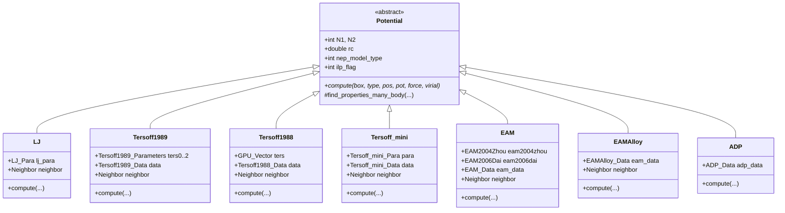
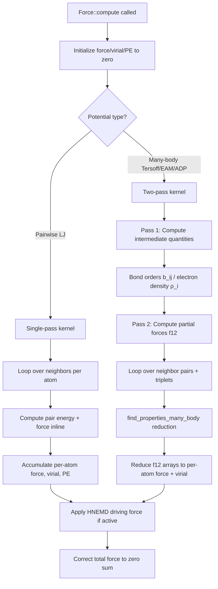

GPUMD implements a suite of **classical empirical interatomic potentials** optimized for GPU execution, covering pairwise, many-body, and embedded-atom formalisms. These potentials serve as the backbone for molecular dynamics simulations of crystalline solids, alloys, and simple fluids. Each implementation inherits from the abstract `Potential` base class and follows a unified computation contract: accept box, type, and position data; produce per-atom potential energy, force, and virial tensors. The entire force evaluation pipeline — from neighbor list construction through kernel launch — executes on the GPU with single-precision arithmetic for accumulated quantities and double-precision for positional data where it matters most.

Sources: [potential.cuh](/src/force/potential.cuh#L1-L114), [force.cu](/src/force/force.cu#L1-L200)

## Architecture and Unified Interface

All potentials in GPUMD descend from the `Potential` abstract base class, which defines the core virtual `compute()` method and shared infrastructure for many-body force accumulation. The `Force` driver class parses the `potential` command from the run input file, instantiates the correct concrete potential class based on the first token in the potential file, and manages the lifecycle of one or more potential objects.



The `Force::parse_potential()` method reads the potential file, identifies the model by its first token (e.g., `lj`, `tersoff_1989`, `eam_zhou_2004`, `adp`), and constructs the appropriate subclass via `std::unique_ptr<Potential>`. Each concrete class carries its own `Neighbor` object for neighbor list management, pre-computed parameter structs transferred to GPU constant memory or texture cache, and working `GPU_Vector` arrays for intermediate quantities like bond orders and partial forces. The `Potential` base class also provides the protected `find_properties_many_body()` helper, which reduces per-neighbor partial force arrays (`f12x`, `f12y`, `f12z`) into final per-atom force and virial — a pattern shared by all many-body potentials.

Sources: [potential.cuh](/src/force/potential.cuh#L59-L100), [force.cu](/src/force/force.cu#L82-L155), [potential.cu](/src/force/potential.cu#L35-L100)

## Lennard-Jones (LJ)

The **Lennard-Jones** potential is the simplest pairwise model in GPUMD, implementing the standard 12-6 form:

$$V(r_{ij}) = 4\varepsilon\left[\left(\frac{\sigma}{r_{ij}}\right)^{12} - \left(\frac{\sigma}{r_{ij}}\right)^{6}\right]$$

The implementation supports up to **10 atom types** (configurable via `MAX_TYPE`), with full cross-interaction matrices for ε, σ, and cutoff. Parameters are pre-computed into GPU-friendly `float` arrays (`s6e4 = 4εσ⁶`, `s12e4 = 4εσ¹²`, `cutoff_square`) at initialization to minimize runtime computation. The CUDA kernel uses **single-precision accumulation** for forces and virials within the neighbor loop, with double-precision positions for distance calculation. The LJ kernel directly computes per-atom potential energy and virial within the same pass — unlike many-body potentials that require a separate reduction step. A default neighbor list capacity of 700 neighbors per atom is allocated.

**Potential file format** — The file begins with `lj` followed by the number of types and element symbols, then an N×N matrix of `epsilon sigma cutoff` triplets:

```
lj 1
Ar
10.0 3.4 10.0
```

For multi-element systems, off-diagonal entries define cross-interactions using Lorentz-Berthelot or explicitly specified mixing rules.

Sources: [lj.cuh](/src/force/lj.cuh#L1-L50), [lj.cu](/src/force/lj.cu#L30-L120)

## Tersoff Potentials

GPUMD provides **three Tersoff variants** covering the major formulations in the literature. All three share the same computational pattern: a two-pass kernel structure where the first pass computes bond order `b_ij` and its derivative `b'_ij` for all pairs, and the second pass accumulates partial forces `f12` which are then reduced to per-atom quantities via `find_properties_many_body()`.

### Tersoff-1989

The **Tersoff-1989** potential implements the two-element formulation from Tersoff's seminal paper on multicomponent systems. It supports **1 or 2 atom types** with explicit parameter sets for same-type interactions and a mixing rule (geometric mean with χ scaling) for cross-type interactions. The bond-order function takes the form:

$$b_{ij} = \left(1 + \beta^n \zeta_{ij}^n\right)^{-1/2n}, \quad \zeta_{ij} = \sum_{k \neq i,j} f_c(r_{ik})\, g(\theta_{ijk})\, \exp\!\left[\lambda^3(r_{ij}-r_{ik})^3\right]$$

The angular function uses $g(\theta) = 1 + c^2/d^2 - c^2/(d^2 + (h - \cos\theta)^2)$. Pre-computed constants include `c2`, `d2`, `one_plus_c2overd2`, `pi_factor`, and `minus_half_over_n` to avoid redundant operations in the kernel. The implementation stores three `Tersoff1989_Parameters` structs (`ters0`, `ters1`, `ters2`) for the two pure types and the mixed type respectively, with a neighbor capacity factor of 50.

Sources: [tersoff1989.cuh](/src/force/tersoff1989.cuh#L1-L57), [tersoff1989.cu](/src/force/tersoff1989.cu#L1-L120)

### Tersoff-1988

The **Tersoff-1988** variant supports **arbitrary multi-element** systems through a flat parameter array (`GPU_Vector<double> ters`) indexed by type pairs. Unlike the 1989 variant which hard-codes type dispatch in device functions, Tersoff-1988 uses a **cell-list neighbor construction** (with `cell_count`, `cell_count_sum`, `cell_contents` arrays) for improved scalability with large cutoffs or dense systems. The parameter structure is more general, allowing different parameter sets for each (type_i, type_j, type_k) triplet combination.

Sources: [tersoff1988.cuh](/src/force/tersoff1988.cuh#L1-L54)

### Tersoff-mini

The **Tersoff-mini** is a **simplified Tersoff** variant that reduces the parameter set to essential terms. It uses a compact `Tersoff_mini_Para` struct with parameter arrays of size 3 (for up to 3 type-pair combinations), storing `a`, `b`, `lambda`, `mu`, `beta`, `n`, `h`, `r1`, `r2` and their derived constants. This variant is useful when the full Tersoff parameterization is unnecessary, offering faster initialization and lower memory footprint while maintaining the same two-pass kernel structure.

Sources: [tersoff_mini.cuh](/src/force/tersoff_mini.cuh#L1-L65)

## Embedded Atom Method (EAM)

GPUMD implements **two EAM formalisms**: an analytical parameterization (Zhou 2004 and Dai 2006) and a tabulated format (eam/alloy) compatible with LAMMPS. EAM potentials model the energy as an embedding function of the local electron density plus a pairwise repulsion:

$$E_i = F(\bar{\rho}_i) + \frac{1}{2}\sum_{j \neq i} \phi(r_{ij}), \quad \bar{\rho}_i = \sum_{j \neq i} \rho(r_{ij})$$

### EAM Zhou 2004 / Dai 2006

The **analytical EAM** implementation supports up to **18 elements** (via `MAX_NUM_ELEMENTS_EAM`), using the Zhou 2004 parameterization for multi-component alloys. The `EAM2004Zhou` struct stores per-element parameters as `float` arrays for GPU efficiency: `re_inv`, `fe`, `rho_e_inv`, `alpha`, `beta`, `A`, `B`, `kappa`, `lambda`, plus embedding function coefficients `Fn0..Fn3`, `F0..F3`, `eta`, `Fe`. The Dai 2006 single-element parameterization uses a simpler `EAM2006Dai` struct with 10 scalar parameters. Both variants compute `F'(ρ)` as an intermediate per-atom quantity stored in `EAM_Data::Fp` during the density accumulation pass, which is then used in the force computation pass.

### EAM/alloy (Tabulated)

The **EAM/alloy** potential reads tabulated function data in the LAMMPS eam/alloy format, supporting arbitrary multi-element systems. The tabulated functions — embedding function `F(ρ)`, electron density `ρ(r)`, and pair potential `φ(r)` — are stored as `float4` arrays (`F_rho_g`, `rho_r_g`, `phi_r_g`) on the GPU, enabling coalesced memory access during spline interpolation. The implementation uses uniform grid spacing (`drho`, `dr`) for efficient index computation from continuous values. A configurable `max_neighbor` parameter (default 400, maximum 1024) controls neighbor list capacity and can be specified as an optional second argument to the `potential` command.

**Potential file format for eam/alloy:**

```
eam/alloy
<number_of_elements> <element_names...>
<nrho> <drho> <nr> <dr> <rc>
<tabulated F, rho, phi data>
```

Sources: [eam.cuh](/src/force/eam.cuh#L1-L83), [eam_alloy.cuh](/src/force/eam_alloy.cuh#L1-L58)

## Angular Dependent Potential (ADP)

The **ADP** potential extends EAM with **dipole (u)** and **quadrupole (w)** distortion terms that capture directional bonding, following Mishin et al. (Acta Mater. 53, 4029, 2005). The total energy per atom is:

$$E_i = F(\bar{\rho}_i) + \frac{1}{2}\sum_j \phi(r_{ij}) + \sum_{\alpha} \mu_i^{\alpha}\mu_j^{\alpha} u(r_{ij}) + \sum_{\alpha,\beta} \lambda_i^{\alpha\beta}\lambda_j^{\alpha\beta} w(r_{ij})$$

where μ and λ are per-atom dipole and quadrupole tensors accumulated from neighbors, analogous to the scalar electron density in standard EAM. The `ADP_Data` struct stores these per-atom tensors as `GPU_Vector<double>` arrays (`mu` with 3 components, `lambda` with 6 components following xx,yy,zz,yz,xz,xy ordering) alongside the standard EAM quantities (`Fp`, embedding derivative). The implementation uses **cubic spline interpolation** with pre-computed spline coefficients (`a`, `b`, `c`, `d` arrays) for all five tabulated functions (F, ρ, φ, u, w), uploaded to the GPU as separate `GPU_Vector<double>` arrays. A `pair_index_map_g` lookup table maps (type_i, type_j) pairs to their corresponding function table indices for O(1) access.

Sources: [adp.cuh](/src/force/adp.cuh#L1-L98)

## Supported Potentials Summary

| Potential | Keyword | Types | Formalism | Key Features |
|-----------|---------|-------|-----------|-------------|
| Lennard-Jones | `lj` | 1–10 | Pairwise | 12-6 form, cross-interaction matrix |
| Tersoff-1989 | `tersoff_1989` | 1–2 | Many-body (bond-order) | Two-element with χ mixing rule |
| Tersoff-1988 | `tersoff_1988` | Multi | Many-body (bond-order) | Cell-list neighbor, general multi-element |
| Tersoff-mini | `tersoff_mini` | Multi | Many-body (simplified) | Reduced parameter set |
| EAM Zhou 2004 | `eam_zhou_2004` | 1–18 | Embedded-atom | Analytical, up to 18 elements |
| EAM Dai 2006 | `eam_dai_2006` | 1 | Embedded-atom | Analytical, single element |
| EAM/alloy | `eam/alloy` | Multi | Embedded-atom (tabulated) | LAMMPS-compatible format, spline interp |
| ADP | `adp` | Multi | Angular-dependent | Dipole + quadrupole terms, spline interp |

Sources: [force.cu](/src/force/force.cu#L97-L155)

## GPU Computation Patterns

All empirical potentials in GPUMD share a common computational architecture optimized for GPU throughput. The execution pattern follows two distinct strategies depending on whether the potential is pairwise or many-body.



**Pairwise potentials** (LJ) use a **single-pass kernel**: each atom iterates over its neighbors, computes pair energy and force directly, and accumulates results into per-atom arrays. The factor of 0.5 in the energy term accounts for double-counting, while forces are computed as `f12x - f21x` using Newton's third law with the half-pair formalism.

**Many-body potentials** (Tersoff, EAM, ADP) require a **two-pass structure**: the first pass computes environment-dependent intermediate quantities (bond orders for Tersoff, electron density for EAM, density tensors for ADP), and the second pass uses these intermediates to compute partial force arrays `f12x/y/z`. The final reduction from partial forces to per-atom forces and virials is handled by the shared `Potential::find_properties_many_body()` kernel, which iterates over each atom's neighbors, applies the minimum image convention, and accumulates both the net force vector and the 9-component virial tensor.

> [!TIP]
> All empirical potentials use **single-precision (float)** accumulation for forces and virials within GPU kernels, while positions remain in **double-precision**. This mixed-precision strategy provides ~2× throughput improvement on GPU hardware while maintaining sufficient accuracy for MD simulations. The `find_properties_many_body` helper has overloads for both `float*` and `double*` f12 arrays to support this pattern.

Sources: [potential.cu](/src/force/potential.cu#L35-L100), [lj.cu](/src/force/lj.cu#L100-L190), [force.cu](/src/force/force.cu#L260-L340)

## Potential File Format and Initialization

Each empirical potential is specified in the GPUMD run input via the `potential` command, which takes the path to a potential parameter file. The first line of this file contains the **potential keyword** that determines which class is instantiated. The `Force::parse_potential()` method reads this keyword, opens the file, and dispatches to the appropriate constructor:

```
# In run.in:
potential /path/to/potential.txt
```

For potentials requiring additional files (e.g., hybrid potentials combining an intralayer model with an interlayer potential), a second parameter specifies the companion file:

```
# EAM/alloy with custom neighbor capacity:
potential /path/to/eam_file.txt 500

# Hybrid Tersoff+ILP (covered in Hybrid Potentials page):
potential /path/to/ilp.txt /path/to/tersoff.txt
```

The initialization sequence for each potential follows a consistent pattern: (1) read and validate the keyword and element count, (2) parse element-specific parameters into pre-computed constants, (3) determine the global cutoff `rc` from the largest interaction range, and (4) initialize the `Neighbor` object with this cutoff and an estimated neighbor capacity. The `Neighbor::initialize()` call pre-allocates GPU memory for the neighbor list arrays based on the cutoff and a per-atom neighbor estimate that varies by potential type (700 for LJ, 50×N for Tersoff-1989).

Sources: [force.cu](/src/force/force.cu#L82-L155), [lj.cu](/src/force/lj.cu#L35-L60), [tersoff1989.cu](/src/force/tersoff1989.cu#L30-L100)

## Available Potential Parameter Files

The `potentials/` directory in the repository provides pre-validated parameter files for common materials:

| Directory | Contents | Potential Type |
|-----------|----------|---------------|
| `potentials/lj/` | Ar (10Å, 20Å cutoffs) | LJ |
| `potentials/tersoff/` | Si, C, Ge, BN, SiC, SiGe, GaN, SiO, Sn, BNC (17 files) | Tersoff-1989 |
| `potentials/eam/` | Cu (Zhou 2004, Dai 2006), CuNi alloy, 18-element Zhou set | EAM |
| `potentials/adp/` | AlCu, CuTa, Ta, U_Mo | ADP |

These files serve as both reference examples and ready-to-use inputs. The Tersoff directory is particularly rich, covering semiconductors (Si with Erhart, Fan, and original Tersoff parameterizations), carbon allotropes (graphene with Lindsay 2010 and modified variants), compound semiconductors (BN, SiC, GaN), and novel materials (Sn with Cherukara 2016, Ge with Dong 2021).

Sources: [potentials/](/potentials)

## Relationship to Other Potential Types

Empirical potentials form one pillar of GPUMD's three-category potential system. The **NEP (Neuroevolution Potential)** family — covered in [NEP Model Architecture](8-nep-model-architecture) — provides machine-learned potentials with superior accuracy and transferability. The **hybrid potentials** — covered in [Hybrid and Composite Potentials](12-hybrid-and-composite-potentials) — combine an intralayer empirical potential (Tersoff, SW, or NEP) with an interlayer potential (ILP) for layered materials. The force computation infrastructure enforces a key constraint: **multiple potentials can only be used simultaneously if all are NEP-type** (as checked by `has_non_nep` flag in `Force::parse_potential()`), since the multiple-potential averaging/observation mode relies on NEP's consistent per-atom energy decomposition.

> [!TIP]
> When choosing between empirical potentials for a new system, prefer **EAM/alloy** for metals (best balance of accuracy and performance), **Tersoff-1989** for covalent semiconductors with 1–2 elements, and **Tersoff-1988** for multi-element covalent systems. For layered materials like graphene or MoS₂, use the hybrid potentials from [Hybrid and Composite Potentials](12-hybrid-and-composite-potentials) rather than a standalone Tersoff.

Sources: [force.cu](/src/force/force.cu#L155-L170)

## Next Steps

- **[Hybrid and Composite Potentials](12-hybrid-and-composite-potentials)** — Learn how empirical potentials combine with interlayer potentials for layered materials
- **[Force and Potential System](5-force-and-potential-system)** — Understand the full force computation pipeline including neighbor lists and HNEMD
- **[CUDA Kernel Design](13-cuda-kernel-design)** — Dive into the GPU kernel optimization strategies used across all potentials