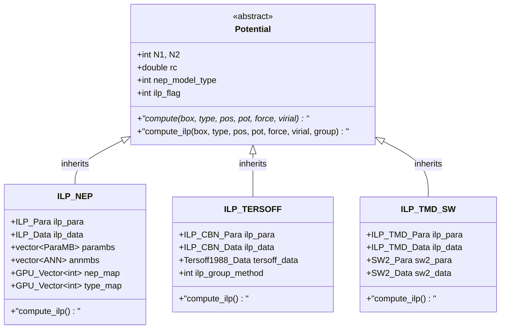
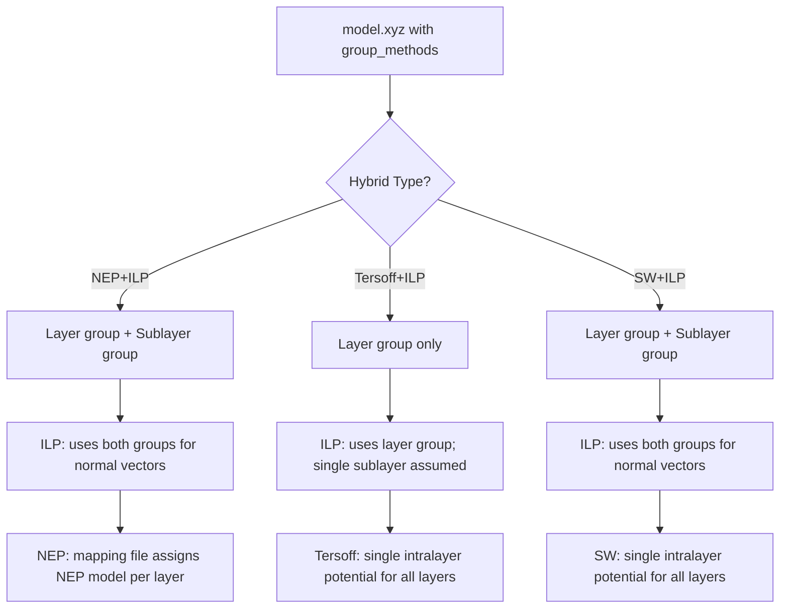

GPUMD implements three **hybrid potential models** that decompose interatomic interactions into **intralayer** (within a single 2D layer) and **interlayer** (between separate layers) contributions. Each hybrid pairs a distinct intralayer potential with the shared **Interlayer Potential (ILP)** formalism, enabling accurate simulation of van der Waals heterostructures — systems where covalent bonding within layers coexists with weak dispersion forces between layers. This architectural separation is both physically motivated and computationally advantageous: the intralayer term operates on a short-range neighbor list while the ILP term requires a much larger cutoff (typically ~16 Å), and the two computations are dispatched through distinct GPU kernel pathways.

## Architectural Overview

All three hybrid potentials inherit from the abstract `Potential` base class and expose a `compute_ilp()` virtual method that accepts group information — the mechanism by which atoms are partitioned into layers and sublayers. The `Force` driver class detects the `ilp_flag` member at runtime and routes computation through `compute_ilp()` rather than the standard `compute()` interface.



The dispatch logic in `Force::compute()` inspects `potentials[0]->ilp_flag`: when set to `1`, the call routes to `compute_ilp()` with the group vector, enabling layer-aware force evaluation. This is a critical architectural branch — standard potentials never require group information, but hybrid ILP potentials depend on it to distinguish intra- from inter-layer atom pairs.

Sources: [force.cu](src/force/force.cu#L499-L522), [potential.cuh](src/force/potential.cuh#L40-L62)

## The Shared Interlayer Potential (ILP)

All three hybrids share the identical ILP mathematical formulation from Ouyang et al. (2018, 2020). The ILP site potential is:

**U_i^ILP = Tap(r_ij) × [U^att(r_ij) + U^rep(r_ij, n_i, n_j)]**

The **taper function** `Tap(r_ij)` provides a smooth cutoff with a 7th-order polynomial ensuring C² continuity. The **attractive term** captures van der Waals dispersion via a C₆/r⁶ dependence modulated by a Fermi-like switching function. The **repulsive term** encodes Pauli exclusion with anisotropic dependence on the normal vectors **n_i**, **n_j** of each layer — this anisotropy is what distinguishes ILP from isotropic Lennard-Jones–type models and is essential for capturing the orientation-dependent corrugation of interlayer adhesion.

The lateral distances ρ_ij and ρ_ji are computed by projecting out the normal component, yielding:

**ρ²_ij = r²_ij − (r_ij · n_i)²**

This projection makes the repulsion sensitive to the local registry (AA vs. AB stacking), a physical effect that purely distance-based potentials cannot reproduce.

Sources: [nep_ilp.rst](doc/potentials/nep_ilp.rst#L25-L65), [sw_ilp.rst](doc/potentials/sw_ilp.rst#L22-L65), [tersoff_ilp.rst](doc/potentials/tersoff_ilp.rst#L22-L65)

## Hybrid Potential Catalog

| Hybrid | Intralayer Term | Interlayer Term | Supported Materials | Files Required | `run.in` Syntax |
|--------|----------------|-----------------|---------------------|----------------|-----------------|
| **NEP+ILP** | NEP (NEP3 or NEP4) | ILP | Graphene, h-BN, TMDs (homo- & heterostructures) | ILP file + NEP map file | `potential <ilp> <nep_map>` |
| **Tersoff+ILP** | Tersoff (1988) | ILP | Graphene, h-BN (homo- & heterostructures) | ILP file + Tersoff file | `potential <ilp> <tersoff>` |
| **SW+ILP** | Modified Stillinger-Weber | ILP | TMD homostructures (MX₂) | ILP file + SW file | `potential <ilp> <sw>` |

### NEP+ILP — Machine-Learning Intralayer

The NEP+ILP hybrid is the most flexible variant, pairing the **Neuroevolution Potential** for intralayer interactions with ILP for interlayer coupling. Its distinguishing capability is the **NEP mapping file**, which assigns different NEP models to different layer groups — enabling heterostructures where, for example, an h-BN layer uses one NEP and a MoS₂ layer uses another.

The class `ILP_NEP` maintains vectors of `ParaMB` and `ANN` structures — one per NEP model — along with GPU-resident `nep_map` and `type_map` arrays that route each atom to its correct parameter set at kernel execution time. This multi-NEP architecture is unique among the three hybrids.

**ILP file format** (`nep_ilp`):
```
nep_ilp <num_types> <element_list>
<group_method_layers> <group_method_sublayers>
beta alpha delta epsilon C d sR reff C6 S rcut1 rcut2
```

**NEP mapping file format**:
```
<group_method_layers> <num_nep_files> <nep_file_0> <nep_file_1> ...
<num_groups>
<NEP_id for group_0>
<NEP_id for group_1>
...
```

The `group_method_sublayers` field is critical for TMDs: a single MoS₂ monolayer contains three sublayers (Mo + 2S), and the ILP normal vector calculation must know which atoms belong to the same sublayer to correctly orient **n_i**. For graphene/h-BN systems where each monolayer is a single sublayer, this value equals the layer group method.

Sources: [ilp_nep.cuh](src/force/ilp_nep.cuh#L96-L215), [nep_ilp.rst](doc/potentials/nep_ilp.rst#L68-L140)

### Tersoff+ILP — Empirical Intralayer for Carbon/BN

The Tersoff+ILP hybrid restricts its domain to graphene and h-BN systems, where the well-parameterized Tersoff (1988) potential provides reliable intralayer forces. The class `ILP_TERSOFF` composes an `ILP_CBN_Para` struct (ILP parameters with `MAX_TYPE_ILP_TERSOFF = 3` for C, B, N) with a `Tersoff1988_Data` struct for the intralayer component.

Only **one group method** is required (for layers), since graphene and h-BN monolayers each constitute a single sublayer — the sublayer concept is unnecessary here.

**ILP file format** (`tersoff_ilp`):
```
tersoff_ilp <num_types> <element_list>
<group_method_layers>
beta alpha delta epsilon C d sR reff C6 S rcut1 rcut2
```

The Tersoff potential file uses the standard Tersoff (1988) parameter format with parameters `A, B, λ, μ, β, n, c, d, h, R, S, m, α, γ` for each triplet type.

Sources: [ilp_tersoff.cuh](src/force/ilp_tersoff.cuh#L30-L96), [tersoff_ilp.rst](doc/potentials/tersoff_ilp.rst#L68-L127)

### SW+ILP — Empirical Intralayer for TMDs

The SW+ILP hybrid targets **transition metal dichalcogenide homostructures** (MoS₂, MoSe₂, WSe₂, etc.). It pairs a modified Stillinger-Weber potential — with a specialized cutoff function `f_C(δ)` that excludes unphysical angle types in TMD structures — with ILP for interlayer coupling. The modification uses thresholds δ₁ = 0.25 and δ₂ = 0.35, defined as compile-time constants in `ilp_tmd_sw.cuh`.

The class `ILP_TMD_SW` composes `ILP_TMD_Para` (with `MAX_TYPE_ILP_TMD_SW = 4` for Mo, S, Se, Te variants) with `SW2_Para` and `SW2_Data` for the intralayer SW component. Two group methods are mandatory: one for layers, one for sublayers (since each TMD monolayer contains three sublayers).

**ILP file format** (`sw_ilp`):
```
sw_ilp 2 M X
beta_MM alpha_MM delta_MM epsilon_MM C_MM d_MM sR_MM reff_MM C6_MM S_MM rcut1_MM rcut2_MM
beta_MX alpha_MX ... (cross terms)
beta_XX alpha_XX ... (X-X terms)
```

The SW file contains two-body parameters (`A, B, a, σ, γ` for each pair) and three-body parameters (`λ, cos0` for each triplet), with the element order matching the ILP file.

> [!TIP]
> The SW+ILP hybrid is restricted to **homostructures only** — all layers must be the same TMD material. For TMD heterostructures, use NEP+ILP with separate NEP models per layer.

Sources: [ilp_tmd_sw.cuh](src/force/ilp_tmd_sw.cuh#L30-L116), [sw_ilp.rst](doc/potentials/sw_ilp.rst#L68-L131)

## Layer Identification via Group Methods

All hybrid potentials require **group methods** defined in `model.xyz` to partition atoms into layers (and optionally sublayers). This is the mechanism that enables the ILP to distinguish intralayer neighbor pairs (same group) from interlayer pairs (different groups). The group method indices specified in the potential files must match those in `model.xyz`.



**Layer group method**: Atoms in the same 2D material layer share the same `group_id`. For a bilayer graphene system, atoms in layer 1 have `group_id = 0` and atoms in layer 2 have `group_id = 1`.

**Sublayer group method**: Atoms in the same atomic plane within a single layer share the same `group_id`. For MoS₂, the Mo plane is one sublayer and each S plane is a separate sublayer, yielding three sublayers per monolayer. For graphene, each monolayer is a single sublayer, so the sublayer group method equals the layer group method.

Sources: [nep_ilp.rst](doc/potentials/nep_ilp.rst#L90-L120), [tersoff_ilp.rst](doc/potentials/tersoff_ilp.rst#L90-L110), [sw_ilp.rst](doc/potentials/sw_ilp.rst#L75-L100)

## ILP Parameter Specification

The ILP parameters are pair-wise and follow a consistent format across all three hybrids. Each line specifies 12 parameters for one atom type pair:

| Parameter | Symbol | Description |
|-----------|--------|-------------|
| `beta` | β | Equilibrium interlayer distance (z₀) |
| `alpha` | α | Exponential decay rate in repulsive term |
| `delta` | δ | Controls width in repulsive exponent denominator |
| `epsilon` | ε | Well depth / energy scale |
| `C` | C | Additional repulsive coefficient |
| `d` | d | Fermi function steepness for attractive term |
| `sR` | S_R | Scaling factor for effective distance |
| `reff` | r_eff | Effective interlayer distance |
| `C6` | C₆ | Dispersion coefficient |
| `S` | S | Scale factor |
| `rcut1` | — | Cutoff for normal vector calculation (~3–4 Å) |
| `rcut2` | — | Cutoff for ILP interactions (typically 16 Å) |

For an N-element system, the ILP file contains N² parameter lines covering all type pairs. The `rcut2` value (typically 16 Å) defines the ILP neighbor list radius — substantially larger than intralayer cutoffs, requiring a dedicated neighbor list construction within each hybrid potential class.

Sources: [nep_ilp.rst](doc/potentials/nep_ilp.rst#L102-L112), [ilp_nep.cuh](src/force/ilp_nep.cuh#L73-L88)

## GPU Data Layout and Constants

Each hybrid potential class defines compile-time constants that bound GPU memory allocation for the ILP neighbor list. These reflect the structural differences between carbon/BN materials and TMDs:

| Constant | C/BN Value | TMD Value | Purpose |
|----------|-----------|-----------|---------|
| `MAX_TYPE_ILP_*` | 3 | 4–7 | Maximum atom types |
| `CUDA_MAX_NL_ILP_*` | 1024–2048 | 2048 | Max interlayer neighbors per atom |
| `MAX_ILP_NEIGHBOR_*` | 3 | 6 | Neighbors for normal vector calculation |
| `MAX_BIG_ILP_NEIGHBOR_*` | 128 | 128 | Extended neighbor buffer |

The `MAX_ILP_NEIGHBOR` difference (3 vs. 6) is physically meaningful: graphene's sp² bonding gives each atom 3 nearest in-plane neighbors for normal vector determination, while TMDs have 6 nearest neighbors in the chalcogen sublattice. These constants are used to size shared memory and loop bounds in CUDA kernels.

> [!TIP]
> The ILP neighbor list is constructed independently from the intralayer neighbor list because its cutoff (16 Å) is much larger. Each hybrid class builds this list using a cell-list approach stored in `ILP_Data::cell_count`, `cell_count_sum`, and `cell_contents`.

Sources: [ilp_nep.cuh](src/force/ilp_nep.cuh#L34-L42), [ilp_tersoff.cuh](src/force/ilp_tersoff.cuh#L30-L36), [ilp_tmd_sw.cuh](src/force/ilp_tmd_sw.cuh#L30-L38)

## Potential Dispatch and Multiple Potentials

The `Force::parse_potential()` method identifies hybrid potentials by reading the first token of the potential file:

- `nep_ilp` → constructs `ILP_NEP(file_ilp, file_nep_map, num_types, N)`
- `tersoff_ilp` → constructs `ILP_TERSOFF(file_ilp, file_tersoff, num_types, N)`
- `sw_ilp` → constructs `ILP_TMD_SW(file_ilp, file_sw, num_types, N)`

Each hybrid requires exactly **two file parameters** in the `potential` command. The first file is always the ILP parameter file; the second is either a NEP mapping file (for NEP+ILP) or an intralayer potential file (for Tersoff+ILP and SW+ILP).

GPUMD also supports **multiple independent potentials** via repeated `potential` commands, but this mode is restricted to NEP-only combinations. When `potentials.size() > 1` and any non-NEP potential is present, the parser raises an error. Hybrid ILP potentials therefore cannot be combined with additional potentials — they must stand alone.

Sources: [force.cu](src/force/force.cu#L156-L205), [force.cu](src/force/force.cu#L206-L218)

## NEP+ILP Example: Bilayer Graphene

Given three files — `C.ilp` (ILP parameters), `C.nep` (NEP3 potential), and `map.nep` (NEP mapping):

**`run.in`:**
```
potential C.ilp map.nep
```

**`C.ilp`:**
```
nep_ilp 1 C
0 0
beta_CC alpha_CC delta_CC epsilon_CC C_CC d_CC sR_CC reff_CC C6_CC S_CC rcut1_CC rcut2_CC
```

**`map.nep`:**
```
0 1 C.nep
2
0
0
```

The `0 0` in `C.ilp` specifies group_method 0 for both layers and sublayers (graphene has one sublayer per layer). In `map.nep`, the first `0` is the layer group method, `1` is the number of NEP files, `2` is the number of groups, and the final two `0`s map both groups to `NEP_0` (C.nep).

Sources: [nep_ilp.rst](doc/potentials/nep_ilp.rst#L142-L175), [hybrid_nep_ilp](potentials/hybrid_nep_ilp)

## NEP+ILP Example: h-BN / MoS₂ Heterostructure

**`BNMoS.ilp`:**
```
nep_ilp 4 B N Mo S
0 1
beta_BB alpha_BB ... rcut2_BB
beta_BN alpha_BN ... rcut2_BN
... (16 pair lines total for 4 elements)
```

**`map.nep`:**
```
0 2 BN.nep MoS.nep
2
1
0
```

Group 0 (MoS₂, `group_id = 0`) maps to `NEP_1` (MoS.nep), and group 1 (h-BN, `group_id = 1`) maps to `NEP_0` (BN.nep). The sublayer group method `1` distinguishes Mo, S-top, and S-bottom planes for normal vector computation.

Sources: [nep_ilp.rst](doc/potentials/nep_ilp.rst#L178-L209), [hybrid_nep_ilp](potentials/hybrid_nep_ilp)

## Design Rationale and Comparison

| Aspect | NEP+ILP | Tersoff+ILP | SW+ILP |
|--------|---------|-------------|--------|
| **Intralayer accuracy** | High (ML-fitted) | Moderate (empirical) | Moderate (empirical) |
| **Parameter effort** | Requires NEP training | Uses published parameters | Uses published parameters |
| **Heterostructure support** | ✅ Different NEP per layer | ✅ Different Tersoff per type | ❌ Homostructures only |
| **Material scope** | Broad (C, BN, TMDs) | Narrow (C, BN only) | Narrow (TMDs only) |
| **Group methods needed** | 2 (layers + sublayers) | 1 (layers) | 2 (layers + sublayers) |
| **Files in `potential` command** | 2 (ILP + NEP map) | 2 (ILP + Tersoff) | 2 (ILP + SW) |
| **ILP neighbor constant** | `MAX_ILP_NEIGHBOR`: 3 or 6 | `MAX_ILP_NEIGHBOR`: 3 | `MAX_ILP_NEIGHBOR`: 6 |

The NEP+ILP hybrid is the recommended choice for production simulations requiring high accuracy, particularly for heterostructures with dissimilar materials. Tersoff+ILP and SW+ILP serve as lightweight alternatives where well-tested empirical parameters exist and training data for NEP is unavailable.

Sources: [ilp_nep.cuh](src/force/ilp_nep.cuh#L34-L42), [ilp_tersoff.cuh](src/force/ilp_tersoff.cuh#L30-L36), [ilp_tmd_sw.cuh](src/force/ilp_tmd_sw.cuh#L30-L38)

## Suggested Reading

For the mathematical foundations of individual intralayer potentials, see [Empirical Potentials](11-empirical-potentials). For the NEP model architecture used in the NEP+ILP hybrid, see [NEP Model Architecture](8-nep-model-architecture). For details on how the force computation pipeline dispatches to these hybrids, see [Force and Potential System](5-force-and-potential-system).