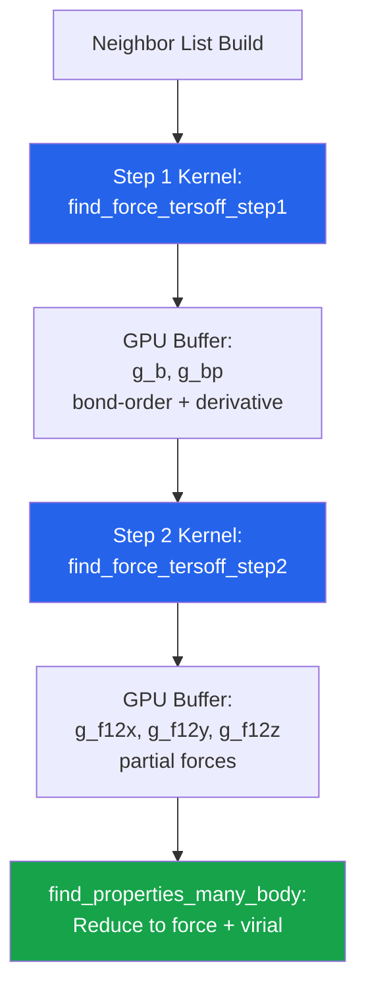
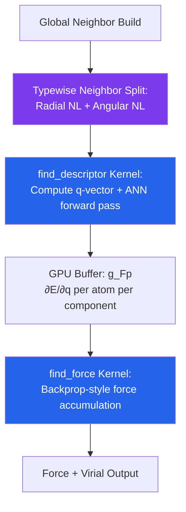

GPUMD's computational engine is built on a carefully layered CUDA kernel architecture that maps molecular dynamics workloads directly onto GPU hardware with minimal abstraction overhead. Every force potential — from simple pairwise LJ to the multi-stage Neuroevolution Potential (NEP) — is expressed as a self-contained GPU kernel following a unified design philosophy: **one thread per atom**, register-heavy accumulation, and explicit multi-step decomposition for many-body interactions. This page dissects the kernel design patterns, execution strategies, and portability abstractions that make GPUMD's GPU acceleration both high-performance and maintainable.

## Kernel Launch Architecture

All force-computation kernels in GPUMD follow a consistent **one-thread-per-atom** mapping. Each CUDA thread is assigned a single atom index and iterates over that atom's neighbor list to accumulate contributions to force, potential energy, and virial stress. The thread-to-atom mapping is computed as:

```
int n1 = blockIdx.x * blockDim.x + threadIdx.x + N1;
```

where `N1` and `N2` define the active atom range `[N1, N2)`, enabling partial-domain execution for multi-GPU decomposition. The grid size is derived directly from the atom count and block size:

```
int grid_size = (N2 - N1 - 1) / BLOCK_SIZE_FORCE + 1;
```

Each potential selects its own **optimal block size** via a compile-time constant, tuned empirically for the kernel's register pressure and occupancy characteristics:

| Potential | Block Size | Rationale |
|-----------|-----------|-----------|
| LJ | 128 | Low register pressure; pairwise-only kernel |
| Tersoff-1989 | 64 | Higher register usage from bond-order precomputation |
| NEP | Varies | Descriptor dimension drives register pressure |

The kernel launch wrapper follows an identical pattern across all potentials — neighbor list construction, then kernel dispatch with `GPU_CHECK_KERNEL` error verification:

```cpp
gpu_find_force<<<grid_size, BLOCK_SIZE_FORCE>>>(
    lj_para, number_of_atoms, N1, N2, box,
    neighbor.NN.data(), neighbor.NL.data(), type.data(),
    position_per_atom.data(), position_per_atom.data() + number_of_atoms,
    position_per_atom.data() + number_of_atoms * 2,
    force_per_atom.data(), force_per_atom.data() + number_of_atoms,
    force_per_atom.data() + 2 * number_of_atoms,
    virial_per_atom.data(), potential_per_atom.data());
GPU_CHECK_KERNEL
```

Sources: [lj.cu](/src/force/lj.cu#L27-L28), [lj.cu](/src/force/lj.cu#L77-L95), [lj.cu](/src/force/lj.cu#L192-L219), [tersoff1989.cu](/src/force/tersoff1989.cu#L29-L29), [tersoff1989.cu](/src/force/tersoff1989.cu#L517-L518)

## Single-Step Kernel Pattern: Pair Potentials

Pairwise potentials (LJ, EAM) use a **single-kernel** design because force computation for atom *i* depends only on pairwise interactions with neighbors — no intermediate data structure is needed between neighbors. The LJ kernel exemplifies this pattern with its characteristic register accumulation strategy:

```cpp
static __global__ void gpu_find_force(
  LJ_Para lj, const int number_of_particles, const int N1, const int N2,
  const Box box, const int* g_neighbor_number, const int* g_neighbor_list,
  const int* g_type, const double* __restrict__ g_x, ...)
{
  int n1 = blockIdx.x * blockDim.x + threadIdx.x + N1;
  float s_fx = 0.0f;  float s_fy = 0.0f;  float s_fz = 0.0f;
  float s_pe = 0.0f;
  float s_sxx = 0.0f;  float s_sxy = 0.0f;  /* ... 9 virial components */
```

Three critical design decisions are visible here:

**1. Mixed-precision accumulation.** Position data arrives as `double` (the `g_x`, `g_y`, `g_z` arrays), but force, energy, and virial accumulators are `float` registers. The displacement computation casts implicitly to float (`float x12 = g_x[n2] - x1`), and all accumulation happens in single precision. The final write-back uses `+=` to the `double` output arrays, enabling mixed-precision accumulation that is both fast (float ALU throughput) and sufficient for MD accuracy requirements.

**2. `__restrict__` pointer qualifiers.** All read-only global memory pointers carry the `__restrict__` qualifier, signaling to the compiler that no aliasing exists between input and output arrays. This enables the NVCC compiler to perform read-write overlap optimizations and reduce unnecessary L1 cache invalidation.

**3. Inlined device functions for physics.** The pairwise potential evaluation is encapsulated in a `static __device__` function:

```cpp
static __device__ void
find_p2_and_f2(float s6e4, float s12e4, float d12sq, float& p2, float& f2)
{
  float d12inv2 = 1.0f / d12sq;
  float d12inv6 = d12inv2 * d12inv2 * d12inv2;
  f2 = 6.0f * (s6e4 * d12inv6 - s12e4 * 2.0f * d12inv6 * d12inv6) * d12inv2;
  p2 = s12e4 * d12inv6 * d12inv6 - s6e4 * d12inv6;
}
```

This keeps the kernel body clean while ensuring the compiler can inline aggressively. The precomputed parameters (`s6e4`, `s12e4` — σ⁶·4ε and σ¹²·4ε) are stored in a constant-size struct (`LJ_Para`) passed by value, placing them in kernel parameter cache rather than global memory.

Sources: [lj.cu](/src/force/lj.cu#L67-L74), [lj.cu](/src/force/lj.cu#L77-L181), [lj.cuh](/src/force/lj.cuh#L25-L29)

## Multi-Step Kernel Pattern: Many-Body Potentials

Many-body potentials (Tersoff, NEP, ADP) **cannot** compute forces in a single pass because the force on atom *i* from neighbor *j* depends on the environment of atom *i* (bond-order functions in Tersoff; descriptor vectors in NEP). GPUMD decomposes these into explicit multi-step kernel launches with intermediate GPU buffers.

### Tersoff Two-Step Decomposition

The Tersoff-1989 potential splits into two kernels plus a shared utility:



**Step 1** (`find_force_tersoff_step1`) computes the bond-order function *b_ij* and its derivative *∂b_ij/∂ζ_ij* for every (atom, neighbor) pair. For each atom `n1` and each neighbor `n2`, it sums the coordination environment:

```cpp
for (int i1 = 0; i1 < neighbor_number; ++i1) {
    // ... compute d12, cutoff fc, angular g-function
    for (int i2 = 0; i2 < neighbor_number; ++i2) {
        // triple loop: accumulate zeta from all n3 != n2
        zeta += fc13 * g123;
    }
    g_b[i1 * number_of_particles + n1] = b12;
    g_bp[i1 * number_of_particles + n1] = -b12 * bzn * 0.5 / ((1.0 + bzn) * zeta);
}
```

**Step 2** (`find_force_tersoff_step2`) consumes the precomputed `g_b` and `g_bp` arrays to evaluate the (i,j) pairwise part and the (i,j,k) three-body part of the force, writing partial forces `f12x/y/z` per neighbor pair.

**Step 3** (`find_properties_many_body`) is a **shared utility** that reduces the per-neighbor-pair partial forces into per-atom total forces and virial tensors, used by all many-body potentials.

The intermediate data buffers are allocated in the potential's constructor with sizes proportional to `num_atoms × max_neighbors`:

```cpp
const int num_of_neighbors = 50 * num_atoms;
tersoff_data.b.resize(num_of_neighbors);
tersoff_data.bp.resize(num_of_neighbors);
tersoff_data.f12x.resize(num_of_neighbors);
```

Sources: [tersoff1989.cu](/src/force/tersoff1989.cu#L141-L149), [tersoff1989.cu](/src/force/tersoff1989.cu#L337-L405), [tersoff1989.cu](/src/force/tersoff1989.cu#L408-L505), [tersoff1989.cu](/src/force/tersoff1989.cu#L508-L586)

### NEP Multi-Stage Pipeline

The NEP potential employs the most elaborate kernel pipeline, reflecting its neural network architecture:



The NEP kernel pipeline has these distinguishing features:

**Typewise neighbor lists.** NEP maintains *two separate neighbor lists* — a radial list (larger cutoff `rc_radial`) and an angular list (smaller cutoff `rc_angular`) — because angular descriptor computation is far more expensive and benefits from a reduced neighbor count. A dedicated kernel (`find_neighbor_list_large_box`) splits the global neighbor list into these two typewise lists, computing type-averaged cutoffs on the fly:

```cpp
float rc_radial = (paramb.rc_radial[t1] + paramb.rc_radial[t2]) * 0.5f;
float rc_angular = (paramb.rc_angular[t1] + paramb.rc_angular[t2]) * 0.5f;
```

**Descriptor computation with stack arrays.** The `find_descriptor` kernel allocates the descriptor vector `q[MAX_DIM]` and its gradient `Fp[MAX_DIM]` as local arrays on the stack (which the compiler places in registers when possible). The radial and angular descriptor loops are structurally separate — radial descriptors sum over the radial neighbor list, angular descriptors sum over the angular neighbor list with spherical harmonic accumulation via `accumulate_s` and `find_q`.

**ANN forward pass in-register.** The neural network evaluation (`apply_ann_one_layer`) executes entirely within the kernel, reading weight matrices from global memory but accumulating the hidden layer in registers. This avoids any intermediate global memory round-trip for the per-atom energy prediction.

Sources: [nep.cu](/src/force/nep.cu#L436-L486), [nep.cu](/src/force/nep.cu#L488-L598), [nep.cu](/src/force/nep.cu#L379-L394)

## Neighbor List Traversal and Memory Layout

All force kernels traverse the neighbor list using a **column-major** (stride-by-N) layout for the neighbor list array `NL`:

```
n2 = g_neighbor_list[n1 + number_of_particles * i1]
```

Here, `i1` is the neighbor index (0 to NN[n1]-1), and `n1` is the atom index. The stride `number_of_particles` means all neighbors of atom `n1` occupy positions `n1`, `n1 + N`, `n1 + 2N`, ... in the flat array. This layout provides **coalesced memory access** when threads in the same warp read `NL[n1 + N * i1]` for the same `i1` but different `n1` — the addresses differ by 1, falling within the same cache line.

The virial tensor output uses a similar stride-by-N layout with 9 components stored as separate "rows":

```cpp
g_virial[n1 + 0 * number_of_particles] += s_sxx;  // component 0
g_virial[n1 + 1 * number_of_particles] += s_syy;  // component 1
// ... up to component 8
```

This ensures that when multiple threads write virial components for the same component index, their accesses are coalesced.

Sources: [lj.cu](/src/force/lj.cu#L118-L118), [lj.cu](/src/force/lj.cu#L168-L176)

## CUDA/HIP Portability Layer

GPUMD targets both NVIDIA (CUDA) and AMD (HIP) GPUs through a comprehensive **macro-based portability layer** in `gpu_macro.cuh`. The entire file is structured as a compile-time branch:

```
#ifdef USE_HIP  →  hipMalloc, hipMemcpy, hipLaunchKernel, ...
#else           →  cudaMalloc, cudaMemcpy, cudaLaunchKernel, ...
```

The abstraction covers six categories of GPU runtime APIs, each mapped to a `gpu`-prefixed macro:

| Category | CUDA Original | GPUMD Macro | HIP Counterpart |
|----------|--------------|-------------|-----------------|
| Memory | `cudaMalloc` | `gpuMalloc` | `hipMalloc` |
| Error | `cudaError_t` | `gpuError_t` | `hipError_t` |
| Device | `cudaSetDevice` | `gpuSetDevice` | `hipSetDevice` |
| Stream | `cudaStream_t` | `gpuStream_t` | `hipStream_t` |
| RAND | `curandState` | `gpurandState` | `hiprandState` |
| FFT | `cufftHandle` | `gpufftHandle` | `hipfftHandle` |

The layer also wraps cuBLAS/hipBLAS and cuSOLVER/hipSOLVER for the NEP training pipeline, plus cuFFT/hipFFT for Ewald and PPPM long-range electrostatics. This design avoids runtime API dispatch overhead — the preprocessor selects the entire backend at compile time, producing a binary that is either pure CUDA or pure HIP with zero abstraction cost.

> [!TIP]
> When adding a new force potential kernel, use the `gpu`-prefixed macros (e.g., `gpuMalloc`, `GPU_CHECK_KERNEL`) rather than raw CUDA calls to maintain HIP portability. The kernel launch syntax `<<<grid, block>>>` works identically under HIP's compilation mode.

Sources: [gpu_macro.cuh](/src/utilities/gpu_macro.cuh#L18-L199)

## Kernel Design Pattern Comparison

The following table summarizes the three distinct kernel design patterns employed across GPUMD's potential implementations:

| Pattern | Potentials | Kernel Steps | Intermediate GPU Buffers | Accumulation Precision |
|--------|-----------|-------------|------------------------|----------------------|
| **Single-step pair** | LJ, EAM | 1 | None | float registers → double output |
| **Two-step many-body** | Tersoff, SW | 2 + reduce | `b`, `bp`, `f12x/y/z` | double throughout |
| **Multi-stage NN** | NEP, DP | 3+ (neighbor split, descriptor, force) | `Fp`, `sum_fxyz`, `f12x/y/z`, separate NL | float descriptor → double output |

The choice between float and double accumulation reflects a precision-performance tradeoff tuned per potential: pair potentials tolerate float accumulation due to the smooth, well-conditioned nature of pairwise force sums; many-body potentials like Tersoff use double throughout because bond-order derivatives can vary over many orders of magnitude; NEP uses float for descriptor/ANN computation (matching the training precision) but double for final force accumulation.

Sources: [lj.cu](/src/force/lj.cu#L77-L181), [tersoff1989.cu](/src/force/tersoff1989.cu#L337-L586), [nep.cu](/src/force/nep.cu#L436-L598)

## Parameter Passing Strategies

GPUMD uses two distinct strategies for passing potential parameters into kernels, chosen based on parameter size and access patterns:

**Value-passed structs (small parameters).** The LJ potential passes its entire `LJ_Para` struct by value into the kernel. Because `LJ_Para` contains only three 10×10 float matrices (300 bytes total), it fits entirely in the kernel parameter cache — a small region of constant memory that broadcasts efficiently to all threads. Similarly, Tersoff passes its parameter structs (`Tersoff1989_Parameters`) by value.

**Pointer-passed arrays (large parameters).** The NEP potential's parameter set (ANN weights + descriptor coefficients) can exceed tens of kilobytes. These are stored in a `GPU_Vector<float>` (`nep_data.parameters`) and passed as device pointers. The `NEP::ANN` struct contains pointer fields (`w0[t]`, `b0[t]`, `w1[t]`) that are set up by `update_potential()` to point into the flat parameter array with correct offsets per atom type:

```cpp
void NEP::update_potential(float* parameters, ANN& ann) {
  float* pointer = parameters;
  for (int t = 0; t < paramb.num_types; ++t) {
    ann.w0[t] = pointer;  pointer += ann.num_neurons1 * ann.dim;
    ann.b0[t] = pointer;  pointer += ann.num_neurons1;
    ann.w1[t] = pointer;  pointer += ann.num_neurons1;
  }
  ann.b1 = pointer;
}
```

This pointer-chasing pattern is safe because the ANN struct is passed by **value** into the kernel — the struct itself is in parameter cache, but its pointer members reference global memory where the actual weight data resides. The kernel then reads weights through these cached pointers with standard global memory loads.

> [!TIP]
> The `update_potential` pointer-wiring pattern is critical for on-line potential updates (e.g., during HNEMD or multi-potential averaging). After modifying parameters on the host, call `update_potential` to re-wire the pointer offsets before the next kernel launch — the kernel reads whatever the pointers currently reference.

Sources: [lj.cuh](/src/force/lj.cuh#L25-L29), [nep.cu](/src/force/nep.cu#L402-L434), [lj.cu](/src/force/lj.cu#L78-L79)

## Minimum Image Convention and Box Handling

All kernels apply the **minimum image convention (MIC)** inline for every neighbor displacement using the `apply_mic(box, x12, y12, z12)` device function. The `Box` struct — passed by value into every kernel — contains the simulation cell parameters and triclinic transformation data needed for MIC computation. Because `Box` is small (a few dozen bytes) and read-only, it resides in kernel parameter cache and is accessible with zero latency from all threads.

The displacement computation follows a consistent pattern: read double-precision positions, compute the raw displacement, apply MIC, then (for float-accumulating kernels) implicitly narrow to float:

```cpp
double x1 = g_x[n1];
float x12 = g_x[n2] - x1;   // double subtraction → float narrowing
apply_mic(box, x12, y12, z12);
float d12sq = x12 * x12 + y12 * y12 + z12 * z12;
```

Sources: [lj.cu](/src/force/lj.cu#L110-L125)

## Next Steps

The kernel designs described here are inseparable from the memory layout and neighbor list construction that feed them. For a deep understanding of the column-major neighbor list format, typewise neighbor splitting, and the GPU_Vector memory management that underpins all kernel I/O, continue to [Neighbor List and Memory Layout](14-neighbor-list-and-memory-layout). For the NEP-specific neural network kernel internals and training-side kernel design, see [NEP Model Architecture](8-nep-model-architecture).