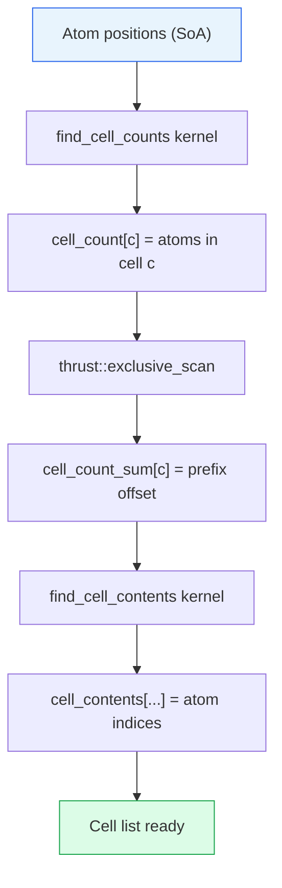
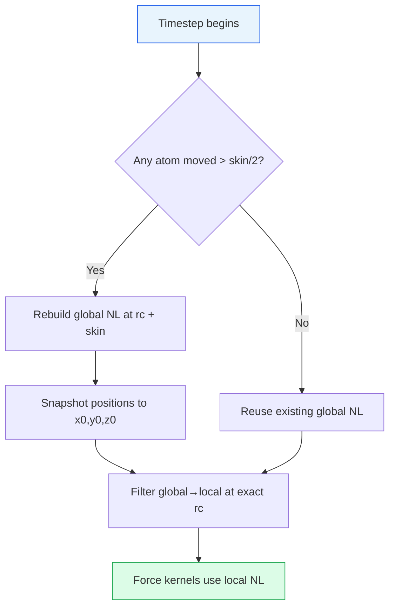
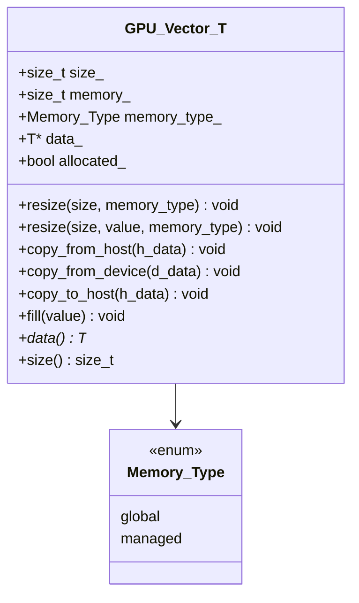
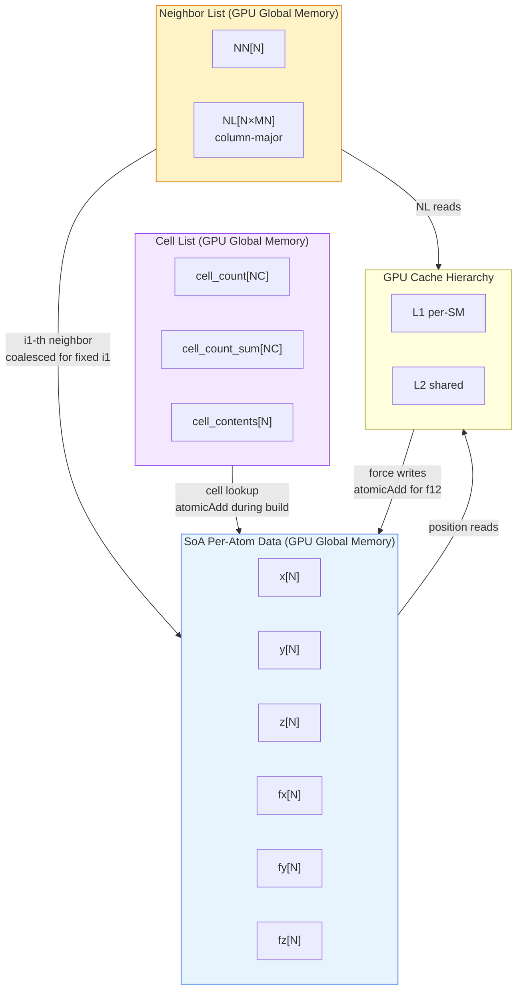

GPUMD's performance hinges on two architectural pillars: an **O(N) cell-list-accelerated Verlet neighbor list** with a dual-resolution (global/local) strategy, and a **Structure-of-Arrays (SoA) memory layout** that aligns per-atom data for coalesced GPU access. This page dissects both systems — how neighbor lists are built, stored, and refreshed, and how all per-atom arrays are arranged in GPU memory to maximize throughput.

## Cell List Construction

The neighbor list algorithm begins by partitioning the simulation domain into a uniform grid of cells, each with side length **rc/2** (half the cutoff radius). This choice guarantees that any atom's neighbors within the cutoff must reside in one of the 27 adjacent cells (3×3×3 stencil for fully periodic systems). The cell list is built in three GPU-parallel phases:

1. **Count atoms per cell** — each atom computes its cell ID via fractional coordinate mapping and atomically increments the count for that cell.
2. **Exclusive prefix sum** — `thrust::exclusive_scan` converts per-cell counts into offsets, yielding `cell_count_sum[c]` = the starting index into a flat array for cell `c`.
3. **Populate cell contents** — atoms re-compute their cell IDs and write their global atom index into `cell_contents[cell_count_sum[cell_id] + ind]` using `atomicAdd` for the local offset `ind`.

The cell ID computation handles both orthogonal and triclinic boxes by transforming Cartesian coordinates into fractional (scaled) space using the inverse box matrix stored in `box.cpu_h[9..17]`, then applying `floor` to obtain integer cell indices. Periodic wrapping ensures indices remain within `[0, nx)`, `[0, ny)`, `[0, nz)` bounds.



Sources: [neighbor.cu](src/force/neighbor.cu#L42-L83), [neighbor.cuh](src/force/neighbor.cuh#L76-L110), [box.cuh](src/model/box.cuh#L32-L33)

## Verlet Neighbor List with Skin Distance

GPUMD implements a **Verlet-style neighbor list** with a configurable skin distance (`skin = 1.0` Å by default). The algorithm maintains two levels of resolution:

| List | Cutoff | Purpose | Rebuild Frequency |
|------|--------|---------|-------------------|
| **Global** | `rc + skin` | Persistent across timesteps | Only when any atom moves > skin/2 |
| **Local** | `rc` (exact) | Used by force kernels | Every timestep (cheap filter) |

The global list is built by `Neighbor::find_neighbor_global`, which first calls `check_atom_distance` to determine if any atom has drifted more than `skin/2` from its position at the last rebuild. If so, it invokes the full O(N) cell-list-based construction at the extended cutoff `rc + skin`, then snapshots all atom positions into `x0, y0, z0` for the next distance check. If no atom has moved beyond the threshold, the global list is reused — this is the key performance optimization that avoids rebuilding every step.

The local list is derived by `Neighbor::find_local_neighbor_from_global`, which simply iterates each atom's global neighbor entries and retains only those within the exact cutoff `rc`. This filter is extremely cheap (one distance comparison per global neighbor) and runs every timestep.



Sources: [neighbor.cu](src/force/neighbor.cu#L742-L823), [neighbor.cuh](src/force/neighbor.cuh#L153-L160)

## Neighbor List Storage: Column-Major Layout

The neighbor list is stored in two GPU arrays:

- **`NN`** — `GPU_Vector<int>` of size `N`, where `NN[i]` = number of neighbors of atom `i`.
- **`NL`** — `GPU_Vector<int>` of size `N × MN`, where `MN` is the maximum neighbors per atom.

The critical access pattern is **column-major**: the j-th neighbor of atom `i` is stored at `NL[N * j + i]`. This layout places all atoms' first neighbors contiguously, then all atoms' second neighbors, and so on. When a force kernel assigns one thread per atom, consecutive threads reading `NL[N * 0 + tid]`, `NL[N * 0 + tid + 1]`, ... access adjacent memory locations — achieving **coalesced global memory reads** on the GPU.

The maximum neighbor count `MN` is estimated during initialization as:

```
MN = num_neighbors × ((rc + skin) / rc)³
```

This scales the expected neighbor count by the cube of the cutoff ratio, accounting for the larger global cutoff volume. If an atom's actual neighbor count exceeds `MN`, the simulation will produce out-of-bounds access — the `num_neighbors` parameter must be chosen conservatively.

After construction, the neighbor list is **sorted** by the `gpu_sort_neighbor_list` kernel, which uses shared-memory bubble-sort logic to order each atom's neighbors by global index. This sorting improves access regularity in downstream force kernels.

Sources: [neighbor.cu](src/force/neighbor.cu#L85-L162), [neighbor.cu](src/force/neighbor.cu#L825-L834), [neighbor.cuh](src/force/neighbor.cuh#L112-L134)

## Specialized Neighbor List Variants

Three distinct neighbor-finding functions serve different potential families:

| Variant | Function | Filter Logic | Use Case |
|---------|----------|--------------|----------|
| **Standard** | `find_neighbor` | All pairs within `rc` | NEP, EAM, Tersoff, LJ |
| **ILP** | `find_neighbor_ilp` | Same-layer vs. different-layer separation | ILP-NEP, ILP-Tersoff hybrids |
| **SW** | `find_neighbor_SW` | Only same-group pairs | Stillinger-Weber in hybrids |

The **ILP variant** maintains two separate neighbor lists: the standard `NN/NL` for inter-layer pairs (different `group_label`) within the ILP cutoff, and `big_ilp_NN/big_ilp_NL` for intra-layer pairs (same `group_label`) within a larger cutoff. This dual-list structure reflects the physics of layered materials where intra-layer bonding (e.g., Tersoff or NEP) operates at a different range than inter-layer van der Waals interactions.

The **SW variant** filters neighbors by `group_label`, only including pairs within the same group — essential for Stillinger-Weber potentials where the three-body term requires all three atoms to belong to the same layer in hybrid ILP-SW models.

All three variants share the same cell-list infrastructure (`cell_count`, `cell_count_sum`, `cell_contents`) and the same column-major NL layout with post-construction sorting.

Sources: [neighbor.cu](src/force/neighbor.cu#L352-L440), [neighbor.cu](src/force/neighbor.cu#L509-L587), [neighbor.cuh](src/force/neighbor.cuh#L43-L74)

## Structure-of-Arrays (SoA) Memory Layout

The `Atom` class stores all per-atom quantities using the **Structure-of-Arrays** pattern via `GPU_Vector<T>`. Each physical quantity is a contiguous GPU array (or multiple arrays for vector/tensor quantities), with components laid out sequentially:

| Quantity | Type | Components | Memory Layout |
|----------|------|------------|---------------|
| `type` | `int` | 1 | `[t₀, t₁, ..., tₙ₋₁]` |
| `mass` | `double` | 1 | `[m₀, m₁, ..., mₙ₋₁]` |
| `charge` | `float` | 1 | `[q₀, q₁, ..., qₙ₋₁]` |
| `position_per_atom` | `double` | 3 | `[x₀..xₙ₋₁, y₀..yₙ₋₁, z₀..zₙ₋₁]` |
| `velocity_per_atom` | `double` | 3 | `[vx₀..vxₙ₋₁, vy₀..vyₙ₋₁, vz₀..vzₙ₋₁]` |
| `force_per_atom` | `double` | 3 | `[fx₀..fxₙ₋₁, fy₀..fyₙ₋₁, fz₀..fzₙ₋₁]` |
| `virial_per_atom` | `double` | 9 | `[v₀₀..v₀₀ₙ₋₁, v₀₁.., ..., v₂₂ₙ₋₁]` |
| `heat_per_atom` | `double` | 5 | `[h₀..hₙ₋₁, ..., h₄ₙ₋₁]` |
| `potential_per_atom` | `double` | 1 | `[p₀, p₁, ..., pₙ₋₁]` |

For a 3-component quantity like position, the x-coordinates of all N atoms occupy the first N elements, y-coordinates the next N, and z-coordinates the final N. Force kernels access these via offset arithmetic: `const double* x = position.data(); const double* y = position.data() + N; const double* z = position.data() + 2*N;`. This pattern — where thread `i` reads `x[i]`, `y[i]`, `z[i]` — maps directly to **coalesced memory transactions** on NVIDIA and AMD GPUs.

> [!TIP]
> SoA layout is non-negotiable for GPU performance. The alternative AoS (Array of Structures) would place xᵢ, yᵢ, zᵢ in adjacent memory, causing stride-3 access patterns where consecutive threads read non-adjacent addresses — severely degrading memory bandwidth utilization.

Sources: [atom.cuh](src/model/atom.cuh#L23-L56), [neighbor.cu](src/force/neighbor.cu#L177-L179)

## GPU_Vector: The Memory Abstraction

`GPU_Vector<T>` is GPUMD's primary GPU memory container, providing allocation, transfer, and initialization for both **global (device) memory** and **managed (unified) memory**:



Key design choices:

- **Dual memory types**: `Memory_Type::global` uses `gpuMalloc` for standard device memory; `Memory_Type::managed` uses `gpuMallocManaged` for unified memory accessible from both host and device.
- **Fill optimization**: For global memory, `fill()` launches a GPU kernel (`gpu_fill`); for managed memory, it uses a simple CPU loop — exploiting the unified access model.
- **Offset-based transfers**: `copy_from_host(h_data, size, offset)` writes to `data_ + offset`, enabling partial updates to sub-arrays without staging buffers.
- **RAII lifecycle**: The destructor calls `gpuFree` if `allocated_` is true, preventing leaks. `resize()` frees existing allocation before reallocating.

All per-atom arrays in `Atom`, all neighbor list arrays (`NN`, `NL`), and all cell-list arrays (`cell_count`, `cell_count_sum`, `cell_contents`) are `GPU_Vector` instances — making this the universal memory backbone of the simulation.

> [!TIP]
> The `GPU_Vector` deliberately omits a copy constructor and assignment operator. Transferring GPU vectors should use `copy_from_device()` / `copy_to_host()` explicitly — implicit deep copies would hide costly device-to-host transfers and break performance reasoning.

Sources: [gpu_vector.cuh](src/utilities/gpu_vector.cuh#L32-L200)

## Cell List Memory Footprint

The cell list requires three auxiliary `GPU_Vector<int>` arrays:

| Array | Size | Purpose |
|-------|------|---------|
| `cell_count` | `N_cells` (= `nx × ny × nz`) | Number of atoms in each cell |
| `cell_count_sum` | `N_cells` | Exclusive prefix sum — starting offset into `cell_contents` |
| `cell_contents` | `N` | Flat array of atom indices, grouped by cell |

The cell grid dimensions `nx, ny, nz` are computed by `box.get_num_bins(rc_cell_list, num_bins)` where `rc_cell_list = rc / 2`. For a cubic box of side L with cutoff rc, this yields roughly `(2L/rc)³` cells. The `cell_contents` array is sized to N (the total number of atoms) since every atom belongs to exactly one cell. If `N_cells > N`, the `cell_count` and `cell_count_sum` arrays are resized dynamically — this can occur for small systems with large cutoffs where the cell grid is finer than the atom count.

The cell list is rebuilt every time the neighbor list is rebuilt (i.e., when atoms exceed the skin/2 displacement threshold). Between rebuilds, the cell list arrays are reused without reallocation, provided the cell count doesn't exceed the previously allocated capacity.

Sources: [neighbor.cu](src/force/neighbor.cu#L164-L215), [neighbor.cu](src/force/neighbor.cu#L297-L349), [neighbor.cuh](src/force/neighbor.cuh#L155-L157)

## Neighbor List Access Patterns in Force Kernels

Force kernels follow a consistent access idiom. Each GPU thread handles one atom `n1` and iterates over its neighbors:

```
for (int i1 = 0; i1 < NN[n1]; ++i1) {
    int n2 = NL[static_cast<size_t>(N) * i1 + n1];
    // compute pair interaction between n1 and n2
}
```

The column-major NL layout means that for a fixed `i1` (neighbor index), all threads access `NL[N * i1 + tid]` where `tid` is the thread index — these are contiguous memory addresses, producing **coalesced 128-byte transactions** on GPUs with warp size 32. However, as `i1` varies within the inner loop, successive reads stride by `N` elements — these are non-coalesced but unavoidable in the neighbor-list iteration pattern. The sorting of neighbor indices (by `gpu_sort_neighbor_list`) partially mitigates this by improving spatial locality of the referenced atom data (`x[n2]`, `y[n2]`, `z[n2]`).

For potentials requiring three-body interactions (Tersoff, SW, ADP), the neighbor list of atom `n2` is also accessed within the inner loop, creating a **double-indirect** access pattern: `n3 = NL[N * i2 + n2]` where `n2` itself came from the neighbor list. This is the primary bottleneck for three-body potentials and benefits greatly from L1/L2 cache hit rates, which the sorted neighbor list improves.

Sources: [neighbor.cu](src/force/neighbor.cu#L85-L162), [potential.cuh](src/force/potential.cuh#L91-L112)

## Putting It All Together: Memory Architecture



The complete data flow for a force computation step: (1) the neighbor list module checks atom displacements against the skin threshold; (2) if triggered, it rebuilds the cell list and neighbor list entirely on the GPU; (3) the local neighbor list is filtered from the global list; (4) each force kernel reads positions via coalesced SoA access, traverses the column-major NL, and accumulates forces back into the SoA `force_per_atom` array using `atomicAdd` for the pairwise decomposition (`f12` pattern). The `Potential::find_properties_many_body` helper centralizes this force/virial accumulation logic across all many-body potentials.

This architecture — SoA layout for coalesced reads, column-major NL for neighbor traversal, Verlet skin for amortized rebuild cost, and cell lists for O(N) construction — represents the standard high-performance pattern for GPU molecular dynamics and is the foundation upon which GPUMD achieves its simulation throughput.

Sources: [neighbor.cuh](src/force/neighbor.cuh#L136-L160), [atom.cuh](src/model/atom.cuh#L23-L56), [potential.cuh](src/force/potential.cuh#L91-L112), [gpu_vector.cuh](src/utilities/gpu_vector.cuh#L37-L200)

## Next Steps

The neighbor list and memory layout form the substrate for all force computations. To understand how force kernels leverage this infrastructure on the GPU:

- **[CUDA Kernel Design](13-cuda-kernel-design)** — examines thread mapping strategies, shared memory usage, and kernel launch configurations that operate on the neighbor list and SoA data described here.
- **[Force and Potential System](5-force-and-potential-system)** — details the potential hierarchy and how each potential type consumes the neighbor list during force computation.
- **[Multi-GPU and MDI Interface](17-multi-gpu-and-mdi-interface)** — covers how the neighbor list is decomposed across multiple GPUs in the `NEP_MULTIGPU` variant.