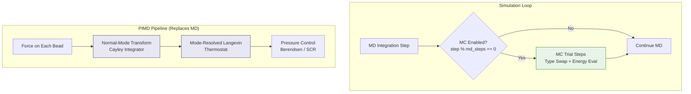

GPUMD implements two distinct classes of advanced sampling methods that extend molecular dynamics beyond classical equilibrium ensembles: **Monte Carlo–Molecular Dynamics (MCMD)** for alloy phase-space exploration and **Path Integral Molecular Dynamics (PIMD)** for quantum nuclear effects. Both subsystems are tightly integrated with the GPU-accelerated NEP potential engine, enabling production-scale simulations of composition-dependent thermodynamics and quantum-statistical properties on a single GPU.

## Architectural Overview

The MC and PIMD subsystems occupy different layers of the simulation pipeline. MC operates as an **interleaved trial step** between MD integration steps — it does not replace the integrator but mutates atomic identities in-place. PIMD, by contrast, is a **full integrator replacement** that evolves a ring-polymer representation of the quantum partition function. The following diagram captures this structural asymmetry:



Sources: [mc.cuh](/src/mc/mc.cuh#L1-L57), [ensemble_pimd.cuh](/src/integrate/ensemble_pimd.cuh#L1-L99)

## Monte Carlo–Molecular Dynamics (MCMD)

### Concept and Scope

MCMD interleaves Monte Carlo trial moves into an ongoing MD trajectory, enabling the system to sample **configurational space** that pure MD cannot efficiently reach — specifically, atom-type swaps in multicomponent systems. This is essential for studying alloy thermodynamics, precipitation, and order–disorder transitions. The MC module supports three statistical ensembles, each governing how atom identities are mutated:

| Ensemble | Trial Move | Governs | Key Use Case |
|----------|-----------|---------|--------------|
| **Canonical** | Swap types of two atoms (i, j) | Fixed composition | Order–disorder transitions at fixed stoichiometry |
| **SGC** (Semi-Grand Canonical) | Change type of one atom | Fixed Δμ between species | Concentration–chemical potential mapping |
| **VCSGC** (Variance-Constrained SGC) | Change type of one atom | Fixed φ, κ (concentration + variance) | Full composition range, miscibility gaps |

The canonical ensemble performs **swap moves** — exchanging the types of two randomly selected atoms of different species — preserving total composition. The SGC and VCSGC ensembles perform **identity-change moves** on a single atom, where acceptance depends on chemical potential differences (SGC) or the constrained φ/κ parameters (VCSGC).

> [!TIP]
> MCMD requires a NEP potential. The `NEP_Energy` class evaluates the local energy change for each MC trial by computing per-atom NEP energies for the affected neighborhood only — not the entire system — which is what makes GPU-accelerated MCMD tractable.

Sources: [mc_ensemble_canonical.cuh](/src/mc/mc_ensemble_canonical.cuh#L1-L38), [mc_ensemble_sgc.cuh](/src/mc/mc_ensemble_sgc.cuh#L1-L57), [mc.rst](/doc/gpumd/input_parameters/mc.rst#L1-L112)

### MC Class Hierarchy

The MC module follows a polymorphic design with a strategy pattern:

```
MC (driver)
 └── MC_Ensemble (abstract base)
      ├── MC_Ensemble_Canonical  (swap moves)
      └── MC_Ensemble_SGC        (identity-change moves, also covers VCSGC)
```

The `MC` driver class holds scheduling parameters (`num_steps_md`, `num_steps_mc`, temperature ramp) and delegates trial computation to the appropriate `MC_Ensemble` subclass via `std::unique_ptr<MC_Ensemble>`. The driver's `compute` method fires MC trials only when `(step + 2) % num_steps_md == 0`, using a linearly interpolated temperature from `T_initial` to `T_final`.

Sources: [mc.cuh](/src/mc/mc.cuh#L1-L57), [mc_ensemble.cuh](/src/mc/mc_ensemble.cuh#L1-L72)

### GPU-Accelerated Trial Evaluation

Each MC trial involves a **local energy evaluation** — only the neighborhood of the trial atom(s) needs re-evaluation. The implementation leverages GPU parallelism through these kernel stages:

1. **Neighbor identification**: CUDA kernels `get_neighbors_of_i_and_j` (canonical) or `get_neighbors_of_i` (SGC) find atoms within the NEP radial cutoff of the trial site(s), storing them in `NL_ij`.
2. **Type arrays**: Before/after type arrays are constructed via `get_types` and `find_local_types` kernels, enabling differential energy computation.
3. **NEP energy**: The `NEP_Energy` class computes per-atom energies for both before and after the proposed change, using the same NEP parameter structure as the MD force engine.
4. **Acceptance & commit**: A host-side Metropolis criterion determines acceptance; if accepted, the `exchange` kernel (canonical) or analogous kernel (SGC) updates atom types, masses, and velocities on the GPU.

Sources: [mc_ensemble_canonical.cu](/src/mc/mc_ensemble_canonical.cu#L1-L200), [nep_energy.cuh](/src/mc/nep_energy.cuh#L1-L100)

### MC Input Syntax

The `mc` keyword in `run.in` supports three forms:

**Canonical ensemble:**
```
mc canonical <md_steps> <mc_trials> <T_i> <T_f> [group <grouping_method> <group_id>]
```

**SGC ensemble:**
```
mc sgc <md_steps> <mc_trials> <T_i> <T_f> <num_species> {<species_0> <mu_0> ...} [group ...]
```

**VCSGC ensemble:**
```
mc vcsgc <md_steps> <mc_trials> <T_i> <T_f> <num_species> {<species_0> <phi_0> ...} <kappa> [group ...]
```

| Parameter | Description | Constraints |
|-----------|-------------|-------------|
| `md_steps` | MD steps between MC trial batches | Positive integer |
| `mc_trials` | Number of MC trials per batch | Positive integer |
| `T_i`, `T_f` | Initial/final MC temperature (K) | Positive; linearly ramped |
| `num_species` | Species count in SGC/VCSGC | 2–4 |
| `mu_i` | Chemical potential of species i (eV) | Only Δμ matters |
| `phi_i` | Dimensionless concentration parameter | Typically −1.2 to +1.2 |
| `kappa` | Variance constraint parameter | Positive; ~100 typical, increase for miscibility gaps |
| `group` | Restrict MC to a subgroup | Optional; requires grouping_method and group_id |

**Concrete examples:**
```
mc canonical 100 200 500 100 group 1 3     # 200 swaps every 100 MD steps, T: 500→100 K, group 3 of method 1
mc sgc 100 1000 300 300 2 Cu 0 Au 0.6      # SGC at 300 K, Δμ(Au−Cu) = 0.6 eV
mc vcsgc 200 1000 500 500 2 Al -2 Ag 0 10000  # VCSGC at 500 K, κ=10000
```

Sources: [mc.rst](/doc/gpumd/input_parameters/mc.rst#L23-L112), [mc.cu](/src/mc/mc.cu#L200-L334)

---

## Path Integral Molecular Dynamics (PIMD)

### Quantum Nuclear Effects via Ring Polymers

PIMD approximates the quantum canonical partition function by mapping each quantum particle onto a **ring polymer** of `P` classical beads connected by harmonic springs. The effective spring constant is `ω_P = P k_B T / ℏ`, and the classical ring-polymer Hamiltonian exactly reproduces quantum thermodynamics as P → ∞. GPUMD supports four PIMD variants that differ in how the ring-polymer modes are thermostatted:

| Variant | Internal Modes | Centroid Mode | Barostat | Physical Regime |
|---------|---------------|---------------|----------|-----------------|
| **pimd** | Langevin thermostat | Langevin thermostat | Berendsen or SCR | Equilibrium quantum statistics (NVT/NPT) |
| **pimd_scr** | Langevin thermostat | Langevin thermostat | Stochastic cell rescaling | NPT with better volume sampling |
| **rpmd** | Free (no thermostat) | Free (no thermostat) | None | Approximate quantum rate theory (NVE) |
| **trpmd** | Langevin thermostat | Free (no thermostat) | None | Improved quantum dynamics [Rossi2014] |

Sources: [ensemble_pimd.rst](/doc/gpumd/input_parameters/ensemble_pimd.rst#L1-L66), [ensemble_pimd.cu](/src/integrate/ensemble_pimd.cu#L1-L50)

### Normal-Mode Integration Scheme

The integration follows the **Ceriotti et al. (2010)** scheme with a Cayley-modified free-polymer propagator for numerical stability. The time-stepping algorithm decomposes into:

1. **Half-kick**: `v += (Δt/2m) · f` for all beads
2. **Normal-mode transform**: Positions and velocities are rotated into the staging/normal-mode basis via the precomputed `transformation_matrix` (a discrete cosine/sine transform of size P × P)
3. **Free-polymer drift**: In normal-mode space, each mode k evolves as a harmonic oscillator with frequency `ω_k`. The centroid (k=0) drifts freely. Internal modes use the **Cayley approximation** rather than exact trigonometric functions:
   - `cos_factor = (1 − (ω_k Δt/2)²) / (1 + (ω_k Δt/2)²)`
   - `sin_factor = ω_k Δt / (1 + (ω_k Δt/2)²)`
   
   This Cayley form is more stable than `cos(ω_k Δt)` for stiff modes, following [Korol et al., J. Chem. Phys. 151, 124103 (2019)].
4. **Inverse transform**: Back to bead representation
5. **Force evaluation**: Compute forces on all beads (P independent NEP evaluations)
6. **Second half-kick**: `v += (Δt/2m) · f`

The Langevin thermostat is applied in normal-mode space between the half-kicks, with mode-dependent friction: the centroid uses a user-specified coupling time `T_coup`, while internal mode k uses friction proportional to `ω_k`.

Sources: [ensemble_pimd.cu](/src/integrate/ensemble_pimd.cu#L200-L399), [ensemble_pimd.cuh](/src/integrate/ensemble_pimd.cuh#L1-L99)

### Ring-Polymer Memory Layout

Each bead stores its own position, velocity, force, potential, and virial arrays. The `Ensemble_PIMD` class maintains **GPU arrays of GPU pointers** — `position_beads`, `velocity_beads`, `force_beads`, `virial_beads` — each of length `P`, where element `k` points to the device memory for bead `k`. This double-indirection pattern allows a single CUDA kernel to iterate over all beads efficiently:

```
GPU_Vector<double*> position_beads;  // P pointers, one per bead
// position_beads[k] → atom.position_beads[k].data() on GPU
```

The first PIMD run allocates bead storage in the `Atom` object and initializes all beads to the classical configuration. Subsequent runs (e.g., RPMD after PIMD equilibration) reuse the same bead arrays — the number of beads cannot change between runs.

Sources: [ensemble_pimd.cu](/src/integrate/ensemble_pimd.cu#L120-L198), [ensemble_pimd.cuh](/src/integrate/ensemble_pimd.cuh#L64-L80)

### Eco-PIMD: Economised Path-Integral Frequencies

The standard Trotter discretization uses internal-mode frequencies `ω_k = 2ω_P sin(kπ/P)`, which reproduce the quantum partition function but require many beads for high-frequency modes. **Eco-PIMD** [Zeng & Manolopoulos, arXiv:2607.06414 (2026)] replaces these with optimised frequencies that minimise the error in Matsubara correlation functions while using far fewer beads.

The optimisation solves a nonlinear least-squares problem: minimize the RMSE between the exact and ring-polymer Matsubara correlation function over a grid of dimensionless frequencies `x = βℏω`, subject to the constraint that the highest physical frequency `ω_max` (supplied in cm⁻¹) is faithfully reproduced. The solver uses:

- **Newton's method** with a shifted Hessian (eigendecomposition via Jacobi solver on GPU) for the Newton direction
- **Line search** for step-size control
- **Small-x series expansion** to avoid cancellation in the objective function
- **Relative convergence test** that terminates in the flat valley of an already-converged fit

The `update_eco_modes` method recalculates Eco frequencies whenever the temperature changes beyond a tolerance, using the previous solution as the Newton starting point — enabling efficient temperature-ramped simulations.

> [!TIP]
> Eco-PIMD is available only for `pimd` and `pimd_scr`; RPMD and TRPMD always use Trotter frequencies. The `eco` option is rejected at parse time for `rpmd`/`trpmd` with a clear error message.

Sources: [eco_pimd.cu](/src/integrate/eco_pimd.cu#L1-L200), [eco_pimd.cuh](/src/integrate/eco_pimd.cuh#L1-L39), [ensemble_pimd.cu](/src/integrate/ensemble_pimd.cu#L200-L248)

### PIMD Input Syntax

**PIMD (NVT or NPT with Berendsen barostat):**
```
ensemble pimd <num_beads> <T_1> <T_2> <T_coup> [{pressure_params}] [eco <omega_max>]
```

**PIMD with stochastic cell rescaling (NPT):**
```
ensemble pimd_scr <num_beads> <T_1> <T_2> <T_coup> {pressure_params} [eco <omega_max>]
```

**Ring-Polymer MD (NVE-like):**
```
ensemble rpmd <num_beads>
```

**Thermostatted Ring-Polymer MD:**
```
ensemble trpmd <num_beads>
```

| Parameter | Description | Constraints |
|-----------|-------------|-------------|
| `num_beads` | Number of ring-polymer beads | Positive even integer ≤ 128 |
| `T_1`, `T_2` | Initial/final target temperature (K) | Positive; linearly ramped |
| `T_coup` | Langevin coupling time (steps) | Positive; controls centroid thermostat |
| `eco omega_max` | Highest wavenumber to reproduce (cm⁻¹) | Only for `pimd`/`pimd_scr` |
| Pressure params | Same forms as `npt_ber` or `npt_scr` | Isotropic, orthogonal, or triclinic |

**Concrete example:**
```
ensemble pimd 32 300 300 100 eco 3500   # 32 beads, 300 K, coupling=100 steps, Eco up to 3500 cm⁻¹
ensemble rpmd 32                       # RPMD with 32 beads (must follow a prior PIMD run)
```

Sources: [ensemble_pimd.rst](/doc/gpumd/input_parameters/ensemble_pimd.rst#L17-L66), [test_eco_pimd.py](/tests_pytest/test_eco_pimd.py#L1-L74)

---

## Implementation Comparison

| Aspect | MCMD | PIMD |
|--------|------|------|
| **Module path** | `src/mc/` | `src/integrate/` |
| **Integration role** | Interleaved adjunct to MD | Full integrator replacement |
| **State mutation** | Atom type, mass, velocity | All bead positions & velocities |
| **Potential calls** | Local NEP energy (affected neighborhood) | Full NEP force × P beads |
| **GPU parallelism** | Within-trial neighbor search + energy | Bead-level parallelism + normal-mode transforms |
| **NEP dependency** | Required (exclusive) | Any potential supporting per-bead evaluation |
| **Output** | `mcmd.out` (composition tracking) | `thermo.out`, `dump_beads` |
| **Group support** | Yes (restrict MC to subgroup) | No (all atoms participate) |
| **Temperature control** | Linear ramp T_i → T_f | Linear ramp + mode-resolved Langevin |

Sources: [mc.cuh](/src/mc/mc.cuh#L1-L57), [ensemble_pimd.cuh](/src/integrate/ensemble_pimd.cuh#L1-L99)

## Testing and Validation

The Eco-PIMD implementation is validated by `test_eco_pimd.py`, which verifies two properties: (1) the Eco RMSE is strictly less than the Trotter RMSE for the same bead count, confirming that the optimisation improves fidelity; and (2) the `eco` suffix is correctly rejected for `rpmd` and `trpmd` ensembles, preventing invalid configurations. MCMD correctness is implicitly validated through the NEP energy local-evaluation path, which shares its core with the production NEP force engine.

Sources: [test_eco_pimd.py](/tests_pytest/test_eco_pimd.py#L1-L74)

## Related Topics

- The NEP potential engine that both MCMD and PIMD depend on: [NEP Model Architecture](8-nep-model-architecture)
- The integration framework that PIMD plugs into: [Integration and Ensemble Methods](6-integration-and-ensemble-methods)
- GPU kernel patterns used in both modules: [CUDA Kernel Design](13-cuda-kernel-design)
- Measurement outputs for PIMD trajectories: [Measurement and Output](7-measurement-and-output)