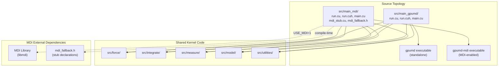
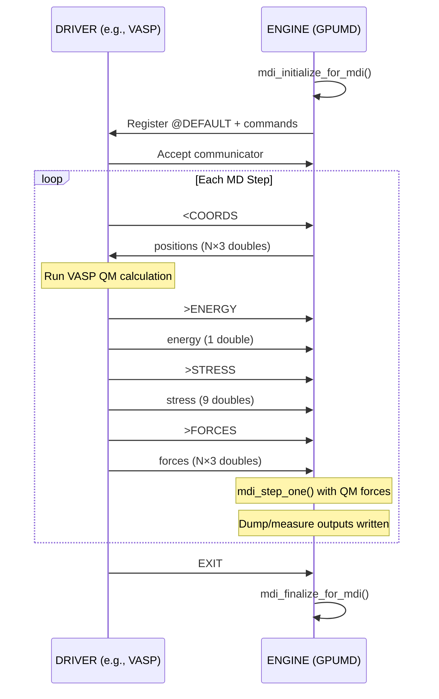

GPUMD extends beyond single-GPU standalone simulation through two complementary architectural strategies: the **MolSSI Driver Interface (MDI)** for inter-code coupling, and a **modular executable topology** that isolates MDI concerns into a dedicated build target. The MDI integration positions GPUMD as an **ENGINE** in the MolSSI ecosystem — an MD integrator whose force evaluation can be delegated to an external **DRIVER** (e.g., VASP for QM forces), enabling hybrid QM/MD workflows without modifying GPUMD's core simulation loop. This page examines the architectural design, command protocol, data marshalling between GPU and MDI layers, and the concrete VASP–GPUMD coupling that ships as a reference implementation.

## Architectural Overview: Executable Topology

GPUMD does not bolt MDI support onto the main `gpumd` executable. Instead, it produces a **separate `gpumd-mdi` binary** from a dedicated source tree under `src/main_mdi/`, sharing the bulk of the simulation kernel code with `src/main_gpumd/` but replacing the entry point and `Run` class with MDI-aware variants. This architectural decision yields three concrete advantages: (1) the standard `gpumd` binary carries zero MDI dependency overhead; (2) the MDI build can conditionally link against the MDI library via compile-time flags without polluting the default build; and (3) the `Run` class in `main_mdi` extends its `main_gpumd` counterpart with MDI-specific member functions and state without risking regression in standalone simulations.



The `main_mdi/main.cu` entry point introduces a **dual-mode dispatch**: if `--mdi` is present on the command line, the `Run` object is constructed with `skip_run = true` (suppressing `run` commands in `run.in`) and control transfers to `mdi_engine_main()`; otherwise, the binary behaves identically to the standard `gpumd` executable. This means `gpumd-mdi` is a **strict superset** — it can always substitute for `gpumd` in standalone mode.

Sources: [main.cu](/src/main_mdi/main.cu#L48-L67), [makefile_mdi](/src/makefile_mdi#L1-L170)

## MDI Command Protocol

The MDI standard defines a **command-exchange protocol** between a DRIVER and an ENGINE over a transport layer (TCP, MPI, or plugin). GPUMD's ENGINE registers a single node `@DEFAULT` and exposes nine commands, split into **outbound queries** (the DRIVER requests data from GPUMD) and **inbound directives** (the DRIVER pushes data into GPUMD):

| Command | Direction | Payload | Units | Purpose |
|---------|-----------|---------|-------|---------|
| `<NATOMS` | ENGINE → DRIVER | 1 × `MDI_INT` | — | Report atom count |
| `<COORDS` | ENGINE → DRIVER | N×3 × `MDI_DOUBLE` | Bohr | Send current positions |
| `>COORDS` | DRIVER → ENGINE | N×3 × `MDI_DOUBLE` | Bohr | Override positions |
| `<FORCES` | ENGINE → DRIVER | N×3 × `MDI_DOUBLE` | MDI force units | Compute & send forces |
| `>FORCES` | DRIVER → ENGINE | N×3 × `MDI_DOUBLE` | MDI force units | Inject external (QM) forces |
| `<ENERGY` | ENGINE → DRIVER | 1 × `MDI_DOUBLE` | MDI energy units | Compute & send total energy |
| `>ENERGY` | DRIVER → ENGINE | 1 × `MDI_DOUBLE` | MDI energy units | Inject external energy |
| `>STRESS` | DRIVER → ENGINE | 9 × `MDI_DOUBLE` | eV/ų | Inject 3×3 stress tensor |
| `EXIT` | DRIVER → ENGINE | — | — | Terminate MDI loop |

The protocol follows a strict **synchronous request-response** pattern: the DRIVER sends a command string via `MDI_Send_Command`, then either sends or receives the associated data buffer. The ENGINE sits in a blocking `MDI_Recv_command` loop until `EXIT` arrives. This design is inherently **step-serial** — each MD step requires a full round-trip — which is appropriate for QM/MD coupling where the QM evaluation dominates wall-clock time.

Sources: [mdi_stub.cu](/src/main_mdi/mdi_stub.cu#L85-L100), [mdi_stub.cu](/src/main_mdi/mdi_stub.cu#L117-L240)

## MDI Engine Implementation: The Command Loop

The `mdi_engine_main()` function in `mdi_stub.cu` orchestrates the ENGINE lifecycle in four phases: **initialization**, **registration**, **communication**, and **finalization**. After `MDI_Init` parses the `--mdi` options string (encoding role, name, method, hostname, port), the ENGINE calls `run->mdi_initialize_for_mdi()` to set up the integrator, MC, and measurement subsystems for **single-step operation** (`one_steps = 1`). This is a critical architectural choice: unlike `perform_a_run()` which loops internally over `number_of_steps`, the MDI mode steps **one integration step at a time**, with the DRIVER dictating when to advance.

The command loop itself is a `while (!exit_flag)` dispatch over received command strings. For outbound queries (`<NATOMS`, `<COORDS`, `<FORCES`, `<ENERGY`), the ENGINE calls the corresponding `mdi_get_*` or `mdi_compute_forces()` method, marshals data from GPU memory to a host `std::vector<double>`, and sends via `MDI_Send`. For inbound directives (`>COORDS`, `>FORCES`, `>ENERGY`, `>STRESS`), the ENGINE receives into a host buffer and calls the corresponding `mdi_set_*` method, which copies into GPU memory. The `>FORCES` command is the most consequential: after receiving external forces, the ENGINE immediately calls `mdi_step_one()`, performing a single velocity-Verlet integration step using the injected forces rather than the internal potential.



Sources: [mdi_stub.cu](/src/main_mdi/mdi_stub.cu#L62-L116), [mdi_stub.cu](/src/main_mdi/mdi_stub.cu#L145-L210)

## Run Class Extensions for MDI

The `Run` class in `main_mdi/run.cuh` extends the standalone version with **ten public MDI methods** and **six private MDI state variables**. The class diff reveals the architectural pattern: MDI support is achieved by adding a **single-step integration pathway** (`mdi_step_one()`) that mirrors the logic of `perform_a_run()` but executes exactly one iteration, and by introducing **external-data pending flags** that override the internal force computation when the DRIVER has supplied QM quantities.

| MDI Method | Operation | GPU ↔ Host Direction |
|------------|-----------|---------------------|
| `mdi_get_natoms()` | Return `atom.number_of_atoms` | — |
| `mdi_get_positions()` | Copy `position_per_atom` to host vector | Device → Host |
| `mdi_set_positions()` | Copy host array to `position_per_atom` | Host → Device |
| `mdi_compute_forces()` | Call `force.compute()` on current positions | GPU internal |
| `mdi_get_forces()` | Copy `force_per_atom` to host vector | Device → Host |
| `mdi_get_potential()` | Copy `potential_per_atom` to host vector | Device → Host |
| `mdi_set_forces()` | Copy host array to `force_per_atom`, set `external_forces_pending = true` | Host → Device |
| `mdi_set_energy()` | Store `external_total_energy`, set `external_energy_pending = true` | — |
| `mdi_set_stress()` | Store 9-component stress, set `external_stress_pending = true` | — |
| `mdi_step_one()` | Execute one integration step (see below) | — |

The **pending-flag pattern** is the key mechanism that reconciles MDI-driven stepping with GPUMD's internal force pipeline. When `mdi_set_forces()` is called, it copies the QM forces directly into `atom.force_per_atom` on the GPU and sets `external_forces_pending = true`. Inside `mdi_step_one()`, the force computation is **conditionally skipped**:

```cpp
if (!external_forces_pending) {
  mdi_compute_forces();  // internal potential
} else {
  // use forces already present (set by mdi_set_forces)
}
```

After integration completes, `external_forces_pending` is cleared. This design ensures that the integrator's `compute1()` and `compute2()` halves see consistent forces without any special-case branching in the integrator code itself.

> [!TIP]
> The `mdi_step_one()` method also handles external energy and stress by distributing the total energy evenly across per-atom potential arrays and converting the 3×3 stress tensor into GPUMD's per-atom virial convention (W = −σ·V/N), so that thermodynamic outputs (`dump_thermo`, `dump_xyz`) remain physically consistent when QM quantities are used instead of the internal potential.

Sources: [run.cuh](/src/main_mdi/run.cuh#L45-L107), [run.cu](/src/main_mdi/run.cu#L399-L570)

## MDI Step Internals: Single-Step Integration Path

The `mdi_step_one()` method reproduces the per-iteration logic of `perform_a_run()` with two modifications: (1) force computation is conditional on `external_forces_pending`, and (2) the step counter is `mdi_step_counter` (a dedicated MDI-local counter) rather than the `step` variable from the `perform_a_run` loop. The complete sequence within a single `mdi_step_one()` call is:

1. **Velocity correction** — `velocity.correct_velocity()` applies constraints (fixed groups, etc.)
2. **Integration half-step 1** — `integrate.compute1()` advances velocities by half a time step
3. **Force evaluation** — conditional: internal `force.compute()` or use pending external forces
4. **External energy/stress injection** — distribute `external_total_energy` and `external_stress` into per-atom arrays, then clear pending flags
5. **Auxiliary force modifiers** — `electron_stop`, `add_force`, `add_spring`, `add_random_force`, `add_efield`
6. **Integration half-step 2** — `integrate.compute2()` completes the velocity-Verlet step
7. **Monte Carlo** — `mc.compute()` handles MC moves if configured
8. **Measurement & output** — `measure.process()` triggers all `dump_*` and `compute_*` outputs
9. **Step counter increment** — `mdi_step_counter++`

This ensures that **all GPUMD output keywords work identically** in MDI mode. The `dump_xyz`, `dump_thermo`, and other diagnostic outputs fire at the same intervals and write the same quantities — except that forces, energy, and virial now reflect the QM-supplied values rather than the internal potential.

> [!TIP]
> When `skip_run_commands = true` (MDI mode), the `execute_run_in()` parser skips any `run` keyword it encounters. This means the `run.in` file can still contain `potential`, `velocity`, `ensemble`, `time_step`, `dump_*`, and `compute_*` directives for initialization, but the actual simulation stepping is entirely under DRIVER control via the MDI command loop.

Sources: [run.cu](/src/main_mdi/run.cu#L510-L570), [run.cu](/src/main_mdi/run.cu#L163-L198)

## Build System and Compilation

GPUMD offers two build paths for the MDI-enabled executable. The **Makefile path** (`src/makefile_mdi`) is the primary method, designed to be invoked from the `src/` directory:

```bash
cd src
make -f makefile_mdi USE_MDI=1 MDI_LIB=1 \
  MDI_LIB_PATH=/path/to/MDI_Library/install/lib64 \
  MDI_INC_PATH=/path/to/MDI_Library/install/include
```

The Makefile links source files from both `main_mdi/` and selected modules from `main_gpumd/` (velocity, cohesive, add_efield, add_force, add_spring, add_random_force, electron_stop, replicate), creating a `gpumd-mdi` executable. The `USE_MDI=1` flag injects `-DUSE_MDI` into the compiler, activating the `#ifdef USE_MDI` guards throughout the codebase. The `MDI_LIB=1` flag adds the MDI library include path and links `-lmdi`.

| Build Variable | Effect | Default |
|---------------|--------|---------|
| `USE_MDI` | Defines `USE_MDI` preprocessor macro | Off |
| `MDI_LIB` | Enables MDI library linking | Off |
| `MDI_LIB_PATH` | Adds `-L<path>` to linker | — |
| `MDI_INC_PATH` | Adds `-I<path>` to compiler | — |
| `CUDA_ARCH` | Sets `-arch=sm_XX` | `sm_60` |

The **CMake path** (`CMakeLists.txt`) currently builds `gpumd`, `nep`, and `gnep` targets but does **not** yet include a `gpumd-mdi` target. Users who prefer CMake must either add a custom target or fall back to the Makefile.

The `mdi_fallback.h` header provides **stub declarations** for the full MDI API (all `MDI_*` functions, types, and constants) so that `mdi_stub.cu` compiles even when the actual MDI library headers are unavailable. At link time, the real library must be present when `USE_MDI=1` and `MDI_LIB=1` are both set.

Sources: [makefile_mdi](/src/makefile_mdi#L1-L170), [mdi_fallback.h](/src/main_mdi/mdi_fallback.h#L1-L152), [CMakeLists.txt](/CMakeLists.txt#L1-L69)

## VASP–GPUMD Reference Implementation

GPUMD ships a complete **QM/MD coupling pipeline** using VASP as the DRIVER and GPUMD as the ENGINE. The implementation consists of three layers:

### Layer 1: Shell Orchestrator (`run_mdi_vasp_gpumd.sh`)

The shell script handles process lifecycle management: it starts `gpumd-mdi` as a background ENGINE process with the `--mdi` flag and TCP options, waits for initialization, then launches the Python DRIVER in the foreground. On completion (or error), it saves logs to a persistent `.gpumd_logs/` directory and optionally cleans up the `.gpumd_vasp_tmp/` intermediate directory.

```bash
# ENGINE (background)
gpumd-mdi --mdi "-role ENGINE -name gpumd -method TCP -hostname localhost -port 8021" -in run.in &

# DRIVER (foreground)
python3 vasp_mdi_driver.py --vasp-cmd "vasp_std" --port 8021 --steps 100
```

### Layer 2: Python MDI Driver (`vasp_mdi_driver.py`)

The driver implements two classes: `VASPCalculator` (VASP I/O wrapper) and `VASPMDIDriver` (MDI communication logic). The MD loop follows a fixed choreography per step:

1. Send `<COORDS` → receive positions from GPUMD
2. Write POSCAR from received coordinates + cell template
3. Execute VASP via `subprocess.run`
4. Parse `vasprun.xml` for energy, forces, stress
5. Send `>ENERGY` with QM energy
6. Send `>STRESS` with 3×3 stress tensor (kbar → eV/ų conversion)
7. Send `>FORCES` with QM forces → triggers `mdi_step_one()` in GPUMD

The stress conversion uses `KBAR_TO_EV_PER_ANG3 = 0.00062415091` to translate VASP's kbar output into GPUMD's eV/ų convention.

### Layer 3: GPUMD Configuration (`examples/gpumd_mdi/`)

The example provides a minimal Cu system with NEP potential, NVE ensemble, and standard dump keywords:

```
potential   ../../potentials/nep/nep89_20250409/nep89_20250409.txt
velocity    1
ensemble nve
time_step  0.5
dump_xyz 1 dump.xyz force precision double
dump_thermo 1
run 5
```

Note that `run 5` is parsed but **skipped** in MDI mode (`skip_run_commands = true`). The `potential`, `ensemble`, `time_step`, and `dump_*` directives still configure the simulation — the DRIVER simply replaces the internal force loop with QM evaluations.

| File | Role |
|------|------|
| `model.xyz` | Initial atomic structure (Cu dimer) |
| `run.in` | GPUMD initialization (potential, ensemble, dumps) |
| `INCAR_template` | VASP DFT parameters |
| `POSCAR_template` | VASP cell + species template |
| `KPOINTS` | VASP k-point mesh |
| `POTCAR` | VASP pseudopotential |

Sources: [run_mdi_vasp_gpumd.sh](/tools/gpumd-mdi/run_mdi_vasp_gpumd.sh#L1-L255), [vasp_mdi_driver.py](/tools/gpumd-mdi/vasp_mdi_driver.py#L1-L200), [run.in](/examples/gpumd_mdi/run.in#L1-L10)

## Extending to Other Driver Codes

The MDI protocol is **code-agnostic by design**. The ENGINE-side logic in GPUMD has no VASP-specific knowledge — it simply responds to the nine standard commands. To couple GPUMD with any other QM or MM code, one needs only a DRIVER that:

1. Initializes MDI in DRIVER role (`MDI_Init` with `-role DRIVER`)
2. Accepts a communicator to the GPUMD ENGINE
3. Repeats: request coordinates (`<COORDS`), compute forces externally, send forces (`>FORCES`), optionally send energy (`>ENERGY`) and stress (`>STRESS`)
4. Sends `EXIT` when done

The transport layer is configurable at launch time: TCP (for single-node or networked execution), MPI (for HPC environments where both codes share an MPI communicator), or plugin (for in-process coupling via `dlopen`). The current VASP example uses TCP, which requires no MPI dependency between the DRIVER and ENGINE processes.

| Transport | Latency | Use Case | Configuration |
|-----------|---------|----------|---------------|
| TCP | ~100 µs/msg | Single-node, codes launched separately | `-method TCP -port 8021` |
| MPI | ~10 µs/msg | HPC, shared MPI_COMM_WORLD | `-method MPI` |
| Plugin | ~1 µs/msg | In-process, shared address space | `-method plugin -path <so>` |

Sources: [mdi_fallback.h](/src/main_mdi/mdi_fallback.h#L74-L78), [mdi_stub.cu](/src/main_mdi/mdi_stub.cu#L62-L80)

## Multi-Executable Design and Future Multi-GPU Considerations

GPUMD's current architecture is fundamentally **single-GPU per process**. The MDI interface does not directly address multi-GPU domain decomposition; instead, it enables a different form of parallelism — **heterogeneous coupling** where GPUMD runs on one GPU handling MD integration while a separate code (potentially on another GPU or CPU cluster) computes forces. This is a form of **functional decomposition** rather than spatial decomposition.

The executable topology hints at how multi-GPU support could evolve: the `main_mdi/` directory demonstrates that GPUMD's `Run` class can be extended with external control interfaces while preserving the core simulation pipeline intact. A future multi-GPU extension could follow the same pattern — a `main_mgpu/` directory with a `Run` subclass that partitions atoms across GPUs, with inter-GPU communication handled in the force computation and neighbor list stages. The MDI interface itself is already compatible with multi-GPU engines, since the MDI standard supports MPI-based communicators where each ENGINE rank can handle its own domain.

| Strategy | Current Status | Mechanism |
|----------|---------------|-----------|
| Single GPU, standalone | ✅ Supported | Default `gpumd` executable |
| Single GPU + MDI coupling | ✅ Supported | `gpumd-mdi` executable |
| Multi-GPU spatial decomposition | ❌ Not yet implemented | Would require domain partitioning in `force.compute()` |
| Multi-GPU via MDI (each rank = 1 GPU) | ⚠️ Theoretically possible | MPI transport + one ENGINE per GPU |

Sources: [run.cuh](/src/main_mdi/run.cuh#L1-L107), [makefile_mdi](/src/makefile_mdi#L37-L56)

## Recommended Reading

For understanding the force computation pipeline that MDI overrides, see [Force and Potential System](5-force-and-potential-system). For the integration methods that execute within `mdi_step_one()`, see [Integration and Ensemble Methods](6-integration-and-ensemble-methods). For the measurement and dump subsystems that produce output in MDI mode, see [Measurement and Output](7-measurement-and-output). For the CUDA kernel design underpinning GPU-side data marshalling, see [CUDA Kernel Design](13-cuda-kernel-design).