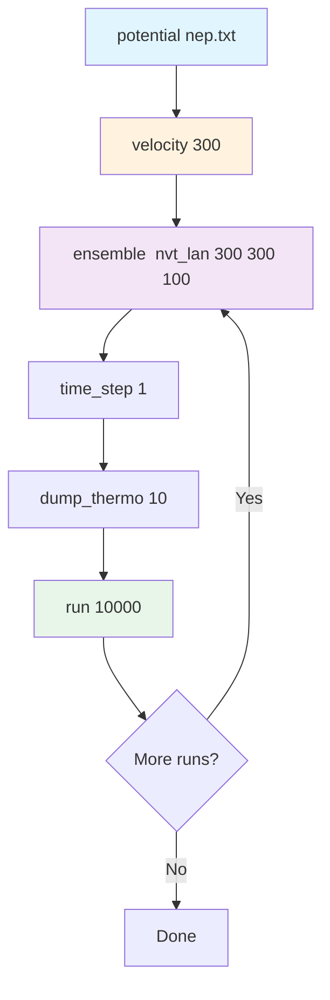
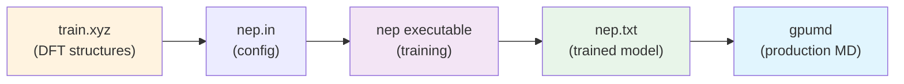

Get GPUMD compiled, configured, and running your first simulation in minutes. This guide walks you through the complete lifecycle — from building the executables to executing a molecular dynamics run and training a Neuroevolution Potential (NEP) model — using the repository's own example datasets.

## Prerequisites at a Glance

Before compiling GPUMD, ensure your environment meets these requirements:

| Requirement | NVIDIA (CUDA) | AMD (ROCm/HIP) |
|---|---|---|
| **GPU** | Compute capability ≥ 3.5 | Any ROCm-supported GPU |
| **Toolkit** | CUDA ≥ 9.0 | ROCm (with hipcc) |
| **C++ Compiler (Linux)** | GCC with C++14+ support | hipcc (C++17 default) |
| **C++ Compiler (Windows)** | MSVC `cl.exe` + 64-bit `make.exe` | Not supported |
| **Additional libs** | cuBLAS, cuSOLVER, cuFFT | hipBLAS, hipSOLVER, hipFFT |

> [!TIP]
> On Windows, if you encounter `c1xx : fatal error C1083` errors during compilation, remove the `-Xcompiler "/wd 4819"` flag from the makefile. For GPUs with compute capability < 6.0, add `-DUSE_KEPLER` to `CFLAGS`.

Sources: [makefile](/src/makefile#L1-L15), [makefile.hip](/src/makefile.hip#L1-L15), [installation.rst](/doc/installation.rst#L10-L30)

## Step 1 — Build the Executables

GPUMD produces two primary executables: **`gpumd`** (the MD simulation engine) and **`nep`** (the NEP training/prediction tool). A third optional executable, **`gnep`**, supports gradient-based NEP training.

### Option A: Make (Recommended)

```bash
cd src
make              # builds gpumd and nep
```

To target a specific GPU architecture, edit the `CUDA_ARCH` variable at the top of the makefile before building:

```makefile
CUDA_ARCH = -arch=sm_80    # e.g., sm_80 for A100, sm_89 for RTX 4090
```

### Option B: CMake (Pre-release)

```bash
cmake -S . -B build
cmake --build build --config Release --parallel
```

The executables appear in the `build/` directory. Target a specific GPU architecture at configure time:

```bash
cmake -S . -B build -DCMAKE_CUDA_ARCHITECTURES=80
```

### Option C: AMD GPU via ROCm/HIP

```bash
cd src
make -f makefile.hip                    # defaults to gfx90a
make -f makefile.hip HIP_ARCH=gfx1100  # override for your GPU
```

### Option D: Docker

A Dockerfile based on `nvidia/cuda:13.1.1-devel-ubuntu24.04` is provided for containerized builds, pre-loaded with Python testing and documentation dependencies:

```bash
docker build -t gpumd .
docker run --gpus all -it gpumd
```

After any build method, verify success:

```bash
ls src/gpumd src/nep    # or ls build/gpumd build/nep for CMake
```

Sources: [makefile](/src/makefile#L49-L62), [CMakeLists.txt](/CMakeLists.txt#L1-L69), [makefile.hip](/src/makefile.hip#L9-L20), [Dockerfile](/Dockerfile#L1-L38), [installation.rst](/doc/installation.rst#L34-L62)

## Step 2 — Understand the Input Files

Every GPUMD simulation requires exactly **two input files** in the working directory:

| File | Purpose | Format |
|---|---|---|
| **`model.xyz`** | Atomic configuration (positions, lattice, species) | Extended XYZ |
| **`run.in`** | Simulation protocol (potential, ensemble, outputs) | Keyword-parameter lines |

For NEP training, the `nep` executable uses a different pair:

| File | Purpose |
|---|---|
| **`train.xyz`** | Training dataset (structures with energies, forces, virials in extended XYZ) |
| **`nep.in`** | NEP training configuration (atom types, hyperparameters) |

### The `model.xyz` File

This file follows the [extended XYZ convention](https://github.com/libAtoms/extxyz). A minimal example for 250 atoms of PbTe:

```
250
Lattice="0.0 16.426 16.426 16.426 0.0 16.426 16.426 16.426 0.0" Properties=species:S:1:pos:R:3:force:R:3
Te  3.379  3.216  3.349  -0.830  0.522 -0.420
Pb 32.611 16.673 16.724   0.085 -1.242 -0.371
...
```

- **Line 1**: Number of atoms
- **Line 2**: Key-value pairs — `Lattice` (9 components of cell vectors in Å), `Properties` (column definitions), optional `pbc` (default `"T T T"`)
- **Line 3+**: One row per atom with the columns defined by `Properties`

Units: positions in **Å**, velocities in **Å/fs**, masses in **amu**.

### The `run.in` File

This file drives the simulation as a sequence of keyword commands. Blank lines and `#` comments are ignored. The overall structure follows a strict logical order:



**Key keywords for your first simulation:**

| Keyword | Syntax | Description |
|---|---|---|
| `potential` | `potential <file> [x\|y\|z]` | Set the interatomic potential (NEP, Tersoff, EAM, LJ, etc.) |
| `velocity` | `velocity <T_K> [seed <n>]` | Initialize velocities at temperature T (K) |
| `ensemble` | `ensemble <type> <params...>` | Choose integrator (nve, nvt_lan, npt_ber, etc.) |
| `time_step` | `time_step <dt>` | Set integration timestep (fs) |
| `dump_thermo` | `dump_thermo <interval>` | Write thermodynamic output every N steps |
| `dump_xyz` | `dump_xyz <interval> <file> force` | Dump positions + forces to XYZ |
| `run` | `run <N_steps>` | Execute N MD steps |

Sources: [run_in.rst](/doc/gpumd/input_files/run_in.rst#L1-L80), [model_xyz.rst](/doc/gpumd/input_files/model_xyz.rst#L1-L80), [potential.rst](/doc/gpumd/input_parameters/potential.rst#L1-L36), [velocity.rst](/doc/gpumd/input_parameters/velocity.rst#L1-L37), [ensemble.rst](/doc/gpumd/input_parameters/ensemble.rst#L1-L41)

## Step 3 — Run Your First MD Simulation

The repository ships ready-to-run examples. The simplest path is the **dynamic simulation** example for PbTe using a pre-trained NEP model:

```bash
cd examples/gpumd_dynamic
../../src/gpumd
```

This reads `model.xyz` and `run.in`, where `run.in` contains:

```
potential   ../nep_train/nep.txt    # use the pre-trained NEP model
velocity    300                      # initialize at 300 K

ensemble    nvt_lan 300 300 100     # NVT Langevin thermostat at 300 K
time_step   1                        # 1 fs timestep
dump_thermo 10                       # output thermo every 10 steps
run         10000                    # run 10,000 steps
```

After completion, you'll find `thermo.out` with columns of time, temperature, pressure, and energy data.

### Static Calculation Example

For a single-point force/energy evaluation:

```bash
cd examples/gpumd_static
../../src/gpumd
```

The `run.in` here uses `ensemble nve` with `time_step 0` and `run 1` — a zero-step "run" that just computes forces:

```
potential   ../nep_train/nep.txt
velocity    1

ensemble nve
time_step 0
dump_xyz 1 dump.xyz force precision double
run 1
```

Sources: [gpumd_dynamic/run.in](/examples/gpumd_dynamic/run.in#L1-L8), [gpumd_static/run.in](/examples/gpumd_static/run.in#L1-L8), [readme.md](/examples/readme.md#L1-L50)

## Step 4 — Train a NEP Model

The NEP (Neuroevolution Potential) framework lets you train machine-learned interatomic potentials from ab initio data. The workflow has two phases:



### Training

```bash
cd examples/nep_train
../../src/nep
```

The `nep.in` file is minimal for this example:

```
type         2 Te Pb     # 2 atom types: Te and Pb
generation   20000        # run 20,000 generations
```

The `nep` executable reads `train.xyz` (training data in extended XYZ with energies and forces) and `nep.in`, then produces `nep.txt` (the trained potential model) and `loss.out` (training metrics).

### Prediction (Validation)

To evaluate the trained model against the training data:

```bash
cd examples/nep_prediction
../../src/nep
```

With `nep.in`:

```
type         2 Te Pb
prediction   1            # run in prediction mode instead of training
```

This writes `force.out` and `energy.out` comparing NEP predictions against reference values.

> [!TIP]
> By default, both `gpumd` and `nep` use **all visible GPUs**. Control GPU selection with `export CUDA_VISIBLE_DEVICES=0` (single GPU) or `export CUDA_VISIBLE_DEVICES=0,2` (multi-GPU). For multi-GPU runs, use GPUs of the same type to avoid slow-GPU bottlenecks. Good parallel efficiency for `gpumd` requires >100k atoms per GPU.

Sources: [nep_train/nep.in](/examples/nep_train/nep.in#L1-L3), [nep_prediction/nep.in](/examples/nep_prediction/nep.in#L1-L3), [readme.md](/examples/readme.md#L12-L40)

## Available Built-in Potentials

GPUMD ships with a rich set of pre-parametrized potentials in the `potentials/` directory, ready to use by pointing `potential` to the file path:

| Category | Potentials | Example Files |
|---|---|---|
| **NEP** | Machine-learned (NEP1–NEP4, UNEP) | `nep/C_2024_NEP4.txt`, `nep/Si_2022_NEP4_3body.txt` |
| **Tersoff** | Empirical many-body | `tersoff/Si_Tersoff_1989.txt`, `tersoff/Graphene_Lindsay_2010.txt` |
| **EAM** | Embedded atom method | `eam/Cu_Zhou_2004.txt`, `eam/CuNi.eam.alloy` |
| **LJ** | Lennard-Jones | `lj/Ar_10A.txt`, `lj/Ar_20A.txt` |
| **Hybrid** | NEP+ILP, SW+ILP, Tersoff+ILP | `hybrid_nep_ilp/hybrid_nep_ilp_gr_hbn_ILP_oywg_2018.txt` |

Use them directly in `run.in`:

```
potential  ../../potentials/tersoff/Si_Tersoff_1989.txt
```

Sources: [potentials/](/potentials), [potential.rst](/doc/gpumd/input_parameters/potential.rst#L16-L36)

## Quick Reference — Complete Workflow

| Step | Command | What Happens |
|---|---|---|
| 1. Build | `cd src && make` | Produces `gpumd` and `nep` executables |
| 2. Prepare | Create `model.xyz` + `run.in` | Define your system and simulation protocol |
| 3. Run MD | `path/to/gpumd` | Executes simulation, writes output files |
| 4. Train NEP | Create `train.xyz` + `nep.in`, then `path/to/nep` | Produces `nep.txt` model file |
| 5. Validate | Set `prediction 1` in `nep.in`, then `path/to/nep` | Compares predictions to reference data |
| 6. Production | Use `nep.txt` in `run.in` with `potential nep.txt` | Full MD with ML potential |

## Troubleshooting Common Issues

| Problem | Solution |
|---|---|
| `nvcc: command not found` | Install CUDA toolkit and add to PATH |
| `undefined reference to cuBLAS` | Ensure CUDA toolkit is fully installed (includes libs) |
| Wrong GPU architecture | Set `-arch=sm_XX` in makefile matching your GPU (e.g., sm_80 for A100) |
| Slow multi-GPU performance | Use same-type GPUs; ensure >100k atoms per GPU for `gpumd` |
| `c1xx : fatal error C1083` (Windows) | Remove `-Xcompiler "/wd 4819"` from makefile |
| Kepler GPU (cc < 6.0) | Add `-DUSE_KEPLER` to `CFLAGS` in makefile |

Sources: [makefile](/src/makefile#L1-L15), [installation.rst](/doc/installation.rst#L34-L62), [readme.md](/examples/readme.md#L12-L40)

## Where to Go Next

Now that you can compile and run GPUMD, explore the deeper architecture and capabilities:

- **[Input File Format](3-input-file-format)** — Complete reference for all `run.in` keywords and `model.xyz` options
- **[Architecture Overview](4-architecture-overview)** — Understand the GPU-native simulation pipeline design
- **[Force and Potential System](5-force-and-potential-system)** — How potentials are evaluated on the GPU
- **[NEP Training Pipeline](9-nep-training-pipeline)** — Detailed guide to training production-quality NEP models
- **[Empirical Potentials](11-empirical-potentials)** — Full catalog of built-in empirical potentials

For step-by-step tutorials with real materials systems, see the [GPUMD-Tutorials repository](https://github.com/brucefan1983/GPUMD-Tutorials) and the [Google Colab tutorial](https://colab.research.google.com/drive/1QnXAveZgzwut4Mvldsw-r2I0EWIsj1KA?usp=sharing) for PbTe.