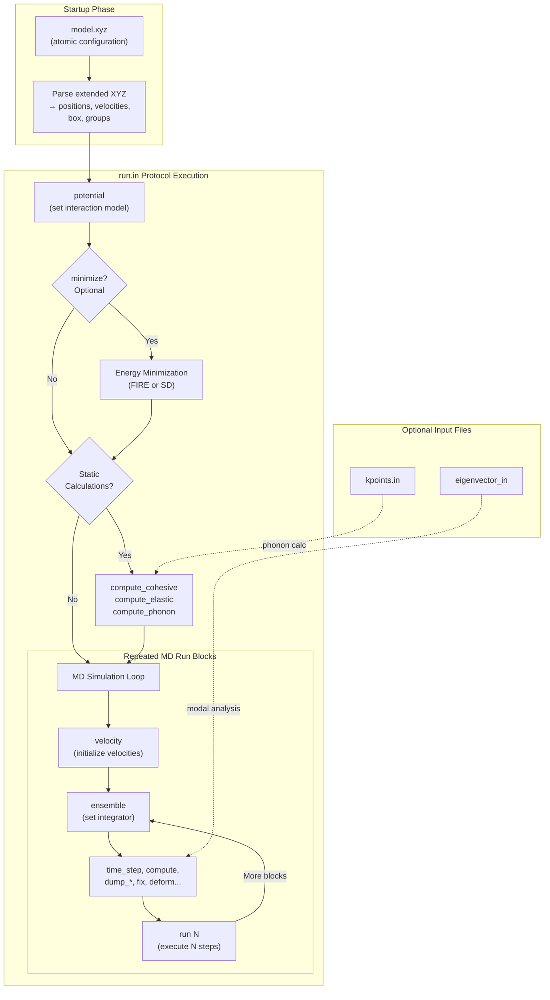

GPUMD requires a small, declarative set of input files to define a simulation. At minimum, you need **two files**: `model.xyz` (the atomic configuration) and `run.in` (the simulation protocol). Two optional files — `kpoints.in` and `eigenvector.in` — support phonon and modal analysis calculations. GPUMD reads these files sequentially, executes commands top-to-bottom, and terminates with an error if any command is invalid. This page provides a complete reference for all four input files, their syntax, and the execution semantics that govern how they interact.

Sources: [index.rst](doc/gpumd/input_files/index.rst#L1-L17), [run_in.rst](doc/gpumd/input_files/run_in.rst#L1-L10)

## File Inventory at a Glance

| File | Required | Purpose | Format |
|------|----------|---------|--------|
| `model.xyz` | **Yes** | Atomic positions, velocities, box, boundary conditions | Extended XYZ |
| `run.in` | **Yes** | Simulation protocol: potentials, ensembles, runs, output | Keyword-parameter lines |
| `kpoints.in` | No | k-point paths for phonon dispersion calculations | Space-separated coordinates + labels |
| `eigenvector_in` | No | Eigenvectors for modal analysis | Specialized format |

Sources: [index.rst](doc/gpumd/input_files/index.rst#L1-L17)

## Execution Architecture

The relationship between input files and GPUMD's execution flow follows a strict sequential pipeline. The diagram below illustrates how `model.xyz` is consumed at startup, how `run.in` drives the simulation loop, and how optional files integrate into specific calculation types:



Sources: [run_in.rst](doc/gpumd/input_files/run_in.rst#L12-L45)

---

## The `model.xyz` File

The `model.xyz` file defines the complete initial state of the simulation system. It uses the **extended XYZ format** — a widely adopted standard in atomistic simulation. The file has a rigid three-section structure: a header line with the atom count, a lattice/properties line, and then one line per atom.

Sources: [model_xyz.rst](doc/gpumd/input_files/model_xyz.rst#L1-L15)

### Line 1: Atom Count

The first line contains a single integer: the total number of atoms *N* in the system.

```
250
```

Sources: [model_xyz.rst](doc/gpumd/input_files/model_xyz.rst#L17-L19)

### Line 2: Lattice, Boundary Conditions, and Properties

The second line consists of `keyword=value` pairs separated by spaces. Spaces around `=` are allowed. Values containing spaces must be enclosed in double quotes (e.g., `keyword="value_1 value_2"`). All characters are **case-insensitive**. The recognized keywords are:

| Keyword | Required | Syntax | Description |
|---------|----------|--------|-------------|
| `lattice` | **Yes** | `lattice="ax ay az bx by bz cx cy cz"` | Nine components of the three cell vectors **a**, **b**, **c** in Å |
| `pbc` | No | `pbc="pbc_a pbc_b pbc_c"` | Periodic boundary conditions: `T` (periodic) or `F` (free/open) per direction. Default: `"T T T"` |
| `properties` | **Yes** | `properties=property_name:data_type:count[:...]` | Defines per-atom data columns (see below) |
| `energy` | No | `energy=<value>` | Total energy in eV (informational; not used by GPUMD) |
| `config_type` | No | `config_type=<string>` | Configuration label (informational) |

**Cell vector interpretation**: The nine lattice components define three vectors in Cartesian coordinates:

> **a** = a_x **ê**_x + a_y **ê**_y + a_z **ê**_z  
> **b** = b_x **ê**_x + b_y **ê**_y + b_z **ê**_z  
> **c** = c_x **ê**_x + c_y **ê**_y + c_z **ê**_z

**Periodic boundary conditions**: For non-NEP potentials, GPUMD uses the minimum-image convention, requiring the box to be at least twice the potential cutoff in each periodic direction. For NEP potentials, sufficiently many periodic images are automatically considered, so this constraint is relaxed.

Sources: [model_xyz.rst](doc/gpumd/input_files/model_xyz.rst#L21-L55)

### Property Definitions

The `properties` keyword defines what data columns appear on each atom line (Line 3+). Properties are concatenated with colons:

| Property | Data Type | Columns | Required | Description |
|----------|-----------|---------|----------|-------------|
| `species` | `S` | 1 | **Yes** | Element symbol (e.g., `C`, `Si`, `Te`) |
| `pos` | `R` | 3 | **Yes** | Position vector (x, y, z) in Å |
| `mass` | `R` | 1 | No | Mass in amu (default values used if missing) |
| `charge` | `R` | 1 | No | Charge in units of e (default: 0) |
| `vel` | `R` | 3 | No | Velocity vector in Å/fs |
| `group` | `I` | *n* | No | *n* grouping methods (integer labels) |

**Grouping methods** are integer labels that partition atoms into groups. Multiple grouping methods can coexist, each providing a different partitioning (e.g., method 0 = left/right half, method 1 = per-atom, method 2 = all-atoms-one-group). These groups are referenced by `compute` and `dump` keywords in `run.in`.

Sources: [model_xyz.rst](doc/gpumd/input_files/model_xyz.rst#L46-L55)

### Lines 3+: Per-Atom Data

Each subsequent line contains the data columns defined by the `properties` keyword, in the same order. Every line must have the same number of values.

Sources: [model_xyz.rst](doc/gpumd/input_files/model_xyz.rst#L57-L58)

### Units Summary

| Quantity | Unit |
|----------|------|
| Mass | unified atomic mass unit (amu) |
| Charge | elementary charge e |
| Position / Cell dimensions | Ångstrom (Å) |
| Velocity | Å/fs |
| Energy (if present) | eV |
| Force (if present) | eV/Å |

Sources: [model_xyz.rst](doc/gpumd/input_files/model_xyz.rst#L60-L66)

### `model.xyz` Example

A minimal example with 10 atoms, periodic in x only, with 3 grouping methods:

```
10
pbc="T F F" lattice="4 0 0 0 1 0 0 0 1" properties=species:S:1:pos:R:3:group:I:3
C  0 0 0 0 0 0
Si 1 0 0 0 1 0
C  2 0 0 0 2 0
Si 3 0 0 0 3 0
C  4 0 0 0 4 0
Si 5 0 0 1 5 0
C  6 0 0 1 6 0
Si 7 0 0 1 7 0
C  8 0 0 1 8 0
Si 9 0 0 1 9 0
```

A real-world example from the repository (250-atom PbTe system with forces):

```
250
energy=-930.7339 config_type=nep2xyz pbc="T T T" Lattice="0.0 16.42598 16.42598 16.42598 0.0 16.42598 16.42598 16.42598 0.0" Properties=species:S:1:pos:R:3:force:R:3
Te 3.271619 3.093816 3.354722 0.4178623 -0.03671069 -0.04290853
Te 3.726119 6.524911 6.853489 -1.835852 -0.5027356 -0.4577284
...
```

Sources: [model_xyz.rst](doc/gpumd/input_files/model_xyz.rst#L68-L103), [model.xyz](examples/gpumd_static/model.xyz#L1-L3)

---

## The `run.in` File

The `run.in` file defines the **simulation protocol** — the sequence of operations GPUMD executes. Blank lines and lines starting with `#` are ignored (enabling inline comments). All other lines follow the form:

```
keyword parameter_1 parameter_2 ...
```

> [!TIP]
> The overall structure of `run.in` is not arbitrary — it follows a strict ordering: (1) `potential` → (2) optional `minimize` → (3) optional static calculations → (4) MD simulation blocks. Each MD block must contain an `ensemble` keyword followed by a `run` keyword, with configuration keywords in between. This block can be repeated for multi-stage simulations.

Sources: [run_in.rst](doc/gpumd/input_files/run_in.rst#L5-L30)

### Keyword Execution Semantics

Every keyword falls into one of two execution categories, indicated by the **Exec.** column in the tables below:

- **Yes (Immediate)**: The command is executed as soon as it is encountered. It does not depend on a subsequent `run` keyword.
- **No (Deferred)**: The command configures settings for the next `run` block. It takes effect only when `run` is encountered.

Additionally, some keywords are **propagating** (**Prop.** = Yes), meaning their setting persists from one `run` block to the next. Most keywords are non-propagating and must be re-specified for each `run` block.

Sources: [run_in.rst](doc/gpumd/input_files/run_in.rst#L32-L45)

### Simulation Setup Keywords

These keywords configure the fundamental simulation parameters before any calculation begins:

| Keyword | Brief Description | Exec. | Prop. |
|---------|-------------------|-------|-------|
| `potential` | Set the interatomic potential model | Yes | N/A |
| `velocity` | Set initial velocities from a temperature | Yes | N/A |
| `dftd3` | Add DFT-D3 dispersion correction to NEP | Yes | N/A |
| `change_box` | Change the simulation box | Yes | N/A |
| `deform` | Deform the simulation box | No | No |
| `ensemble` | Specify the integrator for an MD run | No | No |
| `fix` | Fix (freeze) atoms | No | No |
| `time_step` | Set the integration time step | No | **Yes** |

Sources: [run_in.rst](doc/gpumd/input_files/run_in.rst#L47-L75)

### Action Keywords

These keywords trigger calculations or advance the simulation:

| Keyword | Brief Description | Exec. | Prop. |
|---------|-------------------|-------|-------|
| `minimize` | Perform energy minimization (FIRE or SD) | Yes | N/A |
| `run` | Run N MD steps | Yes | No |
| `compute` | Compute time/space-averaged quantities | No | No |
| `compute_cohesive` | Compute cohesive energy curve | Yes | N/A |
| `compute_elastic` | Compute elastic constants | Yes | N/A |
| `compute_dos` | Compute phonon density of states | No | No |
| `compute_gkma` | Compute modal heat current (GKMA) | No | No |
| `compute_hac` | Compute thermal conductivity (EMD/HAC) | No | No |
| `compute_hnema` | Compute modal thermal conductivity (HNEMA) | No | No |
| `compute_hnemd` | Compute thermal conductivity (HNEMD) | No | No |
| `compute_hnemdec` | Compute multicomponent conductivity (HNEMDEC) | No | No |
| `compute_phonon` | Compute phonon dispersion | Yes | N/A |
| `compute_sdc` | Compute self-diffusion coefficient | No | No |
| `compute_msd` | Compute mean-square displacement | No | No |
| `compute_shc` | Compute spectral heat current | No | No |

Sources: [run_in.rst](doc/gpumd/input_files/run_in.rst#L77-L145)

### Output Keywords

These keywords control what data is written and how frequently:

| Keyword | Brief Description | Exec. | Prop. |
|---------|-------------------|-------|-------|
| `active` | On-the-fly active learning | No | No |
| `dump_observer` | Write observer NEP potential data | No | No |
| `dump_netcdf` | Write positions in netCDF format | No | No |
| `dump_restart` | Write restart file | No | No |
| `dump_thermo` | Write thermodynamic quantities | No | No |
| `dump_xyz` | Write per-atom data in extended XYZ | No | No |

Sources: [run_in.rst](doc/gpumd/input_files/run_in.rst#L147-L190)

---

## Key `run.in` Keywords — Syntax Reference

This section provides the exact syntax for the most commonly used keywords. Each entry shows the parameter format, units, and a working example.

### `potential` — Set Interatomic Potential

```
potential <potential_filename>
```

Specifies the potential file path (relative or absolute). Supported models include: Tersoff (1988/1989/mini), EAM, FCP, Lennard-Jones, NEP, hybrid NEP+ILP, SW+ILP, Tersoff+ILP, and Deep Potential (DP).

**Example:**
```
potential ../nep_train/nep.txt
```

Sources: [potential.rst](doc/gpumd/input_parameters/potential.rst#L1-L36)

### `velocity` — Initialize Velocities

```
velocity <initial_temperature> [seed <seed_number>]
```

| Parameter | Unit | Description |
|-----------|------|-------------|
| `initial_temperature` | K | Target temperature for velocity initialization |
| `seed` | — | Optional random seed for reproducibility |

The generated velocities do **not** follow the Maxwell distribution initially, but converge to it during simulation. Total linear and angular momenta are set to zero. If velocities are already present in `model.xyz`, those are used instead and the temperature parameter is ignored. If this keyword is missing and `model.xyz` has no velocities, a default temperature of 300 K is used.

**Example:**
```
velocity 300
velocity 10 seed 42
```

Sources: [velocity.rst](doc/gpumd/input_parameters/velocity.rst#L1-L37)

### `ensemble` — Set Integrator

```
ensemble <method> <method_parameters...>
```

**Standard ensembles:**

| Method | Parameters | Description |
|--------|------------|-------------|
| `nve` | (none) | Micro-canonical (no thermostat) |
| `nvt_ber` | `T_1 T_2 T_coup` | NVT with Berendsen thermostat |
| `nvt_nhc` | `T_1 T_2 T_coup` | NVT with Nosé-Hoover chain |
| `nvt_bdp` | `T_1 T_2 T_coup` | NVT with Bussi-Donadio-Parrinello |
| `nvt_lan` | `T_1 T_2 T_coup` | NVT with Langevin thermostat |
| `nvt_bao` | `T_1 T_2 T_coup` | NVT with Langevin BAOAB splitting |
| `npt_ber` | `T_1 T_2 T_coup {pressure_params}` | NPT with Berendsen barostat |
| `npt_scr` | `T_1 T_2 T_coup {pressure_params}` | NPT with stochastic cell rescaling |

**Units**: Temperature in K, pressure in GPa. The coupling constant `T_coup` = τ_T/Δt (relaxation time / time step); a good choice is ~100. The pressure coupling `p_coup` = τ_p/Δt; a good choice is ~1000.

**Example:**
```
ensemble nvt_lan 300 300 100
ensemble nve
```

Sources: [ensemble.rst](doc/gpumd/input_parameters/ensemble.rst#L1-L41), [ensemble_standard.rst](doc/gpumd/input_parameters/ensemble_standard.rst#L1-L98)

### `time_step` — Set Integration Time Step

```
time_step <dt_in_fs> [<max_distance_per_step>]
```

| Parameter | Unit | Description |
|-----------|------|-------------|
| `dt_in_fs` | fs | Time step for integration (default: 1 fs) |
| `max_distance_per_step` | Å | Optional: maximum atom displacement per step |

This keyword is **propagating** — its value carries over to subsequent `run` blocks without re-specification.

**Example:**
```
time_step 1
time_step 0.5
time_step 2.0 0.05
```

Sources: [time_step.rst](doc/gpumd/input_parameters/time_step.rst#L1-L51)

### `minimize` — Energy Minimization

```
minimize <method> <force_tolerance> <max_steps> [<box_change> [<hydrostatic_strain>]]
```

| Parameter | Unit | Description |
|-----------|------|-------------|
| `method` | — | `sd` (steepest descent) or `fire` (FIRE algorithm) |
| `force_tolerance` | eV/Å | Convergence criterion (use negative value to force max_steps) |
| `max_steps` | — | Maximum number of iterations |
| `box_change` | — | `1` = optimize box (FIRE only) |
| `hydrostatic_strain` | — | `1` = use hydrostatic strain for box change |

**Example:**
```
minimize fire 1.0e-5 1000
minimize fire 1.0e-5 1000 1 1
```

Sources: [minimize.rst](doc/gpumd/input_parameters/minimize.rst#L1-L83)

### `run` — Execute MD Steps

```
run <number_of_steps>
```

Each `run` keyword defines a self-contained MD block. The block encompasses all keywords from the preceding `ensemble` (or the start of the file) up to and including `run` itself. Multiple blocks can be chained for multi-stage simulations.

**Example:**
```
run 10000
run 1000000
```

Sources: [run.rst](doc/gpumd/input_parameters/run.rst#L1-L42)

### `dump_thermo` — Write Thermodynamic Output

```
dump_thermo <interval>
```

Writes global thermodynamic quantities to `thermo.out` every `interval` steps. **Non-propagating** — must be re-specified for each `run` block.

**Example:**
```
dump_thermo 10
```

Sources: [dump_thermo.rst](doc/gpumd/input_parameters/dump_thermo.rst#L1-L30)

### `dump_xyz` — Write Per-Atom Data

```
dump_xyz <interval> <filename> [group <grouping_method> <group_id>] [precision <single|double>] {<property_1> <property_2> ...}
```

| Parameter | Description |
|-----------|-------------|
| `interval` | Output interval in steps |
| `filename` | Output file path (append `*` to write one file per frame) |
| `group` | Restrict output to a specific group |
| `precision` | `single` (9 digits, default) or `double` (17 digits) |
| properties | `mass`, `velocity`, `force`, `potential`, `virial`, `charge`, `bec`, `group_labels`, `unwrapped_position` |

Wrapped positions are always included. **Non-propagating**. Can be invoked multiple times per `run` block.

**Example:**
```
dump_xyz 1000 positions.xyz
dump_xyz 100 properties.xyz group 1 0 mass velocity potential force virial
dump_xyz 100 forces.xyz precision double force
```

Sources: [dump_xyz.rst](doc/gpumd/input_parameters/dump_xyz.rst#L1-L66)

---

## The `kpoints.in` File (Optional)

This file specifies k-point paths for phonon dispersion calculations invoked by `compute_phonon` in `run.in`. Each line defines a high-symmetry point with three fractional coordinates and a label name:

```
k_x k_y k_z label
```

A **blank line** separates distinct k-point paths (useful for plotting discontinuous segments in the Brillouin zone).

**Example — 2D hexagonal lattice:**
```
0 0 0 G
0.5 0 0 M
0.333 0.333 0 K
0 0 0 G
```

**Example — FCC lattice (two paths):**
```
0 0 0 G
0.5 0 0.5 X
0.625 0.25 0.625 U

0.375 0.375 0.75 K
0 0 0 G
0.5 0.5 0.5 L
0.5 0.25 0.75 W
0.5 0 0.5 X
```

Sources: [kpoints_in.rst](doc/gpumd/input_files/kpoints_in.rst#L1-L53)

---

## The `eigenvector_in` File (Optional)

This file provides eigenvector data for modal analysis calculations. It is only needed when performing specialized modal decomposition and is referenced indirectly through `compute` keywords in `run.in`.

Sources: [eigenvector_in.rst](doc/gpumd/input_files/eigenvector_in.rst#L1-L8)

---

## Complete Working Examples

### Static Calculation (Force Evaluation)

```
potential   ../nep_train/nep.txt
velocity    1

ensemble nve
time_step 0
dump_xyz 1 dump.xyz force precision double
run 1
```

This evaluates forces on the initial configuration using an NEP potential and writes them to `dump.xyz`. The `time_step 0` and `run 1` combination ensures no actual time integration occurs — this is a single-point calculation.

Sources: [run.in](examples/gpumd_static/run.in#L1-L8)

### Dynamic NVT Simulation

```
potential   ../nep_train/nep.txt
velocity    300

ensemble    nvt_lan 300 300 100
time_step   1
dump_thermo 10
run         10000
```

This runs a 10,000-step NVT simulation at 300 K using the Langevin thermostat with a coupling constant of 100. Thermodynamic data is written every 10 steps. The velocity initialization at 300 K matches the target temperature.

Sources: [run.in](examples/gpumd_dynamic/run.in#L1-L8)

### Multi-Stage MD with Minimization

A typical multi-stage workflow combines minimization, equilibration, and production:

```
potential nep.txt

# Stage 1: Energy minimization
minimize fire 1.0e-5 1000

# Stage 2: Equilibrate at 300 K (NVT)
velocity 300
ensemble nvt_lan 300 300 100
time_step 1
dump_thermo 100
run 20000

# Stage 3: Production run (NVE)
ensemble nve
dump_thermo 10
dump_xyz 1000 traj.xyz velocity force
compute_hnemd 10 0.0001
run 1000000
```

Sources: [run.rst](doc/gpumd/input_parameters/run.rst#L28-L42), [minimize.rst](doc/gpumd/input_parameters/minimize.rst#L64-L83)

---

## `run.in` Execution Model — Key Rules

Understanding these rules prevents common configuration errors:

1. **Sequential execution**: Commands in `run.in` are processed top-to-bottom. An invalid command causes immediate termination with an error message.
2. **Immediate vs. deferred**: Immediate keywords (`potential`, `velocity`, `minimize`, `compute_cohesive`, `compute_elastic`, `compute_phonon`) execute when encountered. Deferred keywords (`ensemble`, `time_step`, `compute`, `dump_*`, `fix`, `deform`) configure the next `run` block.
3. **Propagation**: Only `time_step` propagates across `run` blocks. All other deferred keywords must be re-specified for each block.
4. **One ensemble per run**: Exactly one `ensemble` keyword must precede each `run` keyword.
5. **Comment syntax**: Lines starting with `#` and blank lines are ignored. Inline comments after `#` are supported.
6. **Required ordering**: `potential` must come before `minimize`. `minimize` must come before MD runs. `velocity` must come before the first `ensemble`/`run` block.

> [!TIP]
> When debugging a `run.in` file, check whether you've forgotten to re-specify non-propagating keywords (like `dump_thermo` or `compute`) in subsequent `run` blocks — this is the most common source of "missing output" issues.

Sources: [run_in.rst](doc/gpumd/input_files/run_in.rst#L5-L45), [time_step.rst](doc/gpumd/input_parameters/time_step.rst#L40-L51)

---

## Where to Go Next

Now that you understand how to structure GPUMD input files, the following pages provide deeper coverage of the systems you'll configure through `run.in`:

- **[Architecture Overview](4-architecture-overview)** — How the input files connect to GPUMD's internal simulation pipeline
- **[Force and Potential System](5-force-and-potential-system)** — Details on every potential model available via the `potential` keyword
- **[Integration and Ensemble Methods](6-integration-and-ensemble-methods)** — Complete reference for all ensemble types and their thermostat/barostat parameters
- **[Measurement and Output](7-measurement-and-output)** — All `compute_*` and `dump_*` keywords with their output file formats