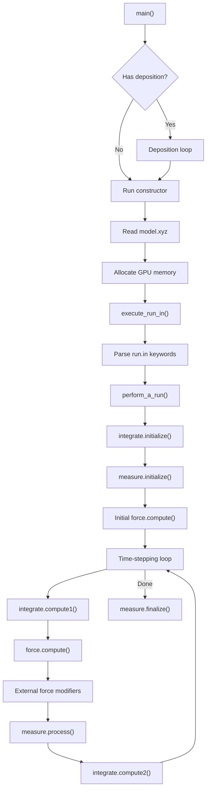
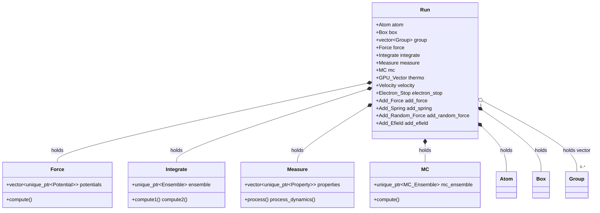
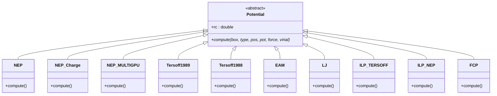
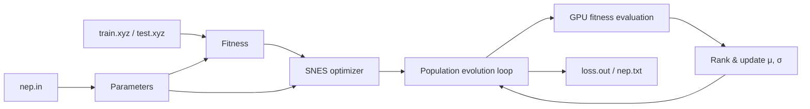

GPUMD (Graphics Processing Units Molecular Dynamics) is a **GPU-first molecular dynamics framework** built entirely in CUDA C++ / HIP C++, designed from the ground up to exploit massive data parallelism on NVIDIA and AMD GPUs. The codebase compiles into three distinct executables — `gpumd` (production MD), `nep` (Neuroevolution Potential training), and `gnep` (gradient-based NEP training) — each with a focused entry point but sharing the `utilities` module for common GPU abstractions. The architectural philosophy is strikingly minimalist: virtually zero external dependencies (only optional NetCDF and PLUMED), no MPI layer, and a deliberate preference for single-GPU computation with domain-decomposition multi-GPU as an opt-in feature for NEP potentials only. This design achieves exceptional kernel occupancy and memory coherence by keeping the simulation state resident on the GPU across the entire time-stepping loop, with minimal host-device synchronization points.

Sources: [CMakeLists.txt](CMakeLists.txt#L1-L69), [developers/readme.md](developers/readme.md#L50-L105)

## Top-Level Executable Architecture

The three executables form a **train-then-deploy** workflow: the `nep` executable trains machine-learning interatomic potentials from ab initio datasets, producing a compact `.nep` model file; the `gpumd` executable then consumes that model (or any of the built-in empirical potentials) to perform production molecular dynamics simulations. The `gnep` executable provides an alternative training path using Adam-based gradient optimization rather than the default separable natural evolution strategy (SNES).

| Executable | Entry Point | Purpose | Key Link Libraries |
|---|---|---|---|
| `gpumd` | `src/main_gpumd/main.cu` | Production MD simulation | CUDA::cublas, cusolver, cufft |
| `nep` | `src/main_nep/main.cu` | NEP potential training | CUDA::cublas, cusolver, cufft |
| `gnep` | `src/main_gnep/main.cu` | Gradient-based NEP training | CUDA::cublas, cusolver, cufft |

Sources: [CMakeLists.txt](CMakeLists.txt#L28-L56), [src/main_gpumd/main.cu](src/main_gpumd/main.cu#L34-L60), [src/main_nep/main.cu](src/main_nep/main.cu#L35-L65)

## Core Simulation Pipeline: The `Run` Orchestrator

The `Run` class is the **top-level orchestrator** for the entire `gpumd` simulation lifecycle. It is instantiated in `main()` and owns — either directly or indirectly — every major subsystem. The constructor performs a three-phase bootstrap: (1) read `model.xyz` to initialize atomic positions and types, (2) allocate GPU memory for per-atom data, and (3) parse and execute `run.in` line-by-line. The simulation itself proceeds in `perform_a_run()`, which implements the canonical MD time-stepping loop with a **velocity-Verlet split** across `integrate.compute1()` and `integrate.compute2()`.

The time-stepping loop in `perform_a_run()` follows a precise ordering that is critical for correctness: the first half-kick of velocity-Verlet (`integrate.compute1`), full force evaluation (`force.compute`), application of external perturbations (electron stopping, added forces, springs, random forces, electric fields), measurement sampling, then the second half-kick (`integrate.compute2`), followed by optional Monte Carlo swaps. The loop also supports **adaptive time-stepping** by computing the maximum atomic velocity and capping the maximum distance per step.

Sources: [src/main_gpumd/run.cuh](src/main_gpumd/run.cuh#L40-L80), [src/main_gpumd/run.cu](src/main_gpumd/run.cu#L211-L350), [src/main_gpumd/main.cu](src/main_gpumd/main.cu#L34-L60)

## Class Ownership and Composition Hierarchy

The `Run` class holds **all core simulation state** through direct member composition. This flat ownership model — as opposed to deep nesting — keeps data flow explicit and avoids virtual dispatch overhead for cross-module communication. The only two polymorphic hierarchies (`Potential` and `Ensemble`) are accessed through `unique_ptr` vectors/holders within their respective manager classes (`Force` and `Integrate`).

> [!TIP]
> The `Run` class deliberately does **not** hold `Minimize` or `Hessian` as members. These are instantiated as **stack-local objects** inside `parse_one_keyword()` and execute synchronously before returning control — they are one-shot computations, not part of the time-stepping loop.

Sources: [src/main_gpumd/run.cuh](src/main_gpumd/run.cuh#L40-L80), [src/force/force.cuh](src/force/force.cuh#L36-L87), [src/integrate/integrate.cuh](src/integrate/integrate.cuh#L27-L120), [src/measure/measure.cuh](src/measure/measure.cuh#L31-L69)

## The Model Layer: Atom, Box, and Group

The **model layer** (`src/model/`) defines the geometric and topological state of the simulation system. `Atom` is the central data structure — it holds all per-atom quantities as `GPU_Vector` objects (position, velocity, force, virial, potential energy, heat current) directly in GPU device memory, with corresponding CPU-side `std::vector` mirrors for type, mass, and charge that are used only during initialization. For path-integral molecular dynamics (PIMD), `Atom` also manages per-bead replicated arrays (`position_beads`, `velocity_beads`, `force_beads`, etc.).

`Box` encapsulates the simulation cell geometry with support for both **orthogonal and triclinic** cells. The box matrix `cpu_h[18]` stores both the cell vectors (entries 0–8) and their inverse (entries 9–17), enabling efficient minimum-image convention (MIC) computation via the inline `apply_mic()` device function — a function that appears in both `double` and `float` overloads and is called from virtually every force kernel.

`Group` implements the **atom grouping system** that partitions atoms into labeled subsets for targeted operations (fixing, thermostating, heat source/sink assignment, Monte Carlo species swaps). Multiple grouping methods can coexist, each stored as a separate `Group` instance in `Run::group`.

| Class | Key GPU Data | Purpose |
|---|---|---|
| `Atom` | `position_per_atom`, `velocity_per_atom`, `force_per_atom`, `virial_per_atom`, `potential_per_atom`, `heat_per_atom` | Per-atom physical state (all GPU-resident) |
| `Box` | `cpu_h[18]`, `float_h[18]` | Simulation cell matrix + inverse (CPU-cached, device-accessible) |
| `Group` | `GPU_Vector<int> label` | Atom-to-group mapping for selective operations |

Sources: [src/model/atom.cuh](src/model/atom.cuh#L22-L57), [src/model/box.cuh](src/model/box.cuh#L13-L47), [src/model/group.cuh](src/model/group.cuh)

## The Force Computation Subsystem

The force subsystem employs a **strategy pattern** with `Potential` as the abstract base class defining a virtual `compute()` interface. The `Force` manager class holds a `std::vector<std::unique_ptr<Potential>>` called `potentials`, enabling **multiple simultaneous potentials** — for example, combining a Tersoff bulk potential with an interlayer potential (ILP) for 2D materials, or running NEP alongside ZBL repulsion at short range. The `Force::compute()` method iterates over all registered potentials and accumulates forces and energies additively.

The `Potential::compute()` signature is uniform: it receives box, type, position arrays and outputs per-atom potential energy, force, and virial. This interface is implemented by over **15 concrete potential classes**, spanning empirical potentials (EAM, Tersoff, LJ, ADP), machine-learned potentials (NEP, DP, NNAP), harmonic force constant potentials (FCP), and composite hybrid potentials (ILP+Tersoff, ILP+SW, ILP+NEP). Each concrete potential internally manages its own `Neighbor` object for GPU-accelerated cell-list neighbor construction.

Sources: [src/force/potential.cuh](src/force/potential.cuh#L28-L114), [src/force/force.cuh](src/force/force.cuh#L36-L87), [src/force/force.cu](src/force/force.cu#L1-L200)

## The Integration and Ensemble Subsystem

Time integration follows the same strategy pattern: `Ensemble` is the abstract base with pure virtual `compute1()` and `compute2()` methods implementing the **two-step velocity-Verlet** decomposition. The `Integrate` manager holds a single `std::unique_ptr<Ensemble>` representing the currently active ensemble, selected at parse time from the `ensemble` keyword in `run.in`. The ensemble type integer (`Integrate::type`) determines the integration scheme, with values ≥31 triggering PIMD bead-mode computation.

The concrete ensemble classes form the richest hierarchy in the codebase with over **20 variants**, covering NVE, NVT (Nose-Hoover chain, Langevin, Bussi-Damped), NPT (MTTK, Berendsen, SCR barostat), heat transport (NEMD, HNEMD), shock (MSST, NPHug), and advanced methods (PIMD, ECO-PIMD, QTBot, TTM two-temperature model, thermodynamic integration ensembles). All ensembles inherit the protected `velocity_verlet()` method from the `Ensemble` base class, ensuring a consistent integration kernel across all thermostat/barostat combinations.

| Ensemble Category | Classes | Key Feature |
|---|---|---|
| Microcanonical | `Ensemble_NVE` | Energy conservation, no thermostat |
| Canonical NVT | `Ensemble_LAN`, `Ensemble_NHC`, `Ensemble_BDP`, `Ensemble_BER` | Langevin, Nose-Hoover, Bussi, Berendsen |
| Isothermal-isobaric NPT | `Ensemble_MTTK`, `Ensemble_NPT_SCR`, `Ensemble_NPT_QTB` | MTTK, Stochastic Cell Rescaling |
| Heat transport | `Ensemble_Heat_Hybrid`, `Ensemble_TI`, `Ensemble_TI_*` | NEMD, HNEMD, thermodynamic integration |
| PIMD | `Ensemble_PIMD`, `ECO_PIMD` | Ring-polymer bead dynamics |
| Shock | `Ensemble_MSST`, `Ensemble_NPHUG` | Multi-Scale Shock, Hugoniot |

Sources: [src/integrate/ensemble.cuh](src/integrate/ensemble.cuh#L30-L158), [src/integrate/integrate.cuh](src/integrate/integrate.cuh#L27-L120)

## The Measurement and Property Subsystem

The measurement subsystem mirrors the force/integrate pattern: `Property` is the abstract base with a three-phase lifecycle — `preprocess()`, `process()`, and `postprocess()` — plus an optional `process_dynamics()` for measurements that need to sample within the integration split (e.g., heat current). The `Measure` manager holds a `std::vector<std::unique_ptr<Property>>` called `properties`, and each `run.in` keyword like `compute_hac`, `compute_msd`, or `dump_thermo` appends a new `Property` subclass instance to this vector.

This design enables **composable, on-the-fly analysis**: multiple measurements execute simultaneously during the same MD run without interfering with each other, as each `Property` maintains its own internal accumulation buffers. The measurement catalog is extensive, covering structural analysis (RDF, ADF, orientational order), dynamical properties (MSD, SDC, VACF, DOS), transport coefficients (HAC for thermal conductivity, HNEMD κ, viscosity), phonon analysis (LSQT, modal analysis), and I/O (XYZ dump, thermo dump, restart, NetCDF trajectories).

Sources: [src/measure/property.cuh](src/measure/property.cuh#L28-L74), [src/measure/measure.cuh](src/measure/measure.cuh#L31-L69)

## NEP Training Pipeline Architecture

The `nep` executable follows a radically simpler architecture compared to `gpumd` — there is no time-stepping loop. Instead, the training pipeline is a three-step sequential process: (1) `Parameters para` reads the `nep.in` configuration file, (2) `Fitness fitness(para)` loads training/test datasets (`train.xyz`, `test.xyz`) and establishes the loss function, and (3) `SNES snes(para, &fitness)` runs the **Separable Natural Evolution Strategy** optimizer, which evolves a population of candidate NEP parameter vectors by mutating mean and step-size parameters, evaluating fitness on GPU, ranking by utility, and updating distribution parameters. The entire evolutionary search runs inside `SNES::compute()`, which is called automatically at the end of the `SNES` constructor.

Sources: [src/main_nep/main.cu](src/main_nep/main.cu#L35-L65), [src/main_nep/snes.cuh](src/main_nep/snes.cuh#L35-L82)

## GPU Memory Model and Portable Abstraction

GPUMD's entire computational state resides in **GPU device memory** through the `GPU_Vector<T>` template class, which wraps raw device allocations with RAII semantics and provides `data()` pointers for direct kernel access. The `Atom` class exemplifies this pattern: positions, velocities, forces, virials, and potentials are all `GPU_Vector<double>`, transferred to the device once during initialization and remaining resident throughout the simulation. CPU-side mirrors exist only for initialization data (`cpu_type`, `cpu_mass`, `cpu_position_per_atom`).

Portability across NVIDIA (CUDA) and AMD (HIP) GPUs is achieved through the **macro abstraction layer** in `gpu_macro.cuh`, which defines conditional compilation macros that map CUDA API calls to their HIP equivalents (e.g., `CHECK()` wraps both `cudaGetLastError` and `hipGetLastError`). All source files use the `.cu` / `.cuh` extension convention regardless of backend, and the build system selects between `makefile` (CUDA) and `makefile.hip` (HIP). The codebase requires C++17 and CUDA 17 standards.

Sources: [src/utilities/gpu_macro.cuh](src/utilities/gpu_macro.cuh), [src/utilities/gpu_vector.cuh](src/utilities/gpu_vector.cuh), [developers/readme.md](developers/readme.md#L58-L75)

## Source Module Map

The following table provides a definitive mapping of each source directory to its architectural role, the key classes it defines, and its relationship to the `Run` orchestrator.

| Directory | Role | Key Classes | Owned By |
|---|---|---|---|
| `src/model/` | Geometric & topological state | `Atom`, `Box`, `Group`, `Read_XYZ` | `Run` (direct members) |
| `src/force/` | Interatomic force computation | `Force`, `Potential` (abstract), `NEP`, `Tersoff*`, `EAM`, `LJ`, `Neighbor`, ... | `Run::force` |
| `src/integrate/` | Time integration & thermostat/barostat | `Integrate`, `Ensemble` (abstract), `Ensemble_NVE`, `Ensemble_LAN`, ... | `Run::integrate` |
| `src/measure/` | On-the-fly property computation & I/O | `Measure`, `Property` (abstract), `HAC`, `MSD`, `RDF`, `Dump_XYZ`, ... | `Run::measure` |
| `src/minimize/` | Energy minimization | `Minimize`, `Minimizer_FIRE`, `Minimizer_SD` | Instantiated locally in `Run::parse_one_keyword()` |
| `src/mc/` | Hybrid Monte Carlo / MD | `MC`, `MC_Ensemble`, `MC_Ensemble_Canonical`, `MC_Ensemble_SGC` | `Run::mc` |
| `src/phonon/` | Phonon / Hessian computation | `Hessian` | Instantiated locally in `Run::parse_one_keyword()` |
| `src/utilities/` | Cross-cutting GPU & I/O utilities | `GPU_Vector`, `gpu_macro.cuh`, `Error`, `Read_File`, `cusolver_wrapper` | Shared by all modules |
| `src/main_nep/` | NEP training pipeline | `Parameters`, `Fitness`, `SNES`, `NEP`, `Structure`, `Dataset` | `nep` executable only |
| `src/main_gnep/` | Gradient NEP training | `Parameters`, `Fitness`, `Adam`, `Gradients`, `Structure`, `Dataset` | `gnep` executable only |

Sources: [developers/readme.md](developers/readme.md#L80-L100), [src/main_gpumd/run.cuh](src/main_gpumd/run.cuh#L40-L80)

## Architectural Design Principles

Several deliberate design choices distinguish GPUMD from conventional MD codes and are worth understanding before diving into subsystem-specific documentation:

- **GPU-resident data**: Per-atom arrays never leave device memory during the time loop. This eliminates the dominant bottleneck in heterogeneous MD codes — host-device data transfer — and enables the ~100× speedups GPUMD achieves over LAMMPS for NEP potentials on a single GPU.
- **Flat polymorphism via `unique_ptr` vectors**: The `Force`, `Integrate`, and `Measure` managers each hold polymorphic objects through `std::unique_ptr`, but the managers themselves are flat members of `Run`. This avoids deep virtual call chains while still supporting runtime extensibility.
- **Cell-list neighbor finding on GPU**: The `Neighbor` class implements a fully GPU-resident cell-list construction algorithm with optional skin distance for Verlet-style reuse. The neighbor list (`NN`, `NL` arrays) lives entirely in device memory and is reconstructed each force evaluation.
- **No MPI, single-GPU default**: The codebase deliberately avoids MPI for inter-node communication. Multi-GPU support exists only for NEP via spatial domain decomposition (`NEP_MULTIGPU`), activated when `gpuGetDeviceCount() > 1`.
- **Internal unit system**: Energy in eV, length in Å, mass in Dalton, temperature in K, charge in e. This choice aligns with materials science conventions and avoids floating-point scaling in the most performance-critical kernels.

> [!TIP]
> The `GPU_Vector<T>` template is the single most important data structure to understand when reading GPUMD source code. Every per-atom quantity flowing through the simulation pipeline — positions, velocities, forces, virials — is a `GPU_Vector`. It provides `size()`, `data()` (returning a raw device pointer), and automatic RAII deallocation, but no host-side element access: kernel code accesses it via raw pointers obtained from `data()`.

Sources: [developers/readme.md](developers/readme.md#L88-L105), [src/force/neighbor.cuh](src/force/neighbor.cuh#L90-L161), [src/utilities/gpu_vector.cuh](src/utilities/gpu_vector.cuh)

---

### Suggested Reading Path

Now that you understand the macro-architecture, follow these pages to explore each subsystem in depth:

1. **[Force and Potential System](5-force-and-potential-system)** — how the `Potential` hierarchy implements each interatomic potential and how the `Force` manager orchestrates multi-potent ial computation
2. **[Integration and Ensemble Methods](6-integration-and-ensemble-methods)** — the velocity-Verlet split and the 20+ ensemble implementations
3. **[Measurement and Output](7-measurement-and-output)** — the `Property` lifecycle and the full catalog of on-the-fly analyses
4. **[NEP Model Architecture](8-nep-model-architecture)** — the neural network architecture behind Neuroevolution Potentials
5. **[CUDA Kernel Design](13-cuda-kernel-design)** — GPU kernel patterns, thread mapping, and memory access strategies