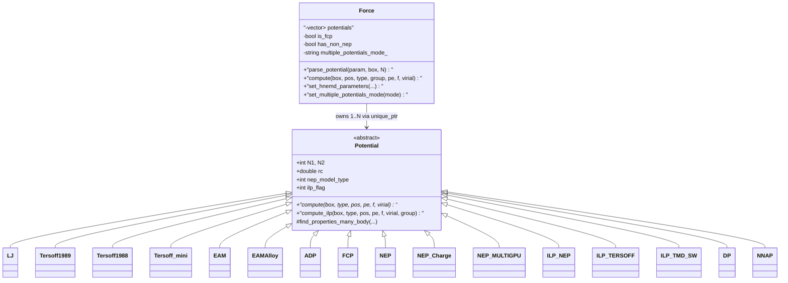
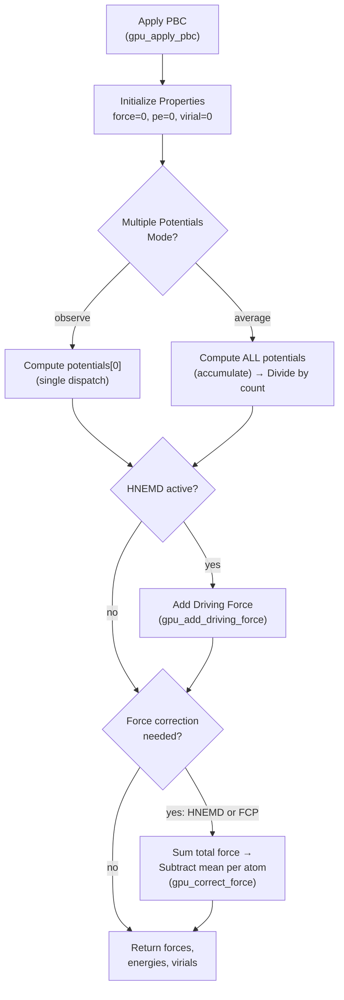

The Force and Potential System is the computational backbone of GPUMD, responsible for evaluating interatomic forces, per-atom potential energies, and per-atom virial tensors that drive every molecular dynamics step. It is organized as a **two-tier hierarchy**: the `Force` class acts as the top-level orchestrator that parses potential inputs, dispatches computation, and applies post-processing corrections, while the `Potential` abstract base class defines the interface that each concrete potential model must implement. This separation ensures that adding a new potential requires only subclassing `Potential` and registering the model name in the `Force::parse_potential` factory — the rest of the simulation pipeline remains untouched.

Sources: [force.cuh](src/force/force.cuh#L1-L87), [potential.cuh](src/force/potential.cuh#L1-L114)

## Architecture Overview

The force computation pipeline follows a strict sequence: periodic boundary conditions are applied, per-atom properties are initialized to zero, each potential's `compute` method is invoked, optional HNEMD driving forces are injected, and finally the total force is corrected to guarantee a zero net force. The following diagram captures the class hierarchy and the data flow through the `Force::compute` method:

The `Force` class owns a `std::vector<std::unique_ptr<Potential>>` named `potentials`, enabling polymorphic dispatch. Each concrete potential stores its own `Neighbor` object (except FCP, which bypasses neighbor lists entirely) and GPU-allocated parameter and scratch space. The `Potential` base class provides the shared `find_properties_many_body` kernel that reduces **partial pairwise forces** (the `f12` arrays) into per-atom forces and the 9-component virial tensor, eliminating code duplication across all many-body potentials.

Sources: [force.cuh](src/force/force.cuh#L63-L78), [force.cu](src/force/force.cu#L37-L68)

## The Force::compute Pipeline

When `Force::compute` is called each timestep, it executes the following sequence as a single GPU-side pipeline with no host-device round-trips between stages:

**PBC application** maps all atom positions back into the simulation box using the inverse box matrix stored in `box.cpu_h[9..17]`. This is skipped for FCP potentials since they operate on equilibrium displacement vectors rather than absolute positions. **Property initialization** zeros out the 3 force components, 1 potential energy, and 9 virial components per atom in a single kernel launch.

Sources: [force.cu](src/force/force.cu#L473-L560), [force.cu](src/force/force.cu#L327-L375)

## Potential Dispatch and Multiple Potential Support

The `parse_potential` method serves as a **factory function** that reads the first token from each potential file and constructs the appropriate `Potential` subclass. The complete dispatch table is:

| Potential Name String | Class | Category | Requires Neighbor List |
|---|---|---|---|
| `lj` | `LJ` | Empirical (pair) | Yes |
| `tersoff_1989` | `Tersoff1989` | Empirical (many-body) | Yes |
| `tersoff_1988` | `Tersoff1988` | Empirical (many-body) | Yes |
| `tersoff_mini` | `Tersoff_mini` | Empirical (many-body) | Yes |
| `eam_zhou_2004` | `EAM` | Empirical (many-body) | Yes |
| `eam_dai_2006` | `EAM` | Empirical (many-body) | Yes |
| `eam/alloy` | `EAMAlloy` | Empirical (many-body) | Yes |
| `adp` | `ADP` | Empirical (many-body) | Yes |
| `fcp` | `FCP` | Lattice dynamics | No |
| `nep3`, `nep4`, `nep5` (and variants) | `NEP` / `NEP_MULTIGPU` | Machine learning | Yes |
| `nep4_charge1/2/3` (and ZBL variants) | `NEP_Charge` | Machine learning (charged) | Yes |
| `nep_ilp` | `ILP_NEP` | Hybrid (ILP + NEP) | Yes (dual) |
| `tersoff_ilp` | `ILP_TERSOFF` | Hybrid (ILP + Tersoff) | Yes (dual) |
| `sw_ilp` | `ILP_TMD_SW` | Hybrid (ILP + SW) | Yes (dual) |
| `dp` | `DP` | Machine learning (DeepMD) | No (built-in) |
| `nnap` | `NNAP` | Machine learning (NN) | No (built-in) |

**Multiple potential support** is restricted to NEP potentials only — the `has_non_nep` flag tracks whether any non-NEP potential has been parsed, and the system raises an error if a second potential is added while `has_non_nep` is true. When multiple NEPs are active, the `multiple_potentials_mode_` string (set via `set_multiple_potentials_mode`) controls behavior:

- **`"observe"`** (default): Only `potentials[0]` is computed. The remaining potentials exist in memory but are not evaluated — useful for on-the-fly model comparison without performance penalty.
- **`"average"`**: All potentials are computed and their per-atom forces, energies, and virials are accumulated, then divided by the number of potentials. This enables model averaging for uncertainty quantification.

Sources: [force.cu](src/force/force.cu#L60-L190), [force.cu](src/force/force.cu#L497-L530)

## The Potential Base Class and Force Reduction

The `Potential` abstract base class defines the contract that every concrete potential must fulfill. Its key virtual methods are:

| Method | Signature | Purpose |
|---|---|---|
| `compute` (pure virtual) | `(Box&, type, pos, pe, force, virial)` | Standard force evaluation |
| `compute` (virtual, default empty) | `(temperature, Box&, type, pos, pe, force, virial)` | Temperature-dependent (NEP free energy) |
| `compute_ilp` (virtual, default empty) | `(Box&, type, pos, pe, force, virial, group)` | ILP-aware computation with group labels |

Each concrete potential implements `compute` by first building or refreshing its neighbor list, then launching GPU kernels that compute **partial pairwise forces** `f12[i]` — the force contribution from atom *i* toward its neighbor *j*, stored as `(f12x, f12y, f12z)` arrays indexed by `[neighbor_index * N + atom_index]`. The base class method `find_properties_many_body` then performs the reduction:

$$F_i = \sum_j (f_{ij} - f_{ji})$$
$$W_{i,\alpha\beta} = \sum_j r_{ij,\alpha} \cdot f_{ji,\beta}$$

This reduction is implemented in the `gpu_find_force_many_body` CUDA kernel, which iterates over each atom's neighbor list, looks up the reciprocal partial force `f21` via a neighbor-list offset search (linear scan for `double` precision, binary search for `float` precision), and accumulates per-atom force and virial components. The **9-component virial** is stored in a flat array with the mapping `{xx→0, yy→1, zz→2, xy→3, xz→4, yz→5, yx→6, zx→7, zy→8}`.

> [!TIP]
> The `float` precision variant of `find_properties_many_body` uses **binary search** to find the reciprocal neighbor offset, while the `double` variant uses a **linear scan**. This is because the `float` path is used by NEP potentials which have sorted neighbor lists, enabling O(log n) lookup versus O(n) for unsorted lists.

Sources: [potential.cuh](src/force/potential.cuh#L43-L80), [potential.cu](src/force/potential.cu#L32-L155)

## Concrete Potential Categories

### Pair Potentials: Lennard-Jones

The `LJ` class is the simplest concrete potential. It stores pre-computed parameters `s6e4[i][j]`, `s12e4[i][j]`, and `cutoff_square[i][j]` for each type pair in a `LJ_Para` struct (with `MAX_TYPE = 10` supported type pairs). These are the coefficients of the 12-6 Lennard-Jones expression after pulling out common factors for GPU efficiency. The `Neighbor` object manages the full neighbor list at the LJ cutoff radius.

### Many-Body Empirical Potentials: Tersoff and EAM

The **Tersoff** family (`Tersoff1989`, `Tersoff1988`, `Tersoff_mini`) follows a two-pass computation pattern: the first kernel computes bond-order values `b` and their derivatives `bp` for each pair, and the second kernel uses these to accumulate the partial forces `f12`. The `Tersoff1989_Data` struct stores `b`, `bp`, and `f12` arrays as `GPU_Vector<double>`, plus its own `Neighbor` object.

The **EAM** potentials (`EAM`, `EAMAlloy`) use a similar two-pass approach: the first pass accumulates electron density at each atom, and the second pass computes forces using the derivative of the embedding function `F'(ρ)` stored in `EAM_Data::Fp`. The `EAM2004Zhou` parameter struct carries all analytic embedding and pair function coefficients for the Zhou 2004 formulation, while `EAMAlloy` reads tabulated potential files in LAMMPS-compatible format. The **ADP** potential extends EAM with additional dipole and quadrupole terms.

### Lattice Dynamics: Force Constant Potential (FCP)

The `FCP` class is architecturally distinct — it does **not** use a neighbor list. Instead, it reads force constant matrices up to 6th order (`phi2` through `phi6`) and equilibrium positions `r0`, then computes forces as a Taylor expansion in atomic displacements. The `FCP_Data` struct stores multi-body index arrays (`i2/j2/index2` through `i6/j6/k6/l6/m6/n6/index6`) that encode which atoms participate in each force-constant term. Because FCP uses absolute displacements rather than neighbor-based interactions, the `Force` class skips PBC application when `is_fcp` is true, and always applies force correction to remove any residual net force.

### Machine Learning Potentials: NEP Family

The `NEP` class is the most complex concrete potential, supporting NEP3, NEP4, and NEP5 model versions with multiple model types (energy, dipole, polarizability, temperature-dependent free energy). Its architecture features:

- **Separate radial and angular neighbor lists** (`NN_radial`/`NL_radial` and `NN_angular`/`NL_angular`) with different cutoff radii, managed by the `Neighbor` object
- **Two box-size code paths**: `compute_small_box` for systems that fit in the expanded-box approach, and `compute_large_box` for larger systems — the small-box path uses an `ExpandedBox` struct with replicated cell data for reduced neighbor-list overhead
- **ANN parameters** stored as raw `float*` pointers in the `ANN` struct (`w0`, `b0`, `w1`, `b1`, `c` per element type), enabling direct GPU constant-memory access
- **Optional ZBL repulsion** for short-range correction, controlled by `ZBL::enabled` and `ZBL::flexibled` flags
- **Optional DFT-D3 dispersion** via the `dftd3` sub-object
- **Multi-GPU support** through the `NEP_MULTIGPU` subclass, which partitions the simulation domain along a user-specified direction (x, y, or z)

The `NEP_Charge` variant adds charge-equilibration logic on top of the base NEP framework. When multiple GPUs are detected and the potential name is a NEP variant, `parse_potential` automatically constructs `NEP_MULTIGPU` instead of `NEP`, unless `num_gpus == 1`.

### Hybrid ILP Potentials

The ILP (interlayer potential) hybrids combine a short-range intralayer potential with a long-range interlayer potential for layered materials. Three variants exist:

| Class | Intralayer Part | Interlayer Part | Target Materials |
|---|---|---|---|
| `ILP_NEP` | NEP (multiple models via map file) | ILP (Kolmogorov-Crespi type) | C, h-BN, TMD |
| `ILP_TERSOFF` | Tersoff 1988 | ILP (Kolmogorov-Crespi type) | C, h-BN |
| `ILP_TMD_SW` | Stillinger-Weber | ILP (Kolmogorov-Crespi type) | TMD |

These are the only potentials that override `compute_ilp` instead of (or in addition to) `compute`. The `compute_ilp` method receives a `std::vector<Group>` reference that provides **group labels** distinguishing different layers — the ILP interlayer force is only computed between atoms in different groups, while the intralayer potential acts within groups. Each ILP variant manages **two separate neighbor lists**: a standard neighbor list for the intralayer potential and a specialized ILP neighbor list (`ilp_NN`/`ilp_NL`) built with `find_neighbor_ilp` that respects the layer-group partitioning.

The `ILP_NEP` variant supports **multiple NEP models** mapped to different groups via a NEP map file, enabling different parameterizations for different layer types (e.g., MoS₂ with different NEP models for Mo-S and S-S interactions).

Sources: [lj.cuh](src/force/lj.cuh#L38-L50), [tersoff1989.cuh](src/force/tersoff1989.cuh#L33-L57), [eam.cuh](src/force/eam.cuh#L64-L83), [fcp.cuh](src/force/fcp.cuh#L33-L57), [nep.cuh](src/force/nep.cuh#L28-L185), [ilp_nep.cuh](src/force/ilp_nep.cuh#L140-L200), [ilp_tersoff.cuh](src/force/ilp_tersoff.cuh#L55-L96)

## HNEMD Driving Force and Force Correction

After all potentials have been evaluated, the `Force::compute` method applies two optional post-processing steps:

**HNEMD (Homogeneous Non-Equilibrium Molecular Dynamics)** adds an external driving force proportional to the per-atom virial tensor to induce a heat current. The `gpu_add_driving_force` kernel computes:

$$F_{i,\alpha}^{\text{drive}} = \sum_\beta f_{e,\beta} \cdot W_{i,\beta\alpha}$$

where $f_e$ is the driving force vector `hnemd_fe_[3]` and $W$ is the virial. Two HNEMD variants are supported: the standard method (`compute_hnemd_`) and the enhanced color conductivity method (`compute_hnemdec_`), which uses type-dependent coefficients stored in the `coefficient` GPU vector.

**Force correction** ensures the total force on the system is exactly zero, which is required for proper center-of-mass conservation. The `gpu_sum_force` kernel computes the total force vector using a parallel reduction, and `gpu_correct_force` subtracts the mean force `F_tot / N` from each atom. This correction is applied when: (1) HNEMD is active, or (2) the potential is FCP. Standard equilibrium MD with pair/many-body potentials does not require correction because Newton's third law is enforced exactly by the `f12 - f21` construction in `find_properties_many_body`.

> [!TIP]
> The force correction kernel `gpu_sum_force` uses a fixed block size of 1024 threads across 3 blocks (one per force component) with manual shared-memory reduction. This is a specialized reduction pattern distinct from the neighbor-list force reduction — it operates on the already-computed per-atom forces, not the pairwise partial forces.

Sources: [force.cu](src/force/force.cu#L226-L310), [force.cu](src/force/force.cu#L560-L598), [force.cu](src/force/force.cu#L608-L660)

## Neighbor List Infrastructure

The `Neighbor` class provides the spatial decomposition layer that all neighbor-based potentials depend on. It encapsulates:

- **GPU vectors** `NN` (neighbor number per atom) and `NL` (neighbor list, column-major with stride `N`)
- **Cell list** infrastructure (`cell_count`, `cell_count_sum`, `cell_contents`) for O(1) spatial binning
- **Position caching** (`x0`, `y0`, `z0`) for incremental rebuild decisions based on maximum atom displacement versus the `skin` distance (default 1.0 Å)

The public interface provides two methods: `find_neighbor_global` builds the full neighbor list at a given cutoff radius `rc`, and `find_local_neighbor_from_global` extracts a tighter local neighbor list from a pre-built global list (used by NEP which needs both radial and angular neighbors at different cutoffs). The free function `find_neighbor_ilp` provides layer-aware neighbor building that only includes inter-layer pairs, and `find_neighbor_SW` provides group-aware neighbor building for Stillinger-Weber potentials.

The cell-list approach transforms Cartesian coordinates to fractional coordinates via the inverse box matrix, assigns each atom to a cell, then scans neighboring cells within the cutoff radius. The `find_cell_id` device function handles the fractional-to-cell-index mapping with periodic wrapping.

Sources: [neighbor.cuh](src/force/neighbor.cuh#L18-L161)

## Virial Tensor Storage Convention

All potentials output a 9-component per-atom virial tensor stored as a flat `GPU_Vector<double>` of size `9 * N`. The storage layout follows a row-major convention for the 3×3 matrix, but the indexing uses a specific component mapping that developers must respect when implementing new potentials:

| Matrix Position | Component | Flat Index Offset |
|---|---|---|
| (0,0) | σ_xx | 0 × N |
| (1,1) | σ_yy | 1 × N |
| (2,2) | σ_zz | 2 × N |
| (0,1) | σ_xy | 3 × N |
| (0,2) | σ_xz | 4 × N |
| (1,2) | σ_yz | 5 × N |
| (1,0) | σ_yx | 6 × N |
| (2,0) | σ_zx | 7 × N |
| (2,1) | σ_zy | 8 × N |

This convention is commented in the source as `{xx xy xz → 0 3 4; yx yy yz → 6 1 5; zx zy zz → 7 8 2}` and is used consistently across `gpu_find_force_many_body`, `gpu_add_driving_force`, and the HNEMD tensor computation in `gpu_find_per_atom_tensor`.

Sources: [potential.cu](src/force/potential.cu#L120-L137), [force.cu](src/force/force.cu#L560-L580)

## Summary of Design Principles

The Force and Potential System embodies several architectural decisions that are worth understanding when extending GPUMD:

1. **Polymorphic dispatch via `unique_ptr<Potential>`**: New potentials are added by subclassing `Potential`, implementing `compute`, and adding a branch in `parse_potential`. No changes to the simulation loop are needed.

2. **Partial-force → per-atom reduction pattern**: All many-body potentials compute pairwise partial forces `f12` in potential-specific kernels, then delegate to the shared `find_properties_many_body` for the final reduction. This avoids duplicating the virial computation logic.

3. **Per-potential neighbor list ownership**: Each potential owns its `Neighbor` object with its own cutoff radius, allowing different potentials to use different neighbor ranges without conflict.

4. **Multiple NEP averaging with observe/average modes**: The system supports loading multiple NEP models simultaneously, with zero-cost observation mode for runtime model comparison or cost-proportional averaging for ensemble predictions.

5. **FCP as a special case**: The force constant potential bypasses both PBC and neighbor lists, operating directly on displacement vectors — a necessary design for harmonic and anharmonic lattice dynamics that cannot be expressed as a short-ranged neighbor interaction.

To understand how forces feed into the time integration loop, see [Integration and Ensemble Methods](6-integration-and-ensemble-methods). For details on the NEP neural network architecture and its GPU kernel design, see [NEP Model Architecture](8-nep-model-architecture) and [CUDA Kernel Design](13-cuda-kernel-design). For the neighbor list construction algorithm and memory layout, see [Neighbor List and Memory Layout](14-neighbor-list-and-memory-layout).
