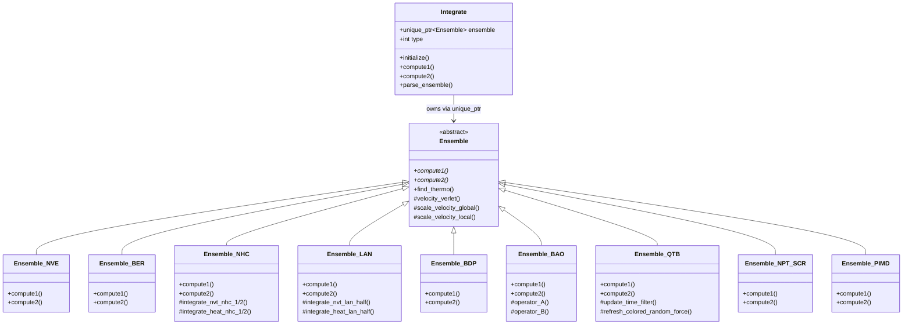
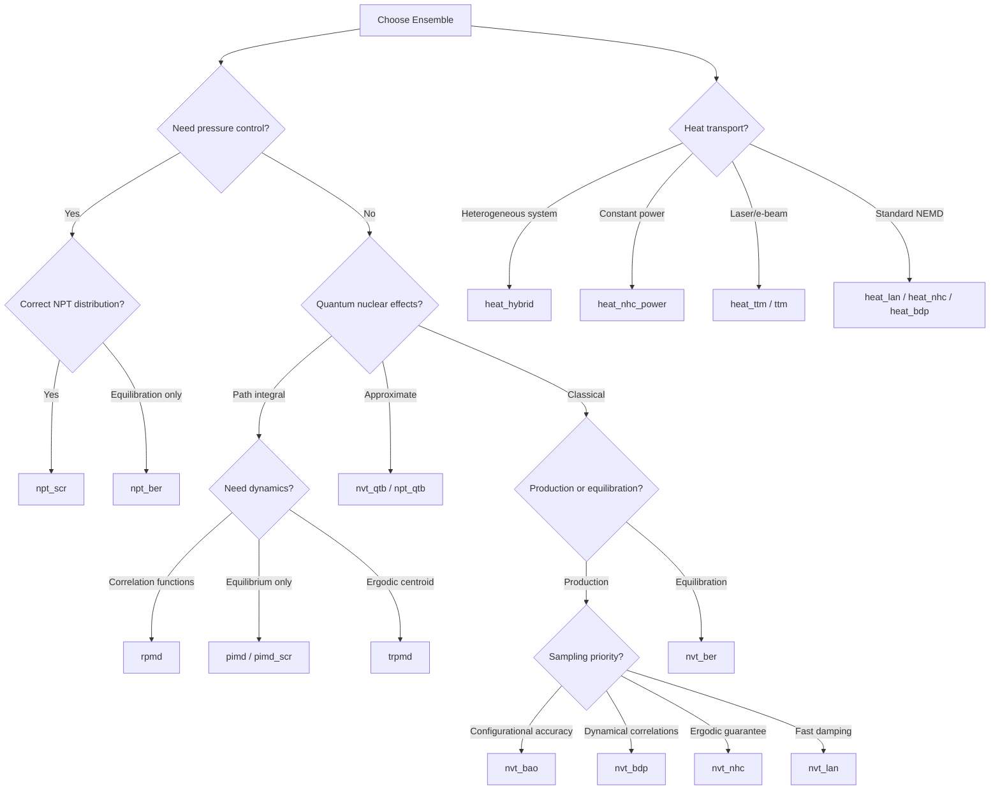

GPUMD implements a rich hierarchy of integration schemes and ensemble methods, organized around a polymorphic `Ensemble` base class driven by the `Integrate` orchestrator. Every simulation run selects exactly one ensemble, which couples a **Velocity Verlet** core integrator with thermostat, barostat, and heat-exchange mechanisms to sample the desired thermodynamic ensemble. The design follows a two-phase split (`compute1` → force evaluation → `compute2`) that cleanly separates the half-step velocity update from the post-force thermostat/barostat application.

## Architecture: The Integrate–Ensemble Class Hierarchy

The `Integrate` class acts as a factory and driver. During initialization, `Integrate::initialize()` reads the ensemble `type` code and constructs the appropriate `Ensemble` subclass via `std::unique_ptr<Ensemble>`, binding it to the simulation's atom, box, group, and thermo data. Each timestep then calls `compute1` (first Velocity Verlet half-step) and `compute2` (second half-step + thermostat/barostat + thermo computation). This polymorphic design means adding a new ensemble requires only subclassing `Ensemble` and registering a new type code.

The type code convention partitions the integer space into semantic regions: **0** = NVE, **1–10** = NVT, **11–20** = NPT, **21–30** = heat/NEMD, **31–40** = PIMD, and **negative values** = specialized methods (MSST, thermodynamic integration, walls).

Sources: [integrate.cuh](/src/integrate/integrate.cuh#L1-L120), [integrate.cu](/src/integrate/integrate.cu#L1-L200), [ensemble.cuh](/src/integrate/ensemble.cuh#L1-L158)

## The Velocity Verlet Core

All ensemble subclasses share the same **Velocity Verlet** integrator inherited from the `Ensemble` base class. The two-phase structure splits each timestep Δt as follows:

- **`compute1`** (first half-step): **v(t + Δt/2) = v(t) + (Δt/2) · F(t)/m**, then **x(t + Δt) = x(t) + Δt · v(t + Δt/2)**
- **Force evaluation** (between compute1 and compute2, performed by the main simulation loop)
- **`compute2`** (second half-step): **v(t + Δt) = v(t + Δt/2) + (Δt/2) · F(t + Δt)/m**, followed by thermostat/barostat correction and thermodynamic output

This splitting is critical: the thermostat and barostat modify velocities *after* the deterministic Verlet step completes, ensuring that the symplectic core remains intact and the stochastic/deterministic corrections compose cleanly.

> [!TIP]
> The `velocity_verlet()` method in the base `Ensemble` class handles both steps via a boolean `is_step1` flag. When `USE_NEPCG` is defined, a code-generated variant `velocity_verlet_cg()` is used instead for NEP force evaluation with fused kernels.

Sources: [ensemble.cuh](/src/integrate/ensemble.cuh#L112-L130), [ensemble_nve.cu](/src/integrate/ensemble_nve.cu#L49-L96)

## NVT Ensemble Thermostats

GPUMD provides five distinct thermostats for canonical (NVT) sampling, each with different ergodicity, correctness, and efficiency properties. All accept a linearly interpolated temperature ramp from `T_initial` to `T_final` over the run, plus a coupling parameter whose interpretation varies by method.

| Keyword | Type Code | Algorithm | Coupling Parameter | Generates Correct Canonical? | Best For |
|---|---|---|---|---|---|
| `nvt_ber` | 1 | Berendsen velocity rescaling | τ_T (time constant in timesteps, ≥1) | No (samples modified ensemble) | Equilibration, gentle cooling |
| `nvt_nhc` | 2 | Nosé–Hoover chain (length 4) | τ_T (time constant in timesteps, ≥1) | Yes (proven ergodic for chains ≥2) | Production NVT, static properties |
| `nvt_lan` | 3 | Langevin thermostat | τ_T (damping time in timesteps, ≥1) | Yes (exact for OU process) | Rough systems, fast equilibration |
| `nvt_bdp` | 4 | Bussi–Donadio–Parrinello (stochastic velocity rescaling) | τ_T (time constant in timesteps, ≥1) | Yes (exact canonical) | Production NVT, energy conservation |
| `nvt_bao` | 5 | BAOAB Langevin (splitting integrator) | τ_T (damping time in timesteps, ≥1) | Yes (with optimal configurational sampling) | High-accuracy sampling, small Δt |

**Syntax**: `ensemble nvt_<method> T_initial T_final tau_T`

### Berendsen Thermostat

The Berendsen thermostat rescales all velocities by a uniform factor each step: **λ = √(1 + (Δt/τ_T)(T_target/T_current − 1))**. It drives the system toward the target temperature exponentially but does *not* generate the correct canonical distribution—it produces a narrower kinetic energy distribution. This makes it ideal for rapid equilibration but unsuitable for production sampling of thermodynamic averages.

Sources: [ensemble_ber.cu](/src/integrate/ensemble_ber.cu#L59-L74)

### Nosé–Hoover Chain Thermostat

The NHC thermostat uses a chain of 4 coupled auxiliary variables (hardcoded via `NOSE_HOOVER_CHAIN_LENGTH`) that evolve deterministically. The chain length of 4 ensures practical ergodicity for most systems. The thermostat variables are integrated using a factorized splitting scheme within the Velocity Verlet framework. The coupling parameter τ_T determines the characteristic timescale of the thermostat response; too small values cause energy oscillations, too large values make the thermostat sluggish.

Sources: [ensemble_nhc.cuh](/src/integrate/ensemble_nhc.cuh#L1-L97), [ensemble.cuh](/src/integrate/ensemble.cuh#L126-L133)

### Langevin Thermostat

The Langevin thermostat adds friction and stochastic forcing to each atom: **m·dv/dt = F − γ·v + √(2γk_BT)·η(t)**, where γ = m/τ_T. The half-step velocity update uses the exact Ornstein–Uhlenbeck solution: **v(t+Δt/2) = c₁·v(t) + c₂·√(k_BT/m)·R**, where **c₁ = exp(−Δt/τ_T)** and **c₂ = √(1 − c₁²)**, and R is a standard normal random number. This guarantees the correct Maxwell–Boltzmann distribution at equilibrium. GPUMD uses per-atom CUDA/HIP random states (`curand_states`) for parallel random number generation.

Sources: [langevin_utilities.cuh](/src/integrate/langevin_utilities.cuh#L35-L52)

### BDP Stochastic Velocity Rescaling

The Bussi–Donadio–Parrinello thermostat rescales the total kinetic energy by a stochastic factor drawn from the exact canonical distribution of kinetic energy. It uses a CPU-side `std::mt19937` RNG to sample the rescaling factor, then applies a uniform velocity scaling. This produces the exact canonical distribution with minimal perturbation to dynamics—particularly good for maintaining realistic dynamical correlations while sampling correctly.

Sources: [ensemble_bdp.cuh](/src/integrate/ensemble_bdp.cuh#L1-L65)

### BAOAB Langevin Integrator

The BAOAB splitting integrator decomposes the Langevin equation into operators **B** (deterministic velocity kick), **A** (position drift), and **O** (Ornstein–Uhlenbeck thermostat step), composing them as **B–A–O–A–B**. This ordering places the stochastic **O** step at the center, which has been proven to provide superior configurational sampling accuracy—especially at large timesteps where the O step dominates error cancellation. The implementation provides both `operator_A` and `operator_B` methods that compose with the central O step.

> [!TIP]
> For production NVT simulations, `nvt_bao` and `nvt_bdp` are generally recommended. BAOAB excels when high configurational accuracy is needed; BDP preserves dynamical correlations better. Avoid `nvt_ber` for production runs due to its incorrect ensemble distribution.

Sources: [ensemble_bao.cuh](/src/integrate/ensemble_bao.cuh#L1-L76)

## NPT Ensemble: Thermostat + Barostat Combinations

GPUMD supports isothermal-isobaric (NPT) simulations by coupling the NVT thermostats above with barostats. Pressure control supports three geometric modes:

| Mode | Pressure Components | Box Type | Elastic Modulus Inputs |
|---|---|---|---|
| Isotropic | 1 (P_iso) | Orthogonal only | 1 (E_iso) |
| Anisotropic orthogonal | 3 (P_x, P_y, P_z) | Orthogonal only | 3 (E_x, E_y, E_z) |
| Fully anisotropic (triclinic) | 6 (P_xx, P_yy, P_zz, P_yz, P_xz, P_xy) | Triclinic | 6 |

| Keyword | Type Code | Thermostat | Barostat | Syntax |
|---|---|---|---|---|
| `npt_ber` | 11 | Berendsen | Berendsen | `ensemble npt_ber T_i T_f tau_T P... E... tau_P` |
| `npt_scr` | 12 | Berendsen | SCR (stochastic cell rescaling) | `ensemble npt_scr T_i T_f tau_T P... E... tau_P` |

The **Berendsen barostat** rescales box dimensions similarly to the Berendsen thermostat: **μ = 1 − κ·(P_target − P_current)**, where κ is the pressure coupling derived from the elastic modulus and τ_P. For orthogonal boxes, each direction scales independently; for triclinic boxes, a full 3×3 scaling matrix μ is applied to the box matrix **h** as **h_new = μ · h_old**.

The **SCR barostat** (stochastic cell rescaling) extends the Berendsen barostat with stochastic cell volume fluctuations, analogous to how BDP extends the Berendsen thermostat. This produces the correct NPT distribution, making `npt_scr` the recommended choice for production NPT simulations.

Optional **deformation** can be applied per direction using `deform` parameters, which override pressure control in specified directions with a fixed strain rate.

Sources: [ensemble_ber.cu](/src/integrate/ensemble_ber.cu#L77-L170), [integrate.cu](/src/integrate/integrate.cu#L550-L700)

## Heat Exchange (NEMD) Ensembles

For non-equilibrium molecular dynamics (NEMD) thermal conductivity calculations, GPUMD implements heat exchange methods that drive a temperature gradient by applying thermostats at different temperatures to source and sink atom groups.

| Keyword | Type Code | Thermostat at Source/Sink | Heat Input Mode |
|---|---|---|---|
| `heat_nhc` | 21 | Nosé–Hoover chain | ΔT offset from mean |
| `heat_lan` | 22 | Langevin | ΔT offset from mean |
| `heat_bdp` | 23 | BDP stochastic rescaling | ΔT offset from mean |
| `heat_nhc_power` | 27 | Nosé–Hoover (no rescaling) | Constant power (eV/fs) |
| `heat_hybrid` | 26 | Mixed (NHC + Langevin per group) | ΔT offset from mean |
| `heat_ttm` | 24 | Langevin + TTM two-temperature model | ΔT with electron TTM |
| `ttm` | 25 | Pure TTM (no thermostat) | Electron-phonon coupling |

**Standard heat syntax**: `ensemble heat_<method> T T_coupling delta_T source sink`

The `heat_lan` method additionally supports **region-based** thermostats (instead of group-based), where source and sink are defined by fractional coordinate bounds rather than group IDs. This allows flexible spatial partitioning without pre-defined groups.

The **heat_hybrid** method is particularly powerful for heterogeneous systems: it allows different atom groups to be thermostatted by different methods (NHC or Langevin) with independent coupling parameters, enabling optimal thermostat selection for each material phase. Syntax: `ensemble heat_hybrid nhc lan T tau_nhc tau_lan delta_T group_nhc group_lan`.

The **heat_nhc_power** method applies a fixed heating power P (in eV/fs) to the source group and removes the same power from the sink, without any thermostat rescaling. This directly controls heat flux for thermal conductivity measurement via Fourier's law.

Sources: [integrate.cu](/src/integrate/integrate.cu#L400-L500), [integrate.cu](/src/integrate/integrate.cu#L700-L900)

## Quantum Thermostats: QTB and NPT-QTB

The **Quantum Thermal Bath (QTB)** method approximates quantum nuclear effects by applying a colored (frequency-dependent) random force that reproduces the quantum fluctuation-dissipation theorem. Instead of white noise, the QTB generates random forces with a power spectrum shaped by the quantum harmonic oscillator energy: **⟨|F(ω)|²⟩ = 2mγω·[ℏω/(exp(ℏω/k_BT) − 1)]**.

**Syntax**: `ensemble nvt_qtb T_initial T_final tau_T [f_max F] [N_f N]`

- `f_max` (default 200 ps⁻¹): maximum frequency in the power spectrum
- `N_f` (default 100): number of frequency bins

The implementation maintains GPU random state arrays and a time-domain filter kernel (`time_H_device`) that is convolved with white noise to produce the colored random forces. The filter is updated whenever the target temperature changes.

The **NPT-QTB** variant combines the QTB thermostat with the SCR barostat for quantum-corrected NPT simulations.

Sources: [ensemble_qtb.cuh](/src/integrate/ensemble_qtb.cuh#L1-L75)

## Path Integral Methods: RPMD, TRPMD, and PIMD

GPUMD implements ring-polymer path integral methods for quantum nuclear effects beyond the QTB approximation. These methods represent each atom as a **ring polymer** with P beads connected by harmonic springs, where P is the number of beads (must be even, 2 ≤ P ≤ 128).

| Keyword | Type Code | Method | Barostat |
|---|---|---|---|
| `rpmd` | 31 | Ring Polymer Molecular Dynamics | None |
| `trpmd` | 32 | Thermostatted Ring Polymer MD | None |
| `pimd` | 33 | Path Integral MD (centroid NHC) | Optional SCR or Berendsen |
| `pimd_scr` | 33 | PIMD with SCR barostat | SCR |

**RPMD** uses free ring-polymer dynamics (no thermostat on centroid mode) to approximate quantum Kubo-transformed time correlation functions. **TRPMD** adds a Langevin thermostat to the centroid mode for better ergodicity. **PIMD** applies a Nosé–Hoover chain thermostat to the centroid mode for exact canonical sampling of the quantum Boltzmann distribution.

The **Eco-PIMD** variant (enabled by appending `eco omega_max_cm1` to the `pimd` command) uses an efficient cutoff scheme for the ring-polymer normal-mode transformation, skipping transformations for frequencies above `omega_max` in cm⁻¹. This significantly reduces computational cost for stiff systems.

**PIMD+NPT syntax** (isotropic): `ensemble pimd P T_i T_f tau_T P_target E_modulus tau_P [eco omega_max]`

Sources: [ensemble_pimd.cuh](/src/integrate/ensemble_pimd.cuh#L1-L10), [integrate.cu](/src/integrate/integrate.cu#L900-L1100)

## Two-Temperature Model (TTM) Ensemble

The **TTM** ensemble couples the atomic system to a continuum electron temperature field governed by the two-temperature model: **C_e·∂T_e/∂t = κ_e·∇²T_e − G·(T_e − T_a) + S**, where G is the electron-phonon coupling, κ_e is electron thermal conductivity, and S is an external source. This is critical for simulating laser-material interactions and radiation damage.

The `heat_ttm` variant thermostats source/sink groups with a Langevin thermostat while simultaneously solving the TTM for the electron subsystem. The `ttm` variant uses pure TTM without explicit thermostat groups. The electron temperature field is discretized on a 3D grid and evolved via finite differences, with electron-phonon energy exchange coupling atoms to the continuum field.

Sources: [ensemble_ttm.cuh](/src/integrate/ensemble_ttm.cuh#L1-L10), [integrate.cu](/src/integrate/integrate.cu#L460-L470)

## Specialized Ensembles

### Thermodynamic Integration Methods

Several ensemble types support free energy calculations via thermodynamic integration (TI), each using different reference systems:

| Keyword | Type Code | Reference System | Purpose |
|---|---|---|---|
| `ti_spring` | −2 | Harmonic spring | Einstein crystal → real system |
| `ti` | −6 | General lambda path | Arbitrary potential interpolation |
| `ti_rs` | −8 | Reversible scaling | Efficient free energy over T range |
| `ti_as` | −9 | Adiabatic switching | Switching between potentials |
| `ti_liquid` | −11 | Ideal gas → liquid | Liquid free energy |

These constructors parse their parameters directly from the `ensemble` command line and construct the ensemble object immediately (rather than deferred construction via the `Integrate` class).

### Wall and Constrained Ensembles

| Keyword | Type Code | Description |
|---|---|---|
| `wall_piston` | −4 | Piston-driven compression/expansion |
| `wall_mirror` | −7 | Reflective wall boundary |
| `wall_harmonic` | −10 | Harmonic confining wall potential |
| `nphug` | −5 | NPHug Hugoniot ensemble for shock simulations |
| `msst` | −1 | Multi-Scale Shock Technique (MSST) |

### The MTTK NPT Integrator

The **MTTK** (Martyna–Tuckerman–Tobias–Klein) integrator (type −3) provides a time-reversible, measure-preserving NPT integrator based on the extended Lagrangian formalism. It is constructed directly from command-line parameters like the specialized ensembles.

Sources: [integrate.cu](/src/integrate/integrate.cu#L530-L570)

## Temperature Ramping and Ensemble Binding

A key design feature is the **automatic temperature interpolation** between runs. When `temperature1 ≠ temperature2`, the `Integrate::compute1/compute2` methods linearly interpolate: **T(step) = T₁ + (T₂ − T₁) × step/total_steps**. For NVE and RPMD/TRPMD (types 0, 31, 32), the temperature is fixed at `temperature2` since no thermostat exists. This enables smooth heating/cooling protocols across consecutive `run` commands without manual temperature scheduling.

The `fix` and `move` constraints bind atom groups to the ensemble: `fix` freezes atoms in place (zero velocity, no position update), while `move` applies a constant drift velocity to a group (e.g., for rigid sliding). These constraints are validated during `Integrate::initialize()`—moving groups require a fixed group, and only NVT Berendsen, NHC, and BDP support moving groups.

Sources: [integrate.cu](/src/integrate/integrate.cu#L327-L370), [integrate.cuh](/src/integrate/integrate.cuh#L51-L64)

## Ensemble Selection Guide

For further details on how forces are computed before the `compute2` phase, see [Force and Potential System](5-force-and-potential-system). For measurement outputs generated during ensemble integration, see [Measurement and Output](7-measurement-and-output). For PIMD-specific theoretical background and the Eco-PIMD algorithm, see [Monte Carlo and PIMD](16-monte-carlo-and-pimd).