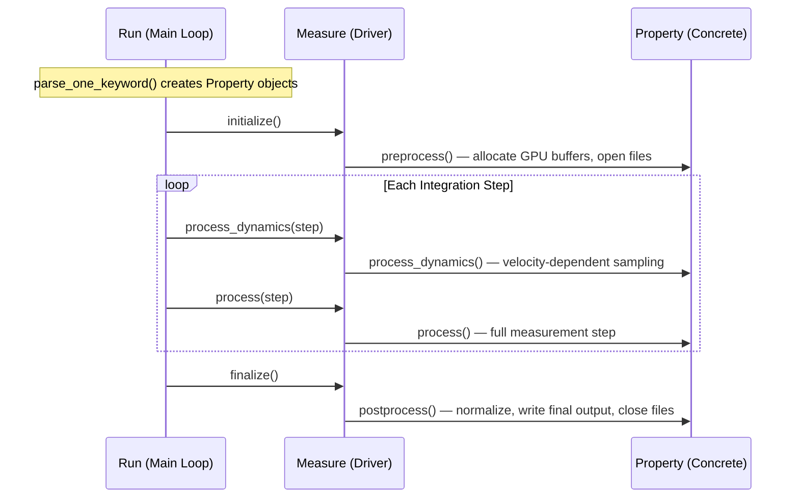
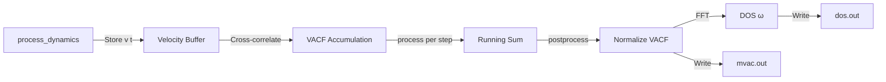

GPUMD's measurement and output subsystem is the observability layer of the simulation pipeline — it defines *what* is computed, *when* it is sampled, and *how* results are persisted to disk. Every measurement in GPUMD follows a strict lifecycle governed by the **Property** abstract base class, and all measurements are orchestrated by the **Measure** driver class during the main integration loop. Understanding this architecture is essential for configuring `run.in` correctly, extending GPUMD with custom observables, or diagnosing unexpected output files.

Sources: [property.cuh](src/measure/property.cuh#L1-L74), [measure.cuh](src/measure/measure.cuh#L1-L69)

## Architectural Overview: The Property Lifecycle

All measurements in GPUMD inherit from the `Property` base class, which defines a four-phase lifecycle that mirrors the simulation's own progression. The `Measure` class holds a `std::vector<std::unique_ptr<Property>> properties` — a polymorphic collection that is populated during input parsing and iterated over at every simulation step.



The four virtual methods of `Property` are:

| Phase | Method | Purpose | Timing |
|-------|--------|---------|--------|
| **Preprocess** | `preprocess()` | Allocate GPU vectors, open output files, validate parameters | Before integration loop |
| **Process Dynamics** | `process_dynamics()` | Sample velocity-dependent quantities (called *before* `integrate.compute2`) | Every step, after force computation |
| **Process** | `process()` | Full measurement logic — accumulation, correlation, output | Every step, after `integrate.compute2` |
| **Postprocess** | `postprocess()` | Normalize accumulated data, write final results, close files | After integration loop |

The `process_dynamics()` method has a **default no-op implementation** in the base class, meaning only measurements that require velocity data *before* the second half-kick (such as VACF-based DOS/SDC) need to override it. The `preprocess()`, `process()`, and `postprocess()` methods are **pure virtual** — every concrete property must implement them.

Sources: [property.cuh](src/measure/property.cuh#L40-L73), [measure.cu](src/measure/measure.cu#L39-L131)

## The Measure Driver: Orchestration and Uniqueness

The `Measure` class acts as a pure orchestrator — it performs no computation itself. Its three key methods (`initialize`, `process`, `process_dynamics`, `finalize`) simply iterate over the `properties` vector and dispatch to each `Property` object.

A critical design constraint is **uniqueness enforcement**. During `initialize()`, the driver scans all registered properties and verifies that no two share the same `property_name`, with **two exceptions**: `dump_xyz` and `dump_netcdf` may be registered multiple times (to write different subsets of atoms at different intervals). Any duplicate registration of other properties triggers an immediate error exit.

```cpp
// From Measure::initialize() — uniqueness check
if (prop->property_name != "dump_xyz" && prop->property_name != "dump_netcdf") {
  for (auto& property_name : property_names) {
    if (property_name == prop->property_name) {
      std::cout << "There are multiple " << prop->property_name << " keywords within one run.\n";
      exit(1);
    }
  }
}
```

Sources: [measure.cu](src/measure/measure.cu#L39-L70)

## Property Registration: The Input Parsing Pipeline

Properties are instantiated during `parse_one_keyword()` in `run.cu`, which maps each `run.in` keyword to a concrete `Property` subclass. The pattern is uniform: parse the keyword → construct the property object → move it into `measure.properties` via `std::unique_ptr`.

The complete mapping of measurement keywords to their `Property` subclasses is:

### Dump (Trajectory & State) Properties

| Keyword | Class | Output File | Description |
|---------|-------|-------------|-------------|
| `dump_thermo` | `Dump_Thermo` | `thermo.out` | Thermodynamic state (T, KE, PE, stress, box) |
| `dump_xyz` | `Dump_XYZ` | Custom filename | Atom positions/velocity/force/potential in XYZ format |
| `dump_restart` | `Dump_Restart` | `restart.xyz` | Simulation restart state |
| `dump_netcdf` | `DUMP_NETCDF` | Custom filename | NetCDF trajectory (optional, requires `USE_NETCDF`) |
| `dump_beads` | `Dump_Beads` | `beads.out` | PIMD bead positions |
| `dump_observer` | `Dump_Observer` | `observer.out` / `observer.xyz` | Observer atom tracking |
| `dump_shock_nemd` | `Dump_Shock_NEMD` | `shock_nemd.out` | Shock NEMD diagnostics |
| `dump_dipole` | `Dump_Dipole` | `dipole.out` | Dipole moments (NEP) |
| `dump_polarizability` | `Dump_Polarizability` | `polarizability.out` | Polarizability tensor (NEP) |
| `dump_cg` | `Dump_CG` | Custom filename | Coarse-grained atom positions |

### Compute (Accumulation & Correlation) Properties

| Keyword | Class | Output File(s) | Description |
|---------|-------|----------------|-------------|
| `compute` | `Compute` | `compute.out` | Group-averaged T, PE, force, virial, heat flux, momentum |
| `compute_dos` | `DOS` | `dos.out`, `mvac.out` | Vibrational density of states via VACF |
| `compute_sdc` | `SDC` | `sdc.out`, `mvac.out` | Self-diffusion coefficient via VACF |
| `compute_msd` | `MSD` | `msd.out` | Mean-squared displacement |
| `compute_hac` | `HAC` | `hac.out`, `kappa.out` | Thermal conductivity via HACF (EMD) |
| `compute_hnemd` | `HNEMD` | `kappa.out`, `onsager.out` | Thermal conductivity via HNEMD |
| `compute_hnemdec` | `HNEMDEC` | `kappa.out` | HNEMD with electron-phonon coupling |
| `compute_shc` | `SHC` | `shc.out` | Spectral heat conductivity |
| `compute_rdf` | `RDF` | `rdf.out` | Radial distribution function |
| `compute_adf` | `ADF` | `adf.out` | Angular distribution function |
| `compute_angular_rdf` | `AngularRDF` | `angular_rdf.out` | Angular-resolved RDF |
| `compute_orientorder` | `OrientOrder` | `orientorder.out` | Bond-orientational order parameters |
| `compute_viscosity` | `Viscosity` | `viscosity.out` | Viscosity via HNEMD |
| `compute_dpdt` | `Compute_dpdt` | `dpdt.out` | Pressure time derivative |
| `compute_es` | `Compute_es` | (various) | Electronic stopping diagnostics |
| `compute_extrapolation` | `Extrapolation` | `extrapolation.out` | NEP extrapolation grade |
| `compute_chunk` | `ComputeChunk` | (various) | Per-chunk spatial averages |
| `compute_gkma` | `MODAL_ANALYSIS` | `heatmode.out`, `kappamode.out` | Green-Kubo modal analysis |
| `compute_hnema` | `MODAL_ANALYSIS` | `heatmode.out`, `kappamode.out` | HNEMD modal analysis |
| `compute_lsqt` | `LSQT` | `lsqt_*.out` | Landauer-Saito quantum transport |
| `compute_ic` | `IC` | `ic.out` | Interface conductance |

### Special Properties

| Keyword | Class | Description |
|---------|-------|-------------|
| `plumed` | `PLUMED` | PLUMED free-energy calculations (requires `USE_PLUMED`) |
| `active` | `Active` | Active learning sample selection for NEP |

Sources: [run.cu](src/main_gpumd/run.cu#L399-L600)

## Dump Properties: State Serialization

Dump properties write simulation state to disk at a user-specified interval. They are the simplest measurement pattern: **sample at interval → write immediately → no accumulation**.

### dump_thermo — The Universal Diagnostic

`dump_thermo` is the most frequently used output command. It writes a single row per dump interval containing 18 columns: temperature, kinetic energy, potential energy, 6 stress components (in Voigt notation: xx, yy, zz, yz, xz, xy), and 9 box matrix components. The output format is self-documenting via header comments:

```
# dump_thermo 100
# format_version 1
# num_atoms 32000
# dt_output 1.0000000000e+01 fs
# columns T KE PE sxx syy szz syz sxz sxy ax ay az bx by bz cx cy cz
```

For PIMD simulations (integrate type ≥ 31), the first column changes from measured `T` to `T_target` and `KE` becomes quantum kinetic energy. Stress components are converted from natural units to GPa via `PRESSURE_UNIT_CONVERSION`.

### dump_xyz — The Flexible Trajectory Writer

`dump_xyz` is the most versatile dump command and the only one (alongside `dump_netcdf`) that can be **registered multiple times** per run. Its signature supports optional trailing keywords:

```
dump_xyz <interval> <filename> [velocity] [force] [potential] [group <method> <id>]
```

This allows simultaneous output of position-only trajectories for visualization and extended trajectories (with velocity/force/potential) for analysis, each at different intervals and for different atom groups.

Sources: [dump_thermo.cu](src/measure/dump_thermo.cu#L1-L144)

## Compute Properties: Accumulation and Time-Correlation

Compute properties follow a fundamentally different pattern from dumps: they **accumulate per-step data on the GPU**, build **time-correlation functions** over many steps, and only produce final normalized output during `postprocess()`. This three-stage pattern (accumulate → correlate → normalize) is the backbone of EMD transport property calculation.

### Common Correlation Pattern

Most correlation-based measurements share this parameter structure:

| Parameter | Meaning | Typical Role |
|-----------|---------|-------------|
| `sample_interval` | Steps between samples | Controls memory vs. resolution tradeoff |
| `num_correlation_steps` (Nc) | Number of correlation points | Determines max correlation time |
| `output_interval` | Thinning factor for output | Reduces output file size |

The number of time origins available for averaging is approximately `(number_of_steps / sample_interval) - Nc`, which directly determines the statistical quality of the result.

### compute_dos — Density of States via Velocity Autocorrelation

The DOS computation illustrates the correlation pattern perfectly. During `process_dynamics()` (called *before* the second velocity half-kick), atomic velocities are stored into a rolling buffer. During `process()`, the velocity autocorrelation function (VACF) is accumulated. In `postprocess()`, the VACF is normalized and Fourier-transformed to yield the DOS.



Key implementation detail: velocity data lives in `GPU_Vector<double>` buffers (`vx_`, `vy_`, `vz_`), and the VACF accumulation (`vacx_`, `vacy_`, `vacz_`) also resides on the GPU. Only the final normalized DOS (`dosx_`, `dosy_`, `dosz_`) is transferred to CPU vectors for file output. This keeps the per-step overhead entirely on-device.

Sources: [dos.cuh](src/measure/dos.cuh#L1-L94), [hac.cuh](src/measure/hac.cuh#L1-L66), [msd.cuh](src/measure/msd.cuh#L1-L84)

## compute — Group-Averaged Observables

The `compute` keyword implements **spatial block averaging** using GPUMD's grouping system. It supports seven per-atom quantities that can be summed over atom groups:

| Quantity | Flag | Per-Atom Formula | Scalars |
|----------|------|------------------|---------|
| Temperature | `compute_temperature` | $m_i v_i^2 / (3 k_B)$ | 1 |
| Potential Energy | `compute_potential` | $U_i$ | 1 |
| Force | `compute_force` | $\mathbf{F}_i$ | 3 |
| Virial | `compute_virial` | $W_{i,\alpha\beta}$ | 9 |
| Potential Heat Flux | `compute_jp` | $W_i \cdot \mathbf{v}_i$ | 3 |
| Kinetic Heat Flux | `compute_jk` | $\mathbf{v}_i (m_i v_i^2/2 + U_i)$ | 3 |
| Momentum | `compute_momentum` | $m_i \mathbf{v}_i$ | 3 |

The group summation uses a dedicated CUDA kernel (`find_group_sum_1`) that assigns one CUDA block per group, with 256 threads per block performing cooperative reduction in shared memory. Results are accumulated as running averages across output intervals and written to `compute.out`.

> [!TIP]
> When using `compute` for heat flux decomposition, note that `compute_jp` gives the *potential* part of the per-atom heat current (virial × velocity), while `compute_jk` gives the *kinetic* part. The total heat current is their sum, which is what `compute_hac` uses internally for thermal conductivity calculation.

Sources: [compute.cuh](src/measure/compute.cuh#L1-L91), [compute.cu](src/measure/compute.cu#L1-L200)

## Integration into the Simulation Loop

The measurement system is invoked at two precise points within the main integration loop in `perform_a_run()`. Understanding this timing is critical for measurements that depend on when exactly the observable is sampled:

```cpp
for (int step = 0; step < number_of_steps; ++step) {
    // ... velocity correction, time step calculation ...
    integrate.compute1(...);          // First half-kick
    force.compute(...);               // Force evaluation
    atom.update_unwrapped_position(); // Update positions
    // ... external forces ...
    measure.process_dynamics(step+1, box, atom);  // ← Point A: velocity at mid-step
    integrate.compute2(...);          // Second half-kick
    atom.update_unwrapped_position(); // Final positions
    mc.compute(...);                  // Monte Carlo moves
    measure.process(...);             // ← Point B: full-step observables
}
```

**Point A** (`process_dynamics`): Called after force computation but before the second half-kick. Velocities here are at the half-step (leapfrog) position — this is the correct sampling point for VACF-based methods (DOS, SDC) because the half-step velocity is time-reversible and produces the correct ensemble average.

**Point B** (`process`): Called after the complete integration step. This is where thermodynamic quantities, spatial averages, and correlation accumulators that depend on the full-step state are evaluated.

Sources: [run.cu](src/main_gpumd/run.cu#L220-L290)

## Output File Convention

GPUMD follows a consistent output file convention across all measurements:

1. **All output files are opened in append mode** (`"a"`) — this allows multiple `run` blocks in a single `run.in` to accumulate results into the same files.
2. **Header comments** use `#` prefix and include metadata: format version, number of atoms, output interval, column labels.
3. **Units are documented in headers** where applicable (e.g., `dt_output ... fs`, stress in GPa).
4. **Correlation-based outputs** are written only during `postprocess()` — the final normalization step. Raw accumulation data is never written mid-simulation.
5. **File names are deterministic** — most properties write to a fixed filename (e.g., `thermo.out`, `hac.out`, `dos.out`). Only `dump_xyz` and `dump_netcdf` accept user-specified filenames.

Sources: [dump_thermo.cu](src/measure/dump_thermo.cu#L57-L80), [measure.cu](src/measure/measure.cu#L72-L87)

## Category Summary: Measurement Taxonomy

The full set of measurements can be organized into five functional categories based on their computational pattern and physical purpose:

| Category | Pattern | Examples | GPU Memory |
|----------|---------|----------|------------|
| **State Dump** | Sample → Write immediately | `dump_thermo`, `dump_xyz`, `dump_restart` | Minimal (file handle only) |
| **Spatial Average** | Per-atom → Group reduce → Accumulate | `compute`, `compute_chunk` | O(groups × scalars) |
| **Time Correlation** | Buffer → Cross-correlate → Normalize → FFT | `compute_dos`, `compute_sdc`, `compute_hac`, `compute_shc` | O(N × Nc) — dominant |
| **Displacement** | Track reference → Compute Δr² → Average | `compute_msd` | O(N × Nc) |
| **Structural** | Histogram binning on GPU | `compute_rdf`, `compute_adf`, `compute_angular_rdf` | O(bins) |

> [!TIP]
> Time-correlation measurements (`compute_hac`, `compute_dos`, `compute_sdc`, `compute_shc`) have GPU memory consumption proportional to `N × Nc` (number of atoms × number of correlation steps). For large systems with long correlation windows, this can dominate GPU memory. Reduce `sample_interval` or `Nc` if you encounter out-of-memory errors.

Sources: [measure.cuh](src/measure/measure.cuh#L1-L69), [run.cu](src/main_gpumd/run.cu#L399-L600)

## Extending the Measurement System

To add a new measurement to GPUMD, follow this precise protocol:

1. **Create** `my_property.cuh` and `my_property.cu` in `src/measure/`, inheriting from `Property`.
2. **Implement** the four lifecycle methods: `preprocess()`, `process()`, `process_dynamics()` (override only if needed), and `postprocess()`.
3. **Set** `property_name` to a unique string in the constructor.
4. **Add** `#include "measure/my_property.cuh"` in `src/main_gpumd/run.cu`.
5. **Add** a parsing branch in `parse_one_keyword()` that constructs your property and moves it into `measure.properties`.
6. **Ensure** your property is not registered twice (unless it should be, like `dump_xyz`).

The polymorphic dispatch via `std::unique_ptr<Property>` means no changes to `Measure` itself are required — the driver is closed for modification but open for extension.

Sources: [property.cuh](src/measure/property.cuh#L1-L74), [run.cu](src/main_gpumd/run.cu#L399-L600)

## Next Steps

The measurement system draws on several upstream subsystems documented elsewhere in this guide:
- **Grouping and atom selection** used by `compute` and `dump_xyz` are configured via the [`fix`](3-input-file-format) input commands.
- **Heat transport measurements** (`compute_hac`, `compute_hnemd`, `compute_shc`) rely on the force/virial decomposition described in [Force and Potential System](5-force-and-potential-system) and the ensembles from [Integration and Ensemble Methods](6-integration-and-ensemble-methods).
- **GPU kernel patterns** for group reduction and correlation accumulation are detailed in [CUDA Kernel Design](13-cuda-kernel-design).
- **The full HNEMD and EMD methodology** is covered in depth in [Heat Transport Methods](15-heat-transport-methods).