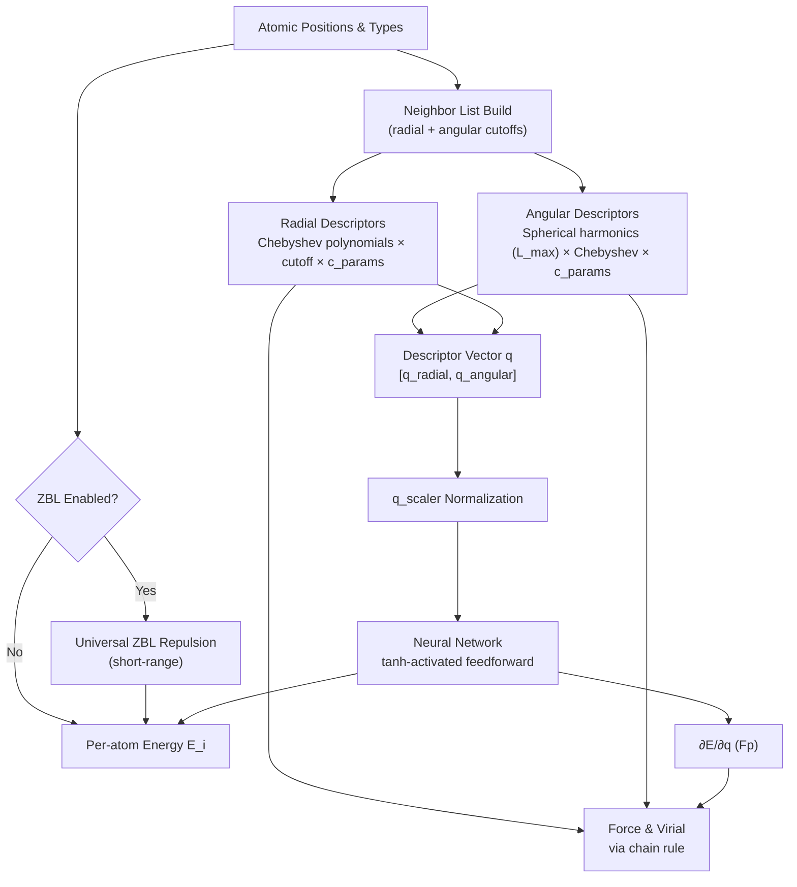
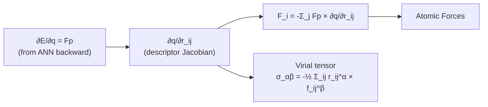

The **Neuroevolution Potential (NEP)** is the flagship machine learning interatomic potential in GPUMD, achieving a distinctive balance between accuracy and computational efficiency through a tightly coupled GPU-native descriptor–neural-network pipeline. Unlike gradient-descent-trained potentials, NEP parameters are optimized via the **Separable Natural Evolution Strategy (SNES)**, a population-based evolutionary algorithm that avoids backpropagation entirely. This page dissects the mathematical foundations, data structures, and computational flow that define the NEP model from input to predicted energy and forces.

Sources: [nep.cu](src/main_nep/nep.cu#L1-L30), [nep.cuh](src/main_nep/nep.cuh#L1-L99)

## Architectural Overview

The NEP model decomposes into three sequential stages executed entirely on GPU: **(1)** neighbor list construction with type-wise cutoffs, **(2)** descriptor computation combining radial Chebyshev basis functions and angular spherical-harmonic-like terms, and **(3)** a compact feedforward neural network that maps the descriptor vector to a per-atom energy. Forces and virials are obtained analytically via the chain rule through the entire pipeline. The following diagram captures this data flow:



Sources: [nep.cuh](src/force/nep.cuh#L40-L80), [nep_utilities.cuh](src/utilities/nep_utilities.cuh#L399-L460)

## Core Data Structures

The NEP architecture is governed by three tightly coupled parameter structs that live in GPU constant memory or registers, plus a data buffer struct for intermediate GPU arrays. These structures exist in two parallel implementations: the **training-side** (`src/main_nep/nep.cuh`) used during SNES optimization, and the **inference-side** (`src/force/nep.cuh`) used during MD simulation.

### ParaMB — Model Hyperparameters

The `ParaMB` struct encodes all architectural choices that define the descriptor space and are fixed once the model is trained:

| Parameter | Type | Description |
|-----------|------|-------------|
| `version` | int | NEP version: 3 (legacy), 4 (standard), 5 (typewise bias) |
| `model_type` | int | 0=potential, 1=dipole, 2=polarizability, 3=temperature-dependent |
| `num_types` | int | Number of chemical species |
| `rc_radial[NUM_ELEMENTS]` | float[] | Per-type radial cutoff distances (Å) |
| `rc_angular[NUM_ELEMENTS]` | float[] | Per-type angular cutoff distances (Å) |
| `n_max_radial` | int | Maximum Chebyshev polynomial order for radial terms |
| `n_max_angular` | int | Maximum Chebyshev polynomial order for angular terms |
| `basis_size_radial` | int | Radial basis size (NEP3 only; NEP4 = n_max_radial) |
| `basis_size_angular` | int | Angular basis size (NEP3 only; NEP4 = n_max_angular) |
| `L_max` | int | Maximum angular momentum (l = 1, 2, …, L_max) |
| `has_q_222` | int | Enable 4-body descriptor q_222 |
| `has_q_1111` | int | Enable 4-body descriptor q_1111 |
| `has_q_112` | int | Enable 4-body descriptor q_112 |
| `has_q_123` | int | Enable 4-body descriptor q_123 |
| `has_q_233` | int | Enable 4-body descriptor q_233 |
| `has_q_134` | int | Enable 4-body descriptor q_134 |
| `MN_radial` / `MN_angular` | int | Maximum neighbor counts (inference only) |

The effective angular dimension is computed as `dim_angular = (n_max_angular + 1) × num_L`, where `num_L` accumulates `L_max` plus each enabled many-body term flag. The total descriptor dimension is `dim = (n_max_radial + 1) + dim_angular`.

Sources: [nep.cuh](src/force/nep.cuh#L42-L82), [nep.cuh](src/main_nep/nep.cuh#L27-L54)

### ANN — Neural Network Parameters

The `ANN` struct holds pointers into a flat parameter array, partitioned per chemical type. This design enables **element-specific neural networks** — each atom type has its own weight matrices and bias vectors, while the output bias `b1` is shared:

| Field | Description |
|-------|-------------|
| `dim` | Descriptor vector dimension (input layer width) |
| `num_neurons1` | Hidden layer 1 width |
| `w0[t]` | Weight matrix: input → hidden layer 1, per type `t` |
| `b0[t]` | Bias vector: hidden layer 1, per type `t` |
| `w1[t]` | Weight vector: hidden layer 1 → output, per type `t` |
| `b1` | Output bias (shared across all types) |
| `c` | Descriptor parameters (Chebyshev combination coefficients) |
| `q_scaler` | Per-descriptor-component normalization factors |

The parameter layout in memory is laid out by `update_potential()`, which walks a flat `float*` pointer: for each type `t`, it assigns `w0[t]` → `b0[t]` → `w1[t]`, then appends the shared `b1`, followed by the descriptor parameters `c`. For NEP5, an extra typewise bias is stored inline with `w1[t]`.

Sources: [nep.cu](src/force/nep.cu#L425-L455), [nep.cuh](src/force/nep.cuh#L84-L107)

### ZBL — Universal Short-Range Repulsion

When atoms approach extremely close distances (e.g., during collision events), the NEP neural network may extrapolate unphysically. The optional ZBL potential provides a universal short-range repulsive correction based on atomic numbers:

```
V_ZBL(r) = (Z_i × Z_j / r) × φ(r/a) × f_switch(r)
```

where `a = 0.8854 × a_0 / (Z_i^0.23 + Z_j^0.23)` is the Bohr radius scaling, `φ` is a sum of exponential screening functions, and `f_switch` smoothly transitions between inner cutoff `rc_inner` (full ZBL) and outer cutoff `rc_outer` (zero ZBL). A **flexible ZBL** variant replaces the fixed screening parameters with trainable ones.

Sources: [nep_utilities.cuh](src/utilities/nep_utilities.cuh#L472-L535), [nep.cuh](src/force/nep.cuh#L109-L117)

## Descriptor Computation

Descriptors are the mathematical fingerprint of each atom's local environment. NEP computes two complementary families — **radial** (2-body) and **angular** (3-body and many-body) — that together form the input to the neural network.

### Cutoff Function

All descriptor contributions are multiplied by a smooth cutoff function that decays to zero at the cutoff radius:

```
f_c(r) = ½ cos(π r / r_c) + ½    for r < r_c
f_c(r) = 0                          for r ≥ r_c
```

This is implemented in `find_fc()` and its derivative variant `find_fc_and_fcp()`. For multi-type systems, the effective cutoff between types *i* and *j* is the arithmetic mean: `r_c = (rc_radial[t_i] + rc_radial[t_j]) / 2`.

Sources: [nep_utilities.cuh](src/utilities/nep_utilities.cuh#L427-L450)

### Radial Descriptors

For each atom *i*, the radial descriptor components are:

```
q_n^i = Σ_j  g_n(r_ij, t_i, t_j)     for n = 0, 1, …, n_max_radial
```

where the radial basis function `g_n` is a learned linear combination of Chebyshev polynomials:

```
g_n(r, t_i, t_j) = Σ_k  c_{n,k,t_i,t_j} × f_k(r) × f_c(r)
```

The **Chebyshev basis functions** `f_k(r)` are defined via the recurrence relation on the mapped variable `x = 2(r/r_c - 1)² - 1`:

```
T_0(x) = 1,  T_1(x) = x,  T_m(x) = 2x·T_{m-1}(x) - T_{m-2}(x)
f_k(r) = (T_k(x) + 1) / 2 × f_c(r)
```

The coefficients `c_{n,k,t_i,t_j}` are the **descriptor parameters** — trainable weights that determine how Chebyshev basis functions combine for each (n, k, type-pair). The total number of radial descriptor parameters is `num_types² × (n_max_radial + 1) × (basis_size_radial + 1)`.

Sources: [nep.cu](src/main_nep/nep.cu#L40-L95), [nep_utilities.cuh](src/utilities/nep_utilities.cuh#L556-L585)

### Angular Descriptors

Angular descriptors encode the angular distribution of neighbors through **spherical-harmonic-like** projections. For each Chebyshev order `n` and angular momentum `l`:

```
q_{n,l}^i = Σ_{m=-l}^{l}  |Σ_j  g_n(r_ij) × Y_l^m(θ_ij, φ_ij)|²
```

In practice, this is computed by first **accumulating partial sums** `s_{l,m}` over neighbors (via `accumulate_s()`), then **contracting** them into rotationally invariant descriptors via `find_q()`. The `s` arrays store the real spherical harmonic components `(x/d, y/d, z/d)` raised to appropriate powers for each `l` value, using the precomputed `C3B` normalization constants stored in constant memory.

The **many-body extension** goes beyond the standard 3-body (L_max) terms by enabling higher-order invariants:

| Flag | Body Order | Description |
|------|-----------|-------------|
| `has_q_222` | 4-body | Products of two 2nd-order angular terms |
| `has_q_1111` | 4-body | Products of four 1st-order angular terms |
| `has_q_112` | 4-body | Mixed 1st and 2nd order products |
| `has_q_123` | 4-body | Mixed 1st, 2nd, 3rd order products |
| `has_q_233` | 4-body | Mixed 2nd and 3rd order products |
| `has_q_134` | 4-body | Mixed 1st, 3rd, 4th order products |

Each enabled flag increments `num_L`, expanding the angular descriptor dimension. The specialized Clebsch-Gordan-like coefficients (`C4B`, `C5B`, `C4B2`, `C4B_123`, `C4B_233`, `C4B_134`) are precomputed in constant memory and used during force backpropagation through `get_f12_4body()`, `get_f12_5body()`, and their variants.

Sources: [nep.cu](src/main_nep/nep.cu#L97-L170), [nep_utilities.cuh](src/utilities/nep_utilities.cuh#L30-L100)

### Descriptor Scaling

Before entering the neural network, each descriptor component is normalized by a **q_scaler** factor: `q_scaled[d] = q[d] × q_scaler[d]`. The scaler is computed as `1 / (max(q_d) - min(q_d))` across the training dataset, ensuring all descriptor components span a comparable numerical range. This normalization is critical for training stability and is stored in the `nep.txt` model file after training.

Sources: [nep.cu](src/main_nep/nep.cu#L228-L260)

## Neural Network Architecture

The NEP neural network is a **compact feedforward network** with **tanh activation** and **per-element-type parameters**. Its small size (typically 30–100 neurons) is by design — the heavy lifting of representational capacity is delegated to the descriptor stage.

### Single Hidden Layer (Default)

For an atom of type `t` with scaled descriptor vector **q**, the per-atom energy is:

```
E_i = Σ_n  w1_n^t × tanh(Σ_d  w0_{n,d}^t × q_d - b0_n^t) - b1
```

The gradient `∂E/∂q_d` (stored as `Fp[d]`) is computed simultaneously using the chain rule:

```
∂E/∂q_d = Σ_n  w1_n^t × (1 - x_n²) × w0_{n,d}^t
```

where `x_n = tanh(Σ_d w0_{n,d}^t × q_d - b0_n^t)` is the hidden layer activation. This is implemented in `apply_ann_one_layer()` as a fused GPU kernel.

### Two Hidden Layers

When `num_hidden_layers = 2`, the network extends to:

```
x1_n = tanh(Σ_d  w0_{n,d} × q_d - b0_n)
x2_m = tanh(Σ_n  w1_{m,n} × x1_n - b1_m)
E_i  = Σ_m  w2_m × x2_m - b2
```

The backward pass propagates gradients through both layers using the `apply_ann_two_layers()` function, which caches intermediate activations `x1[]` and `x2[]` for efficient gradient computation.

### Parameter Count

The total number of trainable parameters determines model capacity and is computed as:

| Component | NEP4 Formula | NEP5 Formula |
|-----------|-------------|-------------|
| ANN (per type) | `(dim + 2) × num_neurons1` | `(dim + 2) × num_neurons1 + 1` |
| ANN (all types) | `num_types × (dim + 2) × num_neurons1 + 1` | `num_types × ((dim + 2) × num_neurons1 + 1) + 1` |
| Descriptors | `num_types² × (n_max_rad+1) × (basis_rad+1) + num_types² × (n_max_ang+1) × (basis_ang+1)` | same |
| **Total** | ANN + Descriptors | ANN + Descriptors |

The `+1` in NEP5 accounts for a per-type output bias stored inline with `w1`, providing more flexibility for element-specific energy offsets.

Sources: [nep_utilities.cuh](src/utilities/nep_utilities.cuh#L200-L280), [nep.cu](src/force/nep.cu#L318-L340)

## Force and Virial Computation

Forces are derived **analytically** from the per-atom energy using the chain rule, ensuring exact energy-force consistency. The computation flows backward through the pipeline:



The key insight is that the **descriptor Jacobian** `∂q/∂r_ij` depends on the same Chebyshev basis functions and their derivatives (`find_fn_and_fnp()`), the cutoff function derivatives (`find_fc_and_fcp()`), and the spherical harmonic derivatives. The `sum_fxyz` intermediate arrays store the partial sums of angular components that are reused during the backward pass, avoiding redundant neighbor iterations.

The partial forces `f12` (3-body or many-body contributions per neighbor pair) are accumulated into `NEP_Data::f12x/y/z` arrays, then reduced to total atomic forces. Virials are computed concurrently from the same partial force data.

Sources: [nep_small_box.cuh](src/force/nep_small_box.cuh#L1-L30), [nep_utilities.cuh](src/utilities/nep_utilities.cuh#L600-L700)

## Model Variants and Extensions

The NEP framework supports several specialized model types beyond the standard potential energy model, all sharing the same descriptor infrastructure:

| Model Type | `model_type` | Token | Output | Extra Parameters |
|-----------|-------------|-------|--------|-----------------|
| Potential | 0 | `nep4` / `nep5` | E_i | None |
| Potential + ZBL | 0 | `nep4_zbl` / `nep5_zbl` | E_i + V_ZBL | ZBL cutoffs |
| Dipole | 1 | `nep4_dipole` | μ_i | Doubled output weights |
| Polarizability | 2 | `nep4_polarizability` | α_i | Separate ANN (`w0_pol`, `b0_pol`, `w1_pol`) |
| Temperature-dependent | 3 | `nep4_temperature` | F_i(T) | Temperature as extra input dim |

For the **dipole model**, the output layer width doubles — the same hidden layer activations feed both energy and charge outputs via separate weight columns in `w1`. For the **polarizability model**, an entirely separate neural network (`w0_pol`, `b0_pol`, `w1_pol`, `b1_pol`) processes the same descriptors to predict the polarizability tensor, effectively doubling the ANN parameter count. The **temperature-dependent** model appends temperature as an additional descriptor dimension with a fixed scaler of 0.001.

Sources: [nep.cu](src/force/nep.cu#L72-L100), [nep_utilities.cuh](src/utilities/nep_utilities.cuh#L290-L400)

## NEP File Format (nep.txt)

The trained model is serialized to a `nep.txt` file with a structured header followed by a flat parameter list. The header lines are:

```
nep4 2 C H                    # model_token, num_types, element symbols
zbl 1.0 2.0                   # (only if ZBL enabled) rc_inner rc_outer
cutoff 6.0 5.0 200 100        # rc_radial rc_angular MN_radial MN_angular
n_max 10 8                    # n_max_radial n_max_angular
basis_size 10 8               # basis_size_radial basis_size_angular
l_max 4 2 0                   # L_max has_q_222 has_q_1111 [has_q_112 ...]
ANN 30 0                      # num_neurons1 num_neurons2
```

Each subsequent line contains a single floating-point parameter, ordered as: ANN weights/biases (type-by-type), descriptor coefficients, and finally the `dim` q_scaler values.

Sources: [nep.cu](src/force/nep.cu#L150-L350), [parameters.cuh](src/main_nep/parameters.cuh#L27-L68)

## Small Box vs. Large Box Paths

The inference-side NEP implementation provides two computation paths selected at runtime based on simulation box size:

- **Small Box** (`compute_small_box`): For systems with fewer than ~1000 atoms, uses an **expanded box** strategy that explicitly enumerates periodic images. The `ExpandedBox` struct precomputes lattice translation vectors and the inverse box matrix for minimum-image computation. Neighbor lists are built directly in the `find_neighbor_list_small_box` kernel by looping over periodic cells.

- **Large Box** (`compute_large_box`): For larger systems, delegates neighbor list construction to the general-purpose `Neighbor` class and then filters into radial/angular-specific lists via `find_neighbor_list_large_box`. This avoids the O(N²) cost of explicit image enumeration.

Both paths converge to identical descriptor and force results — the selection is purely a performance optimization.

Sources: [nep.cuh](src/force/nep.cuh#L119-L160), [nep_small_box.cuh](src/force/nep_small_box.cuh#L30-L130)

> [!TIP]
> When configuring NEP descriptors, the ratio `n_max_radial : n_max_angular` and the choice of many-body flags (`has_q_222`, etc.) have far greater impact on accuracy than increasing `num_neurons1`. Start with a compact network (30 neurons) and expand the descriptor space first.

> [!TIP]
> The per-type cutoff arrays `rc_radial[]` and `rc_angular[]` allow different interaction ranges for different species — setting a shorter angular cutoff than radial cutoff is a common technique to reduce angular neighbor list cost without sacrificing radial accuracy.

## Relationship to Other Components

The NEP model architecture sits at the center of GPUMD's machine learning potential ecosystem. Its descriptor computation is invoked during both [NEP Training Pipeline](9-nep-training-pipeline) (where SNES optimizes the flat parameter vector) and MD simulation (where the inference-side `NEP::compute()` is called each timestep). The [qNEP and TNEP Variants](10-qnep-and-tnep-variants) extend this architecture with charge equilibration and temperature-dependent modifications. At the MD level, NEP can be combined with DFT-D3 dispersion corrections and used within [Hybrid and Composite Potentials](12-hybrid-and-composite-potentials) via the `ilp_nep` interface for layered materials.