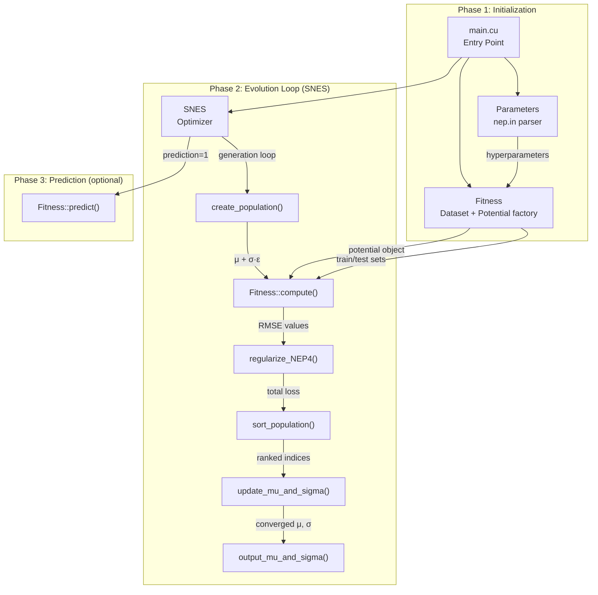

The NEP training pipeline is a GPU-accelerated evolutionary optimization system that fits Neuroevolution Potential (NEP) parameters to ab initio training data. It orchestrates dataset loading, descriptor/force computation, fitness evaluation, and the **Separable Natural Evolution Strategy (SNES)** optimizer across multiple GPUs in a single cohesive executable (`nep`). The pipeline is distinct from the MD simulation engine — it is a standalone program compiled from `src/main_nep/` that produces a trained `nep.txt` potential file usable by the GPUMD simulator.

## Architectural Overview

The training pipeline follows a three-phase lifecycle: **initialization → evolution loop → output**. Each phase maps to a concrete class with well-defined responsibilities:



The **SNES** class owns the evolutionary state (population, μ, σ vectors) and drives the generational loop. The **Fitness** class owns the training data, test data, and a polymorphic `Potential` object that computes forces for each candidate parameter set. The **Parameters** class reads `nep.in` and validates all hyperparameters before any computation begins.

Sources: [main.cu](src/main_nep/main.cu#L39-L56), [snes.cuh](src/main_nep/snes.cuh#L30-L82), [fitness.cuh](src/main_nep/fitness.cuh#L30-L72)

## Entry Point and Program Lifecycle

The `main()` function in `main.cu` is remarkably concise — it instantiates three objects in sequence: `Parameters`, `Fitness`, and `SNES`. The constructor of `SNES` immediately begins the training loop, making the entire pipeline self-contained:

1. **`Parameters para`** — parses `nep.in`, validates all inputs, computes derived dimensions
2. **`Fitness fitness(para)`** — loads `train.xyz` (and optionally `test.xyz`), builds neighbor lists, constructs the appropriate `Potential` subclass
3. **`SNES snes(para, &fitness)`** — initializes the evolutionary state and runs the generational optimization loop to completion

Timing is recorded for both the initialization phase and the training/prediction phase separately, providing clear diagnostics for I/O-bound versus compute-bound stages.

Sources: [main.cu](src/main_nep/main.cu#L39-L76)

## Configuration System: Parameters

The `Parameters` class reads the `nep.in` file and manages all training hyperparameters. It follows a **default-then-override** pattern: `set_default_parameters()` establishes sensible defaults, then `read_nep_in()` parses the user's `nep.in` to override specific values. After parsing, `calculate_parameters()` computes derived quantities (descriptor dimension, total variable count, etc.) and performs cross-validation.

### Default Hyperparameters

| Parameter | Default | Purpose |
|-----------|---------|---------|
| `version` | 4 | NEP model version (3 or 4) |
| `n_max_radial` | 6 | Max order of radial Chebyshev polynomials |
| `n_max_angular` | 6 | Max order of angular Chebyshev polynomials |
| `basis_size_radial` | 6 | Radial basis size (NEP3) |
| `basis_size_angular` | 6 | Angular basis size (NEP3) |
| `L_max` | 4 | Max order of 3-body spherical harmonics |
| `num_neurons1` | 30 | Hidden layer neuron count |
| `lambda_1`, `lambda_2` | -1.0 (auto) | L1/L2 regularization weights |
| `lambda_e`, `lambda_f` | 1.0 | Energy/force RMSE loss weights |
| `lambda_v` | 0.1 | Virial RMSE loss weight |
| `batch_size` | 1000 | Configurations per training batch |
| `population_size` | 50 | SNES population size (auto-adjusted for GPU count) |
| `maximum_generation` | 100000 | Total training generations |
| `rc_radial` | 8.0 Å | Radial cutoff distance |
| `rc_angular` | 4.0 Å | Angular cutoff distance |
| `sigma0` | 0.1 | Initial step size for SNES |

The population size is automatically adjusted upward so that it divides evenly by the number of available GPUs, ensuring all devices are fully utilized in each generation.

Sources: [parameters.cu](src/main_nep/parameters.cu#L104-L166), [parameters.cuh](src/main_nep/parameters.cuh#L37-L158)

### Input File: nep.in

The `nep.in` file uses a simple keyword-per-line format. Lines beginning with `#` are treated as comments. A minimal example for a binary Te-Pb system:

```
type         2 Te Pb
generation   20000
```

All unspecified parameters fall back to their defaults. The full set of supported keywords includes: `type`, `version`, `cutoff`, `n_max`, `basis_size`, `l_max`, `neuron`, `lambda_1`, `lambda_2`, `lambda_e`, `lambda_f`, `lambda_v`, `lambda_shear`, `lambda_q`, `lambda_z`, `force_delta`, `batch`, `population`, `generation`, `save_potential`, `output_interval`, `zbl`, `type_weight`, `mode`, `prediction`, `fine_tune`, `charge_mode`, `vdw`, `charge_vdw`, `sigma0`, `initial_para`, and more.

Sources: [parameters.cu](src/main_nep/parameters.cu#L167-L196), [nep.in](examples/nep_train/nep.in#L1-L3)

### Training Data Format

Training data resides in `train.xyz` (and optionally `test.xyz`) using an extended XYZ format. Each configuration specifies the box dimensions, atom positions, and reference quantities (energy, forces, virials). The `Structure` struct captures all per-configuration data: atom count, types, positions, reference forces, virials, energy, weight, and optional BEC/temperature data. The `read_structures()` function parses these files and populates a `std::vector<Structure>`.

Sources: [structure.cuh](src/main_nep/structure.cuh#L25-L54)

## Fitness Evaluation Pipeline

The `Fitness` class is the bridge between the evolutionary optimizer and the physics computation. Its constructor performs all data preparation, and its `compute()` method evaluates the loss for an entire population of candidate parameter sets.

### Dataset Construction

During initialization, `Fitness` performs the following:

1. **Load structures** from `train.xyz` into a `std::vector<Structure>`
2. **Partition into batches** — the training set is split into `num_batches` batches of `batch_size` configurations each
3. **Replicate across GPUs** — each batch is constructed independently on every available GPU device via `Dataset::construct()`
4. **Load test set** (if `test.xyz` exists) similarly replicated across all GPUs
5. **Instantiate the Potential** — a polymorphic `Potential` subclass is selected based on `train_mode`, `charge_mode`, `vdw`, and `charge_vdw` flags

The `Dataset` class holds all GPU-resident data for a batch: neighbor lists (`NL_radial`, `NL_angular`), relative positions (`x12_radial`, etc.), reference values (`energy_ref_gpu`, `force_ref_gpu`, `virial_ref_gpu`), computed values, and RMSE computation methods. The neighbor list construction is performed once during `Dataset::construct()` and reused across all generations.

### Potential Selection Matrix

The `Potential` subclass is chosen at construction time according to the model configuration:

| Condition | Potential Class |
|-----------|----------------|
| `train_mode == 1` (dipole) or `train_mode == 2` (polarizability) | `TNEP` |
| `train_mode == 0` and `charge_vdw` | `NEP_Charge_VDW` |
| `train_mode == 0` and `charge_mode` | `NEP_Charge` |
| `train_mode == 0` and `vdw` | `NEP_VDW` |
| `train_mode == 0` (default) | `NEP` |

Sources: [fitness.cu](src/main_nep/fitness.cu#L30-L145), [dataset.cuh](src/main_nep/dataset.cuh#L26-L117)

### Loss Computation

For each generation, `Fitness::compute()` evaluates all candidate parameter vectors across the current batch:

1. **Force computation** — `potential->find_force()` computes energy, forces, and virials for each candidate on each GPU
2. **RMSE accumulation** — per-structure RMSE values are computed for energy, force, virial, charge, and BEC, weighted by their respective λ parameters
3. **Multi-GPU parallelism** — the population is distributed across GPUs; each GPU independently evaluates `population_size / deviceCount` candidates
4. **Full-batch mode** — when `use_full_batch = 1`, the remaining batches (beyond the current round-robin batch) are also evaluated and RMSE values are merged via RMS averaging

The total loss per individual is:

**L_total = λ₁·L_L1 + λ₂·L_L2 + λ_e·RMSE_E + λ_f·RMSE_F + λ_v·RMSE_V + λ_q·RMSE_Q + λ_z·RMSE_Z**

Sources: [fitness.cu](src/main_nep/fitness.cu#L149-L270)

## SNES Optimizer

The heart of the training pipeline is the **Separable Natural Evolution Strategy (SNES)**, a gradient-free black-box optimizer that maintains a **diagonal multivariate Gaussian** search distribution parameterized by mean vector **μ** and step-size vector **σ**. Unlike CMA-ES which maintains a full covariance matrix, SNES uses a factored (separable) representation that scales linearly with dimensionality — critical for the thousands of parameters in a NEP model.

Reference: T. Schaul, T. Glasmachers, and J. Schmidhuber, "High Dimensions and Heavy Tails for Natural Evolution Strategies," GECCO 2011.

Sources: [snes.cu](src/main_nep/snes.cu#L21-L30)

### Initialization

The search distribution is initialized from either a `nep.restart` file (for resuming training) or randomly:

- **Without restart**: μ is initialized uniformly in [-1, 1]; σ is set to `para.sigma0` (default 0.1)
- **With restart file**: μ and σ are read from the two-column `nep.restart` format
- **Fine-tuning mode**: μ and σ are extracted from a foundation model's restart file, mapping element indices and selecting the relevant subset of parameters. Descriptor σ can optionally be zeroed (`fine_tune_descriptor = 0`) to freeze the descriptor while only training the ANN weights

The **learning rate** `eta_sigma` is automatically computed as `(3 + ln(d)) / (5·√d) / 2` where `d` is the number of variables per atom type — this adapts the step-size update rate to the problem dimensionality.

Sources: [snes.cu](src/main_nep/snes.cu#L48-L155)

### Generational Loop

Each generation executes the following sequence:


**1. Population Creation** — A GPU kernel generates `population_size` candidate parameter vectors by sampling from the current search distribution: **z_i = μ + σ ⊙ ε**, where ε ~ N(0, I). The random states are managed by GPU-resident cuRAND/hipRAND states for parallel sampling.

**2. Fitness Evaluation** — Delegated to `Fitness::compute()` as described above. Batches are rotated round-robin across generations (`batch_id = generation % num_batches`).

**3. Regularization** — L1 and L2 regularization costs are computed on GPU for each candidate, and added to the physics losses to form the total fitness. The regularization is computed **per atom type** and also **aggregated across all types**, yielding `num_types + 1` separate fitness rankings.

**4. Sorting** — Each per-type and global fitness array is sorted via insertion sort, producing ranked indices that determine which individuals contribute to the distribution update.

**5. Distribution Update** — The core SNES update rule is executed on GPU:

- **Utility weights** are computed as: `u_k = max(0, ln(n/2 + 1) - ln(k + 1))`, normalized to sum to zero
- **Mean update**: `μ ← μ + σ ⊙ Σ_k u_k · s_k` (where s_k are the standardized samples)
- **Step-size update**: `σ ← min(σ · exp(η_σ · Σ_k u_k · (s_k² - 1)), 1.0)`

The step-size is capped at 1.0 to prevent divergence. The update is **type-aware**: each variable's update uses the fitness ranking corresponding to its associated atom type, enabling type-specific evolutionary pressure.

**6. Periodic Output** — Every `output_interval` generations, the current μ and σ are written to `nep.restart`. Every `save_potential` generations, a timestamped `nep.txt` checkpoint and optionally a `.restart` file are written.

Sources: [snes.cu](src/main_nep/snes.cu#L340-L530), [snes.cu](src/main_nep/snes.cu#L600-L687)

### Type-Aware Variable Classification

The `find_type_of_variable()` method assigns each parameter to an atom type, which determines which fitness ranking drives its evolution. The classification follows the parameter layout:

| Parameter Region | Type Assignment |
|-----------------|-----------------|
| ANN weights/biases for element *t* | type *t* |
| Radial descriptor coefficients c_nk for type pair (*t₁*, *t₂*) | type *t₁* |
| Angular descriptor coefficients c_nk for type pair (*t₁*, *t₂*) | type *t₁* |
| Global bias/ε parameters | type `num_types` (global) |

This mechanism ensures that parameters primarily affecting a particular element are updated based on that element's fitness contribution, providing more targeted evolutionary pressure than a single global ranking.

Sources: [snes.cu](src/main_nep/snes.cu#L268-L330)

## Prediction Mode

When `prediction = 1` is set in `nep.in`, the pipeline skips training entirely. Instead, it reads a trained `nep.txt` file, parses its header via `read_nep_txt_header()` to validate model compatibility, extracts the parameter values and q_scaler, and calls `Fitness::predict()` to compute and write predictions for the provided dataset. This enables zero-cost evaluation of an existing model on new structures.

Sources: [snes.cu](src/main_nep/snes.cu#L434-L460), [parameters.cuh](src/main_nep/parameters.cuh#L22-L49)

## Fine-Tuning from Foundation Models

The fine-tuning mechanism (`fine_tune` keyword in `nep.in`) enables transfer learning from a large pre-trained foundation model (e.g., a 89-element universal NEP). The process:

1. Reads the foundation model's restart file (specified as `fine_tune nep_txt_path restart_path`)
2. Maps the target system's elements to the foundation model's element indices via a hardcoded `element_map[94]` lookup table (accounting for gaps in the periodic table)
3. Extracts the relevant ANN weight/bias subsets and descriptor coefficients
4. Optionally freezes descriptor parameters by setting their σ = 0 (`fine_tune_descriptor = 0`), allowing only ANN weights to adapt

This enables rapid adaptation of a universal potential to specific systems with minimal training data.

Sources: [snes.cu](src/main_nep/snes.cu#L120-L265)

## Output Files

The training pipeline produces several output files during the course of optimization:

| File | Contents | Writing Trigger |
|------|----------|----------------|
| `loss.out` | Per-generation loss values (L1, L2, energy, force, virial RMSE for train and test) | Every `output_interval` generations |
| `nep.txt` | Current best potential parameters in human-readable format | Every `save_potential` generations |
| `nep.restart` | μ and σ values for resuming training | Every `output_interval` generations |
| `nep.txt.<timestamp>` | Timestamped checkpoint of the potential | Every `save_potential` generations (format=1) |
| `energy.out`, `force.out`, `virial.out` | Per-configuration prediction vs. reference | At reporting intervals |
| `charge.out`, `bec.out` | Charge/BEC predictions (for charge models) | At reporting intervals |

The `nep.txt` file header encodes the full model specification (version, elements, cutoffs, basis sizes, neuron count, ZBL settings), making it self-describing and directly usable by the GPUMD MD engine.

Sources: [fitness.cu](src/main_nep/fitness.cu#L300-L398)

## Key Design Patterns and Performance Considerations

> [!TIP]
> The SNES optimizer stores all population data (μ, σ, candidate vectors) as GPU-resident `GPU_Vector<float>` arrays. Population creation and the μ/σ update are executed as CUDA/HIP kernels, avoiding CPU-GPU round-trips for the most expensive operations. The only host-device transfers occur when copying the population to CPU for fitness evaluation and periodically writing output files.

> [!TIP]
> The training set is partitioned into batches and rotated round-robin across generations. This means the optimizer sees different subsets of training data in successive generations, effectively performing stochastic evolution without explicit shuffling — a design that reduces memory pressure while maintaining optimization diversity.

The pipeline exploits **multi-GPU parallelism** at the population level: within a single generation, different GPUs evaluate disjoint subsets of the population simultaneously. The `population_size` is automatically padded to be a multiple of `deviceCount`, ensuring perfect load balance. Each GPU maintains its own copy of the training data (neighbor lists, reference values), avoiding inter-device communication during the fitness evaluation phase.

Sources: [snes.cu](src/main_nep/snes.cu#L48-L90), [fitness.cu](src/main_nep/fitness.cu#L149-L200)

## Relationship to Other Components

The NEP training pipeline produces the `nep.txt` file consumed by the MD simulation engine's force computation system (documented in [Force and Potential System](5-force-and-potential-system)). The model architecture details of what is being trained — descriptor composition, ANN structure, parameter layout — are covered in [NEP Model Architecture](8-nep-model-architecture). The trained NEP can also be used in specialized variants documented in [qNEP and TNEP Variants](10-qnep-and-tnep-variants), and the GPU kernel design that makes the per-candidate force evaluation fast is detailed in [CUDA Kernel Design](13-cuda-kernel-design).