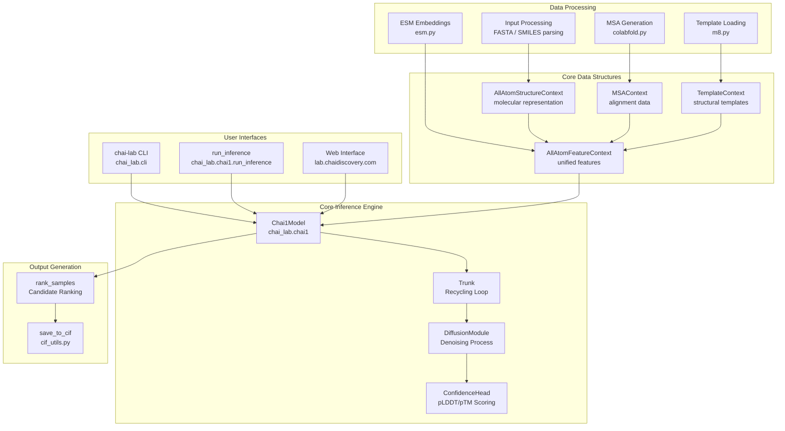
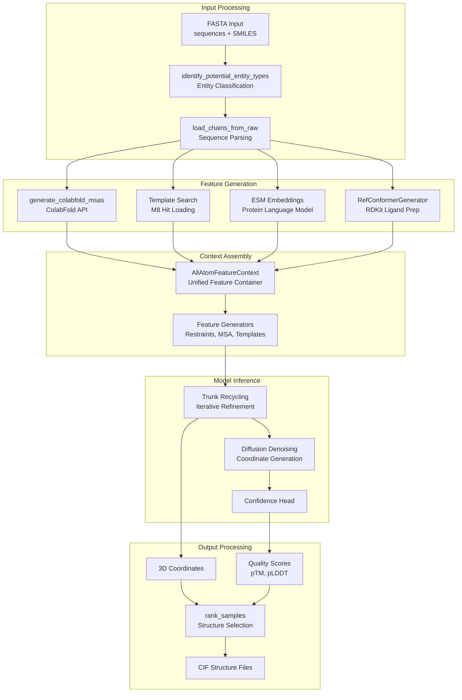

# Overview

<details>
<summary>Relevant source files</summary>

The following files were used as context for generating this wiki page:

- [LICENSE](LICENSE)
- [README.md](README.md)
- [chai_lab/__init__.py](chai_lab/__init__.py)
- [chai_lab/utils/typing.py](chai_lab/utils/typing.py)

</details>


This document provides a comprehensive introduction to the chai-lab repository, which implements the Chai-1 model for molecular structure prediction. It covers the system's architecture, core components, and primary interfaces. For detailed installation instructions, see [Installation and Dependencies](#1.2). For step-by-step usage guides, see [Getting Started](#2). For deep technical details about specific systems, see [Core Systems](#3).

## Purpose and Scope

The chai-lab repository implements Chai-1, a multi-modal foundation model for molecular structure prediction that achieves state-of-the-art performance across various benchmarks. The system enables unified prediction of proteins, small molecules, DNA, RNA, glycosylations, and other molecular entities from sequence inputs [README.md:1-9]().

## What is Chai-1?

Chai-1 is a transformer-based diffusion model that predicts 3D molecular structures from sequence information. The model uses a trunk architecture with recycling and diffusion-based coordinate generation to produce high-quality structural predictions [README.md:23-38]().

### Key Capabilities

| Capability | Description |
|------------|-------------|
| **Multi-modal prediction** | Proteins, DNA, RNA, small molecules, glycans [README.md:3]() |
| **Enhanced features** | MSAs, structural templates, ESM embeddings [README.md:32-34]() |
| **User constraints** | Contact restraints, pocket constraints, covalent bonds [README.md:113-118]() |
| **Quality scoring** | pTM, ipTM, pLDDT confidence metrics [README.md:9]() |
| **Flexible interfaces** | CLI, Python API, web server [README.md:25-107]() |

Sources: [README.md:1-179]()

## System Architecture

The chai-lab system consists of several interconnected components that process molecular inputs and generate structural predictions.

### High-Level Architecture



Sources: [README.md:49-61](), [README.md:88-94]()

## Core Inference Pipeline

The Chai-1 inference pipeline processes molecular inputs through several stages to generate structural predictions.

### Inference Data Flow



Sources: [README.md:49-61](), [README.md:88-94]()

## Supported Input Types

Chai-1 accepts multiple molecular entity types through FASTA format inputs [README.md:27-30]():

| Entity Type | Input Format | Description |
|-------------|--------------|-------------|
| **Proteins** | Standard amino acid sequences | Single letter codes, including modified residues |
| **DNA** | Nucleotide sequences | A, T, G, C nucleotides |
| **RNA** | Nucleotide sequences | A, U, G, C nucleotides |
| **Small molecules** | SMILES strings | Chemical structures in SMILES notation |
| **Glycans** | String representations | Specialized glycan format |

### Enhanced Input Features

The system supports additional features to improve prediction quality:

- **MSAs**: Multiple sequence alignments via ColabFold server or custom `.aligned.pqt` files [README.md:77-84]().
- **Templates**: Structural templates from RCSB PDB or custom structures via `CHAI_TEMPLATE_CIF_FOLDER` [README.md:97-103]().
- **Restraints**: User-defined contact constraints and pocket constraints [README.md:113-118]().
- **Covalent bonds**: Custom covalent bond specifications for branched ligands [README.md:88-94]().

Sources: [README.md:27-44](), [README.md:77-84](), [README.md:113-118]()

## Primary Interfaces

### Command Line Interface

The primary CLI command is `chai-lab fold`, which processes FASTA inputs and generates structural predictions [README.md:29-38]():

```bash
chai-lab fold input.fasta output_folder
chai-lab fold --use-msa-server --use-templates-server input.fasta output_folder
```

### Python API

The main programmatic interface is through `chai_lab.chai1.run_inference`, which provides direct access to the inference pipeline [README.md:49-54]():

```python
from chai_lab.chai1 import run_inference
```

For advanced use cases, `chai_lab.chai1.run_folding_on_context` allows manual construction of `AllAtomFeatureContext` objects [README.md:88-94]().

### Web Interface

A web server is available at `lab.chaidiscovery.com` for browser-based access to the Chai-1 model without local installation [README.md:105-111]().

Sources: [README.md:25-44](), [README.md:49-61](), [README.md:88-94](), [README.md:105-111]()

## Hardware Requirements

Chai-1 requires a Linux environment with a GPU supporting CUDA and bfloat16 [README.md:21]().

- **Recommended**: A100 80GB, H100 80GB, or L40S 48GB.
- **Minimum**: A10 or A30 (for smaller complexes).
- **Consumer Grade**: RTX 4090 has been reported as compatible by users.

Sources: [README.md:21]()

## Output Formats

The system generates structural predictions in CIF format with associated quality metrics [README.md:49-54]():

| Output Type | Description |
|-------------|-------------|
| **CIF files** | Crystallographic Information File format structures |
| **Quality scores** | pTM, ipTM, pLDDT confidence metrics |
| **Rankings** | Ranked candidate structures (default 5 samples) |

By default, the system generates five sample predictions per input, which are ranked by quality scores to identify the best candidates [README.md:32]().

Sources: [README.md:32-38]()

## Key Data Structures

The system uses several core data structures to represent molecular information:

- **`AllAtomStructureContext`**: Central representation of molecular structure.
- **`MSAContext`**: Multiple sequence alignment data.
- **`TemplateContext`**: Structural template information.
- **`AllAtomFeatureContext`**: Unified feature container for model input.

For detailed information about these data structures, see [Data Structures](#3.2). For information about how features are assembled, see [Feature Context Assembly](#3.3).

Sources: [README.md:88-94]()

---