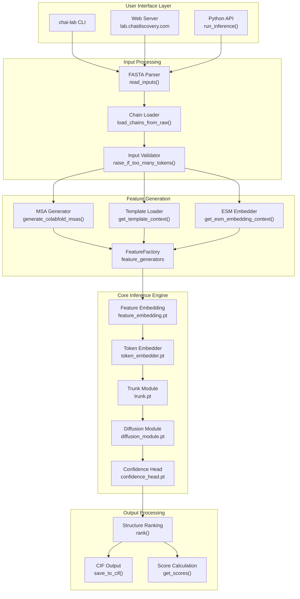
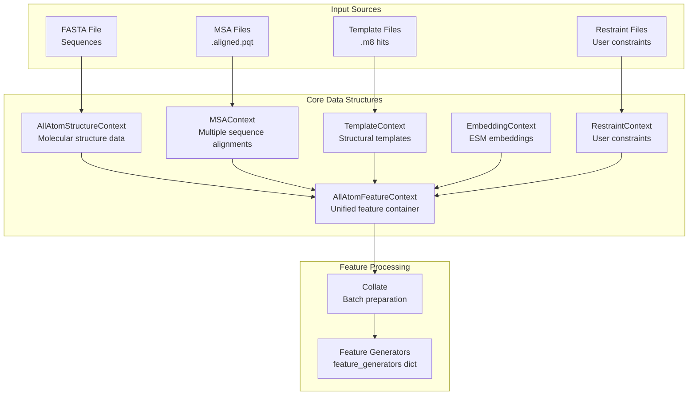
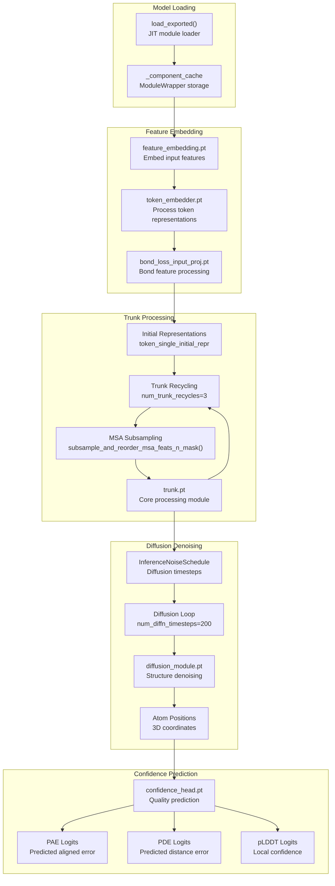
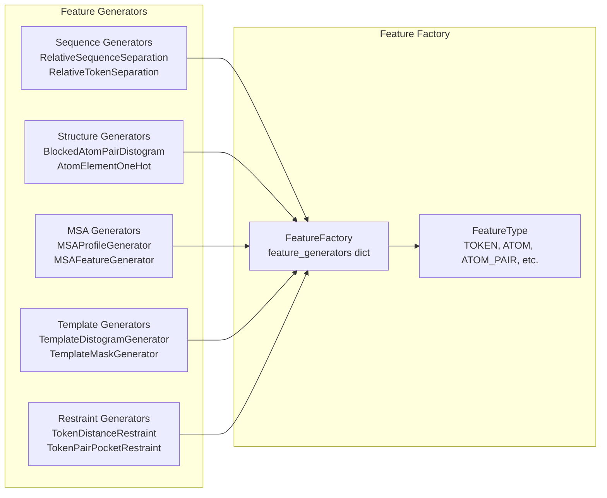
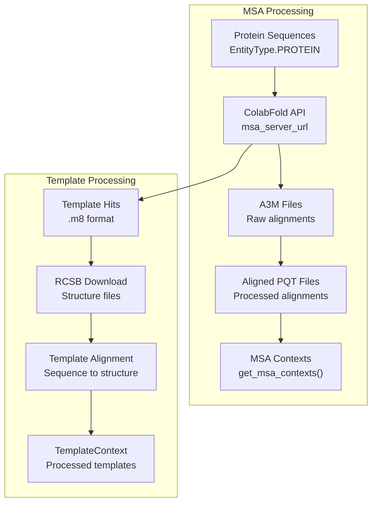
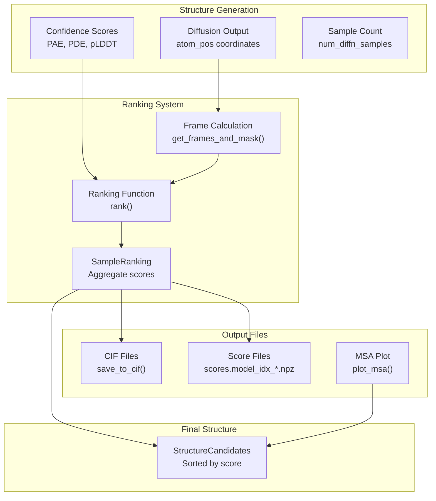
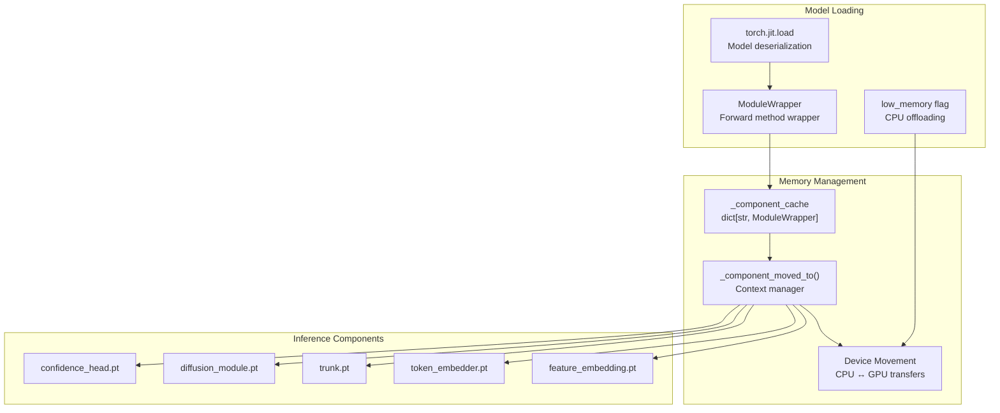

# System Architecture

Relevant source files

The following files were used as context for generating this wiki page:

- [chai_lab/chai1.py](chai_lab/chai1.py)
- [chai_lab/data/collate/collate.py](chai_lab/data/collate/collate.py)
- [chai_lab/data/dataset/all_atom_feature_context.py](chai_lab/data/dataset/all_atom_feature_context.py)
- [chai_lab/data/dataset/msas/utils.py](chai_lab/data/dataset/msas/utils.py)

This document provides a comprehensive overview of the Chai-1 system architecture, covering the core inference pipeline, data processing components, and model structure. For specific implementation details about input processing, see [Input Processing](#4). For feature generation systems, see [Feature Generation](#5).

## Overview

Chai-1 is a multi-modal foundation model for molecular structure prediction that unifies prediction of proteins, small molecules, DNA, RNA, and glycosylations. The system follows a pipeline architecture with distinct stages for input processing, feature generation, model inference, and output generation.

## High-Level System Architecture

### Core Pipeline Components

Sources: [chai_lab/chai1.py:499-1059](), [README.md:23-46]()

### Data Context Architecture

The `AllAtomFeatureContext` serves as the central hub for all molecular and feature data required for inference. It encapsulates various sub-contexts that are eventually collated into tensors for the model.

Sources: [chai_lab/data/dataset/all_atom_feature_context.py:25-40](), [chai_lab/data/collate/collate.py:24-35](), [chai_lab/chai1.py:486-495]()

## Model Inference Pipeline

### Trunk Recycling and Diffusion Process

The inference engine utilizes a sequential execution flow involving feature embedding, trunk recycling, and a diffusion denoising loop. The `ModuleWrapper` handles JIT-loaded components like `trunk.pt` and `diffusion_module.pt`.

Sources: [chai_lab/chai1.py:115-137](), [chai_lab/chai1.py:139-149](), [chai_lab/chai1.py:744-778](), [chai_lab/chai1.py:821-886](), [chai_lab/chai1.py:894-915](), [chai_lab/data/dataset/msas/utils.py:51-86]()

## Feature Generation System

### Feature Factory Architecture

The system uses a `FeatureFactory` that orchestrates multiple `feature_generators` to produce tensors for the model. These generators cover sequence, structure, MSA, and restraint-based features.

| Feature Type | Generator Class | Purpose |
|--------------|----------------|---------|
| Sequence Features | `RelativeSequenceSeparation` | Positional relationships [chai_lab/chai1.py:173]() |
| Token Features | `RelativeTokenSeparation` | Token-level distances [chai_lab/chai1.py:174]() |
| Structure Features | `BlockedAtomPairDistogram` | Atomic distance features [chai_lab/chai1.py:179]() |
| MSA Features | `MSAProfileGenerator` | Sequence alignment profiles [chai_lab/chai1.py:72]() |
| Template Features | `TemplateDistogramGenerator` | Structural template features [chai_lab/chai1.py:86]() |
| Restraint Features | `TokenDistanceRestraint` | User-defined constraints [chai_lab/chai1.py:93]() |

Sources: [chai_lab/chai1.py:172-236](), [chai_lab/data/features/feature_factory.py:13-25]()

## External Service Integration

### ColabFold MSA Generation

MSA generation is integrated via ColabFold, with support for template discovery and processing into the `TemplateContext`.

Sources: [chai_lab/chai1.py:389-402](), [chai_lab/chai1.py:422-438](), [chai_lab/data/dataset/msas/colabfold.py:20-45]()

## Configuration and Validation

### System Limits and Validation

The system enforces several limits to ensure computational feasibility, defined in the feature context and model metadata.

| Limit Type | Maximum Value | Source |
|------------|---------------|--------|
| Token Count | `max(AVAILABLE_MODEL_SIZES)` | [chai_lab/data/collate/utils.py:22]() |
| Template Count | `MAX_NUM_TEMPLATES = 4` | [chai_lab/data/dataset/all_atom_feature_context.py:21]() |
| MSA Depth | `MAX_MSA_DEPTH = 16384` | [chai_lab/data/dataset/all_atom_feature_context.py:20]() |

Sources: [chai_lab/chai1.py:255-277](), [chai_lab/data/dataset/all_atom_feature_context.py:20-21]()

## Output Generation and Ranking

### Structure Candidate Processing

The final stage involves ranking predicted structures based on confidence metrics and saving them to standard formats like CIF.

Sources: [chai_lab/chai1.py:989-1051](), [chai_lab/ranking/rank.py:104-105](), [chai_lab/data/io/cif_utils.py:98]()

## Memory Management and Device Handling

The system implements sophisticated memory management for handling large models via a JIT module cache and transient device movement.

### Component Caching and Device Movement

Sources: [chai_lab/chai1.py:151-167](), [chai_lab/chai1.py:115-148]()

---