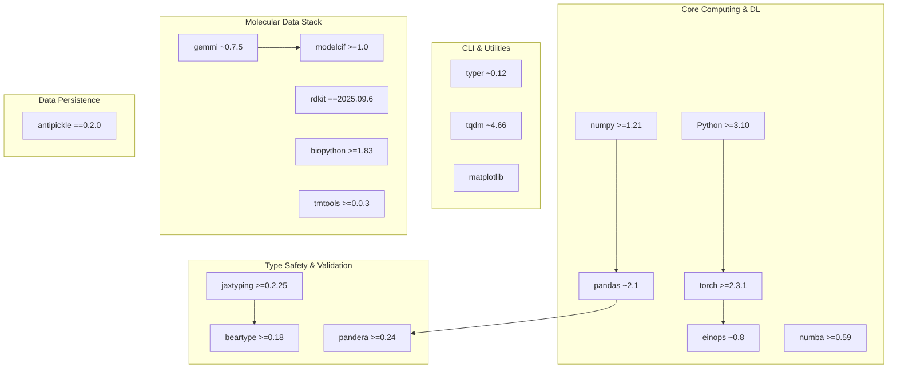
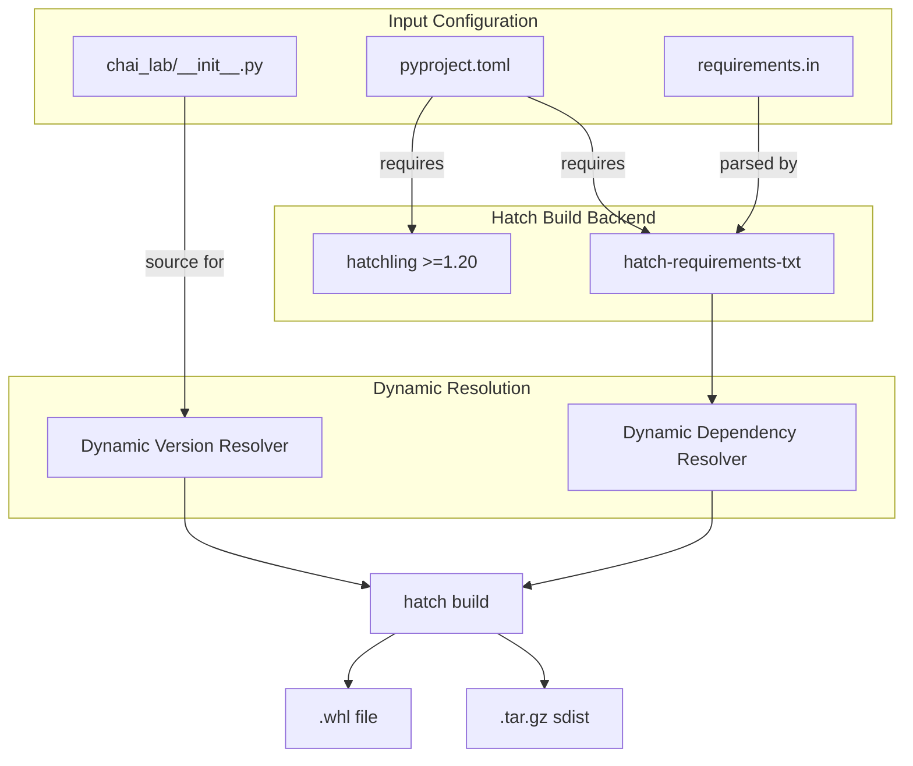

# Installation and Dependencies

<details>
<summary>Relevant source files</summary>

The following files were used as context for generating this wiki page:

- [.devcontainer/devcontainer.json](.devcontainer/devcontainer.json)
- [.github/workflows/mypy.yml](.github/workflows/mypy.yml)
- [.github/workflows/publish-to-pypi.yml](.github/workflows/publish-to-pypi.yml)
- [.github/workflows/ruff.yml](.github/workflows/ruff.yml)
- [Dockerfile.chailab](Dockerfile.chailab)
- [pyproject.toml](pyproject.toml)
- [requirements.in](requirements.in)

</details>


This document provides comprehensive guidance for installing the `chai-lab` package and understanding its dependency structure. It covers system requirements, installation methods, and the build system configuration that enables the Chai-1 molecular structure prediction system.

## System Requirements

The `chai-lab` package requires Python 3.10 or higher, as specified in the project configuration [pyproject.toml:13](). This minimum version requirement ensures compatibility with modern type annotations and language features used throughout the codebase.

**Python Version Compatibility:**
- Minimum: Python 3.10 [pyproject.toml:13]()
- Recommended: Python 3.11 or 3.12
- PyTorch compatibility: Versions 2.3.1 through 2.7.1 are confirmed to work correctly; version 2.2 is known to be broken [requirements.in:31]().

**Hardware Requirements:**
- GPU with CUDA support (strongly recommended for inference).
- Sufficient RAM for model weights and intermediate computations (inference can be memory-intensive).
- Storage space for model assets and cached data.

Sources: [pyproject.toml:13](), [requirements.in:31]()

## Installation Methods

### Standard Installation

The package can be installed directly from the repository using pip:

```bash
pip install git+https://github.com/chaidiscovery/chai-lab.git
```

### Development Installation

For development work, install in editable mode to enable immediate reflection of code changes [pyproject.toml:1]():

```bash
git clone https://github.com/chaidiscovery/chai-lab.git
cd chai-lab
pip install -e .
```

The build system is configured to automatically install in editable mode when possible.

**Command Line Interface:**
After installation, the `chai-lab` command becomes available in your environment, provided by the `chai_lab.main:cli` entry point [pyproject.toml:73]().

Sources: [pyproject.toml:1](), [pyproject.toml:72-73]()

## Dependency Architecture

The `chai-lab` package organizes its dependencies into several functional categories, each serving specific aspects of the molecular structure prediction pipeline.

### Dependency Categories



Sources: [requirements.in:1-32]()

### Key Dependency Details

| Package | Version | Purpose |
|---------|---------|---------|
| `torch` | >=2.3.1 | Deep learning framework for model execution [requirements.in:31]() |
| `rdkit` | 2025.09.6 | Chemical informatics; version pinned for typing consistency [requirements.in:14-15]() |
| `gemmi` | ~0.7.5 | PDB/mmCIF parsing and structure manipulation [requirements.in:13]() |
| `antipickle` | 0.2.0 | Used to save/load heterogeneous Python structures [requirements.in:17]() |
| `jaxtyping` | >=0.2.25 | Tensor shape and type annotations for runtime checking [requirements.in:29]() |
| `beartype` | >=0.18 | Compatible typechecker for `jaxtyping` [requirements.in:30]() |

Sources: [requirements.in:1-32]()

## Build System Configuration

The project uses a modern Python build system based on `hatchling` with dynamic configuration capabilities.

### Build System Architecture



### Build Components

**Backend Configuration:**
- **Build Backend**: `hatchling.build` [pyproject.toml:7]().
- **Requirements Plugin**: `hatch-requirements-txt` enables dynamic dependency loading from `requirements.in` [pyproject.toml:5, 21]().
- **Version Management**: Dynamic version extraction from `chai_lab/__init__.py` [pyproject.toml:19]().

**Package Exclusions:**
The build system excludes development, CI/CD, and large data directories from source distributions (`sdist`):
- `.devcontainer`, `.github`, `.vscode`, `.idea` [pyproject.toml:59-62]().
- `assets`, `downloads`, `outputs` [pyproject.toml:64-66]().

Sources: [pyproject.toml:2-23, 57-73]()

## Docker and Development Environment

The repository provides a robust Docker setup for consistent development and deployment environments.

### Docker Configuration (`Dockerfile.chailab`)

The Dockerfile uses `ubuntu:22.04` as a base and sets up a high-performance environment:
- **Base Image**: `ubuntu:22.04` [Dockerfile.chailab:1]().
- **Python**: 3.10 with `python3.10-dev` [Dockerfile.chailab:37]().
- **Package Manager**: Uses `uv` (version 0.5.4) for extremely fast dependency installation [Dockerfile.chailab:70]().
- **System Dependencies**: Includes `kalign` (required for template logic), `build-essential`, and CUDA-related softlinks [Dockerfile.chailab:35, 39, 45]().
- **Environment**: Sets `PYTHONFAULTHANDLER=1` for debugging segfaults and `PYTHONPYCACHEPREFIX` to keep the working tree clean [Dockerfile.chailab:15-17]().

### Dev Container Configuration

The `.devcontainer/devcontainer.json` enables a seamless VS Code development experience:
- **Build Target**: `chailab-baseimage` from the Dockerfile [devcontainer.json:6]().
- **GPU Support**: Configured to use all GPUs by default via `--gpus=all` [devcontainer.json:10]().
- **Resources**: Set to high limits (60 CPUs, 1000GB RAM) to accommodate large-scale inference tasks [devcontainer.json:16-17]().
- **Extensions**: Pre-installs Python, Pylance, Ruff, Mypy, and Jupyter extensions [devcontainer.json:29-33]().

Sources: [Dockerfile.chailab:1-85](), [devcontainer.json:1-43]()

## CI/CD Pipeline

The project uses GitHub Actions for automated quality assurance and deployment.

- **Ruff Linting**: Runs `ruff` and `ruff-format` via `pre-commit` on every push/PR [ruff.yml:24-28]().
- **Mypy Type Checking**: Validates static types using a specialized setup that installs CPU-only PyTorch to save time [mypy.yml:23-29]().
- **PyPI Deployment**: Automated publishing via `hatch` when a new release tag is created [publish-to-pypi.yml:35]().

Sources: [.github/workflows/ruff.yml:1-29](), [.github/workflows/mypy.yml:1-30](), [.github/workflows/publish-to-pypi.yml:1-36]()

## Troubleshooting

### Dependency Resolution
If you encounter issues with `torch` or `nvidia` dependencies during local development, refer to the `mypy.yml` workflow which demonstrates how to install requirements while filtering specific packages:
`cat requirements.in | grep -v nvidia | grep -v torch` [mypy.yml:25]().

### RDKit Versioning
Note that `rdkit` is pinned to `2025.09.6` because typing is not consistent across versions, which can cause static analysis failures [requirements.in:14-15]().

Sources: [requirements.in:14-15](), [mypy.yml:25]()

---