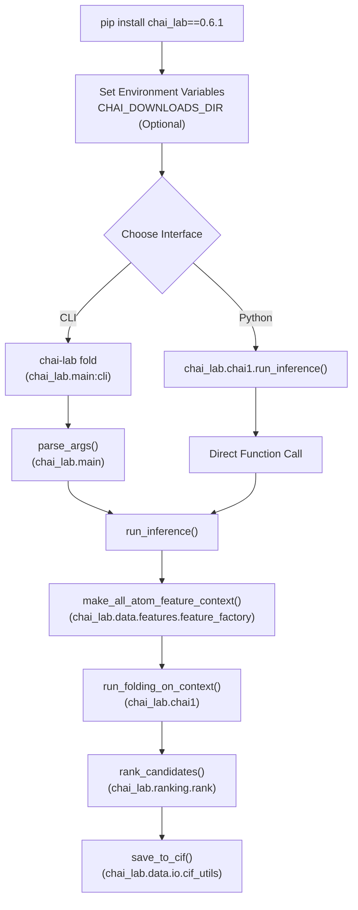
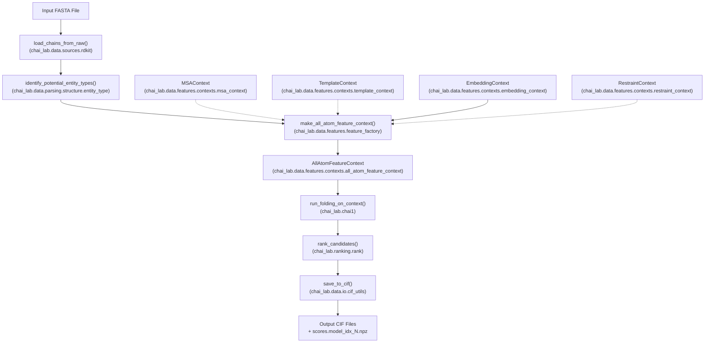

# Getting Started

<details>
<summary>Relevant source files</summary>

The following files were used as context for generating this wiki page:

- [README.md](README.md)
- [examples/predict_structure.py](examples/predict_structure.py)

</details>


This guide walks you through installing Chai-1 and running your first molecular structure prediction. For detailed information on the command-line options, see [Command Line Interface](#2.1); for comprehensive Python API documentation, see [Python API](#2.2).

## System Requirements

Chai-1 requires the following:

- **Operating System**: Linux
- **Python**: Version 3.10 or later
- **GPU**: CUDA-compatible GPU with bfloat16 support
  - Recommended: A100 80GB, H100 80GB, or L40S 48GB
  - Also compatible: A10, A30, or consumer-grade RTX 4090

Sources: [README.md:11-21]()

## Installation

Install Chai-1 using pip:

```bash
# Install the released version from PyPI
pip install chai_lab==0.6.1

# Or install the latest development version
pip install git+https://github.com/chaidiscovery/chai-lab.git
```

The package automatically installs all required dependencies.

Sources: [README.md:11-19]()

## Installation and Operation Flow

The diagram below illustrates the path from installation to the final 3D structure generation, mapping high-level actions to the underlying code entry points.



Sources: [README.md:11-19](), [README.md:25-46](), [README.md:48-62](), [examples/predict_structure.py:7-49]()

## Basic Usage

Chai-1 can be used through either the command-line interface or Python API.

### Command-Line Interface

The main CLI command to predict structures is:

```bash
chai-lab fold input.fasta output_folder
```

By default, this generates 5 structure predictions using ESM embeddings (without MSAs or templates).

For improved predictions, enable MSA and template usage:

```bash
chai-lab fold --use-msa-server --use-templates-server input.fasta output_folder
```

For a custom ColabFold server:

```bash
chai-lab fold --use-msa-server --msa-server-url "https://your-server-url" input.fasta output_folder
```

For details, see [Command Line Interface](#2.1).

Sources: [README.md:25-46]()

### Python API

For programmatic use, import and call the `run_inference` function defined in `chai_lab.chai1`. The following example demonstrates the basic usage pattern:

```python
from chai_lab.chai1 import run_inference
from pathlib import Path

# Create FASTA input file
example_fasta = """
>protein|name=example-protein
AGSHSMRYFSTSVSRPGRGEPRFIAVGYVDDTQFVRFDSDAASPRGEPRAPWVEQEGPEYWDRETQKYKRQAQTDRVSLRNLRGYYNQSEAGSHTLQWMFGCDLGPDGRLLRGYDQSAYDGKDYIALNEDLRSWTAADTAAQITQRKWEAAREAEQRRAYLEGTCVEWLRRYLENGKETLQRAEHPKTHVTHHPVSDHEATLRCWALGFYPAEITLTWQWDGEDQTQDTELVETRPAGDGTFQKWAAVVVPSGEEQRYTCHVQHEGLPEPLTLRWEP
>ligand|name=example-ligand
CCCCCCCCCCCCCC(=O)O
""".strip()

fasta_path = Path("/tmp/example.fasta")
fasta_path.write_text(example_fasta)

# Run the prediction
candidates = run_inference(
    fasta_file=fasta_path,
    output_dir=Path("/tmp/outputs"),
    num_trunk_recycles=3,
    num_diffn_timesteps=200,
    seed=42,
    device="cuda:0",
    use_esm_embeddings=True,
)

# Access results
cif_paths = candidates.cif_paths
agg_scores = [rd.aggregate_score.item() for rd in candidates.ranking_data]
```

For advanced use cases, you can use `run_folding_on_context` to construct a custom `AllAtomFeatureContext` manually. For details, see [Python API](#2.2).

Sources: [README.md:48-94](), [examples/predict_structure.py:7-57]()

## Data Flow Through System

The following diagram maps the data transformation stages to the specific internal contexts and factories used by the Chai-1 engine.



Sources: [README.md:76-94](), [README.md:48-62](), [examples/predict_structure.py:1-57]()

## Environment Configuration

Model weights are automatically downloaded to `<package_root>/downloads`. To specify a custom location, set the `CHAI_DOWNLOADS_DIR` environment variable:

```bash
# For command-line usage
export CHAI_DOWNLOADS_DIR=/path/to/downloads
chai-lab fold input.fasta output_folder

# For Python usage
import os
os.environ["CHAI_DOWNLOADS_DIR"] = "/path/to/downloads"
from chai_lab.chai1 import run_inference
```

Sources: [README.md:64-73]()

## File Formats

Chai-1 works with the following key file formats:

| Format | Description | Usage |
|--------|-------------|-------|
| FASTA (.fasta) | Sequence input | Contains protein sequences, SMILES strings, and other entities |
| CIF (.cif) | Structure output | Contains 3D coordinates of predicted structures |
| Aligned MSA (.aligned.pqt) | Multiple sequence alignment | Used to improve prediction accuracy via `MSAContext` |
| M8 (.m8) | Template hits | BLAST-like format for template search results |
| NPZ (.npz) | Quality scores | Contains pTM, ipTM, pLDDT, and clash scores |

### FASTA Input Format

The FASTA format supports multiple entity types with specific naming conventions:

```
>protein|name=example-protein
AGSHSMRYFSTSVSRPGRGEPRFIAVGYVDDTQFVRFDSDAASPRGEPRAPWVEQEGPEYWDRETQKYKRQAQTDRVSLRNLRGYYNQSEAGSHTLQWMFGCDLGPDGRLLRGYDQSAYDGKDYIALNEDLRSWTAADTAAQITQRKWEAAREAEQRRAYLEGTCVEWLRRYLENGKETLQRAEHPKTHVTHHPVSDHEATLRCWALGFYPAEITLTWQWDGEDQTQDTELVETRPAGDGTFQKWAAVVVPSGEEQRYTCHVQHEGLPEPLTLRWEP
>ligand|name=example-ligand
CCCCCCCCCCCCCC(=O)O
```

For detailed information on input formats and entity identification, see [Input Processing](#4).

Sources: [README.md:76-83](), [examples/predict_structure.py:19-28]()

## Next Steps

- [Command Line Interface](#2.1) - Learn all CLI options and commands.
- [Python API](#2.2) - Explore the full API capabilities including `run_folding_on_context`.
- [Multiple Sequence Alignments](#5.1) - Enhance predictions with evolutionary information.
- [Structural Templates](#5.2) - Use template-based structure prediction.
- [Restraints and Constraints](#5.4) - Apply spatial constraints to predictions.

Sources: [README.md:76-94](), [README.md:113-119]()

---