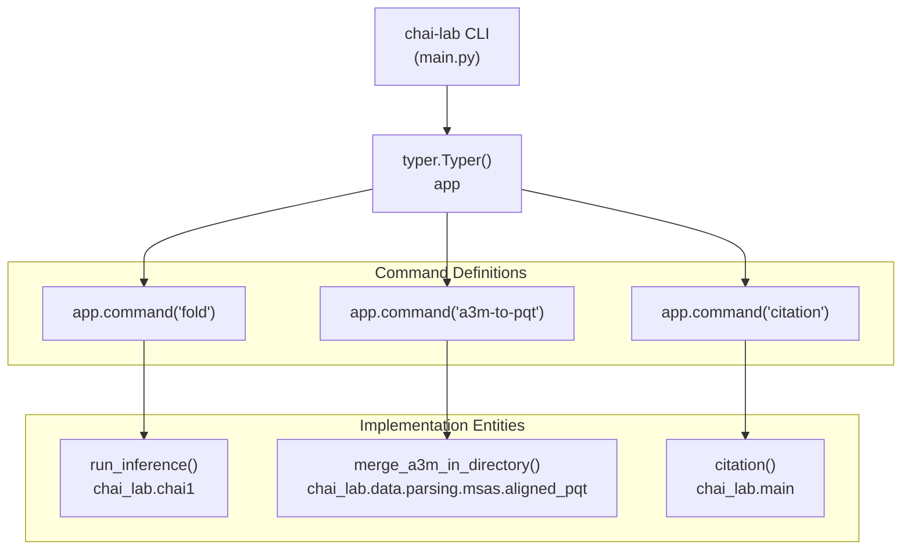
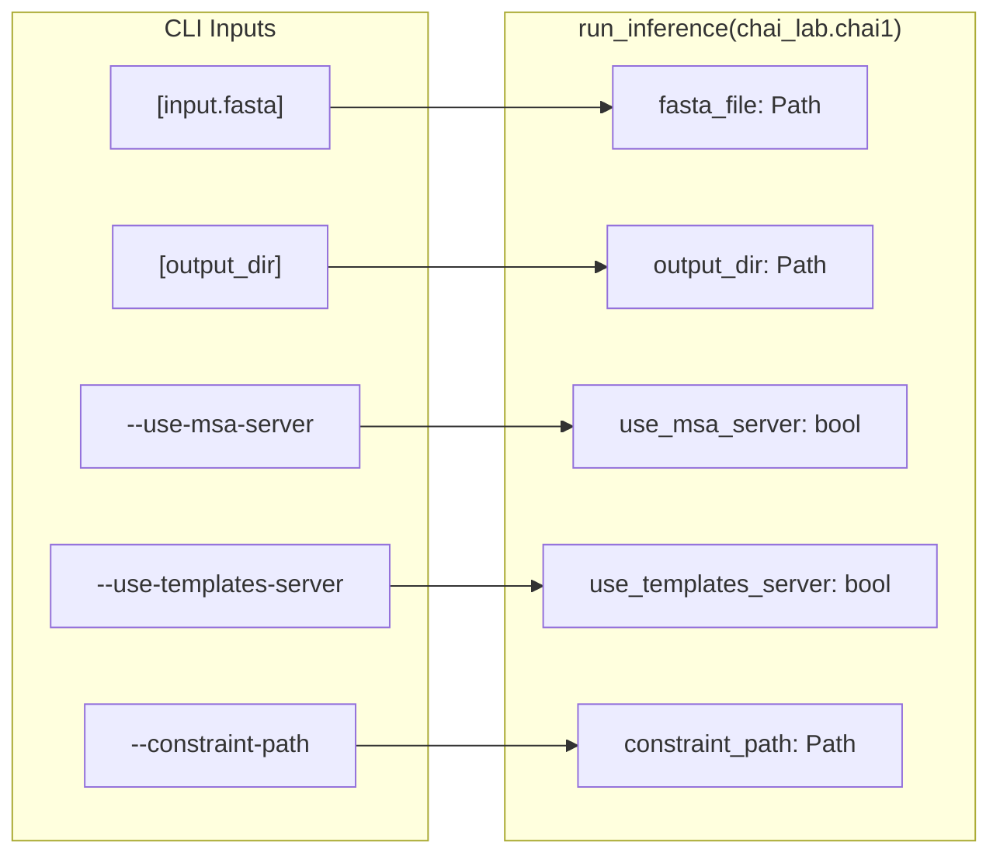

# Command Line Interface

<details>
<summary>Relevant source files</summary>

The following files were used as context for generating this wiki page:

- [README.md](README.md)
- [chai_lab/main.py](chai_lab/main.py)
- [examples/restraints/predict_with_restraints.py](examples/restraints/predict_with_restraints.py)

</details>


This document provides a comprehensive guide to the Chai-1 command line interface (CLI). It covers the installation, basic usage, available commands, and technical implementation for running molecular structure prediction tasks from the terminal. For information about using Chai-1 programmatically, see [Python API]().

## Installation

The Chai-1 CLI is installed automatically when you install the `chai_lab` package. After installation, the `chai-lab` command becomes available in your terminal environment.

```bash
# Install from PyPI
pip install chai_lab==0.6.1

# Or install the latest development version
pip install git+https://github.com/chaidiscovery/chai-lab.git
```

Sources: [README.md:11-19]()

## CLI Architecture

The Chai-1 command line interface is implemented using the `typer` library in [chai_lab/main.py:36-44](). The `cli()` function initializes a `typer.Typer()` application and registers commands that map directly to backend inference and utility functions.

### CLI Entity Mapping

This diagram bridges the CLI command space to the internal Python function space.



The entry point is defined in [chai_lab/main.py:47-48]() and is typically invoked via the `chai-lab` alias created during package installation.

Sources: [chai_lab/main.py:36-48]()

## Available Commands

The CLI provides three primary utilities:

| Command | Backend Function | Module | Purpose |
|---------|----------|---------|-------------|
| `fold` | `run_inference` | `chai_lab.chai1` | Core prediction engine for molecular complexes |
| `a3m-to-pqt` | `merge_a3m_in_directory` | `chai_lab.data.parsing.msas.aligned_pqt` | MSA preprocessing utility |
| `citation` | `citation` | `chai_lab.main` | Displays BibTeX for technical report |

### Command Registration Implementation

The registration logic in [chai_lab/main.py:38-43]() uses Typer decorators to bind CLI strings to Python functions:

```python
app.command("fold", help="Run Chai-1 to fold a complex.")(run_inference)
app.command(
    "a3m-to-pqt",
    help="Convert all a3m files in a directory for a *single sequence* into a aligned parquet file",
)(merge_a3m_in_directory)
app.command("citation", help="Print citation information")(citation)
```

Sources: [chai_lab/main.py:38-43]()

## The 'fold' Command

The `fold` command is the primary interface for running the Chai-1 model. It takes a FASTA file and produces 3D structures.

### Basic Execution

```bash
chai-lab fold input.fasta output_folder
```

By default, this command generates 5 sample predictions and uses ESM embeddings without MSAs or templates.

Sources: [README.md:27-32]()

### Parameter Mapping

The CLI options are derived from the signature of `run_inference`. This diagram maps CLI flags to the internal parameters used by the inference engine.



Sources: [chai_lab/main.py:38](), [examples/restraints/predict_with_restraints.py:25-35]()

### Advanced Flags

| Flag | Description |
|------|-------------|
| `--use-msa-server` | Enables automatic MSA generation via ColabFold MMseqs2 server. |
| `--msa-server-url` | Specifies a custom ColabFold server URL (e.g., internal hosting). |
| `--use-templates-server` | Enables template search and download from RCSB. |
| `--constraint-path` | Path to a file containing residue-residue or pocket restraints. |
| `--num-trunk-recycles` | Number of recycling iterations (default is 3). |
| `--num-diffn-timesteps` | Number of diffusion steps (default is 200). |
| `--use-esm-embeddings` | Whether to use ESM language model embeddings (default is True). |

Sources: [README.md:34-44](), [examples/restraints/predict_with_restraints.py:30-34]()

## Utility Commands

### MSA Preprocessing (`a3m-to-pqt`)

Chai-1 uses a custom Parquet format (`.aligned.pqt`) for MSAs to store metadata like source databases and sequence pairing keys. The `a3m-to-pqt` command converts standard `a3m` files into this optimized format.

```bash
chai-lab a3m-to-pqt /path/to/a3m_files/
```

This invokes `merge_a3m_in_directory` in [chai_lab/data/parsing/msas/aligned_pqt.py]().

Sources: [chai_lab/main.py:39-42](), [README.md:77-82]()

### Citation (`citation`)

To ensure proper attribution, the `citation` command prints the BibTeX entry for the Chai-1 technical report.

```bash
chai-lab citation
```

The citation string is defined as a constant `CITATION` in [chai_lab/main.py:16-28]().

Sources: [chai_lab/main.py:31-34]()

## Environment Variables

The CLI behavior can be modified using environment variables, which is particularly useful in containerized environments (Docker/Apptainer).

| Variable | Default | Role |
|----------|---------|------|
| `CHAI_DOWNLOADS_DIR` | `<package_root>/downloads` | Controls where model weights are stored. |
| `CHAI_TEMPLATE_CIF_FOLDER` | None | Directory to look for custom `.cif.gz` template files. |

Example usage:
```bash
CHAI_DOWNLOADS_DIR=/mnt/data/chai_weights chai-lab fold input.fasta output/
```

Sources: [README.md:64-74](), [README.md:96-103]()

---