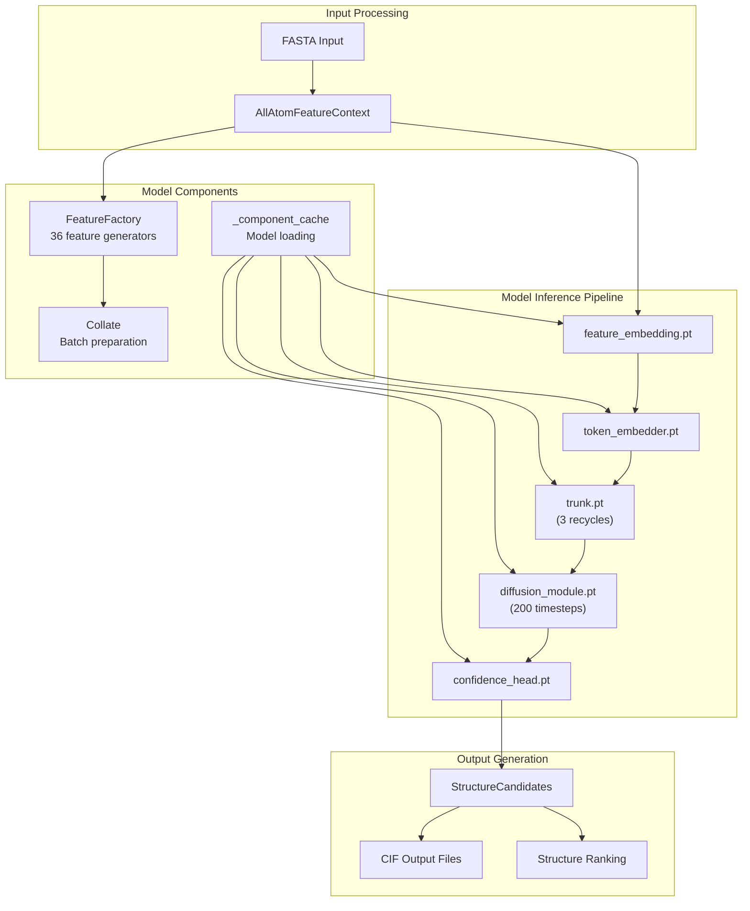
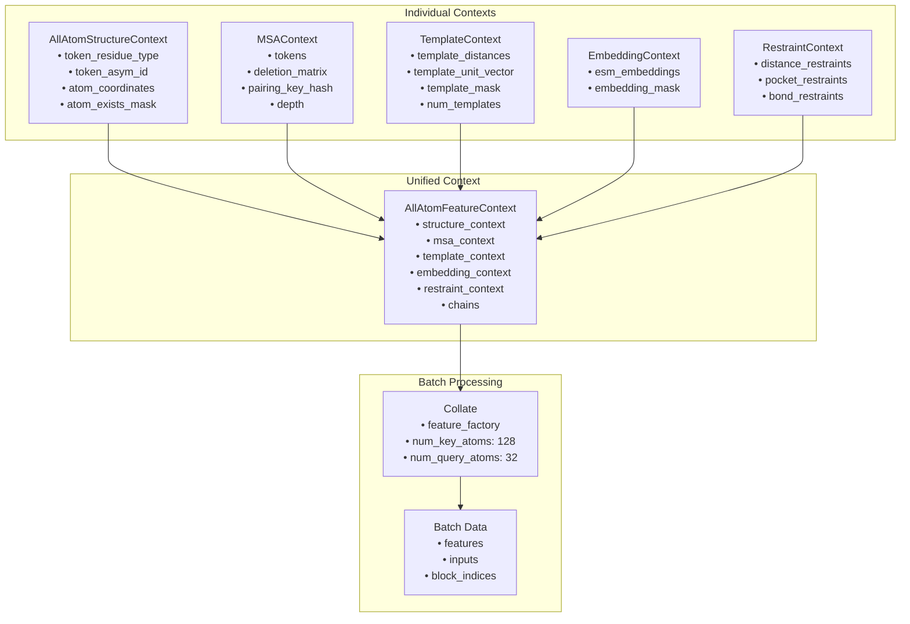
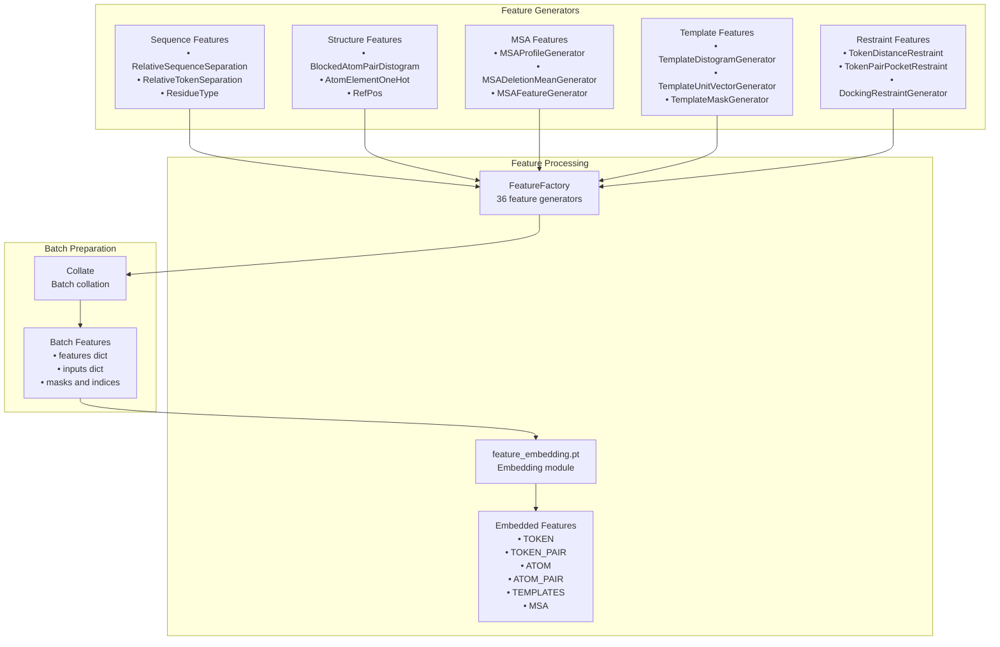
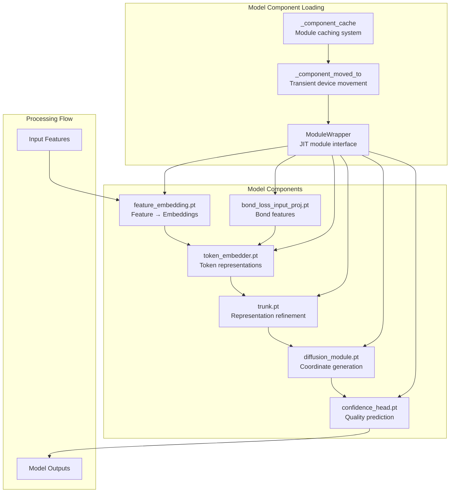
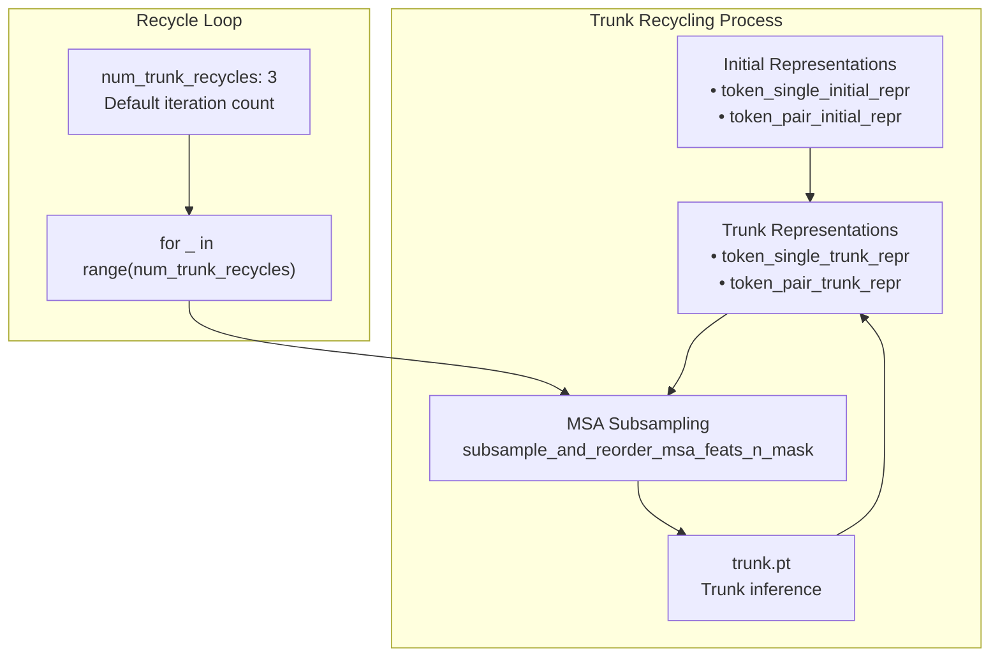
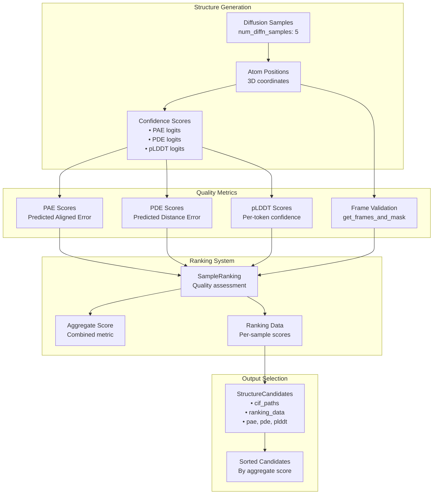

# Core Systems

Relevant source files

The following files were used as context for generating this wiki page:

- [chai_lab/chai1.py](chai_lab/chai1.py)
- [chai_lab/data/dataset/all_atom_feature_context.py](chai_lab/data/dataset/all_atom_feature_context.py)
- [chai_lab/data/dataset/msas/utils.py](chai_lab/data/dataset/msas/utils.py)

This page documents the fundamental systems that comprise the Chai-1 inference engine. These core systems orchestrate the entire structure prediction pipeline, from input processing through model inference to output generation.

For details on the sequential execution flow, see [Inference Engine](#3.1). For documentation on core classes like `PDBContext` and `Chain`, see [Data Structures](#3.2). For information on how the `FeatureFactory` assembles features, see [Feature Context Assembly](#3.3). For details on confidence metrics like PAE and pLDDT, see [Structure Ranking](#3.4).

## Core Inference Pipeline

The Chai-1 inference engine operates through a multi-stage pipeline that transforms molecular inputs into 3D structure predictions. The pipeline consists of feature embedding, trunk recycling, diffusion denoising, and confidence prediction stages.

### Pipeline Architecture

Sources: [chai_lab/chai1.py:498-572](), [chai_lab/chai1.py:579-1059]()

### Main Inference Functions

The core inference logic is implemented in two primary functions:

- `run_inference`: Main entry point that handles input processing, feature context creation, and coordinates multiple trunk samples. [chai_lab/chai1.py:498-572]()
- `run_folding_on_context`: Core folding logic that executes the model inference pipeline on a prepared feature context. [chai_lab/chai1.py:579-1059]()

The pipeline processes inputs through five sequential stages:

1. **Feature Embedding**: Converts raw features into embedded representations. [chai_lab/chai1.py:679-685]()
2. **Token Embedding**: Processes token-level features and creates initial representations. [chai_lab/chai1.py:721-738]()
3. **Trunk Recycling**: Iteratively refines representations through multiple recycles. [chai_lab/chai1.py:748-777]()
4. **Diffusion Denoising**: Generates 3D coordinates through a denoising process. [chai_lab/chai1.py:844-886]()
5. **Confidence Prediction**: Predicts confidence scores for generated structures. [chai_lab/chai1.py:894-915]()

Sources: [chai_lab/chai1.py:498-572](), [chai_lab/chai1.py:579-1059]()

## Data Structure Architecture

The core data structures form a hierarchical system where individual contexts are assembled into a unified feature representation for model inference.

### Core Data Structure Hierarchy

Sources: [chai_lab/data/dataset/all_atom_feature_context.py:25-40](), [chai_lab/data/dataset/structure/all_atom_structure_context.py:38-55](), [chai_lab/data/collate/collate.py:26-38]()

### Structure Context Integration

The `AllAtomStructureContext` serves as the foundational data structure containing atomic coordinates, molecular topology, and metadata. Multiple structure contexts are merged using `AllAtomStructureContext.merge()` to create a unified representation for complex molecular systems. [chai_lab/data/dataset/structure/all_atom_structure_context.py:164-214]()

Key operations include:
- Token-level masking and indexing.
- Atomic coordinate management.
- Covalent bond tracking.
- Glycan leaving atom handling via `drop_glycan_leaving_atoms_inplace()`. [chai_lab/chai1.py:483]()

Sources: [chai_lab/chai1.py:377-379](), [chai_lab/chai1.py:483]()

## Feature Context Assembly

The feature context assembly system combines diverse molecular features into a unified representation suitable for model inference. This process involves feature generation, embedding, and batch preparation.

### Feature Generation Pipeline

Sources: [chai_lab/chai1.py:172-236](), [chai_lab/chai1.py:636-647](), [chai_lab/chai1.py:679-716]()

### Feature Factory Configuration

The system uses a comprehensive `FeatureFactory` with 36 different feature generators organized by type:

- **Sequence Features**: Relative separations, entity relationships, residue types. [chai_lab/chai1.py:173-179]()
- **Structure Features**: Atom distances, elements, coordinates, charges. [chai_lab/chai1.py:180-190]()
- **MSA Features**: Profile statistics, deletion patterns, pairing information. [chai_lab/chai1.py:199-210]()
- **Template Features**: Structural templates, distance constraints, unit vectors. [chai_lab/chai1.py:211-216]()
- **Restraint Features**: Distance restraints, pocket constraints, docking restraints. [chai_lab/chai1.py:221-235]()

Sources: [chai_lab/chai1.py:172-236](), [chai_lab/data/features/feature_factory.py:17-26]()

## Model Components

The Chai-1 model consists of primary components loaded as JIT-compiled modules. Each component is managed through a caching system that optimizes memory usage during inference.

### Component Architecture

Sources: [chai_lab/chai1.py:115-166](), [chai_lab/chai1.py:679-916]()

### Component Management

The model components are managed through a caching and device movement system:

- **ModuleWrapper**: Provides a unified interface for JIT modules with device management. [chai_lab/chai1.py:115-137]()
- **Component Caching**: Global cache `_component_cache` stores loaded modules to avoid repeated disk I/O. [chai_lab/chai1.py:151]()
- **Transient Movement**: `_component_moved_to` context manager temporarily moves modules to GPU for inference. [chai_lab/chai1.py:154-166]()

Sources: [chai_lab/chai1.py:115-166](), [chai_lab/chai1.py:151]()

### Trunk Recycling System

The trunk component implements an iterative refinement process where representations are recycled:

Sources: [chai_lab/chai1.py:744-777](), [chai_lab/data/dataset/msas/utils.py:51-86]()

## Structure Ranking System

The structure ranking system evaluates generated structure candidates using multiple quality metrics to identify the most confident predictions.

### Ranking Pipeline

Sources: [chai_lab/chai1.py:283-335](), [chai_lab/chai1.py:984-1050](), [chai_lab/ranking/rank.py:101-135]()

### Confidence Metrics

The system computes three primary confidence metrics:

1. **PAE (Predicted Aligned Error)**: Inter-residue position error predictions. [chai_lab/chai1.py:931-935]()
2. **PDE (Predicted Distance Error)**: Distance-based error predictions. [chai_lab/chai1.py:937-941]()
3. **pLDDT (Per-residue confidence)**: Local confidence scores converted from per-atom to per-token. [chai_lab/chai1.py:943-958]()

Sources: [chai_lab/chai1.py:920-958](), [chai_lab/chai1.py:1001-1015]()

### Candidate Selection

The `StructureCandidates` class manages multiple structure predictions with associated quality metrics:

- **Sorting**: Candidates are sorted by aggregate score in descending order. [chai_lab/chai1.py:307-318]()
- **Concatenation**: Multiple trunk samples can be combined using `StructureCandidates.concat()`. [chai_lab/chai1.py:320-335]()

Sources: [chai_lab/chai1.py:283-335](), [chai_lab/chai1.py:1052-1059]()

---