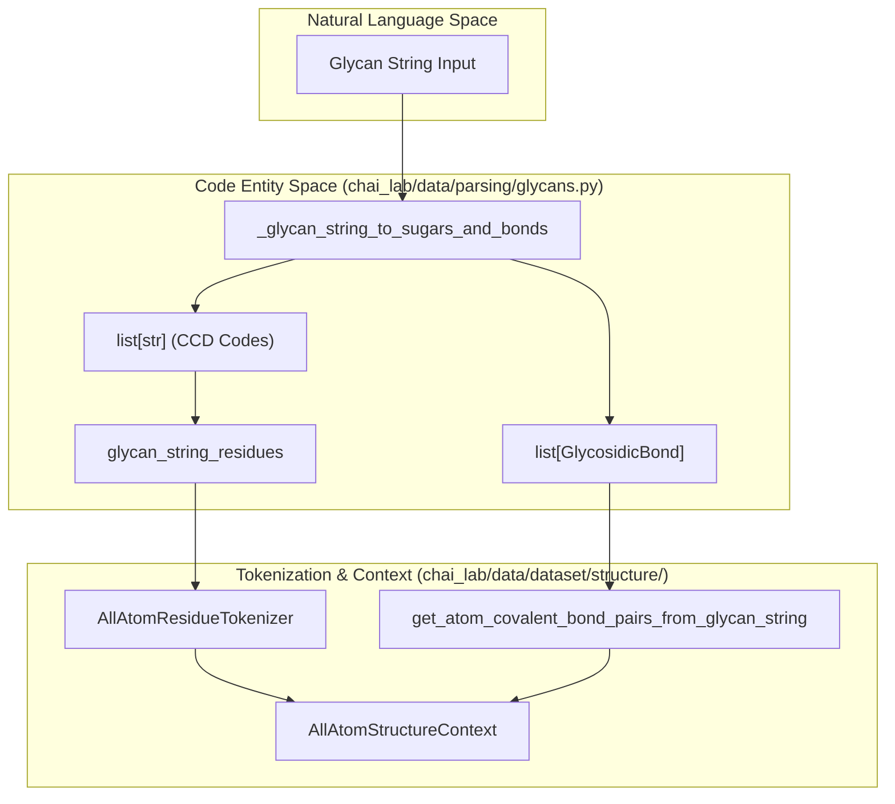
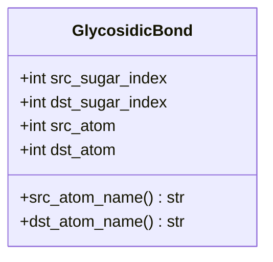
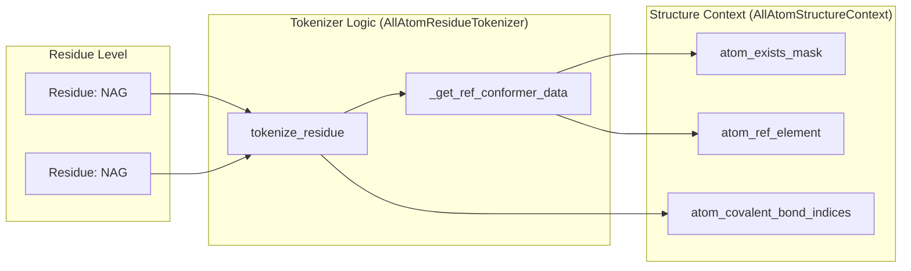

# Glycan Processing

Relevant source files

The following files were used as context for generating this wiki page:

- [chai_lab/data/dataset/structure/all_atom_residue_tokenizer.py](chai_lab/data/dataset/structure/all_atom_residue_tokenizer.py)
- [chai_lab/data/parsing/glycans.py](chai_lab/data/parsing/glycans.py)
- [tests/test_glycans.py](tests/test_glycans.py)

## Purpose and Scope

The glycan processing system handles the parsing and representation of glycan (carbohydrate) structures from string-based input into internal data structures used by the Chai-1 model. This system is specifically designed to process glycan entities identified during input parsing and convert them into the unified `AllAtomStructureContext` representation.

For information about other molecular entity types, see [Entity Type Identification](4.2). For broader input processing workflows, see [Input Processing](4).

## Glycan String Format

The system processes glycan structures using a specialized string notation that represents the hierarchical branching structure of carbohydrates. This format uses three-letter Chemical Component Dictionary (CCD) codes for individual sugars and parenthetical notation for branch structures.

### String Structure Components

| Component | Description | Example |
|-----------|-------------|---------|
| Sugar Code | Three-letter CCD code | `MAN`, `99K`, `FUC` |
| Bond Notation | `src-dst` format (1-6 indexed) | `4-1`, `6-1` |
| Branching | Parentheses for nested structures | `(6-1 FUC)` |

### Example Glycan Strings

- **Simple**: `MAN` [tests/test_glycans.py:14-19]()
- **Linear**: `NAG(4-1 NAG)` [tests/test_glycans.py:70-70]()
- **Branched**: `MAN(6-1 FUC)(4-1 MAN)` [chai_lab/data/parsing/glycans.py:11-11]()
- **Complex**: `MAN(4-1 FUC(4-1 MAN)(6-1 FUC(4-1 MAN)))(6-1 MAN(6-1 MAN(4-1 MAN)(6-1 FUC)))` [tests/test_glycans.py:46-49]()

Sources: [chai_lab/data/parsing/glycans.py:10-12](), [tests/test_glycans.py:22-49]()

## Parsing Pipeline

The glycan processing pipeline converts string representations into structured data through a multi-step parsing process.

### Code-to-Entity Mapping

The following diagram maps the natural language concept of glycan parsing to the specific code entities in the `chai-lab` repository.

**Diagram: Glycan Parsing Data Flow**

Sources: [chai_lab/data/parsing/glycans.py:46-111](), [chai_lab/data/dataset/structure/all_atom_residue_tokenizer.py:17-26]()

### Core Parsing Logic

The `_glycan_string_to_sugars_and_bonds` function performs the primary parsing logic:

1.  **Character-by-character parsing**: Processes the glycan string sequentially [chai_lab/data/parsing/glycans.py:56-88]().
2.  **Bracket tracking**: Maintains parent-child relationships using a stack (`parent_sugar_idx`) to handle branching [chai_lab/data/parsing/glycans.py:61-69]().
3.  **Bond extraction**: Identifies bond patterns (`[1-6]-[1-6]`) using regex and creates `GlycosidicBond` objects [chai_lab/data/parsing/glycans.py:72-82]().
4.  **Sugar identification**: Extracts three-letter CCD codes for individual sugars [chai_lab/data/parsing/glycans.py:84-87]().

Sources: [chai_lab/data/parsing/glycans.py:46-91]()

## Data Structures

### GlycosidicBond

The `GlycosidicBond` dataclass represents covalent bonds between sugar residues:

Key properties:
-   **O-glycosidic bonds**: Links between sugars are modeled as O-glycosidic bonds; the system uses `src O` and `dst C` [chai_lab/data/parsing/glycans.py:36-42]().
-   **Atom naming**: `src_atom_name` returns `O{src_atom}`, `dst_atom_name` returns `C{dst_atom}` [chai_lab/data/parsing/glycans.py:37-42]().
-   **Validation**: The `__post_init__` method ensures that `src_sugar_index` and `dst_sugar_index` are distinct and that atom indices are positive [chai_lab/data/parsing/glycans.py:30-32]().

Sources: [chai_lab/data/parsing/glycans.py:23-43]()

### Residue Conversion

The `glycan_string_residues` function converts parsed sugars into `Residue` objects [chai_lab/data/parsing/glycans.py:94-110]().

| Residue Property | Value | Description |
| :--- | :--- | :--- |
| `name` | Sugar CCD code | Three-letter identifier (e.g., "MAN") |
| `label_seq` | `i + 1` | Sequential (1-based) labels |
| `restype` | `rc.residue_types_with_nucleotides_order["X"]` | Mapped to generic residue type "X" |
| `is_covalent_bonded` | `True` | Indicates covalent connectivity for glycans |

Sources: [chai_lab/data/parsing/glycans.py:94-111]()

## Integration with Tokenizer and Context

The glycan processing system integrates with the broader structure prediction pipeline through the `AllAtomResidueTokenizer` and `AllAtomStructureContext`.

**Diagram: Glycan Atom Representation**

Sources: [chai_lab/data/dataset/structure/all_atom_residue_tokenizer.py:145-177](), [tests/test_glycans.py:87-108]()

### Atom Management and Bond Effects

When glycosidic bonds form between sugars, the system:
1.  **Atom existence masks**: Tracks which atoms are present. A bond between two NAG components (C8 H15 N O6) typically displaces one oxygen atom. For a NAG(4-1 NAG) dimer, the system expects 29 heavy atoms (15 + 15 - 1) [tests/test_glycans.py:85-89]().
2.  **Covalent bond indices**: Maintains explicit O-C bond connections between sugars [tests/test_glycans.py:99-108]().
3.  **Element tracking**: Preserves atomic composition. In a NAG dimer, this results in 16 Carbons (element 6), 2 Nitrogens (element 7), and 11 Oxygens (element 8) [tests/test_glycans.py:90-97]().

Sources: [tests/test_glycans.py:68-109]()

## Error Handling

The parsing system includes validation for:
-   **Bracket matching**: Ensures `open_count == closed_count` [chai_lab/data/parsing/glycans.py:90-90]().
-   **Valid patterns**: Raises `ValueError` if a chunk is neither a valid bond pattern (`[1-6]-[1-6]`) nor a 3-letter CCD code (`[0-9A-Z]{3}`) [chai_lab/data/parsing/glycans.py:88-89]().
-   **Non-empty results**: Raises `ValueError` if no residues are parsed from the string [chai_lab/data/parsing/glycans.py:96-97]().

Sources: [chai_lab/data/parsing/glycans.py:30-32](), [chai_lab/data/parsing/glycans.py:88-90](), [chai_lab/data/parsing/glycans.py:96-97]()

---