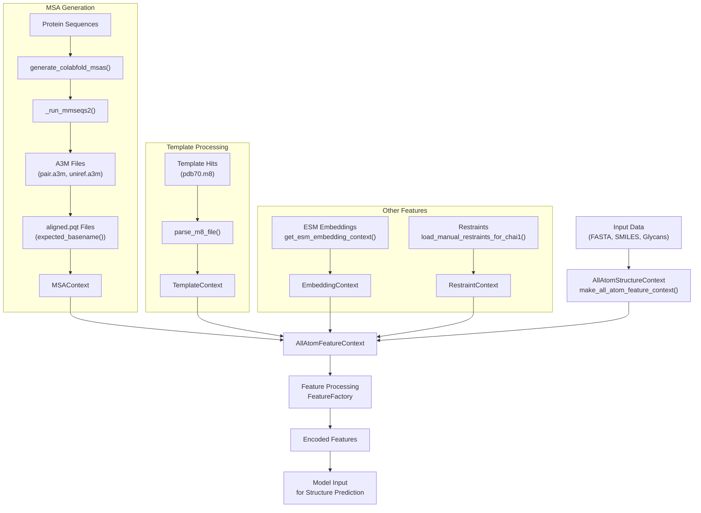
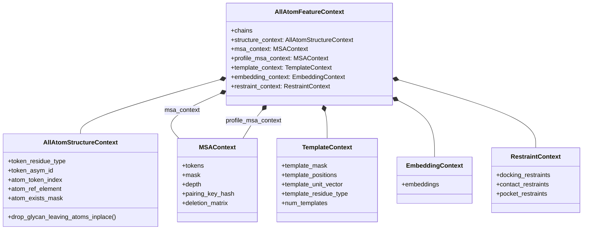
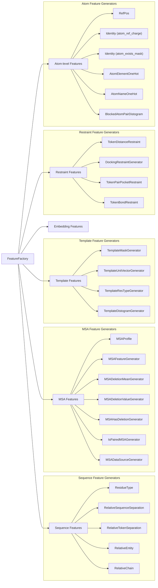
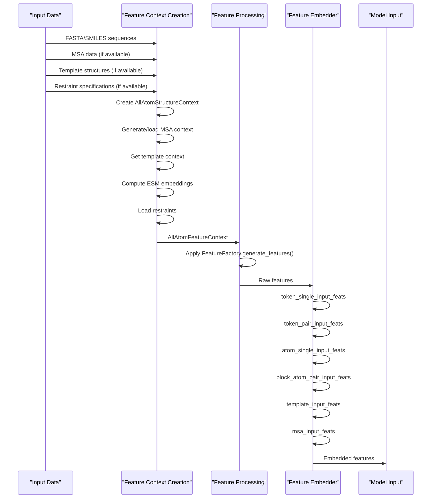
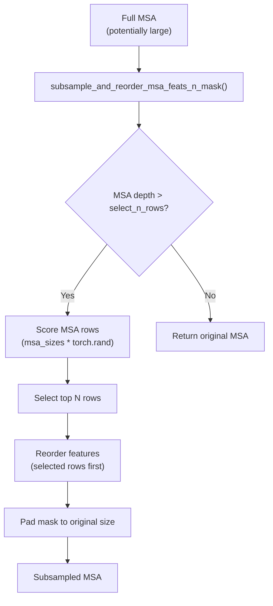

# Feature Generation

Relevant source files

The following files were used as context for generating this wiki page:

- [chai_lab/chai1.py](chai_lab/chai1.py)
- [chai_lab/data/dataset/msas/utils.py](chai_lab/data/dataset/msas/utils.py)
- [chai_lab/data/features/generators/__init__.py](chai_lab/data/features/generators/__init__.py)

Feature Generation is a critical process in the Chai-1 molecular structure prediction pipeline, responsible for transforming raw biological data into structured features that enable accurate structure prediction. This page documents the feature generation process, including how different biological data sources are processed, integrated, and prepared for input to the structure prediction model.

For information about specific feature types, see [Multiple Sequence Alignments](#5.1), [Structural Templates](#5.2), [ESM Embeddings](#5.3), and [Restraints and Constraints](#5.4).

## Feature Generation Overview

The feature generation process integrates information from multiple biological data sources to create a comprehensive representation of the molecular system. This representation captures evolutionary information, structural templates, sequence embeddings, and spatial constraints that guide the structure prediction.

### Feature Generation Pipeline

Sources: [chai_lab/chai1.py:343-498](), [chai_lab/data/dataset/msas/colabfold.py:296-459]()

## Feature Context

The central data structure in the feature generation process is the `AllAtomFeatureContext`, which integrates various types of information about the molecular system:

Sources: [chai_lab/chai1.py:490-497](), [chai_lab/data/dataset/all_atom_feature_context.py:33-56]()

The `make_all_atom_feature_context` function constructs this context by:
1. Loading chains from the input sequence data [chai_lab/chai1.py:372-377]()
2. Generating or loading MSAs from a server or local directory [chai_lab/chai1.py:392-414]()
3. Obtaining template information if available [chai_lab/chai1.py:416-432]()
4. Computing ESM embeddings if requested [chai_lab/chai1.py:434-441]()
5. Incorporating any restraints specified in constraint files [chai_lab/chai1.py:443-455]()
6. Processing special structural elements like glycan bonds [chai_lab/chai1.py:465-485]()

## Feature Generators

Chai-1 uses a collection of feature generators to transform the raw biological data into model-ready features. Each generator specializes in producing a specific type of feature:

Sources: [chai_lab/chai1.py:172-241]()

## Feature Generation Process Flow

The feature generation process flows from raw inputs to model-ready features:

Sources: [chai_lab/chai1.py:500-755](), [chai_lab/data/features/feature_factory.py:38-54]()

## ColabFold MSA Generation

The system uses ColabFold servers for MSA generation through the `generate_colabfold_msas()` function. This process involves both paired and unpaired MSA generation, followed by conversion to the internal `.aligned.pqt` format.

For details, see [Multiple Sequence Alignments](#5.1).

Sources: [chai_lab/data/dataset/msas/colabfold.py:296-459]()

## MSA Subsampling

For large Multiple Sequence Alignments (MSAs), Chai-1 implements subsampling to reduce computational requirements while maintaining the diversity of evolutionary information. The function `subsample_and_reorder_msa_feats_n_mask` handles this by scoring rows based on size and a random factor to select the most informative hits.

Sources: [chai_lab/data/dataset/msas/utils.py:15-86]()

## Feature Embedding

After feature generation, the features are embedded through specialized neural network components. In the inference pipeline, the `feature_factory` is used to generate raw tensors [chai_lab/chai1.py:656-663](), which are then passed to the JIT-loaded model components for embedding.

1. **Token Embedder**: Processes token-level features into initial representations.
2. **Trunk**: Integrates information across tokens through multiple recycles, utilizing MSA and template features.
3. **Diffusion**: Uses the embedded features to guide the prediction of 3D coordinates.

Sources: [chai_lab/chai1.py:656-755]()

## Types of Features and Their Purpose

| Feature Type | Description | Key Generators | Purpose |
|--------------|-------------|----------------|---------|
| Sequence Features | Token-level information about residue types and positions | `ResidueType`, `RelativeSequenceSeparation` | Provide basic sequence information |
| MSA Features | Evolutionary information from homologous sequences | `MSAProfileGenerator`, `MSADeletionMeanGenerator` | Capture evolutionary conservation patterns |
| Template Features | Information from structural templates | `TemplateMaskGenerator`, `TemplateUnitVectorGenerator` | Guide prediction based on similar known structures |
| ESM Embeddings | Representations from protein language models | `ESMEmbeddings` | Capture sequence context and patterns |
| Restraint Features | Spatial constraints to guide prediction | `TokenDistanceRestraint`, `DockingRestraintGenerator` | Enforce spatial relationships between entities |
| Atom-level Features | Information about atoms within residues | `RefPos`, `AtomElementOneHot`, `AtomNameOneHot` | Define chemical properties and initial positions |

Sources: [chai_lab/chai1.py:172-241](), [chai_lab/data/dataset/msas/colabfold.py:296-459]()

---