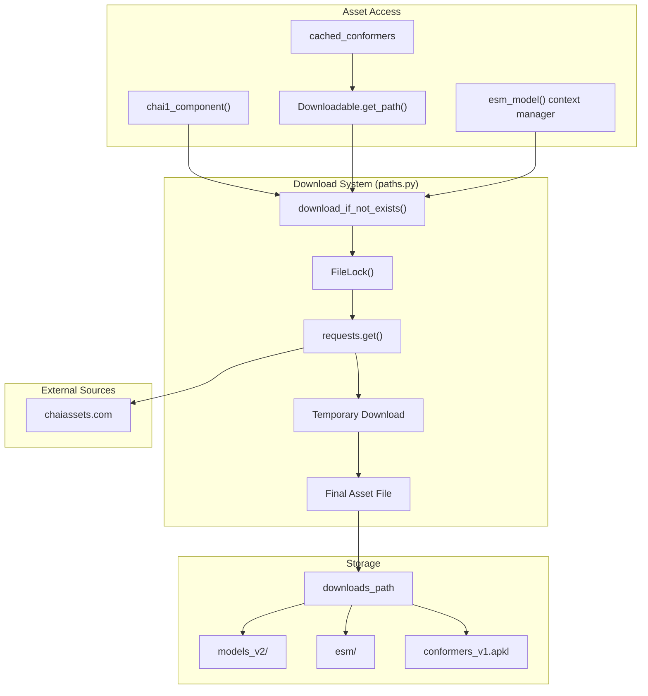
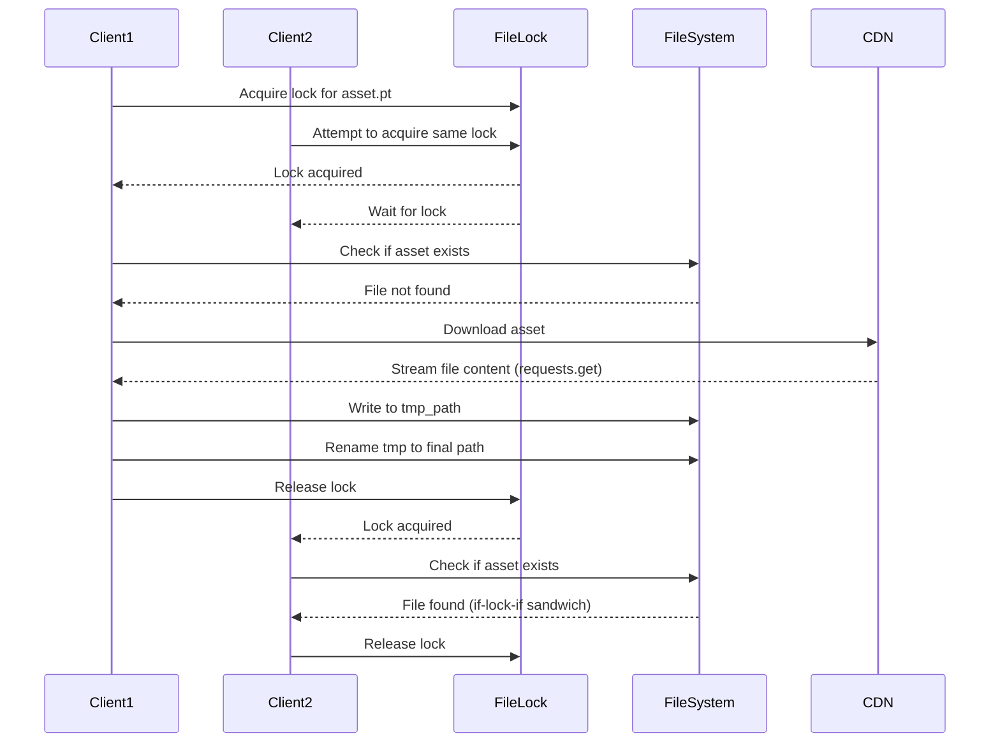
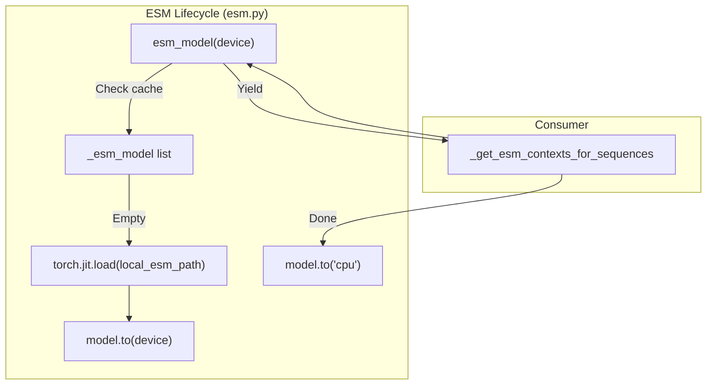

# Asset Management

<details>
<summary>Relevant source files</summary>

The following files were used as context for generating this wiki page:

- [chai_lab/data/dataset/embeddings/esm.py](chai_lab/data/dataset/embeddings/esm.py)
- [chai_lab/utils/defaults.py](chai_lab/utils/defaults.py)
- [chai_lab/utils/paths.py](chai_lab/utils/paths.py)

</details>


## Purpose and Scope

This document covers the asset management system in chai-lab, which handles the downloading, caching, and organization of model weights, conformer data, and external model dependencies like ESM-2. The system ensures efficient storage and retrieval of these assets while providing thread-safe download mechanisms.

For information about input data processing and validation, see [Input Processing](#4). For details about model inference and the core prediction pipeline, see [Inference Engine](#3.1).

## Asset Types and Organization

The chai-lab system manages several categories of assets required for structure prediction:

### Model Components
The primary assets are the trained model weights distributed as PyTorch checkpoint files. These include:
- `trunk.pt` - The main trunk model weights [chai_lab/utils/paths.py:75-76]().
- Additional model components stored in the `models_v2` directory structure [chai_lab/utils/paths.py:79-80]().

### Conformer Data
Pre-computed molecular conformers are cached to accelerate ligand processing:
- `conformers_v1.apkl` - Serialized conformer data (antipickle format) [chai_lab/utils/paths.py:62-65]().

### External Embeddings (ESM)
The system utilizes ESM-2 for protein sequence embeddings:
- `traced_sdpa_esm2_t36_3B_UR50D_fp16.pt` - A TorchScript-traced version of the ESM-2 3B model [chai_lab/data/dataset/embeddings/esm.py:21-22]().

### Download Architecture

The asset management system uses a centralized download mechanism with built-in caching and concurrent access protection:



Sources: [chai_lab/utils/paths.py:29-49](), [chai_lab/data/dataset/embeddings/esm.py:27-34]()

## Storage Configuration

### Default Storage Location
Assets are stored in a configurable downloads directory. The default location is `repo_root/downloads` [chai_lab/utils/paths.py:21](). This path can be overridden using the `CHAI_DOWNLOADS_DIR` environment variable [chai_lab/utils/paths.py:22]().

### Path Resolution
The system uses a hierarchical path resolution strategy:

| Asset Type | Storage Path | Configuration |
|------------|--------------|---------------|
| Model Components | `downloads_path/models_v2/{component}` | Via `chai1_component()` [chai_lab/utils/paths.py:79]() |
| Conformers | `downloads_path/conformers_v1.apkl` | Via `cached_conformers` [chai_lab/utils/paths.py:64]() |
| ESM-2 Model | `downloads_path/esm/traced_sdpa_esm2...pt` | Via `esm_cache_folder` [chai_lab/data/dataset/embeddings/esm.py:24-33]() |
| Downloads Root | `repo_root/downloads` | Via `CHAI_DOWNLOADS_DIR` env var [chai_lab/utils/paths.py:22]() |

Sources: [chai_lab/utils/paths.py:19-22](), [chai_lab/data/dataset/embeddings/esm.py:24-34]()

## Download System Implementation

### Thread-Safe Downloads
The system implements a file locking mechanism using `FileLock` to prevent concurrent downloads of the same asset [chai_lab/utils/paths.py:33]().



Sources: [chai_lab/utils/paths.py:29-48]()

### Downloadable Asset Interface
The `Downloadable` dataclass provides a standardized interface for managing downloadable assets [chai_lab/utils/paths.py:51-60]().

```python
@dataclasses.dataclass
class Downloadable:
    url: str
    path: Path
    
    def get_path(self) -> Path:
        # downloads artifact if necessary
        download_if_not_exists(self.url, path=self.path)
        return self.path
```

Sources: [chai_lab/utils/paths.py:51-60]()

## ESM-2 Asset Management

The ESM-2 model is managed lazily through a context manager that handles device placement and memory cleanup.

### Device Management and Caching
The `esm_model` context manager ensures the model is loaded once and moved between CPU and the target device (e.g., `cuda:0`) to save VRAM when not in use [chai_lab/data/dataset/embeddings/esm.py:27-52]().

- **Lazy Loading**: The model is loaded into a persistent `_esm_model` list only upon first request [chai_lab/data/dataset/embeddings/esm.py:36-45]().
- **Fork Safety**: The `os.register_at_fork` hook clears the model cache in child processes to avoid shared resource issues [chai_lab/data/dataset/embeddings/esm.py:18]().
- **Automatic Offloading**: The model is moved back to CPU after the context exits [chai_lab/data/dataset/embeddings/esm.py:51]().



Sources: [chai_lab/data/dataset/embeddings/esm.py:16-52]()

## Asset URLs and CDN Integration

### Base URL Configuration
Assets are served from a content delivery network with a structured URL scheme:

- **Model Components**: `https://chaiassets.com/chai1-inference-depencencies/models_v2/{comp_key}` [chai_lab/utils/paths.py:67-69]()
- **Conformers**: `https://chaiassets.com/chai1-inference-depencencies/conformers_v1.apkl` [chai_lab/utils/paths.py:63]()
- **ESM-2 Model**: `https://chaiassets.com/chai1-inference-depencencies/esm2/traced_sdpa_esm2_t36_3B_UR50D_fp16.pt` [chai_lab/data/dataset/embeddings/esm.py:21]()

### Component Resolution
The `chai1_component()` function handles model component downloads with automatic path resolution:

```python
def chai1_component(comp_key: str) -> Path:
    assert comp_key.endswith(".pt")
    url = COMPONENT_URL.format(comp_key=comp_key)
    result = downloads_path.joinpath("models_v2", comp_key)
    download_if_not_exists(url, result)
    return result
```

Sources: [chai_lab/utils/paths.py:72-82]()

## Error Handling and Validation

### Download Validation
The system includes several validation mechanisms:

- **Repository Root Validation**: Ensures `repo_root` exists [chai_lab/utils/paths.py:26]().
- **HTTP Response Validation**: Checks for successful HTTP responses using `response.raise_for_status()` [chai_lab/utils/paths.py:39]().
- **File Extension Validation**: Validates model component extensions (`.pt` files) [chai_lab/utils/paths.py:77]().
- **Existence Checks**: Verifies successful downloads with `assert path.exists()` [chai_lab/utils/paths.py:48]().

### Concurrent Access Protection
The download system uses file locking and temporary files to prevent race conditions:
- **Lock files**: Use `.download_lock` suffix [chai_lab/utils/paths.py:33]().
- **Temporary files**: Use `.download_tmp_{random_id}` suffix to avoid collisions during multi-process downloads [chai_lab/utils/paths.py:37]().
- **Atomic rename**: `tmp_path.rename(path)` ensures the final file is only available once complete [chai_lab/utils/paths.py:47]().

Sources: [chai_lab/utils/paths.py:25-48]()

---