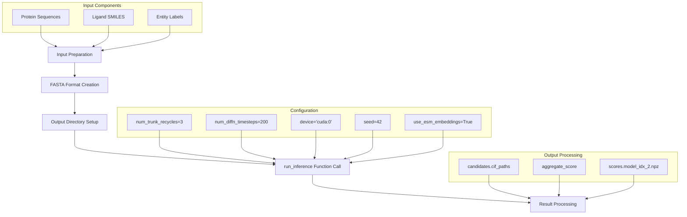
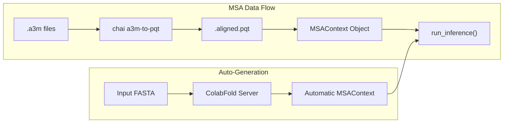
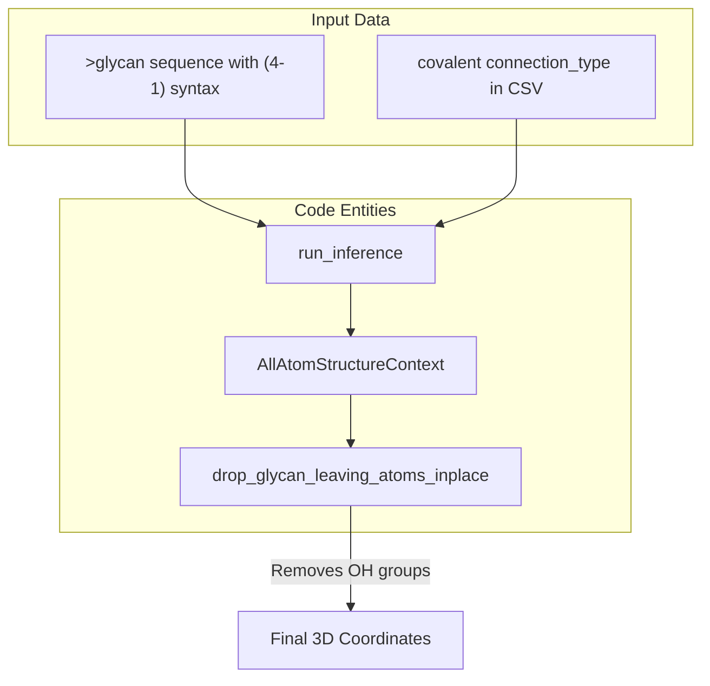

# Examples

Relevant source files

The following files were used as context for generating this wiki page:

- [examples/covalent_bonds/8cyo.fasta](examples/covalent_bonds/8cyo.fasta)
- [examples/covalent_bonds/8cyo.restraints](examples/covalent_bonds/8cyo.restraints)
- [examples/covalent_bonds/README.md](examples/covalent_bonds/README.md)
- [examples/covalent_bonds/non_glycan_output.png](examples/covalent_bonds/non_glycan_output.png)
- [examples/covalent_bonds/output.png](examples/covalent_bonds/output.png)
- [examples/covalent_bonds/predict_covalent_ligand.py](examples/covalent_bonds/predict_covalent_ligand.py)
- [examples/covalent_bonds/predict_glycosylated.py](examples/covalent_bonds/predict_glycosylated.py)
- [examples/msas/README.md](examples/msas/README.md)
- [examples/predict_structure.py](examples/predict_structure.py)
- [examples/restraints/README.md](examples/restraints/README.md)
- [examples/restraints/contact.restraints](examples/restraints/contact.restraints)
- [examples/restraints/pocket.restraints](examples/restraints/pocket.restraints)
- [examples/templates/predict_with_templates.py](examples/templates/predict_with_templates.py)

This document provides practical examples demonstrating various usage patterns and features of the chai-lab system. It covers the Python API for structure prediction, the use of Multiple Sequence Alignments (MSAs), structural templates, and advanced restraint mechanisms including covalent bonds.

## Basic Structure Prediction Workflow

The primary example demonstrates a complete structure prediction workflow using the `run_inference` function. This example shows the end-to-end process from input preparation to result analysis.

### Example Workflow Diagram

Sources: [examples/predict_structure.py:1-57]()

## MSA-Based Prediction

While Chai-1 performs well in single-sequence mode, evolutionary information via Multiple Sequence Alignments (MSAs) can significantly improve performance [examples/msas/README.md:1-3]().

### The `.aligned.pqt` Format
Chai-1 uses a custom Parquet-based format for MSAs which extends the standard `a3m` format with metadata required for featurization and multimer pairing [examples/msas/README.md:5-12]().

| Column | Description |
|---|---|
| `sequence` | Alignment hits in `a3m` format. |
| `source_database` | Origin database (`uniprot`, `uniref90`, `bfd_uniclust`, `mgnify`, or `query`). |
| `pairing_key` | String used to pair alignments across different chains (e.g., species ID). |
| `comment` | Metadata ignored by the model. |

Sources: [examples/msas/README.md:7-12]()

### MSA Implementation Pattern
Users can provide MSAs by pointing to a directory containing `<HASH>.aligned.pqt` files, where the hash corresponds to the unique chain sequence [examples/msas/README.md:33-35](). Alternatively, the system supports automatic generation via the ColabFold server [examples/msas/README.md:64-71]().

Sources: [examples/msas/README.md:27-35](), [examples/msas/README.md:64-71]()

## Restraints and Constraints

Chai-1 allows folding complexes with user-specified "restraints" to guide the model. These are provided as a `.csv` table specifying inter-chain contacts or pockets [examples/restraints/README.md:1-9]().

### Restraint Types
- **Contact**: A restraint between two specific residues in distinct chains (e.g., `A R84` to `C G7`) [examples/restraints/README.md:14-15]().
- **Pocket**: A coarser restraint where a specific residue in one chain is in contact with *any* residue in another chain [examples/restraints/README.md:16-17]().

### Restraint Data Mapping
Chains are identified alphabetically (A, B, C...) based on their order in the FASTA file. Residues are specified using a 1-indexed notation like `D4` (Aspartate at position 4) [examples/restraints/README.md:19-20]().

Sources: [examples/restraints/README.md:7-22](), [examples/restraints/contact.restraints:1-3](), [examples/restraints/pocket.restraints:1-4]()

## Covalent Bond Examples

Covalent bonds can be specified to model glycosylation or non-canonical linkages between ligands and proteins [examples/covalent_bonds/README.md:1-4]().

### Glycan Specification
Chai-1 uses a recursive parenthetical syntax in the FASTA file to define glycan branching and a restraints file to define the attachment point to the protein [examples/covalent_bonds/README.md:32-62]().

**Example Branched Glycan FASTA:**
`NAG(4-1 NAG(4-1 BMA(3-1 MAN)(6-1 MAN)))` [examples/covalent_bonds/README.md:60-61]()

### Bond Restraint Logic
The restraint file links specific atoms (e.g., `@N` on a protein residue to `@C1` on a glycan ring) [examples/covalent_bonds/README.md:27-29]().

Sources: [examples/covalent_bonds/README.md:25-29](), [examples/covalent_bonds/README.md:47-50](), [examples/covalent_bonds/README.md:76-78]()

### Non-Glycan Covalent Ligands
For ligands defined via SMILES, the user must provide a SMILES string *without* the leaving atoms and specify the bond in the restraints file [examples/covalent_bonds/README.md:70-78]().

**Example Restraint for Ligand Bond:**
`A,C217@SG,B,@S1,covalent,1.0,0.0,0.0,protein-ligand,bond1` [examples/covalent_bonds/8cyo.restraints:1-3]()

Sources: [examples/covalent_bonds/8cyo.fasta:1-4](), [examples/covalent_bonds/predict_covalent_ligand.py:16-25]()

---