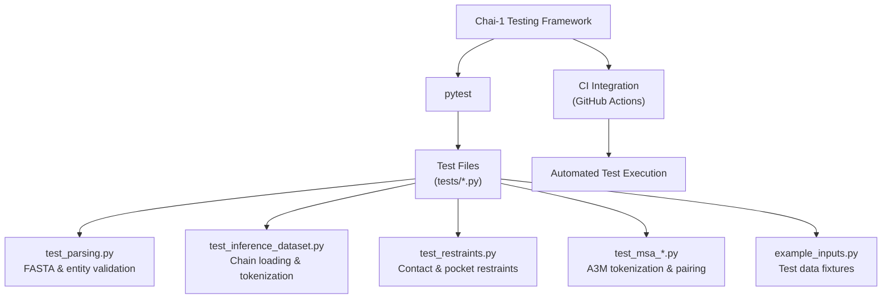
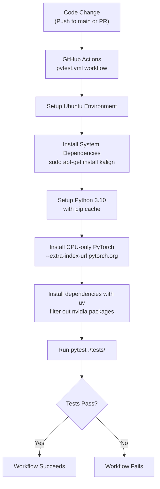

# Testing Framework

<details>
<summary>Relevant source files</summary>

The following files were used as context for generating this wiki page:

- [.github/workflows/pytest.yml](.github/workflows/pytest.yml)
- [chai_lab/data/dataset/inference_dataset.py](chai_lab/data/dataset/inference_dataset.py)
- [chai_lab/data/parsing/input_validation.py](chai_lab/data/parsing/input_validation.py)
- [tests/__init__.py](tests/__init__.py)
- [tests/example_inputs.py](tests/example_inputs.py)
- [tests/test_inference_dataset.py](tests/test_inference_dataset.py)
- [tests/test_kalign.py](tests/test_kalign.py)
- [tests/test_msa_a3m_tokenization.py](tests/test_msa_a3m_tokenization.py)
- [tests/test_msa_preprocess.py](tests/test_msa_preprocess.py)
- [tests/test_parsing.py](tests/test_parsing.py)
- [tests/test_restraints.py](tests/test_restraints.py)

</details>


This document outlines the testing infrastructure and practices used in the Chai-1 molecular structure prediction system. For information about the type system used in conjunction with testing, see [Type System](9.1).

## Overview

The Chai-1 codebase uses pytest as its primary testing framework to verify component functionality and ensure system reliability. Tests cover input parsing, molecular conformer generation, tool integration, dataset collation, and restraint handling. All tests are integrated into the development workflow through automated continuous integration processes.



Sources: [.github/workflows/pytest.yml:1-31](), [tests/test_parsing.py:1-80](), [tests/test_inference_dataset.py:1-124](), [tests/test_restraints.py:1-126]()

## Test Directory Structure

Tests are organized in the `tests/` directory at the repository root. The testing framework follows standard pytest conventions:

1. Test files follow the naming convention `test_*.py` for automatic discovery.
2. Each test file focuses on testing a specific component or module.
3. Test functions use the `test_` prefix naming convention.
4. Shared test data is organized in helper modules like `example_inputs.py` [tests/example_inputs.py:6-38]().

```mermaid
classDiagram
    class "tests/" {
        test_parsing.py
        test_inference_dataset.py
        test_restraints.py
        test_msa_a3m_tokenization.py
        example_inputs.py
    }
    
    class "test_parsing.py" {
        +test_simple_protein_fasta()
        +test_modified_protein_fasta()
        +test_parsing()
    }
    
    class "test_inference_dataset.py" {
        +test_malformed_smiles()
        +test_ions_parsing()
        +test_protein_with_smiles()
    }
    
    class "test_restraints.py" {
        +test_loading_restraints()
        +test_restraints_with_manual_chain_names()
    }
    
    "tests/" --> "test_parsing.py": contains
    "tests/" --> "test_inference_dataset.py": contains
    "tests/" --> "test_restraints.py": contains
    "test_parsing.py" --> "example_inputs.py": imports
```

Sources: [tests/test_parsing.py:1-80](), [tests/test_inference_dataset.py:1-124](), [tests/test_restraints.py:1-126](), [tests/example_inputs.py:1-38]()

## Continuous Integration

Tests run automatically via GitHub Actions as defined in the `pytest.yml` workflow configuration [.github/workflows/pytest.yml:1-31](). The CI pipeline is triggered on pushes to `main` and all pull requests.



### CI Configuration Details

| Configuration | Value | Purpose |
|---------------|-------|---------|
| Python Version | 3.10 | Ensures compatibility with minimum supported version [ .github/workflows/pytest.yml:19]() |
| PyTorch Version | CPU-only | Allows testing in GPU-free environments [.github/workflows/pytest.yml:24]() |
| Package Manager | uv | Fast dependency resolution and installation [.github/workflows/pytest.yml:24-26]() |
| System Dependencies | kalign | Required for sequence alignment tests [.github/workflows/pytest.yml:15]() |

Sources: [.github/workflows/pytest.yml:1-31]()

## Test Implementation Patterns

### Input Parsing and Entity Identification

The `test_parsing.py` module verifies that the system correctly identifies molecular types and parses FASTA headers.

- **Entity Types**: Validates `EntityType` identification for proteins, DNA, RNA, and ligands [tests/test_parsing.py:45-57]().
- **Modified Sequences**: Ensures `constituents_of_modified_fasta` correctly handles bracketed residues like `(KCJ)` or `(SEP)` [tests/test_parsing.py:24-28]().
- **SMILES**: Confirms FASTA-formatted SMILES strings are correctly read [tests/test_parsing.py:73-80]().

### Inference Dataset and Tokenization

The `test_inference_dataset.py` module tests the conversion of raw inputs into `Chain` objects and `AllAtomStructureContext`.

- **Malformed Inputs**: Verifies that malformed SMILES (e.g., "Zn" instead of "[Zn+2]") are dropped during chain loading [tests/test_inference_dataset.py:29-43]().
- **Ions**: Ensures ions like `[Mg+2]` carry the correct charge and atomic number (element 12) in the structure context [tests/test_inference_dataset.py:52-61]().
- **Merging**: Tests the `AllAtomStructureContext.merge` function to ensure multiple chains (proteins and ligands) are correctly combined into a single context [tests/test_inference_dataset.py:80-82]().

### Restraints and Feature Collation

The `test_restraints.py` module tests the end-to-end flow from restraint parsing to feature generation.

- **Chain Mapping**: `test_restraints_with_manual_chain_names` verifies that restraints are correctly mapped to tokens regardless of whether automatic (A, B, C) or manual subchain IDs are used [tests/test_restraints.py:49-126]().
- **Feature Generation**: It uses the `Collate` class and `chai1.feature_factory` to ensure that `TokenDistanceRestraint` and `TokenPairPocketRestraint` features are populated in the batch [tests/test_restraints.py:105-116]().

Sources: [tests/test_parsing.py:24-80](), [tests/test_inference_dataset.py:29-107](), [tests/test_restraints.py:49-126]()

## Running Tests Locally

To run tests locally, follow the setup pattern used in CI:

1. **Install system dependencies**:
   ```bash
   sudo apt-get install kalign  # On Ubuntu/Debian
   ```

2. **Install dependencies** (using `uv` for speed, as seen in CI):
   ```bash
   uv pip install -r requirements.in
   uv pip install -r requirements.dev
   uv pip install -e .
   ```

3. **Run pytest**:
   ```bash
   pytest ./tests/
   ```

### Targeted Testing

```bash
# Run specific test file
pytest tests/test_inference_dataset.py

# Run specific test function
pytest tests/test_inference_dataset.py::test_ions_parsing

# Run with verbose output
pytest ./tests/ -v
```

Sources: [.github/workflows/pytest.yml:22-30](), [tests/test_inference_dataset.py:52-61]()

## Key Test Components

| Component | Test File | Description |
|-----------|-----------|-------------|
| FASTA Parsing | `test_parsing.py` | Validates `read_fasta` and `constituents_of_modified_fasta` [tests/test_parsing.py:59-71](). |
| Dataset Loading | `test_inference_dataset.py` | Tests `load_chains_from_raw` and `AllAtomResidueTokenizer` [tests/test_inference_dataset.py:12-26](). |
| Restraints | `test_restraints.py` | Tests `parse_pairwise_table` and restraint feature mapping [tests/test_restraints.py:31-38](). |
| MSA Processing | `test_msa_a3m_tokenization.py` | Tests `tokenize_sequences_to_arrays` and insertion handling [tests/test_msa_a3m_tokenization.py:10-37](). |
| Alignment | `test_kalign.py` | Tests `kalign_query_to_reference` tool integration [tests/test_kalign.py:5-17](). |

Sources: [tests/test_parsing.py:1-80](), [tests/test_inference_dataset.py:1-124](), [tests/test_restraints.py:1-126](), [tests/test_msa_a3m_tokenization.py:1-37](), [tests/test_kalign.py:1-17]()

---