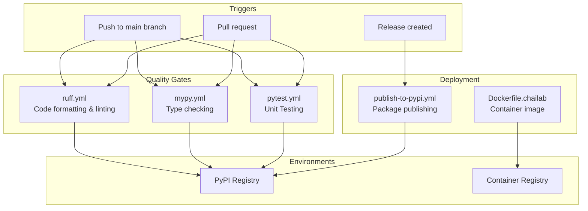
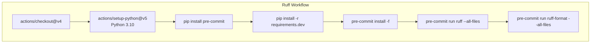
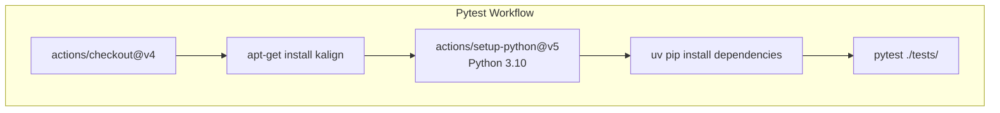
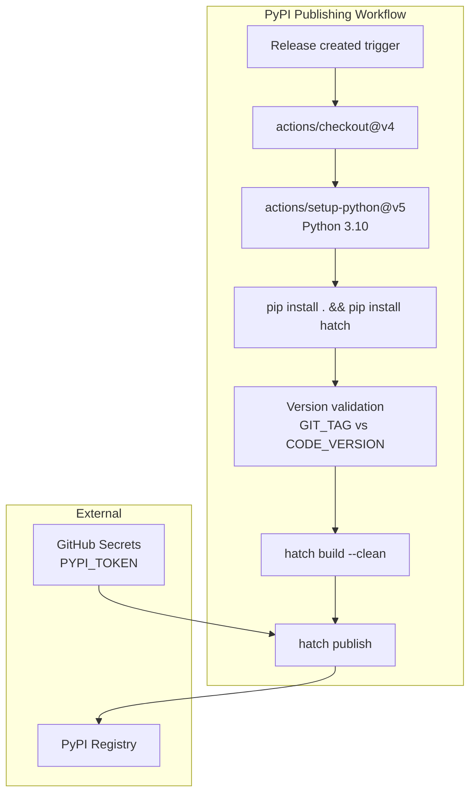
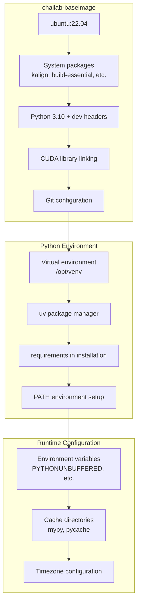
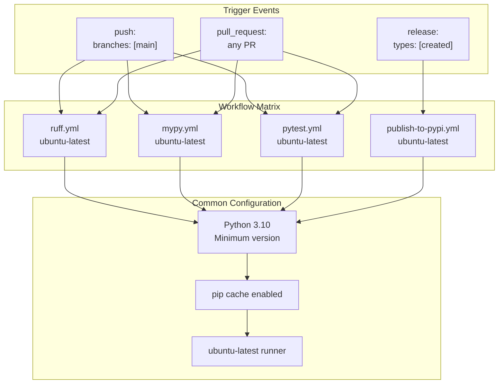

# CI/CD Pipeline

Relevant source files

The following files were used as context for generating this wiki page:

- [.github/workflows/mypy.yml](.github/workflows/mypy.yml)
- [.github/workflows/publish-to-pypi.yml](.github/workflows/publish-to-pypi.yml)
- [.github/workflows/pytest.yml](.github/workflows/pytest.yml)
- [.github/workflows/ruff.yml](.github/workflows/ruff.yml)
- [.pre-commit-config.yaml](.pre-commit-config.yaml)
- [Dockerfile.chailab](Dockerfile.chailab)
- [pyproject.toml](pyproject.toml)
- [tests/test_kalign.py](tests/test_kalign.py)

This document describes the continuous integration and continuous deployment (CI/CD) infrastructure for the chai-lab repository. The CI/CD pipeline ensures code quality, type safety, and automated deployment through GitHub Actions workflows and Docker containerization.

For information about the testing framework that integrates with these CI/CD processes, see [Testing Framework](#9.2).

## Pipeline Overview

The chai-lab CI/CD pipeline consists of five main components: code quality checks, type checking, automated unit testing, automated PyPI publishing, and Docker containerization. All workflows are triggered by pushes to the main branch and pull requests.

**CI/CD Pipeline Architecture**

Sources: [.github/workflows/ruff.yml](), [.github/workflows/mypy.yml](), [.github/workflows/pytest.yml](), [.github/workflows/publish-to-pypi.yml](), [Dockerfile.chailab]()

## Code Quality Checks

The `ruff` workflow enforces code formatting and linting standards across the entire codebase. It runs on every push to main and every pull request using pre-commit hooks.

**Ruff Workflow Process**

The workflow executes the following key steps:

| Step | Command | Purpose |
|------|---------|---------|
| Setup | `pip install pre-commit` | Install pre-commit framework |
| Dependencies | `pip install -r requirements.dev` | Install development dependencies |
| Configuration | `pre-commit install -f` | Configure pre-commit hooks |
| Linting | `pre-commit run ruff --all-files` | Run code linting checks via `ruff` |
| Formatting | `pre-commit run ruff-format --all-files` | Verify code formatting via `ruff-format` |

Sources: [.github/workflows/ruff.yml:20-28](), [.pre-commit-config.yaml:3-10]()

## Type Checking

The `mypy` workflow performs static type checking to ensure type safety across the codebase. It installs dependencies efficiently by separating PyTorch installation from other requirements and uses `uv` for speed.

**MyPy Workflow Process**

```mermaid
flowchart TD
    subgraph "mypy_workflow" ["MyPy Workflow"]
        Checkout["actions/checkout@v4"]
        SetupPython["actions/setup-python@v5<br/>Python 3.10"]
        InstallTorch["pip install torch (CPU-only)"]
        InstallUV["pip install uv"]
        InstallRequirements["uv pip install requirements"]
        InstallDevRequirements["uv pip install requirements.dev"]
        InstallPackage["uv pip install --no-deps -e ."]
        RunMypy["mypy ."]
    end
    
    Checkout --> SetupPython
    SetupPython --> InstallTorch
    InstallTorch --> InstallUV
    InstallUV --> InstallRequirements
    InstallRequirements --> InstallDevRequirements
    InstallDevRequirements --> InstallPackage
    InstallPackage --> RunMypy
```

The workflow uses a sophisticated dependency installation strategy:

- **PyTorch CPU-only**: [.github/workflows/mypy.yml:23]() installs PyTorch from the CPU-only index to avoid large GPU dependencies.
- **Filtered requirements**: [.github/workflows/mypy.yml:25]() excludes `nvidia` and `torch` packages during main installation to optimize runner time.
- **Mypy Configuration**: Mypy is configured in `pyproject.toml` to check untyped definitions [.tool.mypy:26]() and ignore missing imports for specific external packages like `rdkit`, `scipy`, and `modelcif` [.tool.mypy:29-51]().

Sources: [.github/workflows/mypy.yml:21-29](), [pyproject.toml:25-51]()

## Automated Testing

The `pytest` workflow ensures functional correctness by running the test suite on every change.

**Pytest Workflow Process**

The workflow specifically installs `kalign` [.github/workflows/pytest.yml:15](), which is required for structural template alignment tests like `test_all_matches` in `tests/test_kalign.py` [tests/test_kalign.py:8-17]().

Sources: [.github/workflows/pytest.yml:10-30](), [tests/test_kalign.py:1-17]()

## Release Pipeline

The PyPI publishing workflow automatically deploys new versions when GitHub releases are created. It includes version validation to ensure consistency between git tags and package versions.

**PyPI Publishing Workflow**

The version validation process [.github/workflows/publish-to-pypi.yml:22-29]() ensures that:
- `GIT_TAG` matches the git tag from the release.
- `CODE_VERSION` matches the version defined in `chai_lab/__init__.py` (managed by `hatch version` [.tool.hatch.version:19]()).
- The workflow fails if versions don't match.

Authentication uses the `PYPI_TOKEN` secret with the `__token__` username [.github/workflows/publish-to-pypi.yml:32-33]().

Sources: [.github/workflows/publish-to-pypi.yml:1-35](), [pyproject.toml:18-19]()

## Containerization

The Docker configuration provides a complete runtime environment for chai-lab with all necessary dependencies and system tools.

**Docker Build Architecture**

Key Docker configuration elements:

| Component | Configuration | Purpose |
|-----------|---------------|---------|
| Base Image | `ubuntu:22.04` | Stable Linux foundation |
| Python | `python3.10` + `python3.10-dev` | Runtime and development headers |
| Package Manager | `uv` | Fast Python package installation |
| Virtual Environment | `/opt/venv` | Isolated Python environment |
| System Tools | `kalign`, `build-essential` | Template alignment and compilation |
| CUDA | Soft-linked libraries | GPU computation support |

Environment variables are configured for optimal Python execution:
- `PYTHONUNBUFFERED=TRUE` [Dockerfile.chailab:13]() for immediate output.
- `PYTHONFAULTHANDLER=1` [Dockerfile.chailab:15]() for better debugging of segfaults.
- `PYTHONPYCACHEPREFIX='/tmp/.chai_lab_pycache'` [Dockerfile.chailab:17]() for clean cache management.
- `MYPY_CACHE_DIR='/tmp/.chai_lab_mypy_cache'` [Dockerfile.chailab:11]() to keep the working tree clean.

Sources: [Dockerfile.chailab:1-85]()

## Workflow Triggers and Conditions

All CI/CD workflows share consistent trigger patterns and Python version requirements:

**Trigger Configuration**

All workflows use Python 3.10 as the minimum version [.github/workflows/ruff.yml:18](), [.github/workflows/mypy.yml:18](), [.github/workflows/publish-to-pypi.yml:18]() with the rationale that "later versions should maintain backwards-compatibility" [.github/workflows/publish-to-pypi.yml:17]().

The `pip` cache is enabled in development workflows [.github/workflows/ruff.yml:19](), [.github/workflows/mypy.yml:19]() to speed up dependency installation during CI runs.

Sources: [.github/workflows/ruff.yml:2-8](), [.github/workflows/mypy.yml:2-8](), [.github/workflows/pytest.yml:2-8](), [.github/workflows/publish-to-pypi.yml:3-5]()

---