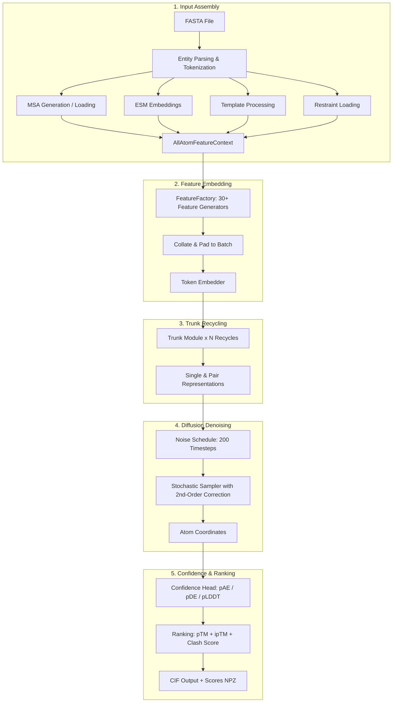

**Chai-1** is a multi-modal foundation model for molecular structure prediction that achieves state-of-the-art performance across a variety of benchmarks. Developed by Chai Discovery and released under the Apache 2.0 license, Chai-1 enables unified prediction of proteins, small molecules, DNA, RNA, glycosylations, and their complexes — all from a single inference pipeline. Whether you are predicting a monomeric protein, a multi-chain protein-ligand complex, or a glycosylated antibody, Chai-1 treats every entity through a consistent input format and a shared architectural backbone.


For full benchmark details, see the [technical report](https://www.biorxiv.org/content/10.1101/2024.10.10.615955).

Sources: [README.md](/README.md#L1-L10), [chai_lab/__init__.py](/chai_lab/__init__.py#L4-L5)

## What Chai-1 Can Predict

Chai-1 accepts a FASTA-like input format where each entity is labeled with a type and a unique name. The model handles six distinct entity types through a single unified entry point, meaning you do not need separate tools or workflows for different molecular species.

| Entity Type | Input Format | Example |
|---|---|---|
| **Protein** | Amino acid sequence (1-letter code) | `AGSHSMRYFSTSVSRPGRGE...` |
| **DNA** | Nucleotide sequence (A/T/G/C) | `ATGCGATC` |
| **RNA** | Nucleotide sequence (A/U/G/C) | `AUGCGAUC` |
| **Ligand** | SMILES string | `CCCCCCCCCCCCCC(=O)O` |
| **Glycan** | Glycan string (monosaccharide notation) | `Man(a1-2)Man(a1-...)` |
| **Modified Residue** | Embedded in sequence as `AAA(MOD)AAA` | `AAA(SEP)AAA` |

The FASTA header syntax uses the pattern `>type|name=identifier` to declare each entity. This convention is parsed by the input validation layer and routed to the appropriate residue tokenizer, enabling a single FASTA file to describe arbitrarily complex multi-modal complexes.

Sources: [examples/predict_structure.py](/examples/predict_structure.py#L17-L31), [chai_lab/data/parsing/structure/entity_type.py](/chai_lab/data/parsing/structure/entity_type.py#L10-L18), [chai_lab/data/dataset/inference_dataset.py](/chai_lab/data/dataset/inference_dataset.py#L94-L128)

## Architecture at a Glance

Chai-1's inference pipeline follows a four-stage architecture: **Input Assembly → Feature Embedding → Trunk Recycling → Diffusion Denoising**, followed by confidence prediction and structure ranking. Each stage is modular and operates on well-defined data structures, making the system both extensible and debuggable.



The central data structure flowing through the pipeline is the **`AllAtomFeatureContext`**, which bundles structure context, MSA context, template context, embedding context, and restraint context into a single object. This context is padded, collated into a batch, and then transformed by a `FeatureFactory` that orchestrates over 30 feature generators — from residue type one-hot encodings to blocked atom-pair distograms.

Sources: [chai_lab/chai1.py](/chai_lab/chai1.py#L100-L162), [chai_lab/data/dataset/all_atom_feature_context.py](/chai_lab/data/dataset/all_atom_feature_context.py#L15-L43), [chai_lab/data/collate/collate.py](/chai_lab/data/collate/collate.py#L24-L97)

## Project Structure

The codebase is organized into five core subsystems under `chai_lab/`, plus examples and tests. Understanding this layout is essential for navigating the deeper documentation pages.

```
chai_lab/
├── chai1.py                 # Main inference entry point & orchestration
├── main.py                  # CLI interface (typer-based)
├── __init__.py              # Package version
├── data/                    # Input parsing, feature generation, collation
│   ├── collate/             #   Batch collation & padding
│   ├── dataset/             #   Feature contexts, MSA, embeddings, templates
│   ├── features/            #   FeatureFactory & 30+ feature generators
│   ├── io/                  #   CIF/PDB I/O utilities
│   ├── parsing/             #   FASTA, restraint, glycan, MSA parsers
│   └── sources/             #   RDKit conformer generation
├── model/                   #   Noise schedules & model utilities
├── ranking/                 #   pTM, pLDDT, clash scoring, ranking
├── tools/                   #   Kalign wrapper, rigid transform utilities
└── utils/                   #   Paths, tensor ops, typing, defaults
```

> [!TIP]
> The `chai1.py` file is the single most important file to understand — it contains both the high-level `run_inference` function (which assembles inputs and loops over trunk samples) and the low-level `run_folding_on_context` function (which executes the core model forward pass through embedding, trunk, diffusion, and confidence stages).

Sources: [chai_lab/chai1.py](/chai_lab/chai1.py#L1-L30), [chai_lab/main.py](/chai_lab/main.py#L1-L49)

## Two Ways to Run Inference

Chai-1 exposes two interfaces for running structure prediction, suited to different levels of customization.

### Command Line Interface

The simplest way to fold a complex is through the `chai-lab fold` command, which is registered as a console script entry point. It accepts a FASTA file and an output directory, with optional flags for MSA generation, template search, and restraints.

```shell
# Basic usage (no MSA, no templates)
chai-lab fold input.fasta output_folder

# With MSA and template server (recommended for best performance)
chai-lab fold --use-msa-server --use-templates-server input.fasta output_folder
```

### Python API

For programmatic control, the `chai_lab.chai1.run_inference` function provides the same functionality with full parameter access. For even deeper control — such as manually constructing an `AllAtomFeatureContext` with custom MSAs, embeddings, or covalent bond specifications — use `chai_lab.chai1.run_folding_on_context`.

```python
from chai_lab.chai1 import run_inference
candidates = run_inference(
    fasta_file=fasta_path,
    output_dir=output_dir,
    num_trunk_recycles=3,
    num_diffn_timesteps=200,
    num_diffn_samples=5,
    use_esm_embeddings=True,
)
```

| Interface | Entry Point | Best For |
|---|---|---|
| CLI | `chai-lab fold` | Quick predictions, scripting, batch jobs |
| Python `run_inference` | `chai_lab.chai1.run_inference` | Programmatic pipelines, parameter sweeps |
| Python `run_folding_on_context` | `chai_lab.chai1.run_folding_on_context` | Custom feature contexts, advanced research |

Sources: [chai_lab/main.py](/chai_lab/main.py#L29-L36), [chai_lab/chai1.py](/chai_lab/chai1.py#L397-L451), [examples/predict_structure.py](/examples/predict_structure.py#L38-L51)

## Key Configuration Parameters

The inference pipeline exposes several parameters that control the quality–speed tradeoff and the richness of input data.

| Parameter | Default | Description |
|---|---|---|
| `num_trunk_recycles` | 3 | Number of times trunk representations are recycled; more recycles improve quality at linear cost |
| `num_diffn_timesteps` | 200 | Denoising timesteps in the diffusion module; fewer steps = faster but lower quality |
| `num_diffn_samples` | 5 | Number of independent structure samples; the best-ranked sample is typically selected |
| `use_esm_embeddings` | True | Use ESM-2 protein language model embeddings as input features |
| `use_msa_server` | False | Query ColabFold MMseqs2 server for MSA generation |
| `use_templates_server` | False | Query server for structural template hits |
| `low_memory` | True | Move model components to CPU between forward passes to reduce GPU memory |

> [!TIP]
> For the best prediction quality, enable both `--use-msa-server` and `--use-templates-server`. The default configuration (ESM embeddings only, no MSA) is optimized for speed and works well for many cases, but MSA and template information substantially improve accuracy for protein complexes.

Sources: [chai_lab/chai1.py](/chai_lab/chai1.py#L397-L427), [README.md](/README.md#L24-L38)

## Output Artifacts

Each inference run produces a set of output files in the specified directory. For every diffusion sample (indexed 0 through `num_diffn_samples - 1`), the pipeline writes:

| File | Contents |
|---|---|
| `pred.model_idx_N.cif` | Predicted 3D structure in CIF format with pLDDT B-factors (0–100 scale) |
| `scores.model_idx_N.npz` | NumPy archive with `aggregate_score`, `ptm`, `iptm`, `per_chain_ptm`, `per_chain_pair_iptm`, `has_inter_chain_clashes`, `chain_chain_clashes` |
| `msa_depth.pdf` | MSA coverage plot (only if MSA data was provided) |

The **aggregate ranking score** combines interface pTM (80% weight), complex pTM (20% weight), and a clash penalty: `0.8 * ipTM + 0.2 * pTM - 100 * has_clashes`. The `StructureCandidates` object returned by the Python API also provides direct access to per-token pLDDT, per-pair pAE, and per-pair pDE tensors.

Sources: [chai_lab/chai1.py](/chai_lab/chai1.py#L238-L268), [chai_lab/ranking/rank.py](/chai_lab/ranking/rank.py#L93-L109), [chai_lab/chai1.py](/chai_lab/chai1.py#L966-L1014)

## Unique Capability: Experimental Restraints

Chai-1 uniquely supports **user-specified restraints** as inputs to guide folding. These include contact restraints (specifying which residues should be near each other), pocket restraints (constraining a ligand's binding site), and covalent bond restraints (for ligands with covalent attachments or glycosylated proteins). Restraints are specified in a `.restraints` file and passed via the `--constraint` CLI flag or `constraint_path` Python parameter.


Sources: [README.md](/README.md#L91-L94), [chai_lab/chai1.py](/chai_lab/chai1.py#L443-L472)

## Try It Online

No GPU? No problem. Chai Discovery hosts a [web server](https://lab.chaidiscovery.com) where you can test Chai-1 directly from your browser — including support for restraints — without any local installation.


Sources: [README.md](/README.md#L84-L87)

## System Requirements

| Requirement | Details |
|---|---|
| **OS** | Linux |
| **Python** | 3.10 or later |
| **GPU** | CUDA with bfloat16 support |
| **Recommended GPUs** | A100 80GB, H100 80GB, L40S 48GB |
| **Works for smaller complexes** | A10, A30, RTX 4090 |
| **License** | Apache 2.0 (code + model weights; commercial use permitted) |

Sources: [README.md](/README.md#L17-L20), [README.md](/README.md#L164-L170)

## Where to Go Next

Now that you have a high-level understanding of Chai-1's purpose and architecture, follow this reading path to go deeper:

1. **[Quick Start](2-quick-start)** — Get Chai-1 installed and running your first prediction in minutes
2. **[CLI Reference](3-cli-reference)** — Complete command-line flags and options
3. **[Architecture Overview](7-architecture-overview)** — Detailed breakdown of the inference pipeline stages
4. **[FASTA Parsing and Entity Types](13-fasta-parsing-and-entity-types)** — How inputs are parsed and validated
5. **[Structure Ranking and Scoring](21-structure-ranking-and-scoring)** — How predictions are evaluated and ranked