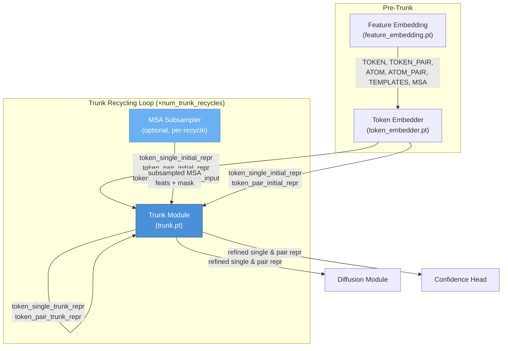
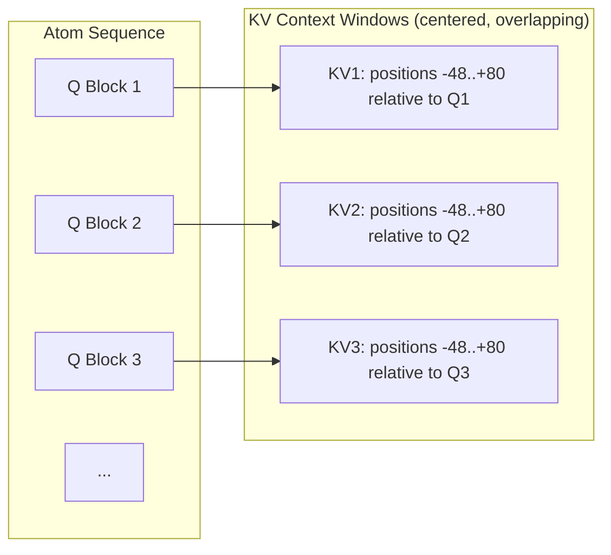
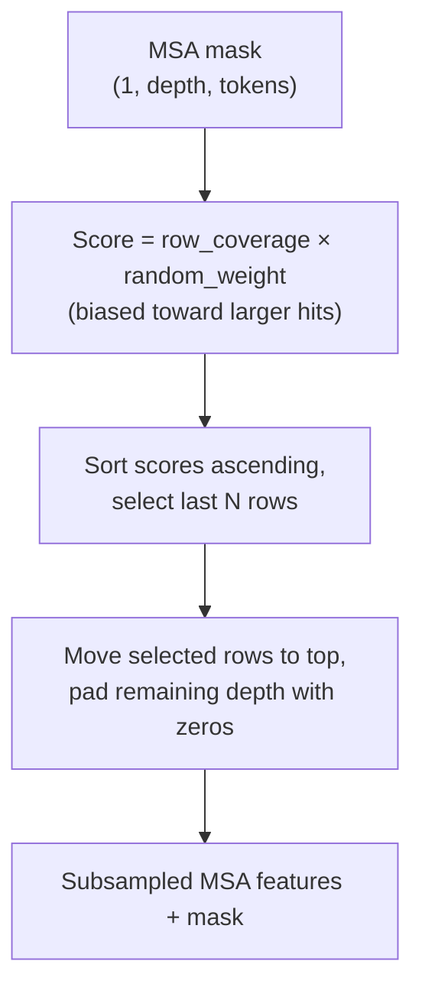

The trunk is the iterative reasoning core of Chai-1's inference pipeline — a module that refines token-level single and pair representations through repeated passes, each enriched by MSA, template, and recycled prior-state information. This page examines the recycling loop mechanics, the blocked local attention pattern that governs atom-pair interactions, and the MSA subsampling strategy that stabilizes later recycles. Understanding this stage is essential because the quality of trunk outputs directly determines the fidelity of the downstream diffusion denoising and confidence prediction.

## Architectural Position of the Trunk

The trunk occupies the central position in Chai-1's three-stage inference pipeline: feature embedding → token embedding → **trunk recycling** → diffusion denoising. It receives four categories of input: (1) initial single and pair token representations from the token embedder, (2) recycled single and pair representations from the previous trunk pass, (3) MSA and template features, and (4) token-level masks. Its outputs — refined `token_single_trunk_repr` and `token_pair_trunk_repr` — are consumed by both the diffusion module and the confidence head.



The initial representations serve as a fixed reference across all recycles, while the recycled representations evolve with each iteration. This dual-input design — constant anchor plus mutable state — prevents representation drift while allowing iterative refinement.

Sources: [chai1.py](/chai_lab/chai1.py#L708-L746), [chai1.py](/chai_lab/chai1.py#L689-L706)

## The Recycling Loop

The recycling loop is the trunk's defining mechanism. On each iteration, the trunk module receives both the **initial** representations (immutable across recycles) and the **current** recycled representations (output of the previous pass). The loop executes `num_trunk_recycles` times (default: 3), and the recycled representations are initialized to the initial representations before the first iteration.

The core loop is straightforward in structure but critical in effect:

```python
token_single_trunk_repr = token_single_initial_repr
token_pair_trunk_repr = token_pair_initial_repr
for _ in range(num_trunk_recycles):
    # Optional: subsample MSA for this recycle
    subsampled_msa_input_feats, subsampled_msa_mask = None, None
    if recycle_msa_subsample > 0:
        subsampled_msa_input_feats, subsampled_msa_mask = (
            subsample_and_reorder_msa_feats_n_mask(msa_input_feats, msa_mask)
        )
    # Run trunk with both initial and recycled representations
    (token_single_trunk_repr, token_pair_trunk_repr) = trunk.forward(
        token_single_trunk_initial_repr=token_single_initial_repr,
        token_pair_trunk_initial_repr=token_pair_initial_repr,
        token_single_trunk_repr=token_single_trunk_repr,  # recycled
        token_pair_trunk_repr=token_pair_trunk_repr,  # recycled
        msa_input_feats=...,
        msa_mask=...,
        template_input_feats=template_input_feats,
        template_input_masks=template_input_masks,
        ...
    )
```

> [!TIP]
> The trunk's dual-input convention — separate `initial` and `recycled` representation arguments — is architecturally significant. The initial representations anchor the model to its first-pass understanding, preventing runaway drift across recycles. The recycled representations carry cumulative refinements. When debugging trunk behavior, inspect both streams independently: if the recycled stream diverges significantly from the initial stream after early recycles, it may indicate unstable attention patterns or excessive MSA noise.

| Parameter | Default | Role |
|---|---|---|
| `num_trunk_recycles` | 3 | Number of iterative trunk passes; more recycles improve quality at linear compute cost |
| `num_trunk_samples` | 1 | Number of independent trunk samples (each with full recycle loop); multiple samples capture stochastic variation |
| `recycle_msa_subsample` | 0 | When > 0, stochastically subsample MSA rows to this depth per recycle; 0 disables subsampling |

Sources: [chai1.py](/chai_lab/chai1.py#L708-L746), [chai1.py](/chai_lab/chai1.py#L478-L484)

## Blocked Local Attention for Atom Pairs

Chai-1 employs a **blocked local attention** pattern for atom-pair interactions, avoiding the quadratic cost of full atom-pair attention. The mechanism is governed by two structural parameters: `num_key_atoms=128` (KV block size) and `num_query_atoms=32` (query stride), configured during collation.

### Block Index Computation

The function `get_qkv_indices_for_blocks` partitions the atom sequence into non-overlapping query blocks of size `stride` (32), each attending to a centered local KV block of size `kv_block_size` (128). For a query block starting at position `q_start`, the KV block spans from `q_start + (stride - kv_block_size) // 2` to `q_start + (stride - kv_block_size) // 2 + kv_block_size`. Given stride=32 and kv_block_size=128, this offset is `(32 - 128) // 2 = -48`, meaning each query block's KV context extends 48 positions before and 80 positions after the query block's start — a heavily backward-biased local window that prioritizes upstream structural context.



### Boundary Handling

When the centered KV block extends beyond sequence boundaries (near the start or end of the atom sequence), the implementation uses modular wrapping (`kv_indices % sequence_length`) combined with a **wrapping mask** that nullifies out-of-bounds positions. This ensures that (a) index computation never fails, and (b) attention weights never attend to wrapped-around atoms, preserving the local attention semantics.

```python
# Mask out positions where kv_indices gets wrapped
kv_mask = (kv_indices < sequence_length) & (kv_indices >= 0)
kv_indices = kv_indices % sequence_length  # Safe indexing, masked later
```

The block atom-pair mask is then computed as the logical AND of the query-side atom mask, the KV-side atom mask, and the wrapping validity mask, producing a `Bool[Tensor, "b bl bl_q bl_kv"]` tensor that gates attention computation.

> [!TIP]
> The 128/32 KV/Q ratio means each query atom attends to 128 local key atoms with 4:1 compression. This is not merely a memory optimization — the local window encodes an inductive bias that structural interactions are spatially local at the atom level, which is consistent with the physics of interatomic forces. When adapting the model to unusually long-range interaction scenarios, consider that the 128-atom KV window covers roughly 5–6 residues of backbone context.

Sources: [utils.py](/chai_lab/model/utils.py#L14-L57), [collate.py](/chai_lab/data/collate/collate.py#L64-L85)

## MSA Subsampling During Recycling

When `recycle_msa_subsample > 0`, each trunk recycle applies stochastic MSA row subsampling. This serves two purposes: (1) it reduces memory and compute for deep MSAs, and (2) it introduces controlled stochasticity that can improve generalization across recycles by presenting different evolutionary information at each pass.

### Subsampling Algorithm

The subsampling function `_subsample_msa_rows` selects `select_n_rows` rows from the MSA using a **size-biased random scoring** strategy. Each MSA row receives a score equal to its non-padding residue count multiplied by a random weight, and the top-scoring rows are selected. This biases selection toward larger, more informative MSA hits while maintaining stochastic diversity.



After selection, the MSA features are reordered so selected rows appear first, while the mask is truncated and zero-padded to maintain the original depth dimension. A critical invariant: every selected row must have nonzero coverage — empty rows are never sampled.

| Aspect | Behavior |
|---|---|
| Selection bias | Larger MSA hits (more non-padding residues) are preferentially selected |
| Ordering | Selected rows maintain their original relative order |
| Padding | Mask is zero-padded to original depth; features retain full depth with unselected rows shifted to the end |
| Default depth | `select_n_rows = 4096` when enabled |
| Inactive when | Input MSA depth ≤ `select_n_rows`, or `recycle_msa_subsample = 0` |

Sources: [utils.py](/chai_lab/data/dataset/msas/utils.py#L11-L87), [chai1.py](/chai_lab/chai1.py#L714-L722)

## Model Size Gating and Static Graph Export

The trunk (along with all other exported modules) is compiled as a **TorchScript static graph** for specific token counts. The available model sizes are `[256, 384, 512, 768, 1024, 1536, 2048]`, and inputs are padded to the nearest size during collation. The trunk's forward method is dispatched via `forward_{crop_size}`, meaning each model size has its own compiled graph.

This design has a direct consequence for the trunk's attention patterns: the blocked local attention indices are pre-computed during collation (not inside the trunk itself), and the specific block structure depends on the padded sequence length. The `get_qkv_indices_for_blocks` function requires that the sequence length be exactly divisible by the query stride (32), which is guaranteed by the padding strategy.

| Model Size | Max Tokens | Max Atoms (23×tokens) |
|---|---|---|
| 256 | 256 | 5,888 |
| 384 | 384 | 8,832 |
| 512 | 512 | 11,776 |
| 768 | 768 | 17,664 |
| 1024 | 1,024 | 23,552 |
| 1536 | 1,536 | 35,328 |
| 2048 | 2,048 | 47,104 |

Sources: [utils.py](/chai_lab/data/collate/utils.py#L11-L40), [chai1.py](/chai_lab/chai1.py#L678-L685)

## Device Management and Memory Strategy

The trunk module uses the `_component_moved_to` context manager for transient device placement. Within each recycle iteration, the trunk module is moved to the compute device (typically CUDA), the forward pass executes, and then the module is moved back to CPU. This pattern is critical for the `low_memory=True` inference mode, where only one model component resides on GPU at any time.

The recycling loop itself operates on CPU-resident representations when `low_memory=True` — the `move_to_device` parameter inside `trunk.forward()` handles the transient GPU transfer of input tensors, and `return_on_cpu` ensures outputs come back to CPU. After all recycles complete, `torch.cuda.empty_cache()` is called explicitly to release fragmented GPU memory before the diffusion stage begins.

Sources: [chai1.py](/chai_lab/chai1.py#L60-L78), [chai1.py](/chai_lab/chai1.py#L748-L749)

## Data Flow Summary

The following table traces the complete tensor lifecycle through the trunk recycling stage, from token embedder output to diffusion module input:

| Tensor | Shape Pattern | Origin | Destination |
|---|---|---|---|
| `token_single_initial_repr` | `(1, n_tokens, d_single)` | Token embedder | Trunk (constant across recycles) + Diffusion + Confidence |
| `token_pair_initial_repr` | `(1, n_tokens, n_tokens, d_pair)` | Token embedder | Trunk (constant across recycles) |
| `token_single_trunk_repr` | `(1, n_tokens, d_single)` | Initialized from initial, updated each recycle | Trunk (recycled) → Diffusion + Confidence |
| `token_pair_trunk_repr` | `(1, n_tokens, n_tokens, d_pair)` | Initialized from initial, updated each recycle | Trunk (recycled) → Diffusion + Confidence |
| `msa_input_feats` | `(1, depth, n_tokens, d_msa)` | Feature embedding | Trunk (optionally subsampled per recycle) |
| `template_input_feats` | `(1, n_templates, n_tokens, d_template)` | Feature embedding | Trunk (constant across recycles) |
| `block_atom_pair_mask` | `(1, n_blocks, 32, 128)` | Collation | Trunk (pre-computed, constant) |

After the recycling loop concludes, the trunk's output representations are split into two streams: the `token_single_trunk_repr` and `token_pair_trunk_repr` flow into the diffusion module alongside the structure-specific input projections (`token_single_structure_input`, `token_pair_structure_input_feats`), while the same trunk representations also feed the confidence head. This bifurcation means the trunk must produce representations that serve both coordinate generation and quality estimation — a dual objective that recycling helps to satisfy.

Sources: [chai1.py](/chai_lab/chai1.py#L689-L746), [chai1.py](/chai_lab/chai1.py#L752-L775)

## What Comes Next

With the trunk's refined representations in hand, the pipeline proceeds to stochastic structure generation. The [Diffusion Denoising Process](11-diffusion-denoising-process) page details how these representations guide the iterative denoising of atom coordinates from Gaussian noise. For the memory implications of running multiple trunk samples and diffusion steps, see [Memory Management and Device Strategy](24-memory-management-and-device-strategy). The noise schedule governing the diffusion process is covered in [Diffusion Noise Schedule](25-diffusion-noise-schedule).