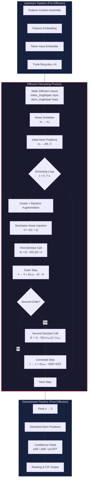
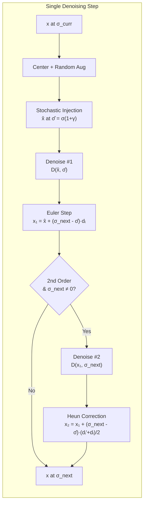

The diffusion denoising process is the generative core of Chai-1: it transforms pure noise into physically plausible all-atom 3D coordinates. Unlike autoregressive or VAE-based structure generation, Chai-1 adopts a **score-based diffusion framework** rooted in the Elucidating the Design Space (EDM) methodology of Karras et al., implementing a stochastic sampler with optional second-order correction. The process takes the trunk's learned representations—token-level single and pair features—and iteratively refines a noisy atom coordinate field across hundreds of timestep steps, ultimately producing multiple independent structure samples ranked by a downstream confidence head.

## Architecture Context: Where Diffusion Fits

The diffusion module sits at the terminal position of the inference pipeline, consuming the fused output of the trunk recycles. Before a single denoising step executes, the model has already assembled features, embedded tokens, and recycled the trunk representations. The diffusion module is the **only stage that directly produces atom coordinates**, making it the singular generative bottleneck in the entire architecture.



Sources: [chai1.py](chai_lab/chai1.py#L782-L888), [diffusion_schedules.py](chai_lab/model/diffusion_schedules.py#L1-L49)

## Static Diffusion Inputs: The Condition Field

Before the iterative denoising loop begins, Chai-1 assembles a **frozen condition dictionary** called `static_diffusion_inputs`. This dictionary remains constant across all denoising timesteps and all diffusion samples—it is the structural context the denoiser conditions on. The inputs bifurcate along two axes: **structure-specific pathways** (used exclusively by the diffusion module) and **shared representations** (originating from the trunk's recycled output).

| Input Key | Source | Shape Pattern | Role |
|---|---|---|---|
| `token_single_initial_repr` | Token embedder (structure split) | `(1, N_tokens, D)` | Per-token identity prior before trunk |
| `token_pair_initial_repr` | Feature embedder (structure split) | `(1, N_tokens, N_tokens, D)` | Pairwise geometric prior |
| `token_single_trunk_repr` | Trunk output (after recycles) | `(1, N_tokens, D)` | Refined single representation |
| `token_pair_trunk_repr` | Trunk output (after recycles) | `(1, N_tokens, N_tokens, D)` | Refined pair representation |
| `atom_single_input_feats` | Feature embedder (structure split) | `(1, N_atoms, D)` | Per-atom conditioning features |
| `atom_block_pair_input_feats` | Feature embedder (structure split) | `(1, N_blocks, N_q, N_kv, D)` | Local block atom-pair features |
| `atom_single_mask` | Input collation | `(1, N_atoms)` | Valid atom mask |
| `atom_block_pair_mask` | Block pair computation | `(1, N_blocks, N_q, N_kv)` | Valid block-pair mask |
| `token_single_mask` | Input collation | `(1, N_tokens)` | Valid token mask |
| `block_indices_h/w` | Block index computation | `(N_blocks, N_q/kv)` | Attention block indices |
| `atom_token_indices` | Input collation | `(1, N_atoms)` | Atom-to-token mapping |

A critical architectural detail: the feature embedding output is **split in half** along the channel dimension. One half feeds the trunk pathway (`token_pair_input_feats`, `atom_single_input_feats`); the other half feeds the structure/diffusion pathway (`token_pair_structure_input_feats`, `atom_single_structure_input_feats`). This partition ensures the diffusion module receives a dedicated feature channel that the trunk does not overwrite during recycling, preserving a clean information pathway from raw features to coordinate generation.

Sources: [chai1.py](chai_lab/chai1.py#L688-L716), [chai1.py](chai_lab/chai1.py#L788-L804)

## Noise Schedule: Power-Law Sigma Trajectory

The denoising trajectory is governed by a **sigma schedule**—a monotonically decreasing sequence of noise levels that the sampler traverses from high noise (pure chaos) to near-zero noise (clean structure). Chai-1 implements this via `InferenceNoiseSchedule`, which produces sigma values through a **power-law interpolation** between `s_max` and `s_min`.

The interpolation formula is:

```
σ(t) = σ_data · [ t · s_min^(1/p) + (1-t) · s_max^(1/p) ]^p
```

where `t ∈ [0, 1]` is the normalized timestep, `p = 7.0` controls the curvature, and `σ_data = 16.0` is the data standard deviation. The schedule distributes timesteps using **midpoint spacing** (`linspace(0, 1, 2N+1)[1::2]`) rather than uniform endpoint spacing, which avoids placing a timestep exactly at t=0 or t=1 where the noise level is degenerate.

| Parameter | Default Value | Effect |
|---|---|---|
| `s_max` | 80.0 (from `DiffusionConfig.S_tmax`) | Starting noise level (maximum σ) |
| `s_min` | 4e-4 | Terminal noise level (minimum σ) |
| `p` | 7.0 | Power-law exponent; higher values concentrate steps at high-noise regime |
| `sigma_data` | 16.0 | Data standard deviation; scales the entire σ range |
| `num_timesteps` | 200 | Number of denoising steps |

The high exponent `p = 7.0` creates a schedule that spends more steps in the high-noise regime where coarse structure is determined, and fewer steps in the low-noise regime where fine details are refined. This is deliberate: early coarse-grained decisions (overall fold, chain arrangement) are more consequential than late fine-grained adjustments (side-chain rotamers).

Sources: [diffusion_schedules.py](chai_lab/model/diffusion_schedules.py#L13-L48), [chai1.py](chai_lab/chai1.py#L821-L829)

## DiffusionConfig: Stochastic Sampler Hyperparameters

The `DiffusionConfig` dataclass controls the stochastic sampling behavior. These parameters directly correspond to Algorithm 2 from Karras et al.'s EDM paper:

| Parameter | Value | EDM Algorithm Role | Description |
|---|---|---|---|
| `S_churn` | 80 | Stochasticity budget | Total amount of noise injection across all steps |
| `S_tmin` | 4e-4 | Lower σ bound for churn | Below this σ, no stochastic noise is added |
| `S_tmax` | 80.0 | Upper σ bound for churn | Above this σ, no stochastic noise is added |
| `S_noise` | 1.003 | Noise inflation factor | Multiplier on the injected noise std |
| `sigma_data` | 16.0 | Data std | Matches `InferenceNoiseSchedule.sigma_data` |
| `second_order` | True | Enable 2nd-order correction | Uses a second denoiser call for Heun's correction |

> [!TIP]
> The `S_churn = 80` value is notably high, enabling substantial stochastic exploration during sampling. The per-step gamma is capped at `√2 - 1 ≈ 0.414` to prevent instability, and distributed as `min(S_churn / num_timesteps, √2 - 1)`. With 200 timesteps, this yields `γ = min(0.4, 0.414) = 0.4`, meaning the effective noise is increased by 40% at each step before denoising—a significant perturbation that promotes sample diversity.

Sources: [chai1.py](chai_lab/chai1.py#L242-L248)

## The Denoising Loop: Step-by-Step Decomposition

The core denoising loop implements a modified Euler-Maruyama sampler with Heun's second-order correction. Below is the precise algorithmic trace, mapping each code block to its mathematical operation.

### Initialization

The process begins by drawing atom positions from a **pure Gaussian** scaled by the maximum sigma:

```
x₀ = σ₀ · 𝒩(0, I)   where σ₀ = σ(t=0) ≈ s_max · σ_data
```

This produces coordinates of magnitude `σ₀ ≈ 80 × 16 = 1280 Å` from the origin—effectively unstructured noise. The shape is `(batch_size × num_diffn_samples, num_atoms, 3)`, where multiple samples share the same conditioning but differ in their random initialization.

### Gamma Schedule

For each pair of consecutive sigmas `(σ_curr, σ_next)`, a **churn parameter** γ is computed:

```
γ = min(S_churn / num_timesteps, √2 - 1)   if S_tmin ≤ σ_curr ≤ S_tmax
γ = 0                                       otherwise
```

This γ controls the amount of **stochastic perturbation** added before the denoiser step, enabling exploration of the solution space.

### Per-Step Algorithm

Each denoising step follows this sequence:

**Step 1 — Centering & Random Augmentation.** The atom coordinates are mean-centered and then randomly rotated and translated via `center_random_augmentation`. This is critical because the diffusion model is trained with SE(3)-equivariance; centering removes translational drift while random rotations prevent the model from overfitting to canonical orientations. The translation scale `s_trans = 1.0` adds only a 1 Å perturbation—small enough not to disrupt the structure but sufficient to break rotational symmetry artifacts.

**Step 2 — Stochastic Noise Injection (EDM Algorithm 2, Lines 4–6).** When γ > 0, the current position is perturbed:

```
σ̂ = σ_curr · (1 + γ)
x̂ = x + S_noise · 𝒩(0, I) · √(σ̂² - σ_curr²)
```

This inflates the noise level from `σ_curr` to `σ̂` and adds noise consistent with that inflation. When `γ = 0` (outside the churn range), `σ̂ = σ_curr` and no noise is added, reducing the sampler to a deterministic ODE solver.

**Step 3 — First Denoiser Call & Euler Step (Lines 7–8).** The denoiser network `D(x̂, σ̂)` predicts the clean signal, and the score-like direction is computed:

```
d_i = (x̂ - D(x̂, σ̂)) / σ̂
x ← x̂ + (σ_next - σ̂) · d_i
```

This is the standard Euler step: move from `σ̂` to `σ_next` along the direction that points from the noisy observation toward the denoised estimate, scaled by the noise difference.

**Step 4 — Second-Order Correction (Lines 9–11).** When `second_order = True` and `σ_next ≠ 0`, a **Heun correction** is applied:

```
d_i' = (x - D(x, σ_next)) / σ_next
x ← x + (σ_next - σ̂) · (d_i' + d_i) / 2
```

Instead of using only the gradient at the current point, the second denoiser call evaluates the gradient at the *projected* next point, then averages the two gradients. This trapezoidal rule correction dramatically reduces discretization error at the cost of a second forward pass through the diffusion module.



Sources: [chai1.py](chai_lab/chai1.py#L838-L885), [model/utils.py](chai_lab/model/utils.py#L178-L194)

## The Denoiser Interface: _denoise Function

The `_denoise` function serves as the bridge between the iterative sampling algorithm and the exported TorchScript diffusion module. Its signature is:

```python
def _denoise(diff_mod, atom_pos, sigma, ds) -> Tensor
```

The function reshapes the flat `(batch_size * num_diffn_samples, num_atoms, 3)` atom position tensor into `(batch_size, num_diffn_samples, num_atoms, 3)`, broadcasts the scalar sigma across all samples, and invokes the diffusion module with both the noised coordinates and the `static_diffusion_inputs` dictionary. The `ds` parameter (equal to `num_diffn_samples`) tells the module how many draws to process in parallel.

> [!TIP]
> The `num_diffn_samples` dimension is handled entirely at the sample level—each sample within a batch is independently denoised but shares the same conditioning. This means the diffusion module processes all samples in a single forward pass (batch dimension = `num_diffn_samples`), which is far more efficient than sequential processing but requires `low_memory` strategies when the atom count is large, as the intermediate activations scale linearly with the number of samples.

Sources: [chai1.py](chai_lab/chai1.py#L806-L819)

## Centering and SE(3) Augmentation

Each denoising step begins with `center_random_augmentation`, which performs three operations in sequence:

1. **Mean-centering**: Computes the weighted centroid of all valid atoms and subtracts it, ensuring the structure is centered at the origin. This prevents translational drift that accumulates across hundreds of denoising steps.

2. **Random rotation**: Applies a uniformly random SO(3) rotation to the centered coordinates, generated via random unit quaternions. This augmentation is essential because the diffusion model should produce the same structure regardless of global orientation; random rotations during inference prevent the model from collapsing to a preferred orientation.

3. **Small random translation**: Adds a Gaussian translation scaled by `s_trans = 1.0 Å`. This is a minor perturbation that breaks any remaining translational symmetry without displacing the structure significantly.

The rotation matrices are derived from random quaternions using the standard Shoemake/Marsaglia method, ensuring uniform coverage of SO(3). The quaternion-to-matrix conversion follows the PyTorch3D implementation exactly, converting `(w, x, y, z)` quaternions to `3×3` rotation matrices via the standard algebraic formula.

Sources: [model/utils.py](chai_lab/model/utils.py#L69-L98), [model/utils.py](chai_lab/model/utils.py#L133-L194)

## Computational Cost and Second-Order Trade-off

The denoising loop is the most computationally expensive phase of inference. With default settings (`num_diffn_timesteps = 200`, `second_order = True`, `num_diffn_samples = 5`), the diffusion module is invoked:

- **First-order only**: 200 calls × 1 = 200 forward passes
- **With second-order**: 200 calls × 2 = **400 forward passes** (one Euler + one Heun correction per step, minus the final step where `σ_next = 0`)

Each forward pass processes all 5 samples simultaneously through the diffusion module, so the batch dimension is 5. The `low_memory` flag controls whether intermediate results are moved to CPU between steps, which trades throughput for GPU memory headroom.

| Configuration | Forward Passes | Relative Time | Quality |
|---|---|---|---|
| 200 steps, 2nd order | ~400 | 1.0× (baseline) | Highest |
| 200 steps, 1st order only | 200 | ~0.5× | Lower (more discretization error) |
| 100 steps, 2nd order | ~200 | ~0.5× | Comparable to 200/1st |
| 100 steps, 1st order | 100 | ~0.25× | Lowest |

The second-order correction is most impactful in the mid-noise regime where the ODE trajectory curves most sharply. At very high noise (where the trajectory is nearly linear) and very low noise (where the score is nearly constant), the correction has diminishing returns.

Sources: [chai1.py](chai_lab/chai1.py#L844-L886)

## Memory Management During Denoising

Chai-1 implements a careful memory strategy for the diffusion phase. The `static_diffusion_inputs` are moved to the target device once before the loop begins. The diffusion module itself uses the `_component_moved_to` context manager, which loads the JIT-compiled module to GPU for the entire denoising loop and returns it to CPU afterward. This avoids repeated disk I/O for module loading.

After the denoising loop completes, `static_diffusion_inputs` is explicitly deleted and `torch.cuda.empty_cache()` is called before the confidence head runs. This is critical because the diffusion module's activations and the confidence head's activations would otherwise compete for the same GPU memory, and the confidence head needs the final denoised coordinates—which are `(num_diffn_samples, num_atoms, 3)` float32 tensors that can be substantial for large complexes.

Sources: [chai1.py](chai_lab/chai1.py#L844-L888), [chai1.py](chai_lab/chai1.py#L786-L804)

## Relationship to Adjacent Pipeline Stages

The diffusion denoising process is tightly coupled to its neighbors in the inference pipeline:

- **Upstream**: [Trunk Recycling and Attention](10-trunk-recycling-and-attention) provides the `token_single_trunk_repr` and `token_pair_trunk_repr` that condition the denoiser. The quality of the trunk output directly determines the quality of the denoised structures—the diffusion module cannot correct for a poor trunk representation.

- **Downstream**: [Confidence Prediction and Scoring](12-confidence-prediction-and-scoring) consumes the final denoised coordinates to produce pAE, pDE, and pLDDT scores. Each diffusion sample is independently scored, enabling ranking across the `num_diffn_samples` draws.

- **Configuration**: [Diffusion Noise Schedule](25-diffusion-noise-schedule) provides the detailed mathematical treatment of the sigma schedule and power-law interpolation used here.
