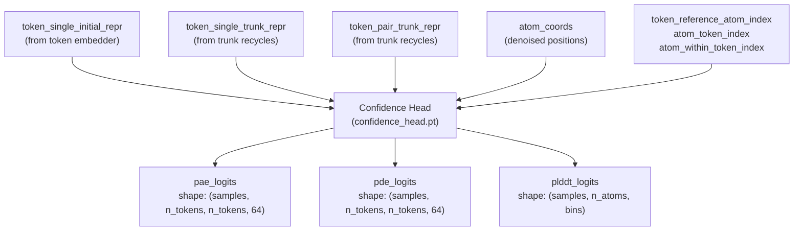
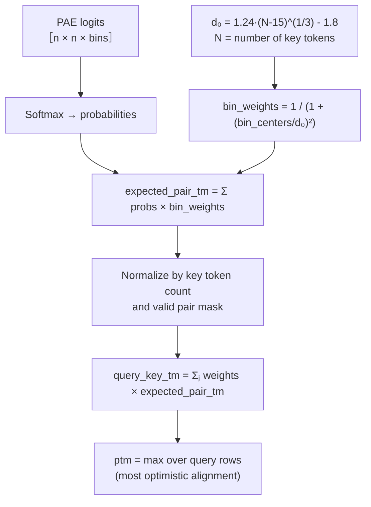
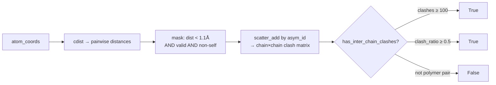
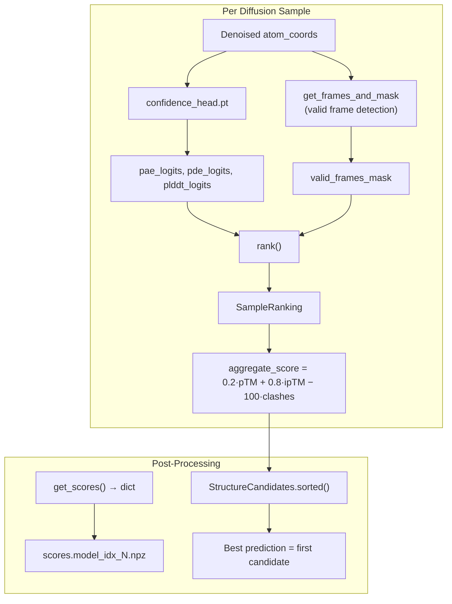

Chai1's confidence system is a **post-diffusion evaluation pipeline** that transforms raw model logits into interpretable quality metrics, then synthesizes those metrics into a single aggregate ranking score. The system operates on three distinct prediction heads—pLDDT, PAE, and PDE—each capturing a different facet of structural confidence, and combines them with geometry-based clash detection to produce a final sample ranking. This page covers the confidence head's input contract, the mathematical derivation of each scoring component, and the aggregate scoring formula that governs sample selection.

## Confidence Head Architecture and Invocation

The confidence head is a separate exported module (`confidence_head.pt`) invoked **after diffusion denoising completes**. It consumes both the initial token representations (from the token embedder) and the recycled trunk representations, alongside the **final denoised atom coordinates** from the diffusion module. Critingly, the confidence head is called once per diffusion sample—not once per batch—because each sample has different atom coordinates even though they share the same trunk representation.



The head produces three logit tensors per sample: **pae_logits** and **pde_logits** over a 64-bin discretization of the [0, 32] Å range, and **plddt_logits** over a variable number of bins spanning [0, 1]. These logits are the raw material from which all downstream confidence scores are derived.

Sources: [chai1.py](chai_lab/chai1.py#L896-L925)

## From Logits to Scores: The Expectation Operator

All confidence metrics share a common computational primitive: the **expectation operator**. Given a tensor of logits over discrete bins and a corresponding tensor of bin weights (which may be bin centers for direct expectation, or TM-Score weighting functions for pTM), the operator applies softmax normalization to the logits and computes a weighted sum:

```
expectation(logits, weights) = softmax(logits, dim=-1) · weights
```

This pattern converts categorical distributions over bins into scalar predictions. The choice of `weights` determines the semantics: **bin centers** yield direct expected values (used for pLDDT and PAE/PDE scores), while **TM-Score weighting functions** yield predicted TM-Scores (used for pTM and ipTM).

Sources: [utils.py](chai_lab/ranking/utils.py#L63-L68)

## pLDDT: Per-Atom Local Confidence

**Predicted Local Distance Difference Test (pLDDT)** measures the expected local distance accuracy at the per-atom level. The computation applies the expectation operator with bin centers spanning [0, 1], then optionally scales to [0, 100] for CIF B-factor output. The system computes three granularities of pLDDT:

| Score | Granularity | Method |
|---|---|---|
| `per_atom_plddt` | Per-atom | Direct expectation over bins (per_residue=True) |
| `per_chain_plddt` | Per-chain | Masked mean of per-atom scores within each asym_id |
| `complex_plddt` | Whole complex | Masked mean of all valid atom scores |

The per-chain variant uses `get_chain_masks_and_asyms` to construct boolean masks for each unique `asym_id`, then computes a masked mean independently for each chain. This decomposition is essential for identifying which chains in a multi-chain complex are well-predicted versus poorly-predicted.

> [!TIP]
> When writing CIF output, pLDDT scores are scaled from the [0, 1] range to [0, 100] and stored as B-factors. The conversion from per-atom to per-token pLDDT for the `StructureCandidates` output uses `torch.bincount` weighted averaging—atoms are grouped by their `atom_token_index` and averaged, not simply pooled.

Sources: [plddt.py](chai_lab/ranking/plddt.py#L23-L82), [chai1.py](chai_lab/chai1.py#L941-L956)

## PAE and PDE: Pairwise Error Prediction

**Predicted Aligned Error (PAE)** and **Predicted Distance Error (PDE)** are both token×token pairwise matrices derived from the same 64-bin logit structure (bins spanning [0, 32] Å). The key distinction:

- **PAE** estimates the expected error in the relative position of two tokens after applying the **best possible rigid-body alignment** of the chain containing the query token to the chain containing the key token. It answers: "If I align chain A to chain B optimally, how far off will token i still be from token j?"
- **PDE** estimates the expected raw distance error without any alignment correction—a direct measure of positional uncertainty.

Both are computed via the same pattern: `softmax(logits) · bin_centers`, where bin centers are generated by `_bin_centers(0.0, 32.0, 64)`—a linspace producing 64 evenly-spaced values in the [0, 32] Å range. The resulting matrices have shape `(num_samples, num_tokens, num_tokens)` after masking to valid tokens.

Sources: [chai1.py](chai_lab/chai1.py#L927-L940)

## pTM and ipTM: Global Quality from PAE Logits

The **predicted TM-Score (pTM)** is computed not from the bin-center expectation of PAE logits, but from a TM-Score-weighted expectation that mirrors the actual TM-Score formula. The core function `_compute_ptm` implements this through several steps:



The TM-Score normalization constant **d₀** is computed as `1.24 · (N - 15)^(1/3) - 1.8`, clamped to a minimum of 19 tokens. The bin weighting `1 / (1 + (d/d₀)²)` ensures that small errors are weighted more heavily, matching the TM-Score's sensitivity to well-aligned regions. The final pTM score takes the **maximum over query rows**, corresponding to the most optimistic alignment.

### Interface pTM (ipTM)

**ipTM** restricts the computation to **inter-chain** interactions. For each chain c, the query mask is set to chain c's tokens and the key mask is set to all tokens *not* in chain c. The per-chain ipTM is computed via `_compute_ptm` with these asymmetric masks, and the final ipTM is the maximum over all chains:

```
ipTM = max_c ptm(query=chain_c, key=¬chain_c)
```

This captures the quality of the predicted interface: how well the relative positioning between chains matches the predicted error distribution.

### Per-Chain and Pairwise Variants

The system also computes:

| Score | Scope | Description |
|---|---|---|
| `per_chain_ptm` | Per-chain | pTM where both query and key are restricted to the same chain |
| `per_chain_pair_iptm` | Chain×Chain | ipTM for every ordered chain pair (c_query, c_key) |

The pairwise variant has a **memory optimization**: when the total tensor size would exceed 2³² elements, it falls back to a sequential for-loop over chains rather than a batched computation. This prevents OOM on large complexes with many chains.

Sources: [ptm.py](chai_lab/ranking/ptm.py#L30-L222)

## Clash Detection: Geometric Quality Control

Clash scoring operates directly on the denoised atom coordinates, independent of the confidence head's logits. The algorithm computes pairwise atom distances and flags pairs closer than `clash_threshold` (default 1.1 Å):



The `has_inter_chain_clashes` determination applies **three criteria** in a logical OR:

1. **Absolute threshold**: A chain pair has ≥ `max_clashes` (100) clashes
2. **Relative threshold**: The clash count for a pair exceeds `max_clash_ratio` (0.5) of the smaller chain's atom count
3. **Polymer filter**: Only polymer-polymer pairs (protein, RNA, DNA, hybrid) are considered; ligand-polymer clashes are ignored

The clash matrix is constructed via `scatter_add_` operations: first aggregating per-atom clashes into per-chain counts, then into a chain×chain matrix. Self-interaction terms (diagonal) are corrected by dividing by 2 to avoid double-counting, since the symmetric matrix counts each clash twice.

Sources: [clashes.py](chai_lab/ranking/clashes.py#L1-L164)

## Aggregate Scoring Formula

The **aggregate score** combines pTM, ipTM, and clash detection into a single scalar for ranking diffusion samples:

```
aggregate_score = 0.2 × complex_ptm + 0.8 × interface_ptm − 100 × has_inter_chain_clashes
```

The weighting reveals Chai1's design priority: **interface quality dominates the ranking** at 80% weight, reflecting that the most common use case is multi-chain complex prediction where inter-chain docking accuracy is paramount. The clash penalty is binary and severe (-100), effectively disqualifying any sample with significant inter-chain steric clashes from being selected as the top prediction.

| Component | Weight | Rationale |
|---|---|---|
| `complex_ptm` | 0.2 | Overall structural quality |
| `interface_ptm` | 0.8 | Inter-chain docking quality (primary signal) |
| `has_inter_chain_clashes` | -100 | Binary veto on steric violations |

> [!TIP]
> The aggregate score is computed inside the `rank()` function, but the `StructureCandidates.sorted()` method re-sorts all candidates by this score in descending order. When consuming `StructureCandidates` programmatically, call `.sorted()` to ensure the first candidate is the highest-ranked prediction.

Sources: [rank.py](chai_lab/ranking/rank.py#L88-L100), [chai1.py](chai_lab/chai1.py#L973-L1009)

## End-to-End Score Computation Pipeline

The complete flow from denoised coordinates to ranked outputs follows this sequence:



For each of the `num_diffn_samples` (default 5), the system: (1) computes valid backbone frames via [frames.py](chai_lab/ranking/frames.py), (2) invokes the confidence head, (3) calls `rank()` to produce a `SampleRanking`, (4) writes per-sample scores to `.npz` files, and (5) collects all rankings into a `StructureCandidates` object. The final output exposes `pae`, `pde`, and `plddt` as dense tensors alongside the per-sample ranking data.

Sources: [chai1.py](chai_lab/chai1.py#L960-L1040), [rank.py](chai_lab/ranking/rank.py#L108-L126)

## Bin Configuration Reference

The confidence system uses different bin configurations for each prediction type. These are hardcoded in the inference pipeline and determine both the logit dimensionality and the score range:

| Prediction | Min | Max | Num Bins | Bin Centers |
|---|---|---|---|---|
| PAE / PDE | 0.0 Å | 32.0 Å | 64 | `linspace(0, 32, 129)[1::2]` |
| pLDDT | 0.0 | 1.0 | Variable | `linspace(0, 1, 2·bins+1)[1::2]` |

The `_bin_centers` function generates bins by creating a linspace with `2 * no_bins + 1` points and selecting every other value starting from index 1, yielding evenly-spaced bin centers that avoid edge artifacts.

Sources: [chai1.py](chai_lab/chai1.py#L476-L478)

---

**Next steps**: For deeper analysis of how these scores are consumed downstream, see [Structure Ranking and Scoring](21-structure-ranking-and-scoring) and [pTM, pLDDT, and Clash Metrics](23-ptm-plddt-and-clash-metrics). For the trunk representations that feed into the confidence head, see [Trunk Recycling and Attention](10-trunk-recycling-and-attention).